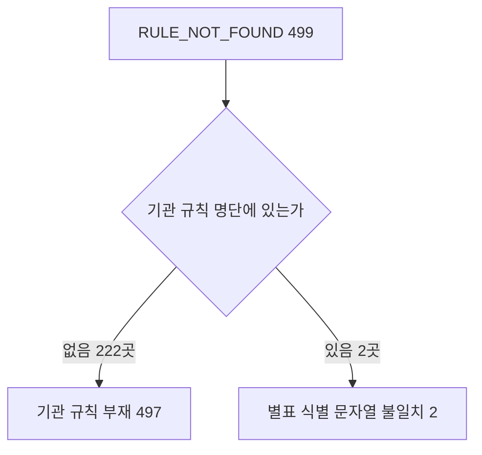

# 계산 차단 RULE_NOT_FOUND 두 갈래와 RULE_REGIME_MISMATCH 시행일 묶음

> **작성일**: 2026-10-15
> **작업**: Orca Task `task_113fc2df2667` (builder). 제품 코드를 바꾸지 않고 조사만 한다.
> **정본 사양**: `.orca/capsules/task_block_cause_split_20261015/capsule.yaml` (`ORCA_TASK_CAPSULE_V2`)
> **작업 브랜치**: `kwanbum217/orca-block-split`
> **선행 문서**: [block_cause_survey_20261015.md](block_cause_survey_20261015.md) (원인 코드별 총계)
> **측정 DB**: 호스트 `127.0.0.1:3306` 의 Docker MySQL `procurement`. 선행 문서와 같은 창·같은 스냅샷이다.
> **산출 원장**: `.cache/block_cause_split_20261015.yaml` (커밋하지 않는 로컬 산출물)
> **범위**: 최근 12개월(`2025-10-15`~`2026-10-15`), 업무구분 `Servc`, 낙찰방법 코드 `낙030001`(적격심사제), 최신 차수만.

---

## 1. 목적과 결론

- 목적: 선행 문서가 "`RULE_NOT_FOUND` 499건은 두 원인이 섞여 있다"고만 적고 넘긴 지점을 건수로 나누고, `RULE_REGIME_MISMATCH` 9,518건을 수요기관과 별표 시행일 단위로 묶는다. 대응 구현은 하지 않는다.
- `RULE_NOT_FOUND` 499건은 기관 규칙 명단에 없는 수요기관 497건(222곳)과, 명단에는 있으나 별표 식별 문자열이 맞지 않는 수요기관 2건(2곳)으로 갈린다. 두 갈래 합은 총건수 499와 같다(3절).
- `RULE_REGIME_MISMATCH` 9,518건은 1,217개 (수요기관, 별표 시행일) 묶음으로 갈리고, 상위 15행이 959건(10.1%)이다. 시행일 한 점(`2026-05-26`)이 8,936건(93.9%)을 차지한다(4절).

### 1.1 RULE_NOT_FOUND 두 갈래



---

## 2. 측정 방법

- 집계는 서비스의 실제 판정 함수 `resolve_evaluation_rule_from_raw_data` 를 `scripts/report_rule_coverage.py` 가 그대로 호출해 수행한다. 판정 로직을 측정용으로 새로 만들지 않는다(train/serve skew 방지).
- 생성 명령(정본): `uv run python scripts/report_rule_coverage.py --months 12 --category Servc --method-code 낙030001 --min-announcements 1 --output .cache/block_cause_split_20261015.yaml`
  - 이 워크트리에는 `.env` 가 없어 `SECRET_KEY`(32자 이상)가 필요하다. 파일로 만들지 않고 `SECRET_KEY=<32자 이상 임시값>` 환경변수로만 주입해 실행했다.
  - 원장은 발행 원장(`data/reference/rule_coverage_ledger.yaml`)을 덮지 않도록 `.cache/` 경로로 따로 썼다. DB 는 `SET SESSION TRANSACTION READ ONLY` 로 열고 `SELECT` 만 쓴다.
- 생성 원장은 선행 문서와 같은 창·같은 값이다. 공고 31,441건, 수요기관 3,435곳, 차단 20,905건이고 `tail` 은 `institutions: 0`, `announcements: 0` 이다.
- **갈래 구분 기준**: 원장 `institutions[].registry_status` 를 쓴다. 이 값은 기관 규칙 명단 `data/reference/institution_rules_20261013.yaml` 의 `institution_name` 과 `name_aliases` 를 공백 제거 후 수요기관명과 대조한 결과다(`scripts/report_rule_coverage.py:169`). `unregistered` 는 명단에 이름이 없다는 뜻이다.
- **시행일 취득 방법**: 별표 시행일은 원장에 남지 않는다. 같은 수집 함수 `collect_records` 를 같은 인자(`months=12`, `category=Servc`, `method_code=낙030001`)로 한 번 더 돌려, `RULE_REGIME_MISMATCH` 로 차단된 건의 `result.rule.effective_date` 를 수요기관명과 묶었다. 이 재판정의 원인 코드 총계는 원장과 정확히 같았다(9,518 / 9,420 / 1,184 / 499 / 212 / 72, 합 20,905).
- 공고일이 시행일보다 앞선 건수는 그 차단의 정의 자체다. 판정 함수는 `announced < effective_date` 일 때만 `RULE_REGIME_MISMATCH` 로 차단한다(`src/app/services/evaluation_rules.py:6425`). 따라서 (수요기관, 시행일) 묶음의 건수가 곧 공고일이 시행일보다 앞선 건수다.

---

## 3. RULE_NOT_FOUND 499건의 두 갈래

| 갈래 | 판정 근거 | 수요기관 | 공고 | 총건수 대비 |
| --- | --- | ---: | ---: | ---: |
| A. 기관 규칙 명단에 없는 수요기관 | `registry_status` = `unregistered` | 222 | 497 | 99.60% |
| B. 명단에 있으나 별표 식별 문자열이 맞지 않음 | `registry_status` = `confirmed`/`partial` | 2 | 2 | 0.40% |
| **합계** | | **224** | **499** | **100.00%** |

- 검산: 497 + 2 = 499. 문서 안의 `RULE_NOT_FOUND` 총건수(선행 문서 4절, 원장 전 기관 `block_codes` 합)와 같다.

### 3.1 갈래 A — 기관 규칙 명단에 없는 수요기관

건수 내림차순 상위 15행이다. 상위 15곳 합계는 132건(497건의 26.6%)이다.

| 순위 | 수요기관 | 공고 | 기관코드 | 기관 유형 |
| ---: | --- | ---: | --- | --- |
| 1 | 한국어촌어항공단 | 32 | B553968 | 기타공공기관 |
| 2 | 해양환경공단 | 11 | B553931 | 공기업 |
| 3 | 한국농수산식품유통공사 | 11 | Z000152 | 준정부기관 |
| 4 | 한국장애인개발원 | 8 | B554244 | 기타공공기관 |
| 5 | 해양수산부 서해어업관리단 | 7 | 1192115 | 국가기관 |
| 6 | 식품의약품안전처 | 7 | 1471000 | 국가기관 |
| 7 | 근로복지공단본부 | 7 | Z004905 | 준정부기관 |
| 8 | 한국환경공단 충청권환경본부 | 7 | Z018993 | 준정부기관 |
| 9 | 해양수산부 동해어업관리단 | 6 | 1192090 | 국가기관 |
| 10 | 기후에너지환경부 낙동강유역환경청 | 6 | 1482027 | 국가기관 |
| 11 | 대한무역투자진흥공사 | 6 | B410001 | 준정부기관 |
| 12 | 국립공원공단 | 6 | B553991 | 준정부기관 |
| 13 | 한국지역난방공사 강남지사 | 6 | D325150 | 공기업 |
| 14 | (주)강원랜드 | 6 | Z003620 | 공기업 |
| 15 | 분당서울대학교병원 | 6 | Z007981 | 기타공공기관 |

- 222곳의 기관 유형은 국가기관 59, 기타기관 50, 준정부기관 41, 기타공공기관 32, 공기업 21, 교육기관 14, 지자체 출자출연기관 3, 유형 미분류 2다. 지방자치단체는 없다. 시·도 규칙 부재로 차단되는 `LOCAL_RULE_NOT_FOUND`(1,184건)와 다른 경로다.
- 222곳 중 120곳(241건)은 `RULE_NOT_FOUND` 가 그 기관의 유일한 차단 코드다. 나머지 102곳은 다른 차단 코드와 섞여 있다.
- 선행 인수인계 [handoff_20261014_detail_page_coverage_close.md](../handoff/handoff_20261014_detail_page_coverage_close.md) 3절의 조사 대상과 겹친다. 해양환경공단 11건, 산림청 서부지방산림청 4건 등이 같은 목록에 있다.

### 3.2 갈래 B — 명단에 있으나 별표 식별 문자열이 맞지 않는 수요기관

| 수요기관 | 기관코드 | 명단 상태 | 기관 전체 공고 | RULE_NOT_FOUND | 기관 규칙 적용 이력 |
| --- | --- | --- | ---: | ---: | --- |
| 인천국제공항공사 | B551177 | `confirmed` | 67 | 1 | 있음 (`SERVC_INST_IIAC_20250101_OTHER`·`_WASTE` 로 21건 적용) |
| 방위사업청 | 1690000 | `partial` | 5 | 1 | 없음 (4건은 조달청 기본 규칙, 1건 차단) |

- 두 곳 모두 규칙이 명단에 있으나, 해당 공고의 별표 식별 문자열이 맞지 않아 규칙 후보가 서지 못한 건이다. 인천국제공항공사는 같은 기관의 다른 공고 21건에서 기관 규칙이 정상 적용되므로, 기관 단위 부재가 아니라 공고 단위 식별 실패다.
- 갈래 B 가 2건뿐인 것은 3.3절의 대조 방식 결과다. 명단 등록 이름과 공고 수요기관명이 정확히 일치해야 갈래 B 로 세므로, 별표 문자열 자체의 유사도는 이 측정에 들어 있지 않다.

### 3.3 검산과 한계

| 항목 | 값 |
| --- | ---: |
| 갈래 A 공고 | 497 |
| 갈래 B 공고 | 2 |
| 두 갈래 합 | 499 |
| `RULE_NOT_FOUND` 총건수(원장) | 499 |
| 차이 | 0 |

- 기관명 대조는 공백 제거 후 정확 일치와 명단 별칭만 쓴다(접두·부분 일치 없음). 명단에 다른 표시명으로 등록된 기관은 갈래 A 로 셀 수 있다.
- 갈래 구분은 원장의 `registry_status` 한 축이다. 명단에 별표 문자열이 아예 등록되지 않은 경우와 문자열이 어긋난 경우를 이 측정은 나누지 않는다.

---

## 4. RULE_REGIME_MISMATCH 9,518건의 기관·시행일 묶음

(수요기관, 별표 시행일) 묶음은 1,217개, 수요기관은 1,125곳이다. 333개 묶음은 1건짜리다.

### 4.1 건수 내림차순 상위 15행

| 순위 | 수요기관 | 별표 시행일 | 규칙 ID | 공고일 < 시행일 건수 |
| ---: | --- | --- | --- | ---: |
| 1 | 서울특별시 | 2026-05-26 | `SERVC_TECH_QUAL_ANNOUNCEMENT_LWLT` | 177 |
| 2 | 제주특별자치도 | 2026-05-26 | `SERVC_TECH_QUAL_ANNOUNCEMENT_LWLT` | 86 |
| 3 | 충청남도 천안시 | 2026-05-26 | `SERVC_TECH_QUAL_ANNOUNCEMENT_LWLT` | 61 |
| 4 | 충청북도 청주시 | 2026-05-26 | `SERVC_TECH_QUAL_ANNOUNCEMENT_LWLT` | 60 |
| 5 | 국토교통부 서울지방국토관리청 수원국토관리사무소 | 2026-05-26 | `SERVC_QUAL_POST_20260526_ATTACH_12` | 59 |
| 6 | 경기도 화성시 | 2026-05-26 | `SERVC_TECH_QUAL_ANNOUNCEMENT_LWLT` | 57 |
| 7 | 전남광주통합특별시 무안청사 | 2026-05-26 | `SERVC_TECH_QUAL_ANNOUNCEMENT_LWLT` | 57 |
| 8 | 경상북도 상주시 | 2026-05-26 | `SERVC_TECH_QUAL_ANNOUNCEMENT_LWLT` | 54 |
| 9 | 서울주택도시개발공사 | 2026-05-26 | `SERVC_TECH_QUAL_ANNOUNCEMENT_LWLT` | 53 |
| 10 | 서울교통공사 | 2026-05-26 | `SERVC_TECH_QUAL_ANNOUNCEMENT_LWLT` | 51 |
| 11 | 전남광주통합특별시교육청 전남광주통합특별시나주교육지원청 | 2026-07-16 | `SERVC_LOCAL_JNGJ_20260716_ATTACH_05` | 51 |
| 12 | 충청남도 아산시 | 2026-05-26 | `SERVC_TECH_QUAL_ANNOUNCEMENT_LWLT` | 51 |
| 13 | 경상남도 김해시 | 2026-05-26 | `SERVC_TECH_QUAL_ANNOUNCEMENT_LWLT` | 49 |
| 14 | 부산광역시 | 2026-05-26 | `SERVC_TECH_QUAL_ANNOUNCEMENT_LWLT` | 47 |
| 15 | 부산항만공사 | 2026-05-26 | `SERVC_TECH_QUAL_ANNOUNCEMENT_LWLT` | 46 |
| | **상위 15행 합계** | | | **959** |

- 상위 15행 959건은 9,518건의 10.1%다. 나머지 1,202개 묶음이 8,559건이다.

### 4.2 시행일 분포

| 별표 시행일 | 공고 | 묶음 수 | 비중 |
| --- | ---: | ---: | ---: |
| 2026-05-26 | 8,936 | 1,082 | 93.9% |
| 2026-07-16 | 349 | 74 | 3.7% |
| 2026-07-13 | 124 | 25 | 1.3% |
| 2026-01-08 | 41 | 17 | 0.4% |
| 2025-12-24 | 30 | 10 | 0.3% |
| 2026-01-01 | 28 | 5 | 0.3% |
| 2026-06-24 | 6 | 1 | 0.1% |
| 2026-05-11 | 3 | 2 | 0.0% |
| 2025-12-01 | 1 | 1 | 0.0% |
| **합계** | **9,518** | **1,217** | **100.0%** |

- 규칙 계열로 나누면 조달청 기본 별표 8,936건(93.9%), 지역 별표 574건(6.0%), 기관 별표 8건(0.1%)이다. 조달청 기본 별표는 `src/app/services/evaluation_rules.py:762`~`:1039`, 지역 별표는 같은 파일 `:1961` 이하(`LOCAL_RULES`), 기관 별표는 `:3022` 이하(`INSTITUTION_RULES`)에 정의된다.
- 시행일 `2026-05-26` 8,936건 중 8,222건(86.4%)이 기술용역 공고 하한율 별표 `SERVC_TECH_QUAL_ANNOUNCEMENT_LWLT`(`src/app/services/evaluation_rules.py:1029`, 시행일 `2026-05-26`, 출처 "공고별 `sucsfbidLwltRate`") 한 건에서 나온다. 나머지는 조달청 별표 `SERVC_QUAL_POST_20260526_ATTACH_12` 540건, `ATTACH_13` 158건, `ATTACH_14` 16건이다.
- 지역 별표 574건은 전남광주(`2026-07-16`) 349건, 충남(`2026-07-13`) 124건, 경북(`2026-01-08`) 41건, 인천(`2025-12-24`) 30건, 대전(`2026-01-01`) 26건, 대구(`2026-05-11`) 3건, 세종(`2025-12-01`) 1건이다.

---

## 5. 이 문서가 하지 않은 것

| 항목 | 상태 |
| --- | --- |
| 대응 코드·화면 구현 | 없음. `src/` 변경 없음 |
| 대응 선택지 확정 | 없음. 구판 별표, 수기심사 안내, 지역 규칙 등록, 기관 규칙 등록, 세부유형 기본값 모두 미확정 |
| `data/reference/rule_coverage_ledger.yaml` | 수정 없음. 리포트 기본 출력 경로로 실행하지 않음 |
| `src/app/services/evaluation_rules.py` | 수정 없음. 산림청·해양환경공단 코드 등록은 다른 워크트리 작업이다 |
| 캐시 YAML | `.cache/block_cause_split_20261015.yaml` 로만 생성. 커밋하지 않음 |

---

## 6. 한계와 후속

| 항목 | 내용 |
| --- | --- |
| 창 | 조회 창은 `2025-10-15`~`2026-10-15` 다. 발행 원장(31,485 / 20,973)은 `2026-10-14` 창의 별개 측정이며 서로 대체하지 않는다. |
| 코드 확정 | 이 문서는 `RULE_NOT_FOUND` 499건과 `RULE_REGIME_MISMATCH` 9,518건만 더 나눈다. 다른 4개 코드는 선행 문서 값을 그대로 쓴다. |
| 기관명 대조 | 갈래 A·B 구분은 명단 이름·별칭의 정확 일치 결과다. 부분 일치나 유사도는 쓰지 않았다. |
| 시행일 출처 | 규칙 객체의 `effective_date` 를 그대로 썼다. 어느 시행일 구간의 벌을 고르는지 그 선택 로직은 분석 대상이 아니다. |
| 후속 | 대응 구현은 사용자 결정과 별도 Task 로 진행한다. 이 문서는 그 근거 자료다. |

---

## 7. 재현 방법

```sh
SECRET_KEY=<32자 이상 임시값> uv run python scripts/report_rule_coverage.py \
  --months 12 --category Servc --method-code 낙030001 \
  --min-announcements 1 --output .cache/block_cause_split_20261015.yaml
```

- 3절의 갈래는 생성 원장 `institutions[].registry_status` 와 `block_codes.RULE_NOT_FOUND` 를 함께 보고 센다. 두 갈래 합이 4절 검산표의 총건수와 같은지 확인한다.
- 4절의 시행일은 같은 수집 함수를 한 번 더 돌려 `RULE_REGIME_MISMATCH` 건의 `result.rule.effective_date` 를 수요기관명과 묶어 센다. 그 원인 코드 총계가 원장과 같은지(9,518) 먼저 확인한다.
