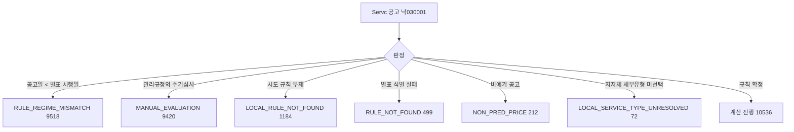

# 최근 12개월 용역 적격심사 계산 차단 원인 코드별 조사

> **작성일**: 2026-10-15
> **작업**: Orca Task `task_cb83200bcc70` (builder). 제품 코드를 바꾸지 않고 조사만 한다.
> **정본 사양**: `.orca/capsules/task_block_cause_survey_20261015/capsule.yaml` (`ORCA_TASK_CAPSULE_V2`)
> **작업 브랜치**: `kwanbum217/orca-block-cause-survey`
> **측정 DB**: 호스트 `127.0.0.1:3306` 의 Docker MySQL `procurement`. 2026-10-11 스냅샷 `snapshot_20261011_225021` 복원본(복원 직후 `bid_announcements` 5,535,023건). 같은 호스트 `3307` 포트의 MariaDB 는 더 새로운 다른 사본이므로 쓰지 않는다.
> **산출 원장**: `.cache/block_cause_ledger_20261015.yaml` (커밋하지 않는 로컬 산출물)
> **범위**: 최근 12개월(`2025-10-15`~`2026-10-15`), 업무구분 `Servc`, 낙찰방법 코드 `낙030001`(적격심사제), 최신 차수만.

---

## 1. 목적과 결론

- 목적: 용역 적격심사 공고에서 계산이 차단된 66%대의 원인을 원인 코드별로 세어, 이후 대응(제품 변경)의 우선순위 판단 근거를 남긴다. 이 문서는 조사이며 차단을 푸는 구현은 하지 않는다.
- 결론: 최근 12개월 용역 적격심사 공고 31,441건 중 계산 차단은 20,905건(66.5%)이다. 차단 원인은 6개 코드로 갈리며, 그중 `RULE_REGIME_MISMATCH`(9,518건, 차단의 45.5%)와 `MANUAL_EVALUATION`(9,420건, 45.1%)가 차단의 90.6%를 차지한다. 나머지 4개 코드는 합쳐 1,967건(9.4%)이다.
- 원인 코드가 비어 차단된 건은 0건이다. 차단 총건수와 원인 코드 합계가 정확히 일치한다(5절).

### 1.1 원인 코드 위치



---

## 2. 측정 방법

- 집계는 서비스의 실제 판정 함수 `resolve_evaluation_rule_from_raw_data` 를 `scripts/report_rule_coverage.py` 가 그대로 호출해 수행한다. 판정 로직을 측정용으로 새로 만들지 않는다(train/serve skew 방지).
- 생성 명령(정본): `.venv/bin/python3 scripts/report_rule_coverage.py --months 12 --category Servc --method-code 낙030001 --min-announcements 1 --output .cache/block_cause_ledger_20261015.yaml`
- `--min-announcements 1` 을 쓴 이유: 기본값 5 로 만들면 공고 5건 미만 기관이 `tail` 로 빠져 그 기관의 `block_codes` 가 원장에서 사라진다. 그러면 원인 코드별 합계가 차단 총건수보다 작아진다. `1` 로 만들면 `tail.announcements` 가 0 이고 모든 기관의 `block_codes` 가 남는다. 이번 생성 원장의 `tail` 은 `institutions: 0`, `announcements: 0` 이다.
- DB 는 `SET SESSION TRANSACTION READ ONLY` 로 열고 `SELECT` 만 쓴다. 생성 원장의 `filter` 는 `months: 12`, `category: Servc`, `method_code: 낙030001`, `min_announcements: 1`, `window_from: 2025-10-15`, `window_to: 2026-10-15` 다.
- 원장은 발행 원장(`data/reference/rule_coverage_ledger.yaml`)을 덮지 않도록 `.cache/` 경로로 따로 썼다.

---

## 3. 범위별 건수와 비율

생성 원장 `totals.applied_scope` 기준이다. 비율은 전체 공고 31,441건 대비다.

| 적용 범위 | 의미 | 공고 | 비율 |
| --- | --- | ---: | ---: |
| `INSTITUTION` | 기관 규칙 적용 | 53 | 0.17% |
| `REGION` | 시·도 규칙 적용 | 1,645 | 5.23% |
| `PPS_DEFAULT` | 조달청 기본 규칙 적용 | 8,838 | 28.11% |
| `BLOCKED` | 계산 차단 | 20,905 | 66.49% |
| `ERROR` | 판정 예외 | 0 | 0.00% |
| **합계** | | **31,441** | **100.00%** |

- 수요기관은 3,435곳이다(`totals.institutions`). 지역 규칙이 적용된 16개 시·도의 합도 1,645건으로 `REGION` 과 같다.

---

## 4. 차단 원인 코드별 건수와 비율

생성 원장의 모든 기관 `block_codes` 를 더한 값이다. `전체 대비` 는 31,441건, `차단 대비` 는 20,905건 기준이다.

| 원인 코드 | 의미 | 공고 | 전체 대비 | 차단 대비 |
| --- | --- | ---: | ---: | ---: |
| `RULE_REGIME_MISMATCH` | 공고일이 적용 별표 시행일보다 앞섬 | 9,518 | 30.27% | 45.53% |
| `MANUAL_EVALUATION` | 낙찰방법 `관리규정외 수기심사` | 9,420 | 29.96% | 45.06% |
| `LOCAL_RULE_NOT_FOUND` | 시·도 규칙 부재 | 1,184 | 3.77% | 5.66% |
| `RULE_NOT_FOUND` | 별표 식별 실패(기관·기본 규칙 후보 없음) | 499 | 1.59% | 2.39% |
| `NON_PRED_PRICE` | 비예가 공고(예정가격 없음) | 212 | 0.67% | 1.01% |
| `LOCAL_SERVICE_TYPE_UNRESOLVED` | 지자체 별표 세부유형 미선택 | 72 | 0.23% | 0.34% |
| **합계** | | **20,905** | **66.49%** | **100.00%** |

- 코드 정의 위치: `src/app/services/evaluation_rules.py:5830` 이하 `BLOCK_CODE_*` 상수.
- `NON_PRED_PRICE` 는 인수인계에 명시된 5개 코드 밖에서 측정된 추가 코드다. 측정값이므로 표에서 빼지 않는다. 이 코드의 대응 선택지는 인수인계에 없어 7절에서 별도로 표시한다.
- `NOT_SERVC`, `NEGOTIATION_CONTRACT`, `TECH_SERVICE_MISSING_LWLT`, `NOT_QUALIFICATION_METHOD`, `RULE_SCOPE_AMBIGUOUS` 등 다른 차단 코드는 이번 범위(`Servc` + `낙030001`)에서 0건이다.

---

## 5. 차단 총건수와 원인 코드 합계의 차이

| 항목 | 값 |
| --- | ---: |
| 차단 총건수(`totals.applied_scope.BLOCKED.announcements`) | 20,905 |
| 원인 코드 합계(전 기관 `block_codes` 합) | 20,905 |
| 차이(원인 코드가 비어 차단된 건) | 0 |

- `--min-announcements 1` 로 생성했으므로 `tail` 에 빠진 기관이 없다(`tail.announcements` 0). 따라서 차단 총건수와 원인 코드 합계가 정확히 일치하며, 원인 코드가 비어 차단된 건은 없다.
- 차이가 0 이 아니면 합계를 맞춘 것처럼 보고하지 않고 escalation 하라는 정본 조건은 이번 측정에서 발생하지 않았다.

---

## 6. 발행 원장과의 차이

발행 원장 `data/reference/rule_coverage_ledger.yaml`(`min_announcements: 5`, `window 2025-10-14`~`2026-10-14`)과 이번 측정(`min_announcements: 1`, `window 2025-10-15`~`2026-10-15`)은 창과 하한이 다르다.

| 항목 | 발행 원장 | 이번 측정 | 차이 |
| --- | ---: | ---: | ---: |
| 전체 공고 | 31,485 | 31,441 | -44 |
| 계산 차단 | 20,973 | 20,905 | -68 |
| 기관 규칙 | 53 | 53 | 0 |
| 지역 규칙 | 1,655 | 1,645 | -10 |
| 조달청 기본 | 8,804 | 8,838 | +34 |
| 수요기관 수 | 3,433 | 3,435 | +2 |

- 차이는 두 원인 때문이다. (1) 조회 창이 하루 밀렸고(`2025-10-14` 기준 → `2025-10-15` 기준), (2) 발행 원장은 `min_announcements: 5` 라 공고 5건 미만 기관 2,321곳(3,983건)이 `tail` 로 빠져 있다. 이번 측정은 `min_announcements: 1` 이라 그 기관들이 모두 기관 행으로 들어왔다.
- 발행 원장의 기관 행 `block_codes` 합은 18,647건으로, 차단 총건수 20,973건보다 2,326건 작다. 그 2,326건이 바로 `tail` 로 빠진 차단분이다. 발행 원장의 숫자가 틀린 것이 아니라 집계 하한이 다른 것이다. 발행 원장은 이 조사에서 수정하지 않는다.
- **이번 문서의 31,441과 20,905는 2026-10-11 스냅샷 복원본 DB 를 2026-10-15 창으로 측정한 값이다.** 발행 원장의 31,485와 20,973은 2026-10-14 창으로 측정한 별개 값이며 서로 대체하지 않는다.

---

## 7. 원인 코드별 대응 선택지 연결

아래 선택지는 인수인계 [handoff_20261014_detail_page_coverage_close.md](../ops/handoff_20261014_detail_page_coverage_close.md) 4절·6절에 적힌 후보다. **이 중 어느 것도 이번 Task 에서 구현하지 않았으며, 대응 선택 자체도 확정하지 않았다.** 코드·화면 변경은 별도 Task 와 사용자 결정이 필요하다.

| 원인 코드 | 공고 | 대응 선택지(미구현) | 비고 |
| --- | ---: | --- | --- |
| `RULE_REGIME_MISMATCH` | 9,518 | 시행일 이전 공고용 구판 별표 추가 | 1년 창에 별표 시행일 이전 공고가 포함되어 발생. 구판 별표를 확보해 규칙군에 넣으면 해소 후보 |
| `MANUAL_EVALUATION` | 9,420 | 수기심사 안내 | 발주기관 자체 기준이라 자동 계산 대상이 아님. 자동 계산 대신 안내 문구로 처리 |
| `LOCAL_RULE_NOT_FOUND` | 1,184 | 지역 규칙 추가 등록 | 시·도 세부기준 미등록. 정본 수집 후 `LOCAL_RULES` 확장 |
| `RULE_NOT_FOUND` | 499 | 기관 규칙 추가 등록 | 별표 식별 문자열 불일치 또는 기관 규칙 부재. 산림청·해양환경공단 등 명단 반영은 별도 Task |
| `NON_PRED_PRICE` | 212 | (인수인계에 대응 선택지 없음) | 비예가 공고는 구조적으로 가격점수 산출 불가. 대응 여부 미정, 별도 검토 필요 |
| `LOCAL_SERVICE_TYPE_UNRESOLVED` | 72 | 지자체 세부유형 기본값 | 사용자가 화면에서 세부유형을 고르면 풀림. 기본값 제공은 제품 결정 사항 |

- 인수인계가 제시한 3개 선택지(구판 별표, 수기심사 안내, 세부유형 기본값)는 위 표에서 원인 코드와 연결만 했다. `RULE_NOT_FOUND`·`LOCAL_RULE_NOT_FOUND` 는 규칙 등록형 대응이며, `NON_PRED_PRICE` 는 대응 선택지가 아직 없다.

---

## 8. 한계와 후속

| 항목 | 내용 |
| --- | --- |
| 창 이동 | 조회 창이 하루 밀려 발행 원장과 총계가 다르다. 비교는 6절 표로만 한다. |
| 스냅샷 시점 | 2026-10-11 스냅샷이므로 `2026-10-12`~`2026-10-15` 공고는 없다. |
| 코드 확정 | `RULE_NOT_FOUND` 499건은 별표 식별 실패와 기관 규칙 부재가 섞여 있다. 분해하려면 별도 측정이 필요하다. |
| 대응 우선순위 | 차단의 90.6%가 `RULE_REGIME_MISMATCH`·`MANUAL_EVALUATION` 두 코드에 몰려 있다. 다만 `MANUAL_EVALUATION` 은 자동 계산 대상이 아니므로, 실제 계산 가능 건수를 늘리는 1순위는 구판 별표 확보(`RULE_REGIME_MISMATCH`)다. |
| 후속 | 대응 구현은 사용자 결정과 별도 Task 로 진행하며, 이 문서는 그 근거 자료다. |

---

## 9. 재현 방법

```sh
.venv/bin/python3 scripts/report_rule_coverage.py \
  --months 12 --category Servc --method-code 낙030001 \
  --min-announcements 1 --output .cache/block_cause_ledger_20261015.yaml
```

- 생성 후 4절의 코드 합계는 생성 원장 `institutions[].block_codes` 를 모두 더해 확인하고, 5절의 `tail.announcements` 가 0 인지 확인한다.
