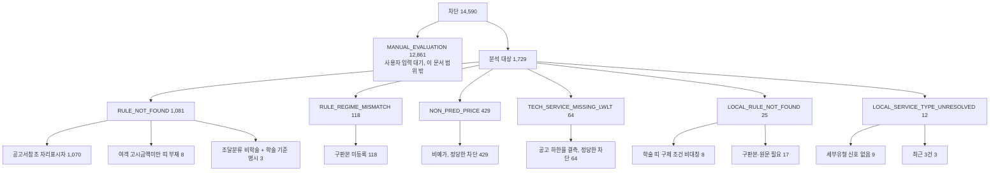

# 최근 24개월 용역 판정 차단 1,729건 원인 묶음과 해소 우선순위 (2026-11-18)

> **작성일**: 2026-11-18
> **작업**: Orca Task `task_be3e3a6b8d3b` (builder, `run_b68a3b16b660`). 코드·규칙·시험은 고치지 않고 조사 문서 한 건만 씁니다.
> **정본 사양**: `.orca/capsules/task_blocked_breakdown_20261118/capsule.yaml` (`ORCA_TASK_CAPSULE_V2`)
> **작업 브랜치**: `kwanbum217/orca-blk-break`
> **대상 스냅숏**: `.orca/judge_main_83d0aeed.tsv` (main `83d0aeed` 판정 결과, 51,387행). 열: `scope`, `rule_id`, `block_code`, `bid_ntce_no`, `bid_ntce_ord`, `dminstt_cd`, `dminstt_nm`
> **측정 창**: 공고일 2024-11-18 ~ 2026-11-18 (24개월). 스냅숏 공고일 최소·최대와 일치합니다.
> **판정 정본**: [src/app/services/evaluation_rules.py](../../src/app/services/evaluation_rules.py), [src/app/services/evaluation_rules_local.py](../../src/app/services/evaluation_rules_local.py)
> **DB 조회**: `uv run python scripts/db_readonly_query.py` 읽기 전용 질의만 사용했습니다. `bid_ntce_no` 목록은 400~500개씩 나눠 조회했고, 무거운 집계를 병렬로 돌리지 않았습니다.
> **범위**: 조사 문서 한 건. 제품 코드·규칙·DB·원장·`CURRENT_STATE` 를 바꾸지 않았습니다.

---

## 1. 요약

### 1.1 차단 코드별 건수

스냅숏 51,387행은 통과 36,797행과 차단 14,590행으로 나뉩니다. 차단 가운데 수기 평가 12,861행을 빼면 분석 대상은 **1,729행**이고, 이 문서가 다루는 범위입니다. 1,729행은 모두 서로 다른 공고번호입니다.

| 차단 코드 | 24개월 건수 | 2026-11-06 보고서(12개월) | 원시 증감 | 같은 길이 12개월 재계산 | 같은 길이 증감 | 묶음 수 |
| --- | ---: | ---: | ---: | ---: | ---: | ---: |
| `RULE_NOT_FOUND` | 1,081 | 46 | +1,035 | 5 | -41 | 3 |
| `NON_PRED_PRICE` | 429 | 211 | +218 | 171 | -40 | 3 |
| `RULE_REGIME_MISMATCH` | 118 | 3 | +115 | 1 | -2 | 7 |
| `TECH_SERVICE_MISSING_LWLT` | 64 | 0 | +64 | 0 | 0 | 1 |
| `LOCAL_RULE_NOT_FOUND` | 25 | 114 | -89 | 0 | -114 | 4 |
| `LOCAL_SERVICE_TYPE_UNRESOLVED` | 12 | 13 | -1 | 1 | -12 | 3 |
| **합계** | **1,729** | **387** | **+1,342** | **178** | **-209** | **21** |
| (참고) `MANUAL_EVALUATION` | 12,861 | 9,424 | +3,437 | 약 8,948 | 약 -476 | - |

- 검산: 1,081 + 429 + 118 + 64 + 25 + 12 = **1,729**. 통과 36,797 + 수기 12,861 + 1,729 = **51,387** 로 스냅숏 행 수와 같습니다.
- **원시 증감은 창 길이가 달라 비교가 성립하지 않습니다.** 이전 보고서는 12개월(2025-11-06~2026-11-06), 이번 스냅숏은 24개월입니다. 같은 길이 비교는 스냅숏 공고일이 2025-11-18 이상인 행만 다시 센 값입니다(6종은 일 단위 정확, `MANUAL_EVALUATION` 은 월 단위 근사).
- 같은 길이로 보면 6종 차단은 387건에서 178건으로 **209건 줄었습니다**. 줄어든 대부분은 `LOCAL_RULE_NOT_FOUND` 114건과 `RULE_NOT_FOUND` 41건입니다.
- 늘어난 것처럼 보이는 `RULE_NOT_FOUND` 1,081건과 `TECH_SERVICE_MISSING_LWLT` 64건은 **거의 전부 2024-11·2024-12 공고**입니다(각각 1,070건, 56건). 24개월로 창을 넓히면서 새로 들어온 구간의 구조적 차단입니다.



### 1.2 핵심 결론

1. **1,729건 중 493건(28.5%)은 지금 계산할 수 없고 계산해서도 안 되는 정당한 차단입니다.** 비예가 429건([evaluation_rules.py:4932](../../src/app/services/evaluation_rules.py:4932))과 기술용역 공고 하한율 결측 64건([:5029](../../src/app/services/evaluation_rules.py:5029))입니다. 이 493건에는 과업을 배정하지 않는 것이 맞습니다.
2. **1,070건(61.9%)이 `낙찰방법명 = 공고서참조` 하나에 몰려 있습니다.** 2024-11·2024-12 공고 전량이고, 엔진은 자리표시자를 낙찰방법 코드 계열명 `적격심사제` 로 바꾼 뒤([:3929-3947](../../src/app/services/evaluation_rules.py:3929)) 띠를 추론하지 않기로 되어 있어([:3885](../../src/app/services/evaluation_rules.py:3885)) 규칙을 세우지 못합니다. 다만 개정 전 규칙 벌에는 조달청 일반용역 띠 표가 아예 없어서, 라우팅만 고쳐도 값이 없으면 계산되지 않습니다.
3. **118건 `RULE_REGIME_MISMATCH` 는 거의 전부 "그 시점 판본이 등록돼 있지 않다"는 한 가지 원인입니다.** 공고일보다 늦게 시행된 판본만 레지스트리에 있어 시행일 대조에서 막힙니다([:4869-4886](../../src/app/services/evaluation_rules.py:4869)). 116건은 예규·기관 규칙의 구판본 값을 등록하면 풀리고, 옛 계열 판별이 실패한 전남광주 2건만 라우팅 문제입니다.
4. **가장 싸게 풀리는 묶음은 `LOCAL_RULE_NOT_FOUND` 8건입니다.** 이미 등록된 행안부 학술연구 띠 규칙(`SERVC_LOCAL_MOIS_ACADEMIC_20250701_1E_2E`, 시행 2025-07-01)을 쓰면 되는데, 띠 표기 공고에 대해 구제를 `RULE_NOT_FOUND` 에서만 실행하는 내부 조건([:4753-4755](../../src/app/services/evaluation_rules.py:4753)) 때문에 `LOCAL_RULE_NOT_FOUND` 는 빠집니다. 원문 값 추가 없이 조건 정합화만으로 8건이 계산됩니다.
5. **`LOCAL_RULE_NOT_FOUND` 는 114건에서 0건으로 줄었습니다.** 최근 12개월 구간에 한 건도 없습니다. 2026-11-15 조사에서 지적한 시·도 예규 공백이 최근 공고에서는 차단을 만들지 않는다는 뜻입니다.
6. **첨부 판별 레지스트리(`bid_announcement_regime`) 적재가 사실상 비어 있습니다.** 대상 1,729건 중 분류 기록이 있는 공고는 1건(`R25BK01244020`)뿐입니다. 첨부 원문으로 푸는 구제 경로(PPS·MOIS 갈래)가 이 스냅숏에서는 거의 작동하지 않았고, 그래서 "원문 필요" 묶음이 실제보다 크게 잡혔을 수 있습니다.

### 1.3 측정 방법과 정합성

| 단계 | 방법 |
| --- | --- |
| 모집단 | `.orca/judge_main_83d0aeed.tsv` 의 `block_code` 가 빈 행을 통과, 값이 있는 행을 차단으로 셈 |
| 공고 원문 필드 | 스냅숏의 `bid_ntce_no` 1,729개를 400~500개씩 `IN` 조회해 `bid_announcements.raw_data` 의 `sucsfbidMthdNm`·`sucsfbidMthdCd`·`srvceDivNm`·`sucsfbidLwltRate`·`sucsfbidMthdAppStd`·`prearngPrceDcsnMthdNm`·조달분류 3필드·`bid_ntce_dt`·`presmpt_prce` 를 읽음 |
| 차수 | 같은 공고번호에 차수가 여럿이면(149건) 최신 차수를 씀. 스냅숏은 공고번호당 1행이므로 행 수는 그대로 1,729 |
| 첨부 판별 | `bid_announcement_regime` 을 같은 `bid_ntce_no` 로 조회. 대상 중 기록 보유 1건 |
| 분기 추적 | 판정 함수를 직접 호출하지 않고(운영 Redis 캐시 오염 방지) 코드 줄과 DB 값 대조로 추적 |
| 재계산 | 아래 부록 A·B 의 명령으로 스냅숏 집계와 표본 질의를 다시 실행할 수 있음 |

- 차단 코드 6종의 합은 스냅숏 집계와 정확히 같습니다. 표의 모든 수치는 `block_code` 빈도와 공고 원문 필드에서만 나왔습니다.
- `MANUAL_EVALUATION` 은 이 문서의 분석 대상이 아니지만, 1.1절 합계 검산을 위해 12,861건만 인용했습니다.

---

## 2. 원인 묶음

### 2.1 묶음표

| # | 묶음 | 차단 코드 | 건수 | 대표 공고번호 3개 | 원인 코드 줄 | 해소 유형 |
| ---: | --- | --- | ---: | --- | --- | --- |
| 1 | `공고서참조` 자리표시자 + 조달청 일반용역 | `RULE_NOT_FOUND` | 1,070 | 20241122600, 20241122063, 20241122751 | [:3885](../../src/app/services/evaluation_rules.py:3885), [:3929-3947](../../src/app/services/evaluation_rules.py:3929), [:4152-4161](../../src/app/services/evaluation_rules.py:4152) | 원문 필요 |
| 2 | 화물→여객 교정 뒤 고시금액미만 띠 부재 | `RULE_NOT_FOUND` | 8 | R25BK00614864, R25BK00867647, R26BK01344845 | [:2572-2591](../../src/app/services/evaluation_rules.py:2572), [:4848-4857](../../src/app/services/evaluation_rules.py:4848) | 원문 필요 |
| 3 | 조달분류 비학술 + 적용 기준만 학술연구 | `RULE_NOT_FOUND` | 3 | R25BK00562329, R25BK00941539, R25BK01097439 | [:2553-2562](../../src/app/services/evaluation_rules.py:2553), [:4753-4755](../../src/app/services/evaluation_rules.py:4753) | 원문 필요 |
| 4 | 행안부 학술연구 띠 구판본 없음 (공고 < 2025-07-01) | `RULE_REGIME_MISMATCH` | 57 | R25BK00601128, R25BK00601627, R25BK00613676 | [:4869-4886](../../src/app/services/evaluation_rules.py:4869), [:2352](../../src/app/services/evaluation_rules.py:2352) | 원문 필요 |
| 5 | 경기도 예규 구판본 없음 (공고 < 2025-08-08) | `RULE_REGIME_MISMATCH` | 33 | 20241133501, 20241200693, 20241201729 | [evaluation_rules_local.py:1951](../../src/app/services/evaluation_rules_local.py:1951) | 원문 필요 |
| 6 | 한국지역난방공사 기관 규칙 구판본 없음 | `RULE_REGIME_MISMATCH` | 11 | R25BK00622518, R25BK00626072, R25BK00655600 | [:3072](../../src/app/services/evaluation_rules.py:3072), [:4869-4886](../../src/app/services/evaluation_rules.py:4869) | 원문 필요 |
| 7 | 한국농어촌공사 기관 규칙 구판본 없음 | `RULE_REGIME_MISMATCH` | 8 | R25BK00584638, R25BK00599602, R25BK00699473 | [:3072](../../src/app/services/evaluation_rules.py:3072), [:4869-4886](../../src/app/services/evaluation_rules.py:4869) | 원문 필요 |
| 8 | 부산광역시 예규 구판본 없음 (공고 < 2025-06-26) | `RULE_REGIME_MISMATCH` | 4 | 20241124515, R25BK00579427, R25BK00728230 | [evaluation_rules_local.py:2007](../../src/app/services/evaluation_rules_local.py:2007) | 원문 필요 |
| 9 | 경상북도 예규 구판본 없음 (공고 < 2024-12-12) | `RULE_REGIME_MISMATCH` | 3 | 20241201760, 20241217682, 20241217701 | [evaluation_rules_local.py:942](../../src/app/services/evaluation_rules_local.py:942) | 원문 필요 |
| 10 | 전남광주통합특별시 예규 이전 공고 (옛 계열 판별 실패) | `RULE_REGIME_MISMATCH` | 2 | R25BK00861428, R26BK01375736 | [evaluation_rules_local.py:1636](../../src/app/services/evaluation_rules_local.py:1636), [:4869-4886](../../src/app/services/evaluation_rules.py:4869) | 라우팅 문제 |
| 11 | 기술용역 P.Q 비예가 | `NON_PRED_PRICE` | 254 | R25BK00556617, R25BK00567905, R25BK00638723 | [:4932-4944](../../src/app/services/evaluation_rules.py:4932) | 정당한 차단 |
| 12 | 기술용역 그 외 비예가 (수기심사 포함) | `NON_PRED_PRICE` | 96 | 20241117757, 20241124250, 20241111098 | [:4932-4944](../../src/app/services/evaluation_rules.py:4932) | 정당한 차단 |
| 13 | 일반용역 비예가 (수기심사 포함) | `NON_PRED_PRICE` | 79 | 20241211469, 20241240939, R25BK00681737 | [:4932-4944](../../src/app/services/evaluation_rules.py:4932) | 정당한 차단 |
| 14 | 기술용역 공고 하한율 결측 | `TECH_SERVICE_MISSING_LWLT` | 64 | 20241119794, 20241123117, 20241122589 | [:5029-5047](../../src/app/services/evaluation_rules.py:5029) | 정당한 차단 |
| 15 | 학술연구 띠 구제 조건 비대칭 (공고 ≥ 2025-07-01) | `LOCAL_RULE_NOT_FOUND` | 8 | R25BK00936613, R25BK00936619, R25BK01004727 | [:4753-4755](../../src/app/services/evaluation_rules.py:4753) | 라우팅 문제 |
| 16 | 학술연구 띠 구제 구판본 없음 (공고 < 2025-07-01) | `LOCAL_RULE_NOT_FOUND` | 13 | R25BK00608905, R25BK00609027, R25BK00664422 | [:4753-4755](../../src/app/services/evaluation_rules.py:4753), [:2352](../../src/app/services/evaluation_rules.py:2352) | 원문 필요 |
| 17 | 조달분류 교육서비스 + 적용 기준만 학술연구 | `LOCAL_RULE_NOT_FOUND` | 3 | R25BK00952544, R25BK01016608, R25BK01016737 | [:2553-2562](../../src/app/services/evaluation_rules.py:2553), [:3019-3020](../../src/app/services/evaluation_rules.py:3019) | 원문 필요 |
| 18 | 공고서참조 + 세부유형 신호 없음 (2024-11·12) | `LOCAL_SERVICE_TYPE_UNRESOLVED` | 9 | 20241132596, 20241137751, 20241144248 | [:2598-2617](../../src/app/services/evaluation_rules.py:2598), [:2939-2957](../../src/app/services/evaluation_rules.py:2939) | 라우팅 문제 |
| 19 | 조달분류 기타 + 세부유형 신호 없음 (최근) | `LOCAL_SERVICE_TYPE_UNRESOLVED` | 2 | R25BK01085812, R25BK01244020 | [:2598-2617](../../src/app/services/evaluation_rules.py:2598), [:2939-2957](../../src/app/services/evaluation_rules.py:2939) | 라우팅 문제 |
| 20 | 대구광역시 학술연구 예외 + 일반 별표 부재 | `LOCAL_SERVICE_TYPE_UNRESOLVED` | 1 | R25BK00704741 | [:3327-3345](../../src/app/services/evaluation_rules.py:3327), [:2958-2985](../../src/app/services/evaluation_rules.py:2958) | 원문 필요 |
| 21 | 공고서참조 + 사업장 위탁, 시·도 일반 별표 없음 | `LOCAL_RULE_NOT_FOUND` | 1 | 20241234986 | [:3014-3020](../../src/app/services/evaluation_rules.py:3014) | 원문 필요 |
| **합계** | | | **1,729** | | | |

- 검산: 1,070 + 8 + 3 + 57 + 33 + 11 + 8 + 4 + 3 + 2 + 254 + 96 + 79 + 64 + 8 + 13 + 3 + 9 + 2 + 1 + 1 = **1,729**.
- 해소 유형별 합계: 라우팅 문제 2(묶음 10) + 8(묶음 15) + 9(묶음 18) + 2(묶음 19) = **21**, 원문 필요 1,070 + 8 + 3 + 57 + 33 + 11 + 8 + 4 + 3 + 13 + 3 + 1 + 1 = **1,215**, 정당한 차단 254 + 96 + 79 + 64 = **493**. 21 + 1,215 + 493 = **1,729**.

### 2.2 `RULE_NOT_FOUND` 1,081건

#### 묶음 1: `공고서참조` 자리표시자 1,070건

- 전량 **2024-11(450건)·2024-12(620건)** 공고입니다. 24개월 창의 첫 두 달에만 나타납니다.
- 전량 `category=Servc`, `sucsfbidMthdCd=낙030001`, `srvceDivNm=일반용역` 입니다. 낙찰방법명은 `공고서참조` 뿐입니다.
- 분기: [resolve_method_name:3929-3947](../../src/app/services/evaluation_rules.py:3929) 이 자리표시자를 코드 계열명 `적격심사제` 로 바꾸고([:3672](../../src/app/services/evaluation_rules.py:3672)), [match_rule_by_mthd_nm:3879-3908](../../src/app/services/evaluation_rules.py:3879) 이 어느 패턴에도 맞추지 못해 [RULE_NOT_FOUND:4152-4161](../../src/app/services/evaluation_rules.py:4152) 로 끝납니다.
- **띠 추론이 없는 것은 의도된 설계입니다.** 매칭 함수 주석이 "추정가격 구간으로 별표를 추론하지 않고 공고에 명시된 낙찰방법 문자열을 정본으로 삼습니다"([:3885](../../src/app/services/evaluation_rules.py:3885))라고 밝힙니다. 차단 메시지도 "적용 별표는 공고서에서만 확인할 수 있습니다"([:4837-4846](../../src/app/services/evaluation_rules.py:4837))입니다.
- **라우팅만 고쳐도 값이 없습니다.** 공고일이 2024-11·12 이면 [규칙 벌은 PRE_20230501_RULES:3973](../../src/app/services/evaluation_rules.py:3973) 인데, 이 벌에는 조달청 일반용역 추정가격 띠 표가 없습니다. `"추정가격 2억원 미만인 용역"` 표는 제2026-260호 벌([:955-970](../../src/app/services/evaluation_rules.py:955))에만 있습니다. 개정 전 벌의 일반 띠 값(낙찰하한율·기준비율)이 원문에서 확인돼야 계산됩니다.
- 조달분류 분포: 시설물관리·청소 299, 여행·숙박·음식·운송·보험 274, 폐기물 160, 행사·기타 사업지원 110, 임대·위탁·수리 95, 교육·전문직종 52, ICT 51, 연구조사 20, 정보통신방송 5, 기술용역 2, 매체제작 2.
- 수요기관 상위: 산림청 국립자연휴양림관리소 40, 국가유산진흥원 29, 공무원연금공단 26, 국회사무처 22, 코레일테크 19, 국민건강보험공단 15, 광주과학기술원 13, 국방과학연구소 12.
- **중복 주의**: (공고명, 수요기관)이 같은 묶음이 71개, 154행입니다. 재공고·정정공고를 빼면 실질 고유 공고는 약 987건입니다. 차단 건수는 원장 규칙대로 행 단위로 셉니다.

#### 묶음 2: 화물→여객 교정 뒤 고시금액미만 띠 부재 8건

- 낙찰방법명은 `적격심사제-화물 육상운송용역 적격심사 추정가격 고시금액미만` 인데 조달분류가 `도로여객운송서비스` 라 [correct_passenger_method_name:2572-2591](../../src/app/services/evaluation_rules.py:2572) 이 여객으로 교정합니다([:4848-4857](../../src/app/services/evaluation_rules.py:4848)).
- 조달청 여객 별표는 5억원 미만·이상 두 구간만 등록돼 있습니다([:803-817](../../src/app/services/evaluation_rules.py:803)). 고시금액미만 띠가 없고, 다른 구간 근사는 금지돼 있습니다(D17).
- 8건 중 에스알 2건(각 52,438,887원)과 남양주시다산노인복지관 2건(각 99,290,909원)은 같은 공고의 등록·재공고입니다. 실질 6건입니다.
- 선행 조사(2026-11-15 `blocked_misc_rules_20261115.md`)가 같은 원인을 이미 원문으로 정리했습니다. 조달청 고시 원문에 해당 띠가 실제로 없는지, 있는데 미등록인지만 확인하면 됩니다.

#### 묶음 3: 조달분류 비학술 + 적용 기준만 학술연구 3건

- 강원특별자치도영월의료원(2025-01-07), 경상북도 안동의료원(2025-07-03), 강원특별자치도 삼척의료원(2025-10-17)입니다. 모두 `적격심사제-추정가격 2억미만 1억이상` + `sucsfbidMthdAppStd=학술연구용역 적격심사 세부기준` 입니다.
- 조달분류는 `교육 및 전문직종/기술서비스 > 기술시험,검사 및 분석` 이라 학술연구 계열이 아닙니다. [\_is_academic_band_classification:2553-2562](../../src/app/services/evaluation_rules.py:2553) 는 공고의 적용 기준 표기를 확정 근거로 쓰지 않으므로, 학술 띠로 확정하지 않고 종전 차단을 유지합니다.
- 표본 확인: 세 건 모두 같은 유형(의료원 검사·분석 용역)이고, 적용 기준 표기와 조달분류가 서로 다릅니다. 공고 첨부가 실제로 학술연구 별표를 지목하는지 확인이 필요합니다. 2026-11-06 보고서도 같은 갈래(2억미만 1억이상 14건)를 첨부 판별 대상으로 분류했습니다.

### 2.3 `RULE_REGIME_MISMATCH` 118건

118건 모두 공고일보다 늦은 시행일의 판본이 선택됐다는 점은 같습니다. 판정은 [시행일 대조:4869-4886](../../src/app/services/evaluation_rules.py:4869) 에서 이뤄지고, 공고일이 규칙 시행일보다 앞서면 계산하지 않습니다. 이는 사용자 결정 "시행일 불일치 차단 유지"(2026-10-13)와 일치합니다. 갈래는 어느 레지스트리에 구판본이 없는지로만 나뉩니다.

| 묶음 | 건수 | 공고일 범위 | 등록된 판본 시행일 | 근거 |
| --- | ---: | --- | --- | --- |
| 행안부 학술연구 띠 | 57 | 2025-01-23 ~ 2025-06-26 | 2025-07-01 | [evaluation_rules.py:2352](../../src/app/services/evaluation_rules.py:2352) |
| 경기도 예규 | 33 | 2024-11-25 ~ 2025-07-23 | 2025-08-08 | [evaluation_rules_local.py:1951](../../src/app/services/evaluation_rules_local.py:1951) (별표 1-6, 일반) |
| 한국지역난방공사 기관 규칙 | 11 | 2025-02-06 ~ 2025-07-03 | 2026-01-01 계열 | [:3072](../../src/app/services/evaluation_rules.py:3072) 에서 기관 규칙 조회 |
| 한국농어촌공사 기관 규칙 | 8 | 2025-01-16 ~ 2025-08-26 | 2025-10-01 계열 | 위와 같음 |
| 부산광역시 예규 | 4 | 2024-11-18 ~ 2025-03-25 | 2025-06-26 | [evaluation_rules_local.py:2007](../../src/app/services/evaluation_rules_local.py:2007) |
| 경상북도 예규 | 3 | 2024-12-03 ~ 2024-12-10 | 2024-12-12 | [evaluation_rules_local.py:942](../../src/app/services/evaluation_rules_local.py:942) |
| 전남광주통합특별시 예규 | 2 | 2025-05-22, 2026-03-06 | 2026-07-16 | [evaluation_rules_local.py:1636](../../src/app/services/evaluation_rules_local.py:1636) |

- **경상북도 3건은 가장 선명한 표본입니다.** 공고일 2024-12-03·12-10 이 등록된 경북 예규의 가장 이른 시행일 2024-12-12 보다 2~9일 앞섭니다. 그 이전 판본이 없어 시행일 대조에서 막힙니다.
- **경기도 33건은 등록된 경기 예규 판본이 2025-08-08 하나뿐이라 생깁니다.** 경기 규칙은 SW·폐기물·육상운송·보험·일반 5종이 모두 2025-08-08 시행입니다. 보험 14건·폐기물 7건·SW 1건은 해당 유형 별표에, 공고서참조 6건·`추정가격 2억원 미만` 2건은 일반 별표에 직접 붙습니다. 임대차·시설분야·학술연구 각 1건은 등록된 유형 별표가 없어 [일반 별표 폴백:3014-3018](../../src/app/services/evaluation_rules.py:3014) 으로 붙습니다. 세 경로 모두 별표 시행일이 공고일보다 뒤라 막힙니다.
- **행안부 학술연구 57건**은 띠 표기 공고를 학술연구 열로 구제한 뒤([:4753-4758](../../src/app/services/evaluation_rules.py:4753)) 시행일 대조에 걸린 경우입니다. 구제 자체는 의도대로 동작했고, 2025-07-01 이전 판본의 값이 없어 계산하지 못합니다.
- 전남광주 2건은 옛 계열(전라남도 46·광주광역시 29) 판별이 실패해 통합 예규(2026-07-16)만 후보로 남은 경우입니다. 2026-11-15 조사에서 AI교육원 1건을 같은 원인으로 기록했습니다.

### 2.4 `NON_PRED_PRICE` 429건

- 전량 `prearngPrceDcsnMthdNm=비예가` 입니다. 예정가격이 없어 가격점수 분모를 만들 수 없으므로 [차단이 맞습니다:4932-4944](../../src/app/services/evaluation_rules.py:4932).
- 표본 5건이 아니라 429건 전량의 원문 필드를 확인했습니다. 예외 없이 `비예가` 입니다.

| 묶음 | 건수 | 특징 |
| --- | ---: | --- |
| 기술용역 P.Q | 254 | 추정가격 1.1억~102억. P.Q 대상 기술용역은 협상·기술평가 체계라 가격점수 분모가 없음 |
| 기술용역 그 외 | 96 | 수기심사 57, 공고서참조 30, 설계·건설사업관리 등 |
| 일반용역 | 79 | 수기심사 60, SW·학술연구·임대차·여객 등 19 |

- **분류 순서 관찰**: 429건 중 **117건은 낙찰방법명에 `관리규정외 수기심사` 도 함께 있습니다.** 판별 순서가 비예가([:4932](../../src/app/services/evaluation_rules.py:4932)) → 수기심사([:4946-4957](../../src/app/services/evaluation_rules.py:4946))라 이 117건은 `MANUAL_EVALUATION` 이 아니라 `NON_PRED_PRICE` 로 기록됩니다. 두 코드 모두 정당한 차단이므로 계산 결과는 달라지지 않지만, 코드별 집계를 해석할 때는 이 겹침을 알아야 합니다.
- 수요기관 상위: 인천도시공사 27, 전남광주통합특별시 장성군 22, 충청북도 충주시 14, 한국개발연구원 13, 서정대학 12, 경상남도 고성군 12.

### 2.5 `TECH_SERVICE_MISSING_LWLT` 64건

- 전량 `srvceDivNm=기술용역` 이고 `sucsfbidLwltRate` 가 `0`(61건) 또는 `0.0`(3건)입니다. 기술용역은 공고별 하한율이 유일한 기준이므로 결측이면 계산하지 않습니다([:5029-5047](../../src/app/services/evaluation_rules.py:5029)).
- 시기: 2024-11 47, 2024-12 9, 2025-01 1, 2025-02 5, 2025-03 2. 2025-03 이후에는 한 건도 없습니다.
- **수집 누락이 아니라 공고 미기재로 판단합니다.** 같은 창(2024-11-18~2025-03-31)의 기술용역 낙030001 공고 6,828건 중 하한율이 0·결측인 공고는 173건(2.5%)뿐입니다. 대부분의 공고에는 값이 있으므로 수집기 결함이 아닙니다.
- 조달분류: CM 19, 설계 18, 감리 18, 기타 8, 선박 1.

### 2.6 `LOCAL_RULE_NOT_FOUND` 25건

| 묶음 | 건수 | 조건 | 원인 |
| --- | ---: | --- | --- |
| 학술연구 띠, 공고 ≥ 2025-07-01 | 8 | 조달분류 학술연구, `2억미만 1억이상` | 행안부 띠 규칙은 등록돼 있고 시행일도 지났는데, 띠 표기 공고의 구제를 `RULE_NOT_FOUND` 에서만 실행하는 내부 조건([:4753-4755](../../src/app/services/evaluation_rules.py:4753)) 때문에 `LOCAL_RULE_NOT_FOUND` 는 제외됨 |
| 학술연구 띠, 공고 < 2025-07-01 | 13 | 위와 같음 | 구제 조건에 걸리지 않고, 걸리더라도 2025-07-01 이전 판본이 없음 |
| 조달분류 교육서비스 | 3 | 충남 아산시, 적용 기준만 학술연구 | 조달분류에 학술연구 표기가 없어 [\_is_academic_band_classification:2553-2562](../../src/app/services/evaluation_rules.py:2553) 이 거짓 |
| 공고서참조 + 사업장 위탁 | 1 | 충남 금산군, 2024-12-19 | 낙찰방법명 자리표시자 + 충남에 일반 별표 없음 → [후보 없음:3019-3020](../../src/app/services/evaluation_rules.py:3019) |

- 지역 분포: 충청남도 14, 전남광주통합특별시 9, 세종특별자치시 2. 세 지역 모두 `LOCAL_RULES` 에 일반(`GENERAL`) 별표가 없습니다(충남은 시설·폐기물·육상운송·SW·어장정비, 통합은 시설·SW·폐기물·생활폐기물·육상운송·어장정비, 세종은 7종).
- **첫 행(8건)이 가장 싼 과업입니다.** `SERVC_LOCAL_MOIS_ACADEMIC_20250701_1E_2E` 규칙이 이미 있고, 공고일도 모두 시행일 이후입니다. 내부 조건만 정합화하면 계산 경로가 열립니다. 다만 시·도 예규 우선 원칙([:4737-4752](../../src/app/services/evaluation_rules.py:4737))과 충돌하지 않는지 결정이 필요합니다.

### 2.7 `LOCAL_SERVICE_TYPE_UNRESOLVED` 12건

| 묶음 | 건수 | 원인 |
| --- | ---: | --- |
| 2024-11·12 공고서참조 | 9 | 낙찰방법명이 자리표시자라 세부유형 표지가 없고, 조달분류(`시설물관리, 청소 등`·`기타`·`운송서비스`·`보험서비스`)도 [조달분류 표지 4종:2530-2535](../../src/app/services/evaluation_rules.py:2530) 에 없어 `GENERAL/UNRESOLVED` → 일반·단순노무 후보 병존으로 차단([:2939-2957](../../src/app/services/evaluation_rules.py:2939)) |
| 최근 2건 (영천시 2025-10-13, 사하구 2025-12-22) | 2 | 띠 표기 + 조달분류 `기타` 로 같은 미판정. 두 지역 모두 일반·단순노무 후보가 병존 |
| 대구광역시 2025-03-12 | 1 | 조달분류 학술연구이나 대구는 일반용역 정의에서 학술연구를 제외([:3327-3345](../../src/app/services/evaluation_rules.py:3327))해 학술 유형으로 확정하지 않음. 대구에는 일반 별표가 없어 단순노무 단독 후보로 남음([:2958-2985](../../src/app/services/evaluation_rules.py:2958)) |

- 9건의 지역: 서울 2, 부산 1, 인천 2, 충북 1, 전북 1, 경북 2. 모두 일반·단순노무 별표가 함께 등록된 지역입니다.
- 사하구 1건은 첨부 판별 기록이 `LOCAL`(부산 별표 1)로 남아 있는 유일한 대상입니다. 판별이 있어도 세부유형은 확정되지 않았습니다.
- 이 코드는 사용자가 세부유형을 선택하면 계산되는 경로가 이미 있습니다. 자동화 가치는 "선택 대기"를 줄이는 데 있습니다.

---

## 3. 다음 과업 후보 상위 5개

우선순위는 **확실성 × 해소 건수 ÷ 작업량** 으로 정했습니다. 493건 정당한 차단은 후보에서 제외했습니다.

| 순위 | 후보 | 해소 건수 | 필요한 결정 | 위험 | 근거 묶음 |
| ---: | --- | ---: | --- | --- | --- |
| 1 | 띠 표기 학술연구 공고의 행안부 띠 구제 조건 정합화 | 8 | 시·도 예규가 일반 별표를 두지 않은 지역에 행안부 학술연구 띠를 적용하는 것이 시·도 우선 원칙과 충돌하는지 | 낮음. 이미 등록된 규칙을 쓰고 원문 값 추가가 없음. 충남·전남광주·세종 3개 지역으로 한정 | 15 |
| 2 | 행안부 학술연구 띠 구판본(2025-07-01 이전) 등록 | 70 | 구판본 값을 소급 적용하는 정책. "시행일 불일치 차단 유지" 결정과의 관계 정리 | 중간. 70건 전량이 2억미만 1억이상 열이라 구판본 배점표·기준비율·통과점수·낙찰하한율을 확보해야 함 | 4, 16 |
| 3 | `공고서참조` 공고의 띠 라우팅 + 개정 전 조달청 일반 띠 규칙 등록 | 1,070 | 낙찰방법명이 자리표시자일 때 추정가격·조달분류로 별표를 추론할지. 하지 않으면 영구 차단 | 높음. 2024-11·12 편중, 재공고 중복 83행, 개정 전 벌에 일반 띠 값 자체가 없음. 유형별 별표(시설·폐기물·보험 등)를 띠만으로 확정하면 오적용 위험 | 1 |
| 4 | 경기·부산·경북 예규 구판본 등록 | 40 | 지자체 예규 구판본 소급 적용 정책. 지역별로 결정이 갈릴 수 있음 | 중간. 원문 3종 확보 필요. 경기 별표 1-1 은 원문 산식 미확인 이력이 있음 | 5, 8, 9 |
| 5 | 한국지역난방공사·한국농어촌공사 기관 규칙 구판본 등록 | 19 | 기관 자체 세부기준 구판본 소급 적용 정책. 기관 협의가 필요할 수 있음 | 중간. 기관 규칙 레지스트리(`evaluation_rules_institution.py`)는 이 과업의 허용 읽기 범위 밖이라 판본 구성은 재확인 필요 | 6, 7 |

- **6순위(잔여 29건)**: 화물→여객 고시금액미만 띠 원문 확인 8, 조달분류 비학술 + 학술 기준 명시 3, 교육서비스 3, 사업장 위탁 1, 세부유형 표지 보강 11, 대구 학술연구 예외 1, 전남광주 옛 계열 판별 2.
- **1순위가 8건뿐인데도 먼저인 이유**는 원문·정책 없이 코드 조건만 맞추면 되는 유일한 묶음이기 때문입니다. 2순위 70건은 원문 1종으로 8.75배를 회수합니다.
- **3순위는 절대 건수가 가장 큽니다.** 다만 원문 확보와 정책 결정이 모두 필요해 1·2순위보다 뒤에 두었습니다. 코디네이터가 절대 건수 우선으로 판단하면 3순위를 1순위로 올리는 것이 맞습니다.
- **`RULE_NOT_FOUND` 46 → 5건, `LOCAL_RULE_NOT_FOUND` 114 → 0건** 이라는 최근 12개월 개선은 이미 반영된 과업의 성과입니다. 새 후보는 구간 창이 넓어진 2024-11~2025-08 공고에 집중돼 있습니다.

### 3.1 사용자 결정이 필요한 항목

| # | 결정 | 현재 상태 | 왜 필요한가 | 선택지 |
| ---: | --- | --- | --- | --- |
| 1 | 구판본 소급 적용 정책 | 시행일이 지난 현행 판본만 등록 | 118건 `RULE_REGIME_MISMATCH` 가 전부 구판본 공백. 차단 유지 결정과 "당시 시행되던 기준으로 계산"은 다른 문제 | (가) 차단 유지, (나) 구판본 등록 후 계산, (다) 구판본 등록하되 별도 플래그로 사용자 선택 |
| 2 | 자리표시자 낙찰방법의 띠 추론 허용 여부 | 추론하지 않음([:3885](../../src/app/services/evaluation_rules.py:3885)) | 1,070건이 여기에 걸림. 다만 개정 전 벌에 일반 띠 값이 없어 추론만으로는 부족 | (가) 현 상태 유지, (나) 추정가격 띠 추론 + 개정 전 값 등록, (다) 조달분류 유형까지 결합한 추론 |
| 3 | 띠 표기 학술연구 구제의 적용 범위 | `RULE_NOT_FOUND` 만 구제, `LOCAL_RULE_NOT_FOUND` 는 제외 | 같은 띠·같은 조달분류인데 차단 코드에 따라 계산 여부가 갈림. 8건이 여기 해당 | (가) 현 상태 유지, (나) 두 코드 모두 구제, (다) 시·도별로 결정 |
| 4 | `NON_PRED_PRICE` 우선 순위 | 비예가 검사가 수기심사보다 먼저 | 117건이 두 사유에 동시 해당. 집계 해석에 영향 | (가) 현 상태 유지(권고), (나) 수기심사를 먼저 판정 |

---

## 4. 한계와 확인하지 못한 것

| 항목 | 내용 |
| --- | --- |
| 창 비교 | 이전 보고서는 12개월, 이번 스냅숏은 24개월이다. 1.1절의 "같은 길이 재계산"은 공고일 2025-11-18 이상 행만 다시 센 값이며, `MANUAL_EVALUATION` 은 월 단위 근사다 |
| 차수 | 같은 공고번호에 차수가 여럿인 149건은 최신 차수 원문을 썼다. 스냅숏 판정이 다른 차수를 썼다면 원문 필드가 달라질 수 있다 |
| 첨부 판별 | 대상 1,729건 중 `bid_announcement_regime` 기록이 있는 공고는 1건뿐이다. 첨부 원문 기반 구제 경로의 실제 기대 효과는 이 스냅숏으로 측정할 수 없다 |
| 기관 규칙 판본 | 한국지역난방공사·한국농어촌공사 규칙은 `evaluation_rules_institution.py` 에 있고, 이 과업의 허용 읽기 범위 밖이라 시행일과 판본 구성을 직접 확인하지 못했다. 2026-11-06 보고서가 인용한 규칙 ID를 참고했다 |
| 원문 미확보 | 묶음 1~10, 16~18, 20~21 의 원문 값은 저장소에 없다. 값을 추측해 적지 않았고 "원문 필요"로 분류했다 |
| 판정 함수 직접 실행 | 캡슐 규칙에 따라 `resolve_evaluation_rule_from_raw_data` 를 호출하지 않았다. 분기는 코드 줄과 DB 원문 필드 대조로만 추적했다 |
| 중복 공고 | 묶음 1은 (공고명, 수요기관) 기준 71개 묶음·154행이 중복이다. 차단 건수는 원장 규칙대로 행 단위로 셌고, 고유 공고 수는 별도로 적었다 |
| DB 조회 | 공유 운영 DB 이므로 `bid_ntce_no` 목록 조회만 했고, `raw_data LIKE` 스캔과 대량 집계는 하지 않았다. 24개월 전체 월별 집계 1회는 30초 제한에 걸려 기간을 좁혀 다시 실행했다 |

---

## 부록 A. 스냅숏 집계 재실행

### A.1 차단 코드별 건수

```sh
awk -F'\t' 'NR>1 && $3!=""{c[$3]++} END{for(k in c) print c[k], k}' .orca/judge_main_83d0aeed.tsv | sort -rn
```

### A.2 분석 대상 1,729건 목록

```sh
awk -F'\t' 'NR>1 && $3!="" && $3!="MANUAL_EVALUATION"{print $4}' .orca/judge_main_83d0aeed.tsv | sort -u > /tmp/ids.txt
wc -l /tmp/ids.txt   # 1729
```

### A.3 공고 원문 필드 조회 (400~500개씩)

```sh
# ids.txt 를 400행씩 나눈 뒤 chunk 마다 실행한다.
uv run python scripts/db_readonly_query.py --sql "SELECT bid_ntce_no, bid_ntce_ord, bid_ntce_dt, presmpt_prce, dminstt_nm,
 JSON_UNQUOTE(JSON_EXTRACT(raw_data,'\$.sucsfbidMthdNm')) AS mthd,
 JSON_UNQUOTE(JSON_EXTRACT(raw_data,'\$.sucsfbidMthdCd')) AS mthd_cd,
 JSON_UNQUOTE(JSON_EXTRACT(raw_data,'\$.srvceDivNm')) AS srvce_div,
 JSON_UNQUOTE(JSON_EXTRACT(raw_data,'\$.sucsfbidLwltRate')) AS lwlt,
 JSON_UNQUOTE(JSON_EXTRACT(raw_data,'\$.sucsfbidMthdAppStd')) AS appstd,
 JSON_UNQUOTE(JSON_EXTRACT(raw_data,'\$.prearngPrceDcsnMthdNm')) AS pred,
 JSON_UNQUOTE(JSON_EXTRACT(raw_data,'\$.pubPrcrmntLrgClsfcNm')) AS lrg,
 JSON_UNQUOTE(JSON_EXTRACT(raw_data,'\$.pubPrcrmntMidClsfcNm')) AS mid
 FROM bid_announcements WHERE bid_ntce_no IN ('...','...')" --format json --limit 0
```

### A.4 첨부 판별 기록 확인

```sh
uv run python scripts/db_readonly_query.py --sql "SELECT bid_ntce_no, bid_ntce_ord, regime, matched_rules, status
 FROM bid_announcement_regime WHERE bid_ntce_no IN ('R25BK01244020') AND category='Servc'" --format json
```

### A.5 기술용역 하한율 결측률 (묶음 14 근거)

```sh
uv run python scripts/db_readonly_query.py --sql "SELECT COUNT(*) n,
 SUM(CASE WHEN JSON_UNQUOTE(JSON_EXTRACT(raw_data,'\$.sucsfbidLwltRate')) IN ('0','0.0','')
      OR JSON_EXTRACT(raw_data,'\$.sucsfbidLwltRate') IS NULL THEN 1 ELSE 0 END) zero_lwlt
 FROM bid_announcements WHERE category='Servc' AND bid_ntce_dt >= '2024-11-18' AND bid_ntce_dt < '2025-04-01'
 AND JSON_UNQUOTE(JSON_EXTRACT(raw_data,'\$.srvceDivNm'))='기술용역'
 AND JSON_UNQUOTE(JSON_EXTRACT(raw_data,'\$.sucsfbidMthdCd'))='낙030001'" --limit 0
```

## 부록 B. 이 문서에서 쓰지 않은 것

- 운영 DB·Redis 쓰기, docker 명령, 외부 API 호출, 새 라이브러리 설치를 하지 않았습니다.
- 판정 함수를 직접 실행하지 않았고, 규칙·시험·원장을 고치지 않았습니다.
- 상업 입찰 정보 페이지와 외부 원문을 쓰지 않았습니다.
