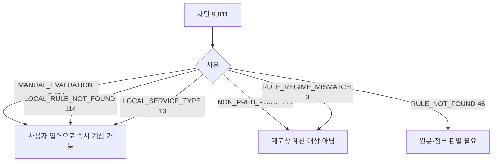

# 정량평가 계산 차단 9,811건 사유 분해와 해소 경로 (최근 12개월 Servc)

> **작성일**: 2026-11-06
> **작업**: Orca Task `task_f57dc971f25b` (builder, `run_8734173629f4`). 코드·규칙·원장은 고치지 않고 조사 문서만 쓴다.
> **정본 사양**: `.orca/capsules/task_f57dc971f25b/capsule.yaml` (`ORCA_TASK_CAPSULE_V2`)
> **작업 브랜치**: `kwanbum217/blocked-breakdown`
> **기준 원장**: [data/reference/rule_coverage_ledger.yaml](../../data/reference/rule_coverage_ledger.yaml) (생성 2026-11-06, `--months 12 --category Servc --method-code 낙030001 --min-announcements 5`)
> **측정 창**: 2025-11-06 ~ 2026-11-06, 업무구분 `Servc`, 낙찰방법 코드 `낙030001`, 공고번호·업무구분별 최신 차수
> **판정 정본**: [src/app/services/evaluation_rules.py](../../src/app/services/evaluation_rules.py), [src/app/api/v1/evaluations.py](../../src/app/api/v1/evaluations.py)
> **범위**: 조사 문서 한 건. 제품 코드·규칙·DB·원장·`docs/context/CURRENT_STATE.md` 를 바꾸지 않았다.

---

## 1. 요약

### 1.1 사유별 건수

최근 12개월 `Servc` 적격심사 공고 31,348건 중 정량평가 자동 계산이 차단된 공고는 **9,811건(31.30%)** 이다. 사유별 건수와 합계는 아래와 같다.

| 차단 코드 | 건수 | 차단 대비 | 공고 전체 대비 | 차단 기관 수 | 판정 지점 |
| --- | ---: | ---: | ---: | ---: | --- |
| `MANUAL_EVALUATION` | 9,424 | 96.06% | 30.06% | 1,423 | [evaluation_rules.py:3489](../../src/app/services/evaluation_rules.py:3489) |
| `NON_PRED_PRICE` | 211 | 2.15% | 0.67% | 75 | [evaluation_rules.py:3480](../../src/app/services/evaluation_rules.py:3480) |
| `LOCAL_RULE_NOT_FOUND` | 114 | 1.16% | 0.36% | 46 | [evaluation_rules.py:2255](../../src/app/services/evaluation_rules.py:2255) |
| `RULE_NOT_FOUND` | 46 | 0.47% | 0.15% | 34 | [evaluation_rules.py:3600](../../src/app/services/evaluation_rules.py:3600) |
| `LOCAL_SERVICE_TYPE_UNRESOLVED` | 13 | 0.13% | 0.04% | 8 | [evaluation_rules.py:2267](../../src/app/services/evaluation_rules.py:2267) |
| `RULE_REGIME_MISMATCH` | 3 | 0.03% | 0.01% | 2 | [evaluation_rules.py:3428](../../src/app/services/evaluation_rules.py:3428) |
| **합계** | **9,811** | **100.00%** | **31.30%** | - | - |

- 검산: 9,424 + 211 + 114 + 46 + 13 + 3 = **9,811**. 원장 `totals.applied_scope.BLOCKED.announcements` 와 정확히 같다.
- 기관 수는 공고의 수요기관명 기준이며, 지사·지원청을 별도 기관으로 센다.

### 1.2 핵심 결론

1. **차단의 97.35%(9,551건)는 이미 사용자 입력 경로로 계산할 수 있다.** `MANUAL_EVALUATION` 9,424건은 B·k·기준비율·통과점수와 비가격 정량점수를 입력하면 계산되고([evaluations.py:1892](../../src/app/api/v1/evaluations.py:1892)), `LOCAL_RULE_NOT_FOUND` 114건도 같은 구조의 지방계약 입력 경로가 있다([evaluations.py:1862](../../src/app/api/v1/evaluations.py:1862)). `LOCAL_SERVICE_TYPE_UNRESOLVED` 13건은 용역 세부유형을 선택하면 풀린다([evaluations.py:1851](../../src/app/api/v1/evaluations.py:1851)).
2. **자동 계산 없이 그대로 막히는 잔여는 260건(2.65%)이다.** `NON_PRED_PRICE` 211건, `RULE_NOT_FOUND` 46건, `RULE_REGIME_MISMATCH` 3건이다.
3. **그 260건 중 214건은 제도상 계산 대상이 아니다.** 비예가 211건은 가격점수 분모가 없고, 시행일 불일치 3건은 사용자 결정에 따라 차단을 유지한다. 실제로 자동화로 줄일 수 있는 상한은 46건이다.
4. **`MANUAL_EVALUATION` 9,424건은 "차단"이라기보다 "사용자 입력 대기"다.** 원장은 사용자 입력 없이 판정 함수만 호출하므로 이 코드를 차단으로 센다([report_rule_coverage.py:147](../../scripts/report_rule_coverage.py:147)). 응답 계약과 원장 분류가 다른 지점이며, 다음 과업 우선순위를 정할 때 이 차이를 먼저 정리해야 한다.
5. **원장 꼬리 1,332건의 사유는 원장에 없다.** `min_announcements 5` 로 접힌 `tail` 은 코드별 `block_codes` 를 남기지 않는다. 이 문서는 같은 수집·판정 함수를 메모리에서 다시 돌려 9,811건 전량의 사유를 복원했고, 원장의 기관별 합계 8,479건과 꼬리 1,332건의 합과 일치함을 확인했다.



### 1.3 측정 방법과 정합성

- 원장은 다시 생성하지 않았다. `data/reference/rule_coverage_ledger.yaml` 을 `yaml.safe_load` 로 읽어 `totals` 와 기관별 `block_codes` 를 확인했다.
- 원장에 없는 꼬리 사유는 [scripts/report_rule_coverage.py](../../scripts/report_rule_coverage.py) 의 `collect_records`([:417](../../scripts/report_rule_coverage.py:417))를 같은 인자로 import 해 메모리에서 집계했다. 파일 쓰기는 없고, DB 세션은 `SET SESSION TRANSACTION READ ONLY` 로 열어 `SELECT` 만 썼다.
- 판정은 서비스 함수 `resolve_evaluation_rule_from_raw_data`([evaluation_rules.py:3663](../../src/app/services/evaluation_rules.py:3663))를 그대로 호출했다. 측정용 판정 로직을 새로 만들지 않았다.
- 재수집 결과는 공고 31,348건, 차단 9,811건으로 원장과 같다. 사유별 합계도 원장 기관 항목 합계(8,479)와 꼬리 차단(1,332)의 합(9,811)과 같다.
- 금액 구간은 추정가격 `presmpt_prce` 기준으로 1억원 미만 / 1억~2억원 / 2억~5억원 / 5억~10억원 / 10억~30억원 / 30억원 이상 / 미상으로 나눴다. 적격심사 별표의 추정가격 경계(2억·5억·10억·30억)와 `2억미만 1억이상` 표기의 경계를 함께 반영한 구분이다.
- 시·도 축은 `institution_sido`([demand_institutions.py:297](../../src/app/services/demand_institutions.py:297))의 시·도명을 우선 쓰고, 국가기관처럼 시·도가 없는 경우 상급기관명(`toplvl_instt_nm`)을 썼다. 표의 `(시·도 미상)` 은 지방계약인데 시·도를 산출하지 못한 경우다.

---

## 2. 사유별 상위 분포

### 2.1 `MANUAL_EVALUATION` 9,424건

낙찰방법명이 모두 `적격심사제-관리규정외 수기심사(총점입력)` 이다. 판정 함수는 낙찰방법명에 `관리규정외 수기심사` 가 있으면 자체 심사기준표가 정본이라 보고 계산을 차단한다([evaluation_rules.py:3489](../../src/app/services/evaluation_rules.py:3489)). 9,424건 전량이 같은 표기이고, 규칙 객체는 붙지 않는다.

**시·도(지방) / 상급기관(국가) 상위 10**

| 순위 | 지역·상급기관 | 건수 |
| ---: | --- | ---: |
| 1 | 경기도 | 1,614 |
| 2 | 서울특별시 | 1,109 |
| 3 | 국토교통부 | 762 |
| 4 | (시·도 미상) | 652 |
| 5 | 인천광역시 | 473 |
| 6 | 경상북도 | 441 |
| 7 | 경상남도 | 429 |
| 8 | 충청남도 | 377 |
| 9 | 강원특별자치도 | 306 |
| 10 | 부산광역시 | 292 |

**기관 유형 상위 10**

| 순위 | 기관 유형 | 건수 |
| ---: | --- | ---: |
| 1 | 자치행정조직 | 5,126 |
| 2 | 미상 | 1,079 |
| 3 | 국가행정기관 | 1,076 |
| 4 | 산하기관 | 1,041 |
| 5 | 정부투자기관및기타 | 405 |
| 6 | 교육행정조직 | 367 |
| 7 | 초등학교 | 109 |
| 8 | 유치원 | 65 |
| 9 | 고등학교 | 48 |
| 10 | 고등교육기관 | 44 |

**금액 구간**

| 금액 구간 | 건수 |
| --- | ---: |
| 1억원 미만 | 2,018 |
| 1억~2억원 | 3,181 |
| 2억~5억원 | 2,482 |
| 5억~10억원 | 809 |
| 10억~30억원 | 577 |
| 30억원 이상 | 351 |
| 미상 | 6 |

**상위 기관 10**

| 순위 | 기관 코드 | 기관명 | 건수 |
| ---: | --- | --- | ---: |
| 1 | 3940000 | 경기도 고양시 | 113 |
| 2 | ZD00303 | 국방부 국군재정관리단 | 104 |
| 3 | Z003688 | 서울주택도시개발공사 | 101 |
| 4 | 1613306 | 국토교통부 부산지방국토관리청 포항국토관리사무소 | 93 |
| 5 | 6110000 | 서울특별시 | 92 |
| 6 | 1613187 | 국토교통부 서울지방국토관리청 의정부국토관리사무소 | 79 |
| 7 | 1613311 | 국토교통부 부산지방국토관리청 영주국토관리사무소 | 78 |
| 8 | B555210 | 국가유산진흥원 | 74 |
| 9 | 5530000 | 경기도 화성시 | 72 |
| 10 | B553766 | 서울교통공사 | 67 |

### 2.2 `NON_PRED_PRICE` 211건

예정가격 결정 방법이 `비예가` 인 공고다. 211건 전량의 `prearngPrceDcsnMthdNm` 이 `비예가` 이고, 판정 함수는 예정가격이 없어 가격점수 분모를 만들 수 없다고 차단한다([evaluation_rules.py:3480](../../src/app/services/evaluation_rules.py:3480)).

**시·도 / 상급기관 상위 10**

| 순위 | 지역·상급기관 | 건수 |
| ---: | --- | ---: |
| 1 | 전라남도 | 40 |
| 2 | 전남광주통합특별시 | 32 |
| 3 | 인천광역시 | 23 |
| 4 | 경상남도 | 14 |
| 5 | 경상북도 | 11 |
| 6 | 한국개발연구원 | 9 |
| 7 | 충청남도 | 8 |
| 8 | 교육부 | 7 |
| 9 | 강원특별자치도 | 7 |
| 10 | 기후에너지환경부 | 6 |

**기관 유형 상위 10**

| 순위 | 기관 유형 | 건수 |
| ---: | --- | ---: |
| 1 | 자치행정조직 | 127 |
| 2 | 미상 | 34 |
| 3 | 산하기관 | 23 |
| 4 | 정부투자기관및기타 | 9 |
| 5 | 고등교육기관 | 9 |
| 6 | 국가행정기관 | 6 |
| 7 | 평생교육기관 | 3 |

**금액 구간**

| 금액 구간 | 건수 |
| --- | ---: |
| 1억원 미만 | 21 |
| 1억~2억원 | 11 |
| 2억~5억원 | 34 |
| 5억~10억원 | 30 |
| 10억~30억원 | 61 |
| 30억원 이상 | 47 |
| 미상 | 7 |

**상위 기관 10**

| 순위 | 기관 코드 | 기관명 | 건수 |
| ---: | --- | --- | ---: |
| 1 | Z007503 | 인천도시공사 | 22 |
| 2 | 5895000 | 전남광주통합특별시 장성군 | 14 |
| 3 | 5420000 | 경상남도 고성군 | 12 |
| 4 | 5855000 | 전남광주통합특별시 화순군 | 10 |
| 5 | B090001 | 한국개발연구원 | 8 |
| 6 | 6130769 | 전남광주통합특별시 무안청사 | 8 |
| 7 | 7004263 | 서정대학 | 7 |
| 8 | 4490000 | 충청남도 천안시 | 7 |
| 9 | 5885000 | 전남광주통합특별시 함평군 | 7 |
| 10 | 5910000 | 전남광주통합특별시 신안군 | 6 |

### 2.3 `LOCAL_RULE_NOT_FOUND` 114건

계약 법령이 `LOCAL` 인데 수요기관 시·도의 세부기준에 해당 용역 유형 별표가 없거나, 그 조합이 등록되지 않은 경우다([evaluation_rules.py:2255](../../src/app/services/evaluation_rules.py:2255), [:2323](../../src/app/services/evaluation_rules.py:2323)). 114건 전량이 `LOCAL` 이다.

**시·도 상위 10**

| 순위 | 시·도 | 건수 |
| ---: | --- | ---: |
| 1 | 전남광주통합특별시 | 61 |
| 2 | (시·도 미상) | 21 |
| 3 | 충청남도 | 15 |
| 4 | 대구광역시 | 6 |
| 5 | 광주광역시 | 4 |
| 6 | 전라남도 | 4 |
| 7 | 세종특별자치시 | 3 |

**기관 유형**

| 기관 유형 | 건수 |
| --- | ---: |
| 자치행정조직 | 53 |
| 교육행정조직 | 30 |
| 미상 | 19 |
| 산하기관 | 7 |
| 정부투자기관및기타 | 4 |
| 초등학교 | 1 |

**금액 구간**

| 금액 구간 | 건수 |
| --- | ---: |
| 1억원 미만 | 23 |
| 1억~2억원 | 32 |
| 2억~5억원 | 42 |
| 5억~10억원 | 13 |
| 10억~30억원 | 4 |

**상위 기관 10**

| 순위 | 기관 코드 | 기관명 | 건수 |
| ---: | --- | --- | ---: |
| 1 | Z008548 | 서울특별시서대문구도시관리공단 | 12 |
| 2 | 6130769 | 전남광주통합특별시 무안청사 | 12 |
| 3 | 5790000 | 전남광주통합특별시 순천시 | 6 |
| 4 | 5800000 | 전남광주통합특별시 광양시 | 5 |
| 5 | 8692000 | 전남광주통합특별시교육청 전남광주통합특별시장성교육지원청 | 4 |
| 6 | 8502000 | 전남광주통합특별시교육청 전남광주통합특별시목포교육지원청 | 4 |
| 7 | 8612000 | 전남광주통합특별시교육청 전남광주통합특별시화순교육지원청 | 3 |
| 8 | 8652000 | 전남광주통합특별시교육청 전남광주통합특별시영암교육지원청 | 3 |
| 9 | 8682000 | 전남광주통합특별시교육청 전남광주통합특별시영광교육지원청 | 3 |
| 10 | 8662000 | 전남광주통합특별시교육청 전남광주통합특별시무안교육지원청 | 3 |

**낙찰방법명 상위**

| 낙찰방법명 | 건수 |
| --- | ---: |
| 적격심사제-보험용역 적격심사 추정가격 5억원미만 | 31 |
| 적격심사제-임대차 적격심사 추정가격 고시금액 이상 | 29 |
| 적격심사제-수리ㆍ점검용역 적격심사 고시금액 미만 | 12 |
| 적격심사제-시설분야용역 적격심사 추정가격 5억원 미만 | 10 |
| 적격심사제-보험용역 적격심사 추정가격 5억원이상 | 7 |
| 적격심사제-추정가격 2억미만 1억이상 | 5 |

- 전남광주통합특별시 61건은 새 통합 예규에 보험·임대차·수리ㆍ점검·일반 별표가 없기 때문이다. 등록된 `SERVC_LOCAL_JNGJ_20260716_*` 규칙은 시설·소프트웨어·폐기물·생활폐기물·육상운송·어장정비 6종이다([evaluation_rules_local.py:1473](../../src/app/services/evaluation_rules_local.py:1473) 이하).
- 선행 조사에서 전남·충남·대구·세종·서울의 해당 유형 별표 부재가 원문으로 확인됐다([local_not_found_basis_20261019.md](../analysis/local_not_found_basis_20261019.md)). 이 문서는 그 결론을 뒤집지 않고 현재 창의 건수만 다시 셌다.

### 2.4 `RULE_NOT_FOUND` 46건

낙찰방법명 `sucsfbidMthdNm` 이 현행 조달청 별표 식별 문자열과 맞지 않아 규칙 후보가 서지 못한 경우다([evaluation_rules.py:3600](../../src/app/services/evaluation_rules.py:3600)). 46건 전량이 `rule` 없이 차단된다.

**시·도 / 상급기관 상위 10**

| 순위 | 지역·상급기관 | 건수 |
| ---: | --- | ---: |
| 1 | 한국지역난방공사 | 17 |
| 2 | 대구광역시 | 3 |
| 3 | 전남광주통합특별시 | 3 |
| 4 | 군인공제회C_C | 2 |
| 5 | 인천광역시 | 2 |
| 6 | 과학기술정보통신부 | 2 |
| 7 | 한국산업은행 | 2 |
| 8 | 강원도원주의료원 | 1 |
| 9 | (상급기관 미상) | 1 |
| 10 | 양평군 신활력 추진단 | 1 |

**기관 유형**

| 기관 유형 | 건수 |
| --- | ---: |
| 산하기관 | 22 |
| 미상 | 14 |
| 국가행정기관 | 5 |
| 고등교육기관 | 2 |
| 교육행정조직 | 1 |
| 자치행정조직 | 1 |
| 정부투자기관및기타 | 1 |

**금액 구간**

| 금액 구간 | 건수 |
| --- | ---: |
| 1억원 미만 | 6 |
| 1억~2억원 | 15 |
| 2억~5억원 | 17 |
| 5억~10억원 | 3 |
| 10억~30억원 | 3 |
| 30억원 이상 | 2 |

**낙찰방법명 전량**

| 낙찰방법명 | 건수 | 갈래 |
| --- | ---: | --- |
| 적격심사제-추정가격 2억미만 1억이상 | 14 | 띠 표기 불일치 |
| 적격심사제-기타용역(사용자기계실 유지관리용역 등) 적격심사 추정가격 고시금액 이상 | 10 | 별표 없음 |
| 적격심사제-기타용역(사용자기계실 유지관리용역 등) 적격심사 추정가격 고시금액 미만 | 7 | 별표 없음 |
| 적격심사제-소프트웨어용역(중소기업자간 경쟁제품 비대상) 적격심사 추정가격 5억원 미만-추정가격 고시금액이상 | 7 | 띠 표기 불일치 |
| 적격심사제-소프트웨어용역(중소기업자간 경쟁제품 비대상) 적격심사 추정가격 5억원 이상 | 4 | 띠 표기 불일치 |
| 적격심사제-여객 육상운송용역 적격심사 추정가격 5억원이상 | 4 | 띠 표기 불일치 |
| **합계** | **46** | |

- 현행 `SERVC_QUAL_POST_20260526_ATTACH_03` 은 여객 육상운송 `5억원미만` 패턴만 갖고([evaluation_rules.py:806](../../src/app/services/evaluation_rules.py:806)), `ATTACH_05` 는 소프트웨어 비대상 `고시금액미만` 패턴만 갖는다([evaluation_rules.py:838](../../src/app/services/evaluation_rules.py:838)). 5억 이상·5억 미만 고시금액 이상 띠의 식별 문자열이 없다.
- 코드 어디에도 `기타용역` 식별 문자열은 없다. 선행 조사도 같은 결론이다([rule_not_found_rest_20261017.md](../analysis/rule_not_found_rest_20261017.md)).
- `2억미만 1억이상` 14건은 같은 낙찰방법명 안에서 적용 기준이 여러 갈래로 갈린다. 선행 조사는 같은 표기 100건 중 77건이 행안부 예규 별표 4 학술연구로 판별됐고, 코드에는 추정가격 1억~2억 학술연구 규칙이 없다고 적었다([band_2to1_attachment_classifier_design_20261106.md](../analysis/band_2to1_attachment_classifier_design_20261106.md)).

### 2.5 `LOCAL_SERVICE_TYPE_UNRESOLVED` 13건

시·도 규칙 후보는 있으나 단순노무 여부나 중소기업자간 경쟁제품 대상 여부가 공고 표기만으로 확정되지 않아 별표를 고르지 못한 경우다([evaluation_rules.py:2267](../../src/app/services/evaluation_rules.py:2267), [:2325](../../src/app/services/evaluation_rules.py:2325)). 13건 전량이 `LOCAL` 이다.

| 시·도 | 건수 | | 기관 유형 | 건수 | | 금액 구간 | 건수 |
| --- | ---: | --- | --- | ---: | --- | --- | ---: |
| 제주특별자치도 | 4 | | 자치행정조직 | 11 | | 1억원 미만 | 1 |
| 전북특별자치도 | 2 | | 미상 | 2 | | 1억~2억원 | 11 |
| 부산광역시 | 2 | | | | | 5억~10억원 | 1 |
| 서울특별시 | 2 | | | | | | |
| 울산광역시 | 1 | | | | | | |
| 대전광역시 | 1 | | | | | | |
| 경상북도 | 1 | | | | | | |

낙찰방법명은 `적격심사제-추정가격 2억미만 1억이상` 8건, `적격심사제-추정가격 2억원 미만인 용역` 3건, `적격심사제-추정가격 2억미만 1억이상 - 지역업체참여` 1건, `적격심사제-추정가격 15억원 미만 5억원 이상인 용역` 1건이다.

### 2.6 `RULE_REGIME_MISMATCH` 3건

매칭된 별표의 시행일이 공고일보다 뒤여서 그 별표로 계산하지 않는 경우다([evaluation_rules.py:3428](../../src/app/services/evaluation_rules.py:3428)). 3건 전량이 여객 육상운송이고, 매칭된 규칙은 `SERVC_LOCAL_JNGJ_20260716_ATTACH_05` 2건(시행 2026-07-16)과 `SERVC_INST_KDHC_20260101_PASSENGER` 1건(시행 2026-01-01)이다.

| 시·도 / 상급기관 | 건수 | | 기관 유형 | 건수 | | 금액 구간 | 건수 |
| --- | ---: | --- | --- | ---: | --- | --- | ---: |
| 전남광주통합특별시 | 2 | | 교육행정조직 | 2 | | 1억원 미만 | 1 |
| 한국지역난방공사 | 1 | | 산하기관 | 1 | | 2억~5억원 | 2 |

---

## 3. 풀 수 있는 경로 분류

경로는 캡슐 정의를 그대로 쓴다. (A) 이미 규칙 원문이 있어 등록만 하면 됨, (B) 원문 수집 필요, (C) 첨부 판별 필요, (D) 제도상 계산 대상 아님, (E) 미상.

### 3.1 경로별 건수

| 경로 | 건수 | 대상 사유 | 근거 | 즉시 해소(사용자 입력 포함) | 계산 가능 상한(전체) |
| --- | ---: | --- | --- | ---: | ---: |
| A. 규칙 등록만 | 0 | 없음 | 이번 창의 어떤 사유도 "원문이 이미 있고 등록만 하면" 단독으로 풀리지 않는다 | 0 | 0 |
| B. 원문 수집 필요 | 146 | `LOCAL_RULE_NOT_FOUND` 114, `RULE_NOT_FOUND` 32 | [evaluation_rules.py:2255](../../src/app/services/evaluation_rules.py:2255), [local_not_found_basis_20261019.md](../analysis/local_not_found_basis_20261019.md), [rule_not_found_rest_20261017.md](../analysis/rule_not_found_rest_20261017.md) | 114 | 최대 146 |
| C. 첨부·공고문 판별 필요 | 9,451 | `MANUAL_EVALUATION` 9,424, `RULE_NOT_FOUND` 14, `LOCAL_SERVICE_TYPE_UNRESOLVED` 13 | [evaluation_rules.py:3489](../../src/app/services/evaluation_rules.py:3489), [band_2to1_attachment_classifier_design_20261106.md](../analysis/band_2to1_attachment_classifier_design_20261106.md), [evaluation_rules.py:2267](../../src/app/services/evaluation_rules.py:2267) | 9,437 | 최대 9,451 |
| D. 제도상 계산 대상 아님 | 214 | `NON_PRED_PRICE` 211, `RULE_REGIME_MISMATCH` 3 | [evaluation_rules.py:3480](../../src/app/services/evaluation_rules.py:3480), [remaining_block_codes_20261018.md](../analysis/remaining_block_codes_20261018.md), 사용자 결정 "시행일 불일치 차단 유지" | 0 | 0 |
| E. 미상 | 0 | 없음 | - | 0 | 0 |
| **합계** | **9,811** | | | **9,551** | **최대 9,597** |

- 검산: 0 + 146 + 9,451 + 214 + 0 = 9,811. 즉시 해소 114 + 9,437 = 9,551. 계산 가능 상한 146 + 9,451 = 9,597 이고, D 214는 어떤 경로로도 자동 계산되지 않는다. 두 해소 열은 더하지 않는다. 즉시 해소 9,551은 계산 가능 상한 9,597의 부분집합이다.
- 계산 가능 상한 9,597은 "원문을 모두 확보하고 첨부 판별·규칙 등록을 마쳤을 때"의 상한이다. 실제 해소량은 원문 확보율에 따라 달라진다.

### 3.2 사유별 경로 판단

| 사유 | 경로 | 판단 근거 | 현재 계산 가능한 경로 |
| --- | :---: | --- | --- |
| `MANUAL_EVALUATION` 9,424 | C | 자체 심사기준표가 공고 첨부 또는 기관 내규에 있어 서버가 표준 별표로 확정할 수 없다. 사용자가 B·k·기준비율·통과점수를 입력하면 계산된다([evaluations.py:1892](../../src/app/api/v1/evaluations.py:1892), [manual_eval_input_apply_20261017.md](../analysis/manual_eval_input_apply_20261017.md)) | 사용자 입력 9,424 |
| `NON_PRED_PRICE` 211 | D | `비예가` 는 예정가격이 없어 가격점수 분모가 없다([evaluation_rules.py:3480](../../src/app/services/evaluation_rules.py:3480)). 선행 조사도 정상 차단 유지로 판정했다([remaining_block_codes_20261018.md](../analysis/remaining_block_codes_20261018.md)) | 없음 |
| `LOCAL_RULE_NOT_FOUND` 114 | B | 시·도 세부기준에 해당 유형 별표가 없거나 등록되지 않았다([local_not_found_basis_20261019.md](../analysis/local_not_found_basis_20261019.md)). 원문 수집·등록이 필요하다 | 사용자 입력 114([evaluations.py:1862](../../src/app/api/v1/evaluations.py:1862)) |
| `RULE_NOT_FOUND` 46 중 기타용역 17 | B | 코드와 현행 별표 어디에도 `기타용역` 식별 문자열이 없다([evaluation_rules.py:3600](../../src/app/services/evaluation_rules.py:3600), [rule_not_found_rest_20261017.md](../analysis/rule_not_found_rest_20261017.md)) | 없음 |
| `RULE_NOT_FOUND` 46 중 SW 비대상 11 | B | 현행 `ATTACH_05` 는 고시금액 미만 패턴만 있다([evaluation_rules.py:838](../../src/app/services/evaluation_rules.py:838)). 5억 미만 고시금액 이상·5억 이상 띠의 원문 존재 여부 확인이 필요하다 | 없음 |
| `RULE_NOT_FOUND` 46 중 여객 5억 이상 4 | B | 현행 `ATTACH_03` 은 5억 미만 패턴만 있다([evaluation_rules.py:806](../../src/app/services/evaluation_rules.py:806)). 5억 이상 띠의 원문 존재 여부 확인이 필요하다 | 없음 |
| `RULE_NOT_FOUND` 46 중 2억미만 1억이상 14 | C | 같은 표기 안에서 행안부 학술연구·지자체 자체 기준 등 갈래가 갈리고, 첨부 원문으로만 판별된다([band_2to1_attachment_classifier_design_20261106.md](../analysis/band_2to1_attachment_classifier_design_20261106.md)). 판별 뒤에도 1억~2억 학술연구 규칙 등록이 필요하다 | 없음 |
| `LOCAL_SERVICE_TYPE_UNRESOLVED` 13 | C | 공고문의 단순노무·중소기업 경쟁 표기를 확인하거나 사용자가 세부유형을 선택해야 한다([evaluation_rules.py:2267](../../src/app/services/evaluation_rules.py:2267)) | 세부유형 선택 13([evaluations.py:1851](../../src/app/api/v1/evaluations.py:1851)) |
| `RULE_REGIME_MISMATCH` 3 | D | 공고일이 별표 시행일보다 앞서면 해당 별표로 계산하지 않는다([evaluation_rules.py:3428](../../src/app/services/evaluation_rules.py:3428)). 사용자 결정 "시행일 불일치 차단 유지"를 그대로 적용한다 | 없음 |

### 3.3 원장 차단과 응답 차단의 차이

원장은 사용자 입력 없이 판정 함수만 호출해 `is_blocked` 를 센다([report_rule_coverage.py:147](../../scripts/report_rule_coverage.py:147)). 그래서 `MANUAL_EVALUATION`·`LOCAL_RULE_NOT_FOUND`·`LOCAL_SERVICE_TYPE_UNRESOLVED` 는 원장에서 차단으로 남지만 API 에서는 사용자가 값을 넣으면 계산된다. 이 차이는 선행 조사에서도 확인됐다([calc_block_response_trace_20261106.md](../analysis/calc_block_response_trace_20261106.md)).

| 구분 | 건수 | 비중 |
| --- | ---: | ---: |
| 사용자 입력·선택으로 즉시 계산 가능 | 9,551 | 97.35% |
| 자동 계산 경로만 있는 잔여 | 260 | 2.65% |
| 그중 제도상 계산 대상 아님 | 214 | 2.18% |
| 그중 자동화로 줄일 수 있는 상한 | 46 | 0.47% |

---

## 4. 다음 과업 후보 우선순위

우선순위는 "자동 해소 상한 ÷ 작업량"으로 판단했다. 이미 사용자 입력으로 풀리는 9,551건은 차단 해소 과업의 대상이 아니라 지표 정의와 사용성 과업의 대상으로 분리했다.

| 순위 | 후보 | 대상 | 자동 해소 상한 | 작업량 | 판단 |
| ---: | --- | ---: | ---: | --- | --- |
| 1 | 차단 지표 정의 정리 | 9,551 | 0(지표) | 소 | 원장 차단 9,811과 응답 차단이 다르다. 사용자 입력 필요 코드를 별도 분류하지 않으면 우선순위가 왜곡된다. 코드 변경 없이 원장 생성기·문서 정의만 정리하는 선택지가 있다([calc_block_response_trace_20261106.md](../analysis/calc_block_response_trace_20261106.md)) |
| 2 | `RULE_NOT_FOUND` 46건 원문·식별 문자열 보완 | 46 | 46 | 중 | 기타용역 17, SW 비대상 11, 여객 4는 현행 별표 원문의 띠 존재 여부만 확인하면 등록 여부가 갈린다. 2억미만 1억이상 14는 첨부 판별 뒤 학술연구 규칙 등록이 필요하다 |
| 3 | `LOCAL_RULE_NOT_FOUND` 114건 시·도 원문 수집 | 114 | 114 | 대 | 전남광주 61, 충남 15, 대구 6, 광주 4, 전남 4, 세종 3이다. 선행 조사에서 해당 유형 별표가 원문에 없는 조합이 다수 확인됐으므로, 수집해도 등록할 별표가 없는 경우가 섞여 있다([local_not_found_basis_20261019.md](../analysis/local_not_found_basis_20261019.md)) |
| 4 | `MANUAL_EVALUATION` 9,424건 자동 추출 | 9,424 | 0 | 대 | 현재도 사용자 입력으로 계산된다. 자동 추출은 첨부 원문에서 B·k·기준비율·통과점수를 뽑는 별도 과업이며, 차단 건수 감소가 아니라 입력 부담 감소 효과다 |
| 5 | `NON_PRED_PRICE` 211건, `RULE_REGIME_MISMATCH` 3건 | 214 | 0 | - | 제도상 계산 대상이 아니거나 사용자 결정으로 차단을 유지한다. 과업 후보가 아니다 |

- **자동 계산만 기준으로 하면 남은 과업은 46건이 먼저다.** 2순위 46건은 현행 별표 식별 문자열과 띠 등록만으로 풀릴 수 있어 작업량 대비 해소 건수가 가장 크다.
- **3순위 114건은 사용자 입력으로 이미 계산된다.** 자동화 가치는 있으나 원문 수집 비용이 크고, 별표가 원문에 없는 조합은 등록할 수 없다.
- **4순위 9,424건은 차단 해소 과업이 아니다.** 계산 경로는 이미 열려 있고, 남은 것은 입력 부담과 안내 품질이다.

---

## 5. 사용자 결정이 필요한 항목

기존 사용자 결정은 그대로 존중한다. 이 절은 그 결정을 뒤집는 제안이 아니라, 새 수치를 반영해 다시 확인이 필요한 항목만 적는다.

| # | 결정 항목 | 현재 상태 | 결정이 필요한 이유 | 선택지 |
| ---: | --- | --- | --- | --- |
| 1 | 원장 차단 집계를 "자동 계산 불가"와 "사용자 입력 필요"로 나눌지 | 원장은 사용자 입력 없이 판정해 세 코드를 차단으로 센다 | 9,811 중 9,551(97.35%)이 이미 사용자 입력으로 계산된다. 이대로면 차단 9,811이 실제 사용자 불가 건수처럼 읽힌다 | (가) 현 정의 유지, (나) 원장 생성기에 사용자 입력 필요 분류를 추가해 재생성, (다) 문서에만 병기 |
| 2 | `RULE_NOT_FOUND` 46건의 처리 | 46건 모두 차단 | 기타용역 17, SW 비대상 11, 여객 5억 이상 4는 현행 별표 원문에 해당 띠가 있는지 확인 전이다. 2억미만 1억이상 14는 첨부 판별이 먼저다 | (가) 원문 확인 후 규칙 등록, (나) 현행 별표에 없으면 제도상 대상 아님으로 확정, (다) 2억미만 1억이상만 첨부 판별 기능 구현 |
| 3 | `LOCAL_RULE_NOT_FOUND` 114건의 원문 수집 범위 | 114건 차단, 사용자 입력 경로 있음 | 전남광주 61, 충남 15 등 시·도별 원문 수집 비용이 크고, 선행 조사에서 별표 부재 조합이 확인됐다. 준용 확대는 "전남만 준용" 결정을 바꾸는 일이라 별도 결정 없이는 제안하지 않는다 | (가) 114건 전량 원문 수집, (나) 상위 시·도만 수집, (다) 현 사용자 입력 경로 유지 |
| 4 | `2억미만 1억이상` 14건의 첨부 판별 기능 구현 여부 | 설계 조사만 완료, 미구현 | 같은 표기 100건 중 77건이 행안부 학술연구로 판별됐고, 코드에 1억~2억 학술연구 규칙이 없다. 판별만 붙여도 계산되지 않는다 | (가) 판별+규칙 등록 함께, (나) 규칙 등록만, (다) 현 상태 유지 |
| 5 | `MANUAL_EVALUATION` 9,424건의 자동 추출 투자 여부 | 사용자 입력 경로 운영 중 | 차단 건수는 이미 사용자 입력으로 해소된다. 자동 추출은 입력 부담 감소가 목적이며, 첨부 원문 추출 정확도 검증이 선행돼야 한다 | (가) 현 입력 경로 유지, (나) 첨부 추출 시범 적용, (다) 전량 자동화 |
| 6 | `NON_PRED_PRICE` 211건 중 표기 오류 의심 건 확인 여부 | 전량 차단 유지 | `비예가` 표기 자체가 잘못된 공고가 섞였는지는 공고문 직접 확인으로만 판별된다. 선행 조사도 정상 차단 유지를 1순위로 뒀다([remaining_block_codes_20261018.md](../analysis/remaining_block_codes_20261018.md)) | (가) 차단 유지, (나) 표본 확인, (다) 전량 공고문 확인 |
| 7 | `RULE_REGIME_MISMATCH` 3건 | 차단 유지 | 사용자 결정 "시행일 불일치 차단 유지"가 적용된 결과다. 이 결정을 유지하는 한 과업 대상이 아니다 | (가) 현 상태 유지(권고), (나) 결정 변경 검토 |

- **조달청 대행 배제, 시행일 불일치 차단 유지, 전남만 준용, 산림청 미등록** 네 결정은 이 문서에서 변경 제안을 하지 않았다. 3절의 경로 분류도 그 결정을 전제로 계산했다.

---

## 6. 한계

| 항목 | 내용 |
| --- | --- |
| 창 | 2025-11-06 ~ 2026-11-06, `Servc`, `낙030001`, 최신 차수만 센다. 다른 창·업무구분·낙찰방법 코드와 비교하지 않는다 |
| 원장 꼬리 | 원장 `tail` 은 코드별 사유를 남기지 않는다. 이 문서는 같은 수집·판정 함수를 메모리에서 다시 돌려 복원했다. 원장 파일 자체의 사유별 합계와는 표현이 다르다 |
| 시·도 축 | 국가기관은 시·도가 없어 상급기관명으로 셌다. 지방계약인데 시·도를 산출하지 못한 21건은 `(시·도 미상)` 이다 |
| 금액 축 | 추정가격 `presmpt_prce` 만 썼다. 기초금액·배정예산 등 다른 금액 컬럼으로 바꾸면 분포가 달라질 수 있다 |
| 경로 판단 | 경로 A~E 는 코드·선행 문서 근거에 따른 분류다. 원문 수집 전에는 B와 D의 경계가 확정되지 않는 항목이 있다(SW 비대상 11, 여객 4) |
| 하지 않은 것 | 코드·규칙·DB·원장·`CURRENT_STATE` 변경, 규칙 등록, 첨부 다운로드, 원장 재생성 |

---

## 부록. 재계산 명령

### A. 원장만으로 사유별 합계 확인

```sh
uv run python - <<'PY'
import yaml
from collections import Counter
d = yaml.safe_load(open('data/reference/rule_coverage_ledger.yaml', encoding='utf-8'))
print(d['totals'])
c = Counter()
for inst in d['institutions']:
    for code, n in (inst.get('block_codes') or {}).items():
        c[code] += n
print('institution-level', dict(c), 'sum', sum(c.values()))
print('tail', d['tail'])
PY
```

기관 항목 합 8,479와 `tail.applied_scope.BLOCKED` 1,332의 합이 9,811이다. `tail` 은 사유별 내역이 없으므로 사유 분해는 아래 B로 한다.

### B. 전량 사유·분포 재계산

```sh
uv run python - <<'PY'
import json
from collections import Counter, defaultdict
from datetime import date, datetime, time as day_time, timedelta

from sqlalchemy import text

from scripts.report_rule_coverage import (
    ANNOUNCEMENT_SQL, _as_dict, _load_institutions, _months_ago, _ord_key, _to_record,
)
from src.app.services.band_regime_lookup import attachment_regime_key, lookup_attachment_regimes
from src.app.services.demand_institutions import institution_sido
from src.app.core.db import engine


def band(v):
    try:
        v = float(v)
    except (TypeError, ValueError):
        return '미상'
    if v <= 0:
        return '미상'
    for limit, label in ((1e8, '1억원 미만'), (2e8, '1억~2억원'), (5e8, '2억~5억원'),
                         (1e9, '5억~10억원'), (3e9, '10억~30억원')):
        if v < limit:
            return label
    return '30억원 이상'


today = date.today()
wfrom = _months_ago(today, 12)
wend = today + timedelta(days=1)
rows, records = [], []
with engine.connect() as conn:
    conn.execute(text('SET SESSION TRANSACTION READ ONLY'))
    insts = _load_institutions(conn)
    res = conn.execution_options(stream_results=True).execute(text(ANNOUNCEMENT_SQL), {
        'category': 'Servc',
        'window_from': datetime.combine(wfrom, day_time.min),
        'window_end': datetime.combine(wend, day_time.min),
    })
    cur = None
    best = None
    best_ord = -1
    for row in res:
        raw = _as_dict(row.raw_data)
        if str(raw.get('sucsfbidMthdCd') or '').strip() != '낙030001':
            continue
        key = (row.bid_ntce_no, row.category)
        if key != cur:
            if best is not None:
                rows.append(best)
            cur, best, best_ord = key, None, -1
        o = _ord_key(row.bid_ntce_ord)
        if best is None or o > best_ord:
            best, best_ord = row, o
    if best is not None:
        rows.append(best)
    res.close()
    regimes = lookup_attachment_regimes(conn, (attachment_regime_key(r) for r in rows))

for row in rows:
    raw = _as_dict(row.raw_data)
    rec = _to_record(row, insts, regimes.get(attachment_regime_key(row)))
    inst = insts.get(str(raw.get('dminsttCd') or '').strip()) or {}
    rec.update(raw=raw, amount=row.presmpt_prce, inst_type=inst.get('instt_ty_lrgclsfc_nm'),
               sido=institution_sido(inst)[1] or (inst.get('toplvl_instt_nm') or '미상'))
    records.append(rec)

blocked = [r for r in records if r['result'] is not None and r['result'].is_blocked]
print('records', len(records), 'blocked', len(blocked))
codes = Counter(r['result'].block_reason_code or 'UNKNOWN' for r in blocked)
print(codes, 'sum', sum(codes.values()))
for code, n in codes.most_common():
    sub = [r for r in blocked if (r['result'].block_reason_code or 'UNKNOWN') == code]
    print(f'== {code} {n} ==')
    print('  sido', Counter(r['sido'] for r in sub).most_common(10))
    print('  inst_type', Counter(r['inst_type'] or '미상' for r in sub).most_common(10))
    print('  band', Counter(band(r['amount']) for r in sub).most_common())
    print('  method', Counter(str(r['raw'].get('sucsfbidMthdNm') or '(없음)') for r in sub).most_common(10))
PY
```

### C. 검증 명령

```sh
uv run pytest tests/test_validate_doc_links.py -q
python3 scripts/validate_agent_rules.py --quiet
```

### D. 이 문서에서 쓰지 않은 것

- 상업 입찰 정보 페이지와 외부 원문을 쓰지 않았다.
- 운영 DB 쓰기, Redis, Docker 제어, 원장 재생성, 새 라이브러리 설치를 하지 않았다.
- `raw_data LIKE` 검색을 쓰지 않았다.
