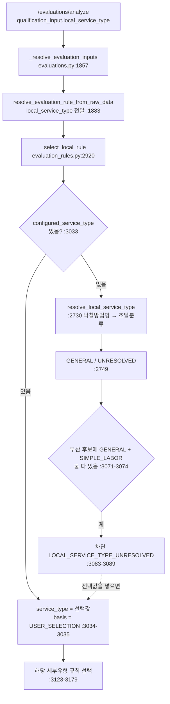

# 부산 `R25BK01244020` 단순노무 기록 저장 경로 설계 (2026-11-18)

> **작성일**: 2026-11-18
> **작업**: Orca Task `task_7e5215f361ed` (investigator, `run_82a17166254d`). 코드·규칙·시험은 고치지 않고 설계 문서 한 건만 씁니다.
> **정본 사양**: `.orca/capsules/task_busan_labor_design_20261118/capsule.yaml` (`ORCA_TASK_CAPSULE_V2`)
> **작업 브랜치**: `kwanbum217/busan-labor`
> **사용자 결정**: 2026-11-18 이 공고를 단순노무로 기록한다. 같은 차단 코드의 다른 공고를 자동 분류하는 정책은 승인되지 않았다.
> **대상 공고**: `R25BK01244020` (차수 `000`, `bid_announcements.id` 9905460)
> **판정 정본**: [src/app/services/evaluation_rules.py](../../src/app/services/evaluation_rules.py), 요청 스키마 [src/app/schemas/evaluations.py](../../src/app/schemas/evaluations.py), API [src/app/api/v1/evaluations.py](../../src/app/api/v1/evaluations.py)
> **DB 조회**: `uv run python scripts/db_readonly_query.py` 의 SELECT 만 사용했습니다. 행을 쓰지 않았습니다.

---

## 1. 결론 먼저

1. **"단순노무로 기록"은 두 가지 뜻이고, 지금 코드에 있는 것은 한 가지뿐입니다.**
   - (가) **판정 기본값으로 저장**: 이 공고를 평가할 때마다 `SIMPLE_LABOR` 별표가 자동으로 선택되게 하는 것. **이 저장 위치는 코드에 없습니다.** `bid_announcement_regime`·`bid_evaluation_snapshots` 어디에도 공고 단위 세부유형 컬럼이 없습니다.
   - (나) **한 건의 선택과 결과를 감사 가능하게 보존**: 평가 요청의 `qualification_input.local_service_type` 에 `SIMPLE_LABOR` 를 넣어 호출하면, 그 선택과 계산 결과가 `bid_evaluation_snapshots` 에 남습니다. **이 경로는 이미 있습니다**([evaluations.py:1746](../../src/app/api/v1/evaluations.py:1746), [:2380](../../src/app/api/v1/evaluations.py:2380)).
2. **이번 과업(코드 미수정)에서 쓸 수 있는 저장 경로는 (나) 하나입니다.** 기존 입력 필드 [schemas/evaluations.py:162](../../src/app/schemas/evaluations.py:162) 와 기존 저장 함수 `_save_snapshot_async` 를 그대로 씁니다. 새 테이블·새 컬럼·규칙 변경이 없습니다.
3. **(나)는 "이후 평가의 기본값"이 되지 않습니다.** 다른 사용자가 같은 공고를 다시 평가하면 여전히 `LOCAL_SERVICE_TYPE_UNRESOLVED` 로 막힙니다. 기본값이 필요하면 **코드 상수 단건 예외**(6장 후보 B)를 별도 과업으로 승인받아야 합니다. 이 문서는 두 안의 경계와 삽입 지점을 함께 적습니다.
4. **범위는 이 공고 한 건입니다.** 같은 차단 코드의 `R25BK01085812`(묶음 19), 2024-11·12 `공고서참조` 9건(묶음 18), 대구 1건(묶음 20)은 대상이 아니며, 자동 판별 규칙을 바꾸지 않습니다.

---

## 2. 대상 공고 실측

조회는 아래 한 문장으로 했고, 값은 원문 필드 그대로입니다.

```sh
uv run python scripts/db_readonly_query.py --sql "SELECT id, bid_ntce_no, bid_ntce_ord, category, bid_ntce_dt, dminstt_nm, presmpt_prce, cntrct_mthd_nm, JSON_UNQUOTE(JSON_EXTRACT(raw_data,'\$.sucsfbidMthdNm')) AS mthd, JSON_UNQUOTE(JSON_EXTRACT(raw_data,'\$.srvceDivNm')) AS srvce_div, JSON_UNQUOTE(JSON_EXTRACT(raw_data,'\$.sucsfbidLwltRate')) AS lwlt, JSON_UNQUOTE(JSON_EXTRACT(raw_data,'\$.sucsfbidMthdAppStd')) AS appstd, JSON_UNQUOTE(JSON_EXTRACT(raw_data,'\$.pubPrcrmntLrgClsfcNm')) AS lrg, JSON_UNQUOTE(JSON_EXTRACT(raw_data,'\$.pubPrcrmntMidClsfcNm')) AS mid FROM bid_announcements WHERE bid_ntce_no='R25BK01244020'"
```

| 항목 | 값 |
| --- | --- |
| `bid_announcements.id` | 9905460 |
| 차수 | 000 |
| 공고일 | 2025-12-22 |
| 수요기관 | 부산광역시 사하구 익숙도문화회관 |
| 추정가격 | 140,999,127 원 |
| 계약방법 | 제한경쟁 |
| 낙찰방법명 | `적격심사제-추정가격 2억미만 1억이상 - 지역업체참여` |
| 용역구분 | 일반용역 |
| 낙찰하한율 | 87.745 |
| 적용 기준 표기 | `학술연구용역 적격심사 세부기준` |
| 조달분류 | 행사관리 및 기타 사업 지원서비스 > 기타 (소분류 없음) |

첨부 판별 레지스트리와 기존 스냅숏도 확인했습니다.

| 조회 | 결과 |
| --- | --- |
| `bid_announcement_regime` (`bid_ntce_no='R25BK01244020'`, `category='Servc'`) | 1행: `regime=LOCAL`, `matched_rules=R10`, `status=CLASSIFIED` |
| `bid_evaluation_snapshots` (`bid_id=9905460`) | 0행. 아직 이 공고에 대한 평가 스냅숏이 없습니다 |

- `regime=LOCAL`·`matched_rules=R10` 은 **첨부 원문 분류기**가 남긴 갈래입니다. 적용 별표 ID 도, 사용자 세부유형 선택도 아닙니다. 이 표를 세부유형 저장처로 쓰면 안 되는 이유가 여기에 있습니다(5장 경계 3).
- `bid_evaluation_snapshots` 컬럼은 `id, bid_id, user_id, rule_id, model_id, model_version, input_json, result_json, created_at, contract_regime, institution_code, institution_name, region_code, region_name` 입니다. **세부유형 컬럼이 없습니다.** 세부유형은 `input_json` 안에만 들어갑니다.
- 2026-11-18 조사 문서는 이 공고를 묶음 19(공고서참조 아님, 조달분류 `기타` + 세부유형 신호 없음)에 넣고 `LOCAL_SERVICE_TYPE_UNRESOLVED` 로 기록했습니다([blocked_breakdown_20261118.md:108](blocked_breakdown_20261118.md:108)). 같은 문서가 부산을 "일반·단순노무 별표가 함께 등록된 지역"으로 적었습니다([:202](blocked_breakdown_20261118.md:202)). 부산 예규의 등록 시행일은 2025-06-26 이라([:152](blocked_breakdown_20261118.md:152)) 이 공고일 2025-12-22 는 효력 구간 안입니다.

---

## 3. 지금 코드가 이 공고를 막는 지점



- 낙찰방법명에 `단순노무` 가 없고(`:2739`), 조달분류도 세부유형 표지에 걸리지 않아 `GENERAL`/`UNRESOLVED` 로 끝납니다([:2744-2749](../../src/app/services/evaluation_rules.py:2744)).
- 이때 부산 후보에 `GENERAL` 과 `SIMPLE_LABOR` 가 함께 있으면 코드는 임의로 하나를 고르지 않고 사용자 선택을 요구합니다([:3071-3089](../../src/app/services/evaluation_rules.py:3071)). 차단 메시지가 요구하는 값이 정확히 `local_service_type` 입니다([:3086-3087](../../src/app/services/evaluation_rules.py:3086)).
- `sucsfbidMthdAppStd`(적용 기준 표기)는 이 판정의 입력이 아닙니다. `resolve_local_service_type` 은 **낙찰방법명과 조달분류만** 받습니다([:2730-2749](../../src/app/services/evaluation_rules.py:2730)). 이 공고의 기준 표기가 `학술연구용역 적격심사 세부기준` 이어도 학술 유형으로 확정되지 않습니다. 2026-11-18 조사도 같은 이유를 적었습니다([blocked_breakdown_20261118.md:139](blocked_breakdown_20261118.md:139)).

---

## 4. 저장 위치 후보 비교

| # | 저장 위치 | 기존 코드 | 이번 과업 가능 여부 | 지속성 | 판단 |
| --- | --- | --- | --- | --- | --- |
| A | 평가 요청 `qualification_input.local_service_type` + `_save_snapshot_async` 스냅숏 | [schemas/evaluations.py:162](../../src/app/schemas/evaluations.py:162), [evaluations.py:1746](../../src/app/api/v1/evaluations.py:1746), [:2380](../../src/app/api/v1/evaluations.py:2380) | 가능. 코드 수정 없음 | 요청 1건 단위 감사 기록. **이후 평가 기본값 아님** | **권고** |
| B | 판정 코어의 공고 단건 상수 예외 | `_select_local_rule` [evaluation_rules.py:3037](../../src/app/services/evaluation_rules.py:3037) 직후 | 불가. 코드·시험 수정 필요 | 공고 단위 지속 기본값 | 6장. 별도 승인 필요 |
| C | 새 테이블·새 컬럼 또는 `bid_announcement_regime` 재사용 | 없음 | 불가. 스키마 변경 | 지속 | **기각**. G1 위반, 첨부 분류 표의 의미 훼손 |
| D | `/evaluations/recommend` 의 `overrides.local_service_type` | [schemas/evaluations.py:666](../../src/app/schemas/evaluations.py:666) | 가능하나 기록 없음 | 없음 | 기각. 요청 스키마가 "서버는 저장하지 않습니다"라고 명시([:687-691](../../src/app/schemas/evaluations.py:687)) |
| E | 평가 프로필(`bid_evaluation_profiles`) | 사용자 단위 | 필드 없음 | 사용자 단위 | 기각. 세부유형 필드가 없고 공고 단위가 아님 |

### 4.1 왜 A 를 권고하는가

- **코드를 고치지 않아도 되고, 이미 있는 저장 함수가 그 선택을 그대로 보존합니다.** `input_json` 은 `qualification_input.model_dump(mode="json")` 결과를 담으므로([:2369-2373](../../src/app/api/v1/evaluations.py:2369)) `local_service_type` 값이 원문 그대로 남습니다.
- **규칙 문맥도 같은 선택값으로 계산됩니다.** 스냅숏 저장 직전 문맥 판별도 `local_service_type` 을 넘깁니다([:2365](../../src/app/api/v1/evaluations.py:2365)). 즉 `rule_id`·`contract_regime`·`institution_code`·`region_code` 가 선택값 기준으로 일관되게 기록됩니다.
- **실패해도 응답을 막지 않고, 성공·차단 모두 저장됩니다**([:2352-2353](../../src/app/api/v1/evaluations.py:2352)). 반대로 말하면 **차단 응답도 스냅숏을 만드므로**, "기록 완료" 판정은 `rule_id` 와 `result_json.status` 로 해야 합니다.
- **A 의 한계는 분명합니다.** 스냅숏은 `user_id` 소유의 분석 이력입니다([:3229-3235](../../src/app/api/v1/evaluations.py:3229)). 다른 사용자의 다음 평가에 선택값을 주입하지 않습니다. 그래서 A 는 "기록"이지 "설정"이 아닙니다.

---

## 5. 권고안 A: 단건 기록 절차

### 5.1 호출

`POST /api/v1/evaluations/analyze` ([evaluations.py:190](../../src/app/api/v1/evaluations.py:190) prefix, [:2318](../../src/app/api/v1/evaluations.py:2318)) 를 **로그인 사용자 세션으로 1회** 호출합니다(`require_current_user`, [:2323](../../src/app/api/v1/evaluations.py:2323)).

```json
{
  "bid_id": 9905460,
  "candidate_bid_amount": 125000000,
  "qualification_input": {
    "local_service_type": "SIMPLE_LABOR",
    "max_price_score": null,
    "multiplier": null,
    "pass_threshold": null
  }
}
```

| 필드 | 채우는 방법 |
| --- | --- |
| `bid_id` | 9905460 (2장 실측). `bid_ntce_no`+차수로 찾을 수 없으므로 ID 를 그대로 씁니다 |
| `candidate_bid_amount` | 0 보다 큰 값이어야 합니다([schemas:283-287](../../src/app/schemas/evaluations.py:283)). 위 125,000,000 은 예시값이며 실제 검토 금액으로 대체합니다. 이 값은 가격점수에만 쓰이고 `rule_id` 판정에는 쓰이지 않습니다 |
| `local_service_type` | `"SIMPLE_LABOR"` (대문자). 판정 코어가 `.strip().upper()` 로 정규화합니다([evaluation_rules.py:3034](../../src/app/services/evaluation_rules.py:3034)) |
| `max_price_score`·`multiplier`·`pass_threshold` | **비워 둡니다.** 이 셋은 공고문 배점표에서 읽어 넣는 값이고, 하나라도 없으면 점수 계산을 차단합니다([schemas:118-125](../../src/app/schemas/evaluations.py:118)). 시·도 규칙의 정량점수도 레지스트리 배점표가 없어 사용자 직접 입력입니다([:1991-1992](../../src/app/api/v1/evaluations.py:1991)). 값을 추측해 넣지 않으며, 비우면 점수표 단계에서 막히지만 그 응답도 스냅숏으로 저장됩니다 |

### 5.2 기록 완료 판정

아래 세 조건을 모두 만족할 때만 "단순노무로 기록됐다"고 말합니다.

| 조건 | 확인 방법 |
| --- | --- |
| 1. 세부유형이 저장됨 | `GET /api/v1/evaluations/snapshots?bid_id=9905460` ([evaluations.py:3219](../../src/app/api/v1/evaluations.py:3219)) 의 최신 항목에서 `input_json.qualification_input.local_service_type == "SIMPLE_LABOR"` |
| 2. 적용 규칙이 부산 `SIMPLE_LABOR` 규칙 | 같은 항목의 `rule_id` 가 부산광역시 단순노무 별표 규칙 ID 이고 `"BLOCKED"` 가 아님. 저장 시 `response.rule_id or "BLOCKED"` 를 쓰므로([:2384](../../src/app/api/v1/evaluations.py:2384)) `"BLOCKED"` 는 기록 실패로 봅니다 |
| 3. 문맥이 부산 LOCAL | 같은 항목의 `contract_regime == "LOCAL"`, `region_code`/`region_name` 이 부산 |

- 조건 2 는 **`LOCAL_SERVICE_TYPE_UNRESOLVED` 가 사라졌다는 뜻**입니다. 판정 코어가 `USER_SELECTION` 으로 넘어가 후보 병존 분기([:3071-3089](../../src/app/services/evaluation_rules.py:3071))를 타지 않았기 때문입니다.
- 조건 2 가 `"BLOCKED"` 로 남으면 선택은 저장됐지만 별표는 확정되지 않은 상태입니다. 이때는 기록으로 인정하지 않고, 막힌 사유(`lwlt`/`pred_price`/`score_table` 등)를 그대로 보고합니다.
- `GET /evaluations/rules?bid_id=9905460` 는 **확인 도구로 쓰지 않습니다.** 이 목록은 조달청 별표 20종만 돌려주고 시·도 규칙은 넣지 않으며([:3009-3011](../../src/app/api/v1/evaluations.py:3009)), `matched_rule` 판별에 `local_service_type` 을 넘기지 않습니다([:3027-3037](../../src/app/api/v1/evaluations.py:3027)). 여기서 `null` 이 나와도 기록 실패가 아닙니다.

### 5.3 되돌리기·정정

- 스냅숏은 추가 전용입니다. 삭제·수정 엔드포인트가 없고 `POST /snapshots`([:3272](../../src/app/api/v1/evaluations.py:3272)) 는 새 행을 만듭니다.
- 잘못된 선택을 넣었다면 **행을 지우지 않고** 올바른 선택으로 새 스냅숏을 1건 더 만든 뒤, 최신 행을 정본으로 삼습니다.
- 운영 DB 에 직접 `INSERT`·`UPDATE`·`DELETE` 를 하지 않습니다. 기록은 API 경로로만 만듭니다.

### 5.4 중복

- 같은 공고를 여러 번 호출하면 스냅숏이 여러 행 쌓입니다. 감사 로그 성격이므로 중복 자체는 결함이 아니지만, 이번 기록은 **1회 호출**을 원칙으로 하고 검증은 최신 1행으로 합니다.
- 기존 행이 0건임을 확인했으므로(2장), 이번 호출로 생기는 행이 첫 기록입니다.

---

## 6. 후보 B: 공고 단건 상수 예외 (다음 과업)

A 로는 "이후 모든 평가에서 자동 적용"이 되지 않습니다. 그 요구가 실제 요구사항이면 아래가 **가장 작은 코드 변경**입니다. 이번 과업에서는 **구현하지 않습니다.**

| 항목 | 내용 |
| --- | --- |
| 삽입 지점 | [evaluation_rules.py:3037](../../src/app/services/evaluation_rules.py:3037) 의 `resolve_local_service_type(...)` 호출 직후. `configured_service_type` 분기([:3033-3035](../../src/app/services/evaluation_rules.py:3033))보다 뒤라 사용자가 직접 고른 값이 항상 우선합니다 |
| 키 | `raw_data["bidNtceNo"]` + 차수. `bidNtceNo` 는 같은 파일에서 이미 쓰는 키입니다([:2760](../../src/app/services/evaluation_rules.py:2760)) |
| 값 | `"SIMPLE_LABOR"`, `basis` 는 `"ANNOUNCEMENT_OVERRIDE"` 같은 새 표기, 경고에 근거(사용자 승인일·출처)를 남김 |
| 가드 | 자동 판정이 `UNRESOLVED` 일 때만 적용. 낙찰방법명이 이미 유형을 확정한 공고는 덮지 않음. 표에 없는 공고는 종전과 완전히 동일 |
| 시험 | (1) 이 공고 → 부산 `SIMPLE_LABOR` 선택 (2) 인접 공고 `R25BK01085812`·같은 지역 다른 공고 → `LOCAL_SERVICE_TYPE_UNRESOLVED` 유지 (3) 표가 비면 전 지역 판정 불변 |
| 승인 | 사용자 승인 + 규칙 ID 확정 + `tests/` 추가 필요. 스키마·테이블 변경 없음 |

- 이 안도 **한 건 예외**입니다. 표에 다른 공고를 추가하지 않는 한 자동 분류 정책이 되지 않습니다.
- A 와 B 는 배타적이지 않습니다. B 를 넣더라도 A 의 스냅숏 기록은 그대로 남겨 근거를 보존합니다.

---

## 7. 바꾸면 안 되는 경계

| # | 경계 | 이유·근거 |
| ---: | --- | --- |
| 1 | `resolve_local_service_type`·`_select_local_rule` 의 자동 판정 순서와 `UNRESOLVED` 차단 유지 | 이 공고 한 건 예외가 일반 추론 규칙이 되면 미판정 공고 전체의 판정이 바뀝니다. 사용자 결정은 한 건입니다 |
| 2 | 다른 미판정 공고에 같은 선택을 자동 적용하지 않음 | 묶음 19의 `R25BK01085812`, 묶음 18의 9건, 묶음 20 대구 1건은 범위 밖입니다([blocked_breakdown_20261118.md:107-109](blocked_breakdown_20261118.md:107)) |
| 3 | DB 스키마·테이블·컬럼 변경 금지. `bid_announcement_regime` 에 세부유형을 쓰지 않음 | G1 데이터 무손실. 이 표의 `regime`·`matched_rules` 는 첨부 원문 분류 결과이며 사용자 선택의 저장처가 아닙니다(2장 실측) |
| 4 | `src/ml/features.py` 및 학습·추론 특징 경로 무변경 | Train/Serve 특징 단일화. 이 과업은 특징을 만들지 않습니다 |
| 5 | `/evaluations/rules` 응답을 이 선택으로 바꾸지 않음 | 이 엔드포인트는 조달청 별표 메타 목록이고 시·도 규칙을 포함하지 않습니다([:3004-3012](../../src/app/api/v1/evaluations.py:3004)) |
| 6 | `/evaluations/recommend` 를 기록 경로로 쓰지 않음 | 무상태 계산입니다([schemas:687-691](../../src/app/schemas/evaluations.py:687)) |
| 7 | `lwlt`·`appstd`·`presmpt_prce` 로 단순노무를 추론하지 않음 | 낙찰하한율 87.745 는 단순노무 외 유형도 공유하고, 적용 기준 표기는 판정 입력이 아닙니다(3장) |
| 8 | 운영 DB 직접 쓰기 금지 | 기록은 `/analyze` 또는 `POST /snapshots` 경로만 사용 |
| 9 | `공고서참조` 1,070건 등 다른 차단 묶음 정책 무변경 | 2026-11-18 사용자 결정은 현 상태 유지입니다 |
| 10 | 코드·규칙·시험·마이그레이션 무변경 | 이번 과업은 설계 문서 한 건입니다 |

---

## 8. 검증

| # | 명령 | 통과 기준 |
| ---: | --- | --- |
| 1 | `python3 scripts/validate_agent_rules.py --quiet` | 오류 없음 |
| 2 | `git diff --name-only main...HEAD` | 이 설계 문서 한 파일만 |
| 3 | `git status --short` | 코드·규칙·시험 파일 변경 없음 |
| 4 | 기록 후 `GET /api/v1/evaluations/snapshots?bid_id=9905460` | 5.2절 세 조건 충족 |

- 4번은 기록 실행 시점의 확인이며, 이번 설계 과업에서는 호출하지 않았습니다. 설계 시점 스냅숏 0행은 2장에 적었습니다.
- 판정 함수를 직접 호출해 재현하지 않았습니다. 3장의 분기는 코드 줄과 2장의 원문 필드, 2026-11-18 조사 문서 대조로만 추적했습니다.

---

## 9. 남은 결정

| # | 결정 | 선택지 | 권고 |
| ---: | --- | --- | --- |
| 1 | 기록의 목적이 "감사 이력 1건"인지 "이후 평가 자동 적용"인지 | (가) A 만, (나) A + B | (가)로 지금 기록하고, 자동 적용이 필요하면 B 를 다음 과업으로 승인 |
| 2 | B 를 승인할 경우 예외 표의 표기 | 공고번호+차수 / 공고번호만 | 차수 포함. 재공고·정정공고를 같은 공고로 묶지 않기 위해 |
| 3 | A 로 기록할 때 `candidate_bid_amount` 값 | 최저 투찰금액 수준 / 실제 검토 금액 | 실제 검토 금액이 있으면 그 값. 없으면 기록 목적임을 남기고 최저 투찰금액 수준 |

---

## 부록 A. 이 문서에서 하지 않은 것

- 코드·규칙·시험·마이그레이션을 고치지 않았습니다.
- 운영 DB 에 쓰지 않았고, `docker exec`·`mysql` 직접 호출을 하지 않았습니다. 조회는 `scripts/db_readonly_query.py` 의 SELECT 만 사용했습니다.
- 판정 함수를 직접 실행하지 않았습니다.
- 외부 원문·상업 입찰 정보 페이지를 쓰지 않았습니다.
- 다른 공고의 단순노무 자동 분류 정책을 제안하지 않았습니다.
