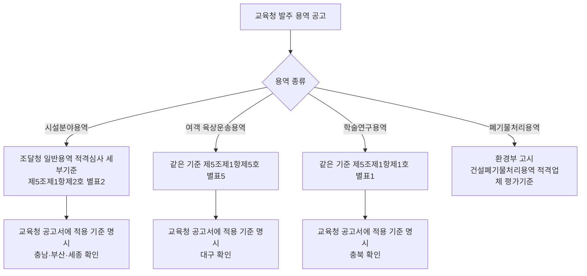

# 교육청 다섯 곳 일반용역 적격심사 적용 기준 추가 조사 (충남·부산·충북·대구·세종)

> **작성일**: 2026-10-17
> **작업**: Orca Task `task_42fa218c5a13` (builder). 제품 코드와 규칙을 바꾸지 않고 원문만 확인한다.
> **정본 사양**: `.orca/capsules/task_edu_basis_followup_20261017/capsule.yaml` (`ORCA_TASK_CAPSULE_V2`)
> **선행 문서**: [edu_local_rule_basis_20261017.md](edu_local_rule_basis_20261017.md) — 상위 7개 시·도교육청 조사, 다섯 곳을 `미확인` 으로 남겼다.
> **작업 브랜치**: `kwanbum217/orca-edu-basis-followup`
> **범위**: 충청남도·부산광역시·충청북도·대구광역시·세종특별자치시 교육청이 발주하는 **일반용역** 적격심사의 적용 기준. 상위 7개 중 경상북도(확정)·전북특별자치도(정황)는 선행 문서에서 결론이 났으므로 다시 다루지 않는다.
> **확인 날짜**: 2026-10-17.
> **원문 저장 위치**: `.cache/edu_basis_followup/` (커밋하지 않는 로컬 산출물). 이 문서는 `.cache/` 를 마크다운 링크로 걸지 않고 인라인 코드로만 언급한다.
> **결론**: 다섯 교육청 모두 **자기 명의 공고서(나라장터 공고 첨부)에 일반용역 적격심사 기준을 「조달청 일반용역 적격심사 세부기준」으로 적는다.** 선행 문서가 남긴 다섯 개 `미확인` 행이 모두 `조달청 기준 적용`(근거 수준 `확정`)으로 바뀐다. 같은 교육청의 **폐기물처리용역**은 별도로 환경부 고시를 적용하므로, 기준은 발주 기관이 아니라 **용역 종류**가 가른다.

---

## 1. 목적과 결론

- 목적: 선행 문서가 상위 7개 시·도교육청 중 다섯 곳(충남·부산·충북·대구·세종)에 대해 남긴 `미확인` 을, 그 교육청 명의의 **공식 원문**으로 확정하거나 기각한다.
- 확인할 질문은 둘이다. 1) 그 교육청이 일반용역 적격심사에 실제로 거는 기준은 무엇인가. 2) 그것이 교육청 명의 문서에 적혀 있는가(확정), 아니면 배포·표기 같은 간접 단서뿐인가(정황).
- 답: 다섯 곳 모두 **조달청 일반용역 적격심사 세부기준**을 공고서에 명시한다. 근거 수준은 다섯 곳 모두 `확정` 이다. 선행 문서의 `미확인` 은 "원문을 찾지 못했다"는 뜻이었고, 이번에는 나라장터 공고 첨부(공고서)까지 내려받아 문장을 직접 확인했다.

| 항목 | 판정 | 핵심 근거 |
| --- | --- | --- |
| 다섯 교육청이 일반용역에 거는 기준 | **조달청 일반용역 적격심사 세부기준** 5곳 | 3절 판정 표·4절 인용 |
| 자체 일반용역 세부기준 보유 | **확인되지 않음** (ELIS 교육자치법규 검색 5곳 모두 0건) | 5.1절 |
| 기준을 가르는 변수 | 발주 기관이 아니라 **용역 종류** | 5.2절(폐기물처리용역은 환경부 고시) |
| 선행 문서 판정 변경 | 다섯 행 모두 `미확인` -> `조달청 기준 적용` | 6절 |

---

## 2. 판정 기준

선행 문서 [edu_local_rule_basis_20261017.md](edu_local_rule_basis_20261017.md) 2절의 규칙을 그대로 적용했다.

1. 상업 페이지(bidpro, 비드큐, info21c, 모두입찰, korbid, igunsul, 블로그)의 계수·조문은 확정값으로 옮기지 않는다. 제목과 날짜 단서로만 쓴다.
2. 나라장터 첨부나 교육청 자료실 파일은 그 기관 명의 규정일 때만 원문으로 본다. **배포**와 **적용 선언**은 다르다.
3. `확정` 은 그 교육청 명의의 공식 문서(**공문·지침·공고 첨부 머리말·재무과 안내 표**)가 일반용역 적용 기준을 적은 경우만이다. 이번 다섯 건은 모두 **교육청 공고 번호가 붙은 공고서(입찰공고 첨부)** 이므로 `확정` 조건에 해당한다.
4. 공식 출처는 국가법령정보센터(law.go.kr), 자치법규정보시스템(elis.go.kr), 기관 공식 누리집, 나라장터 공고 첨부다.
5. 원문 미확보, 접속 실패, 근거 0건은 **조사 결과이지 차단이 아니다.** `미확인` 은 차단이 아니다.

- 판정 값은 선행 문서와 같은 여섯 가지를 쓴다. **자체 기준 / 행안부 예규 직접 적용 / 시·도청 예규 적용 / 조달청 기준 적용 / 조달청 기준 적용(정황) / 미확인**.
- 원문 확보 경로는 나라장터 공고 첨부 내려받기다. 첨부가 HWP5 바이너리·HWPX·PDF 로 섞여 있어, 조사용 임시 추출기(외부 의존성 없음)로 본문을 뽑아 문장을 대조했다. 받은 원문과 추출 텍스트는 `.cache/edu_basis_followup/` 에만 두었다.

---

## 3. 판정 표 (필수)

`근거 수준` 은 `확정`(교육청 명의 공식 문서가 적용을 적음)과 `정황`(자료실 배포·상업 페이지 표기 등 간접 단서만)으로 나눈다.

| 교육청 | 판정 | 근거 수준 | 출처 URL | 인용 문장 |
| --- | --- | --- | --- | --- |
| 충청남도교육청 | 조달청 기준 적용 | 확정 | `https://www.g2b.go.kr/link/PNPE027_01/single/?bidPbancNo=R25BK00745193&bidPbancOrd=000` (충청남도교육청 공고 제2025-32호, 첨부 1번) | "적격심사는 「조달청 일반용역 적격심사 세부 기준」 제5조제1항제2호 [별표 2] 시설분야용역 적격심사(추정가격 5억원 미만)의 평가기준'을 적용합니다." |
| 부산광역시교육청 | 조달청 기준 적용 | 확정 | `https://www.g2b.go.kr/link/PNPE027_01/single/?bidPbancNo=R25BK01237397&bidPbancOrd=000` (첨부 1번 공고문, 공고번호 표기 없음) | "본 용역은 적격심사 대상으로 「조달청 일반용역 적격심사 세부기준」제5조제1항제2호 [별표2] 시설분야용역 적격심사 세부기준에 따라 … 종합평점이 85점 이상이면 낙찰자로 결정합니다." |
| 충청북도교육청 | 조달청 기준 적용 | 확정 | `https://www.g2b.go.kr/link/PNPE027_01/single/?bidPbancNo=R26BK01650487&bidPbancOrd=000` (충청북도교육청 공고 제2026-181호, 첨부 1번) | "「조달청 일반용역 적격심사 세부기준」제5조제1항제1호 학술연구용역 평가기준[별표1]에 따라 … 종합 평점이 85점(적격통과점수) 이상인 자를 낙찰자로 결정합니다." |
| 대구광역시교육청 | 조달청 기준 적용 | 확정 | `https://www.g2b.go.kr/link/PNPE027_01/single/?bidPbancNo=R26BK01663260&bidPbancOrd=000` (대구광역시교육청 공고 제2026-277호, 첨부 1번) | “적격심사기준은 “조달청 일반용역 적격심사 세부기준”(조달청 공고 제2026-390호, 2026.7.27.) 제5조제1항제5호 [별표5] 여객 육상운송용역 평가기준을 적용합니다.” |
| 세종특별자치시교육청 | 조달청 기준 적용 | 확정 | `https://www.g2b.go.kr/link/PNPE027_01/single/?bidPbancNo=R26BK01337102&bidPbancOrd=000` (세종특별자치시교육청 공고 제2026-66호, 첨부 1번) | "낙찰자 결정은 예정가격 이하 낙찰하한율 87.995% 이상 최저가 입찰한 자의 순으로 적격여부를 심사하여 종합 평점이 85점 이상인 자(「조달청 일반용역 적격심사 세부기준」(조달청 공고) [별표 2] 시설분야용역 추정가격 5억원 미만)를 낙찰자로 결정합니다." |

- 위 URL 은 나라장터 공고 상세주소다. 첨부 1번(공고문) 내려받기 주소는 같은 공고번호로 `https://www.g2b.go.kr/pn/pnp/pnpe/UntyAtchFile/downloadFile.do?bidPbancNo=<공고번호>&bidPbancOrd=000&fileType=&fileSeq=1&prcmBsneSeCd=03` 이다. 전체 목록은 8절에 있다.
- 다섯 행 모두 **교육청 공고 번호가 붙은 공고서**를 근거로 삼았다. 상업 페이지 표기나 자료실 배포만 있는 단서는 이번 판정에 쓰지 않았다.

---

## 4. 교육청별 상세

### 4.1 충청남도교육청 — 조달청 기준 적용(확정)

| 항목 | 값 |
| --- | --- |
| 근거 문서 | 충청남도교육청 공고 제2025-32호, 용역 입찰 재공고(총액/제한경쟁입찰), 공고일 2025-03-26 |
| 공고명 | 2025년 근골격계부담작업 유해요인조사(정기) 및 물질안전보건자료 전수조사 용역(1권역) |
| 추정가격 | 309,545,455원 (나라장터 공고 raw 값) |
| 적용 별표 | 조달청 일반용역 적격심사 세부기준 제5조제1항제2호 [별표 2] 시설분야용역(추정가격 5억원 미만) |
| 낙찰하한율·통과점수 | 87.995% 이상, 종합평점 85점 이상 |
| 담당 | 충청남도교육청 재무과 (공고서 문의처 041-640-8231) |
| 판정 | 조달청 기준 적용 / 근거 수준 확정 |

- 공고서 7절(예정가격 및 낙찰자 결정방법) 원문 인용:

> 나. 적격심사는 「조달청 일반용역 적격심사 세부 기준」 제5조제1항제2호 [별표 2] 시설분야용역 적격심사(추정가격 5억원 미만)의 평가기준'을 적용합니다.
> 다. 입찰서를 제출한 자 중에서 예정가격 이하로서 낙찰하한율(87.995%) 이상 입찰한 자 중에서 최저가 입찰자 순으로 적격심사하여 종합평점이 85점 이상인 자를 낙찰자로 결정합니다.

- 공고서 6절(입찰 및 계약방식)도 "가. 총액, 지역제한, 적격심사, 전자계약 대상 용역입니다." 로 적어 적격심사 대상임을 명시한다.
- 첨부 파일명: `(공고문) 2025년 근골격계부담작업 유해요인조사(정기) 및 물질안전보건자(MSDS) 전수조사 용역(1권역).hwp`
- 선행 문서가 단서로만 적었던 시·도청 예규(충청남도 일반용역 적격심사 세부기준, 공고 2026-1235호)는 이 건의 근거가 아니다. **교육청이 자기 공고서에 조달청 기준을 적었다.**

### 4.2 부산광역시교육청 — 조달청 기준 적용(확정)

| 항목 | 값 |
| --- | --- |
| 근거 문서 | 부산광역시교육청 전자입찰 공고, 공고일 2025-12-19 (첨부 1번 `공고문.hwp`) |
| 공고명 | (긴급)2026년 늘봄전용학교(명지·정관·윤산·남부민) 환경미화 용역 |
| 추정가격 | 117,661,945원 (기초금액 129,428,140원) |
| 적용 별표 | 조달청 일반용역 적격심사 세부기준 제5조제1항제2호 [별표2] 시설분야용역 |
| 낙찰하한율·통과점수 | 87.995% 이상, 종합평점 85점 이상 |
| 담당 | 부산광역시교육청 재정과 (적격심사 자료제출처) |
| 판정 | 조달청 기준 적용 / 근거 수준 확정 |

- 공고서 「개찰 및 낙찰자 결정방법」 원문 인용:

> 나. 본 용역은 적격심사 대상으로 「조달청 일반용역 적격심사 세부기준」제5조제1항제2호 [별표2] 시설분야용역 적격심사 세부기준에 따라 적격심사 대상자 중 예정가격 이하로서 예정가격 대비 낙찰하한율(87.995%)이상 최저가로 입찰한 자의 순으로 적격심사하여 종합평점이 85점 이상이면 낙찰자로 결정합니다.
> 다. 적격심사 세부기준 1) 경영상태:'신용평가등급에 의한 평가방법'에 의하며, 세부 적용기준은 조달청 일반용역 적격심사 [별표10]에 따라 평가합니다. 2) 이상의 신인도 등 적격심사 항목별 평가방법은 「조달청 일반용역 적격심사 세부기준」 따라 평가합니다.
> ※ 반드시 조달청 적격심사 세부기준을 숙지하고 투찰하시기 바랍니다.

- 공고서 「적격심사 서류제출」의 자료제출처는 `부산광역시 부산진구 화지로 12, 부산광역시교육청 재정과` 이고, 말미 주소도 `[주소 : 부산광역시 부산진구 화지로 12 (양정동) 부산광역시교육청]` 이다. 발주 주체가 교육청임을 원문으로 확인했다.
- 이 공고에는 공고번호 표기가 없어 나라장터 공고번호 `R25BK01237397` 로 식별한다.
- 선행 문서는 부산의 정황으로 상업 페이지의 "부산광역시교육청 적격심사 세부기준 적용" 표기를 적었는데, 실제 원문은 **조달청 기준**이다. 상업 페이지 표기를 확정값으로 쓰지 않은 판단이 옳았음을 보여준다.

### 4.3 충청북도교육청 — 조달청 기준 적용(확정)

| 항목 | 값 |
| --- | --- |
| 근거 문서 1 | 충청북도교육청 공고 제2026-181호, 공고일 2026-07-28 |
| 공고명 1 | 2026년 충청북도교육청 물질안전보건자료(MSDS) 전수조사 용역 |
| 근거 문서 2 | 충청북도교육청 공고 제2026-123호, 공고일 2026-05-08 |
| 공고명 2 | 2026년 급식 종사자 2차 폐암 건강검진(저선량 흉부CT 촬영) 용역 |
| 적용 별표 | 조달청 일반용역 적격심사 세부기준 제5조제1항제1호 [별표1] 학술연구용역 평가기준 |
| 낙찰하한율·통과점수 | 문서 1: 86.245% 이상 / 문서 2: 84.245% 이상, 종합평점 85점(적격통과점수) 이상 |
| 판정 | 조달청 기준 적용 / 근거 수준 확정 |

- 공고문 8절(예정가격 결정 및 낙찰자 결정방법) 원문 인용(두 문서가 같은 문구):

> 나. 「조달청 일반용역 적격심사 세부기준」제5조제1항제1호 학술연구용역 평가기준[별표1]에 따라 예정가격 대비 낙찰하한율 86.245% 이상 최저가 입찰한자의 순서대로 적격 여부를 심사하여 종합 평점이 85점(적격통과점수) 이상인 자를 낙찰자로 결정합니다.
> 다. 신속한 낙찰자 결정을 위하여 예상종합평점이 85점 이상으로서 최저가로 입찰한 자 순으로 1차 적격심사대상자로 선정되며 적격심사 대상자는 적격심사서류 제출의 통보를 받은 날로부터 7일 이내에 적격심사서류를 제출하여야 합니다.

- 두 공고 모두 교육청 공고 번호가 붙은 공고문 PDF(`공고문(...)_입찰.pdf`)가 첨부 1번이다.
- **반례 주의**: 같은 교육청의 폐기물처리용역(공고 제2025-208호, 나라장터 `R25BK00917840`)은 "「건설폐기물처리용역 적격업체 평가기준(환경부고시) [별표] 추정가격 2억원 미만인 용역"을 적용한다고 적는다. 충북의 일반용역 기준이 조달청 하나로 고정되는 것이 아니라 **용역 종류에 따라 갈린다**는 뜻이다(5.2절).

### 4.4 대구광역시교육청 — 조달청 기준 적용(확정)

| 항목 | 값 |
| --- | --- |
| 근거 문서 | 대구광역시교육청 공고 제2026-277호, 공고일 2026-08-03 |
| 공고명 | 2026 글로벌 탐구 미래삶 해외 봉사활동(필리핀) 용역 |
| 추정가격 | 92,714,545원 |
| 적용 별표 | 조달청 일반용역 적격심사 세부기준(조달청 공고 제2026-390호, 2026.7.27.) 제5조제1항제5호 [별표5] 여객 육상운송용역 평가기준 |
| 낙찰하한율·통과점수 | 89.995% 이상, 종합평점 88점 이상 |
| 담당 | 대구시교육청 회계정보과(계약) / 기획조정과(과업) |
| 판정 | 조달청 기준 적용 / 근거 수준 확정 |

- 공고서 7절(적격심사 평가기준) 원문 인용:

> 가. 적격심사기준은 “조달청 일반용역 적격심사 세부기준”(조달청 공고 제2026-390호, 2026.7.27.) 제5조제1항제5호 [별표5] 여객 육상운송용역 평가기준을 적용합니다.
> 나. 이행실적 평가는 동등이상용역의 이행실적비율 …
> 라. 경영상태, 신인도 등 적격심사 항목별 평가방법은 「조달청 일반용역 적격심사 세부기준」을 적용합니다.

- 공고서 「입찰참가자격」 첫머리도 "가. 본 입찰은 제한경쟁입찰 및 적격심사(조달청 일반용역 적격심사 세부기준 중 여객 육상운송용역 평가 기준) 대상입니다." 로 적는다. 첨부 과업설명서(`(붙임2) 과업설명서….hwpx`)에도 같은 취지("입찰 방식 - 제한경쟁입찰 및 적격심사(조달청 일반용역 적격심사 세부기준 중 [별표5] 여객 육상운송용역 적격 심사 평가 기준)")가 있다.
- 이 건은 **교육청 공고문이 조달청 기준의 공고 번호와 시행일까지 적은 사례**다. 다섯 건 중 가장 구체적이다.
- 참고로 이 공고서가 가리키는 조달청 일반용역 적격심사 세부기준의 판은 조달청 공고 제2026-390호(시행 2026. 7. 27.)다. 선행 문서가 인용한 제2025-257호(시행 2025. 9. 1.)는 그 이전 판이다.

### 4.5 세종특별자치시교육청 — 조달청 기준 적용(확정)

| 항목 | 값 |
| --- | --- |
| 근거 문서 | 세종특별자치시교육청 공고 제2026-66호 (나라장터 게시 2026-02-19, 공고문 기재 2026. 2. 23., 재무관) |
| 공고명 | 2026년 학교 시설 내 공기질 점검 용역(2구역) |
| 추정가격 | 145,085,945원 |
| 적용 별표 | 조달청 일반용역 적격심사 세부기준(조달청 공고) [별표 2] 시설분야용역 추정가격 5억원 미만 |
| 낙찰하한율·통과점수 | 87.995% 이상, 종합평점 85점 이상 |
| 담당 | 세종특별자치시교육청 재무행정과(계약) / 학교안전과(과업) |
| 판정 | 조달청 기준 적용 / 근거 수준 확정 |

- 공고문 5절(예정가격 및 낙찰자 결정) 원문 인용:

> 나. 낙찰자 결정은 예정가격 이하 낙찰하한율 87.995% 이상 최저가 입찰한 자의 순으로 적격여부를 심사하여 종합 평점이 85점 이상인 자(「조달청 일반용역 적격심사 세부기준」(조달청 공고) [별표 2] 시설분야용역 추정가격 5억원 미만)를 낙찰자로 결정합니다.
> 다. 낙찰예정자는 적격심사서류(적격심사신청서, 적격심사 자기평가와 심사표, 용역이행 실적증명서, 재무제표 또는 신용평가등급 확인서 등)를 5일 이내에 세종특별자치시교육청 재무행정과로 제출하여야 하며 …

- 11절(기타 유의사항)도 열람 대상 법규로 "지방자치단체 입찰 및 계약 집행기준, 지방자치단체 입찰시 낙찰자 결정기준, 조달청 일반용역 적격심사 세부기준, 용역계약일반조건 및 계약특수조건 …" 을 나열한다.
- 첨부 파일명: `(재무행정과-4005 (첨부)) [공고문] 2026년 학교 시설 내 공기질 점검 용역(2구역).pdf`
- 같은 교육청의 폐기물처리용역(나라장터 `R26BK01355387`)은 「건설폐기물처리용역 적격업체 평가기준」(환경부고시 제2025-165호, 2025. 10. 7.)을 적용한다고 적는다(5.2절).

---

## 5. 보조 확인

### 5.1 교육청 자체 일반용역 세부기준은 확인되지 않았다

- 자치법규정보시스템 교육자치법규 목록(`https://www.elis.go.kr/edulaw/eduLawList`)을 교육청 기관코드로 나눠 검색했다. 검색어 `적격심사` 와 `낙찰자` 모두 **다섯 교육청 전부 총 0건**이다.

| 교육청 | ELIS 기관코드 | `적격심사` 검색 | `낙찰자` 검색 |
| --- | --- | --- | --- |
| 부산광역시교육청 | 7150000 | 0건 | 0건 |
| 대구광역시교육청 | 7240000 | 0건 | 0건 |
| 세종특별자치시교육청 | 9300000 | 0건 | 0건 |
| 충청남도교육청 | 8140000 | 0건 | 0건 |
| 충청북도교육청 | 8000000 | 0건 | 0건 |

- 세종특별자치시교육청 목록에 「정책연구용역 관리 조례」, 「협상에 의한 계약 제안서평가위원회 구성·운영에 관한 규칙」 이 있으나 둘 다 적격심사 세부기준이 아니다.
- 이 결과는 선행 문서의 "일반용역 자체 세부기준 0곳" 과 일치한다. 다만 ELIS 에 등록되지 않은 내부 지침·공문은 이 검색으로 잡히지 않으므로, **"없다"가 아니라 "이번 조사에서 확인되지 않았다"** 로 적는다.

### 5.2 기준을 가르는 것은 발주 기관이 아니라 용역 종류다

- 이번에 확보한 공고 중 폐기물처리용역은 예외 없이 환경부 고시를 적용한다.

| 공고 | 발주·집행 | 적용 기준(원문 문구) |
| --- | --- | --- |
| 부산광역시교육청 `R26BK01662007` (건설폐기물처리용역, 2026-08-03) | 부산지방조달청 집행 | "(환경부)건설폐기물처리용역 적격업체 평가기준" |
| 충청북도교육청 `R25BK00917840` (추정가격 2억원 미만, 2025-06-20) | 충청북도교육청 | "「건설폐기물처리용역 적격업체 평가기준(환경부고시) [별표] 추정가격 2억원 미만인 용역" |
| 세종특별자치시교육청 `R26BK01355387` (2026-02-26) | 세종특별자치시교육청 | "「건설폐기물처리용역 적격업체 평가기준」(환경부고시 제2025-165호, 2025. 10. 7.) [별표] 추정가격 2억원 미만인 용역의 평가기준" |

- 이는 조달청 일반용역 적격심사 세부기준 제3조 단서("주무부처에서 관련법령에 따라 별도의 심사기준을 정한 경우에는 그 기준에 따른다")와 정합한다. 일반용역으로 묶어 한 기준을 일괄 적용하면 폐기물처리용역에서 어긋난다.
- 시·도청 예규(시행령 제42조 제4항)가 교육청에 적용된다는 조문은 선행 문서 3.3절에서 이미 부정 확인됐고, 이번 조사에서 이를 뒤집을 원문은 나오지 않았다. 다섯 교육청 모두 **조달청 기준**을 적었지, 시·도청 예규를 적지 않았다.

### 5.3 조달청 기준이 스스로 밝히는 심사대상

- 현행 조달청 일반용역 적격심사 세부기준(조달청 공고 제2026-390호, 시행 2026. 7. 27.) 제3조는 심사대상을 "「국가계약법 시행령」 제42조제1항 및 「지방계약법 시행령」 제42조 제1항 본문에 해당하는 용역계약 중 제2조의 일반용역 계약 또는 그에 준하는 용역 계약"으로 적는다.
- 즉 교육청이 자체 기준을 두지 않은 일반용역에서 이 기준을 준용하는 경로는 조문상 열려 있고, 다섯 교육청이 실제로 그렇게 적고 있다.

---

## 6. 선행 문서와 달라진 판정

선행 문서 [edu_local_rule_basis_20261017.md](edu_local_rule_basis_20261017.md) 4절의 상위 7개 판정 표와 대조한 결과다.

| 교육청 | 선행 문서 판정 | 이 문서 판정 | 바뀐 이유 |
| --- | --- | --- | --- |
| 충청남도교육청 | 미확인 | **조달청 기준 적용 (확정)** | 충청남도교육청 공고 제2025-32호 공고서 7절이 조달청 기준 [별표2] 시설분야용역을 적용한다고 명시. 선행 문서는 교육청 자체 문서를 찾지 못해 미확인으로 두었다. |
| 부산광역시교육청 | 미확인 | **조달청 기준 적용 (확정)** | 부산광역시교육청 재정과 발주 공고(`R25BK01237397`) 공고서가 조달청 기준 [별표2]와 [별표10]을 적용한다고 명시. 선행 문서의 상업 페이지 단서("교육청 자체 기준 적용" 표기)는 원문과 다르다. |
| 충청북도교육청 | 미확인 | **조달청 기준 적용 (확정)** | 충청북도교육청 공고 제2026-181호·제2026-123호 공고문이 조달청 기준 [별표1] 학술연구용역 평가기준을 적용한다고 명시. 선행 문서는 입찰자료실에 일반용역 기준이 없다는 이유로 미확인으로 두었다. |
| 대구광역시교육청 | 미확인 | **조달청 기준 적용 (확정)** | 대구광역시교육청 공고 제2026-277호 공고서가 조달청 기준 [별표5] 여객 육상운송용역 평가기준을 공고 번호·시행일까지 적어 명시. 선행 문서의 자료실 배포 단서보다 직접적인 근거다. |
| 세종특별자치시교육청 | 미확인 | **조달청 기준 적용 (확정)** | 세종특별자치시교육청 공고 제2026-66호 공고문이 조달청 기준 [별표2] 시설분야용역을 적용한다고 명시. 선행 문서는 누리집에서 원문을 찾지 못했다. |

- 바뀐 이유는 다섯 행 모두 같다. **선행 문서는 교육청 누리집·자료실을 뒤졌고, 이번에는 나라장터 공고 첨부(공고서)를 내려받아 문장을 대조했다.** 자료실에 기준 문서가 없어도 공고서에 적용 기준이 적혀 있으면 확정 근거가 된다(2절 규칙 3).
- 경상북도(확정)·전북특별자치도(정황) 행은 이 문서에서 다시 판정하지 않았고 선행 문서 값을 그대로 둔다.

---

## 7. 코드 반영 시 무엇이 필요한가 (구현하지 않음)

이 절은 판단 근거만 적고 코드·규칙은 고치지 않는다.

- 선행 문서 7절이 남긴 선택지 중 **(나) 조달청 일반용역 적격심사 세부기준을 교육청 일반용역 기본값으로 등록하고, 시·도청 예규를 붙이지 않는다** 는 안이 다섯 교육청의 실제 공고 문구로 지지된다. 다섯 곳 모두 자체 기준이 확인되지 않았고, 공고서가 조달청 기준을 지목한다.
- 다만 **폐기물처리용역을 함께 묶으면 안 된다.** 충북·세종·부산 공고가 환경부 고시를 적용한다(5.2절). 일반용역 기본값을 정하더라도 폐기물처리용역은 별도 규칙 축으로 남겨야 한다.
- 이 문서는 어느 안도 확정하지 않는다. 판정은 `candidate` 다. 규칙 등록 범위와 우선순위는 사용자 결정과 별도 Task 로 진행한다.

---

## 8. 출처 URL

**교육청 공고(나라장터)**

- 충청남도교육청 — 공고 R25BK00745193 (공고 제2025-32호)
  - 상세: `https://www.g2b.go.kr/link/PNPE027_01/single/?bidPbancNo=R25BK00745193&bidPbancOrd=000`
  - 첨부 1번(공고문): `https://www.g2b.go.kr/pn/pnp/pnpe/UntyAtchFile/downloadFile.do?bidPbancNo=R25BK00745193&bidPbancOrd=000&fileType=&fileSeq=1&prcmBsneSeCd=03`
- 부산광역시교육청 — 공고 R25BK01237397
  - 상세: `https://www.g2b.go.kr/link/PNPE027_01/single/?bidPbancNo=R25BK01237397&bidPbancOrd=000`
  - 첨부 1번(공고문): `https://www.g2b.go.kr/pn/pnp/pnpe/UntyAtchFile/downloadFile.do?bidPbancNo=R25BK01237397&bidPbancOrd=000&fileType=&fileSeq=1&prcmBsneSeCd=03`
- 충청북도교육청 — 공고 R26BK01650487 (공고 제2026-181호), R26BK01505645 (공고 제2026-123호)
  - 상세: `https://www.g2b.go.kr/link/PNPE027_01/single/?bidPbancNo=R26BK01650487&bidPbancOrd=000`
  - 첨부 1번(공고문): `https://www.g2b.go.kr/pn/pnp/pnpe/UntyAtchFile/downloadFile.do?bidPbancNo=R26BK01650487&bidPbancOrd=000&fileType=&fileSeq=1&prcmBsneSeCd=03`
  - 상세: `https://www.g2b.go.kr/link/PNPE027_01/single/?bidPbancNo=R26BK01505645&bidPbancOrd=000`
- 대구광역시교육청 — 공고 R26BK01663260 (공고 제2026-277호)
  - 상세: `https://www.g2b.go.kr/link/PNPE027_01/single/?bidPbancNo=R26BK01663260&bidPbancOrd=000`
  - 첨부 1번(공고문): `https://www.g2b.go.kr/pn/pnp/pnpe/UntyAtchFile/downloadFile.do?bidPbancNo=R26BK01663260&bidPbancOrd=000&fileType=&fileSeq=1&prcmBsneSeCd=03`
- 세종특별자치시교육청 — 공고 R26BK01337102 (공고 제2026-66호)
  - 상세: `https://www.g2b.go.kr/link/PNPE027_01/single/?bidPbancNo=R26BK01337102&bidPbancOrd=000`
  - 첨부 1번(공고문): `https://www.g2b.go.kr/pn/pnp/pnpe/UntyAtchFile/downloadFile.do?bidPbancNo=R26BK01337102&bidPbancOrd=000&fileType=&fileSeq=1&prcmBsneSeCd=03`
- 대조(폐기물처리용역): 부산 `R26BK01662007`, 충북 `R25BK00917840`, 세종 `R26BK01355387`

**법령·행정규칙**

- 국가법령정보센터 행정규칙 「조달청 일반용역 적격심사 세부기준」(조달청 공고 제2026-390호, 시행 2026. 7. 27.): `https://www.law.go.kr/LSW/admRulLsInfoP.do?admRulSeq=2100000260962`
- 「지방자치단체를 당사자로 하는 계약에 관한 법률 시행령」 제42조 (시행 2024. 2. 13.)
- 자치법규정보시스템 교육자치법규 목록: `https://www.elis.go.kr/edulaw/eduLawList`

---

## 9. 한계

| 항목 | 내용 |
| --- | --- |
| 표본 수 | 교육청마다 1~2건의 공고서를 확인했다. 해당 교육청의 모든 일반용역 공고를 전수 조사한 것이 아니며, 확인한 공고 범위에서 조달청 기준이 일관되게 적혀 있었다. |
| 시점 | 확보한 공고는 2025-03 ~ 2026-08 게시분이다. 그 이전·이후 공고의 문구는 확인하지 않았다. |
| 첨부 미확보 | 나라장터 첨부 내려받기가 일부 요청에서 422 응답을 냈다. 같은 공고의 다른 첨부(PDF·HWPX)로 대체 확인한 건도 있고, 끝내 받지 못한 첨부도 있다. 이는 해당 문서 부재의 증거가 아니다. |
| 자체 기준 부재의 성격 | ELIS 교육자치법규 검색 0건은 "등록된 법규에 없다"는 뜻이다. 내부 지침·공문·부서 배포물은 검색되지 않으므로 "없다"로 단정하지 않는다. |
| 폐기물처리용역 | 환경부 고시 적용을 3건의 공고 문구로 확인했다. 다만 교육청이 일반용역 전체에 어떤 기본값을 두는지를 정하는 규정은 확인하지 않았다. |
| HWP5 본문 | 첨부가 HWP5 바이너리인 경우 조사용 임시 추출기로 본문 텍스트를 뽑아 대조했다. 표 격자·서식 정보는 복원하지 않았고, 인용 문장은 추출 텍스트 기준이다. |
| 판정 확정 범위 | 이 문서가 확정한 것은 "해당 공고에 그 기준을 적용한다"는 사실이다. 교육청 전체 계약 규정으로 일반화하려면 추가 원문이 필요하다. |

---

## 10. 검증 실행

| 명령 | 결과 |
| --- | --- |
| `python3 scripts/validate_agent_rules.py --quiet` | `검증 통과: 21/21 건.` (종료 코드 0) |

---

## 11. 변경 파일

| 항목 | 값 |
| --- | --- |
| 이 작업의 커밋 산출물 | `docs/analysis/edu_basis_followup_20261017.md` 1개 |
| 코드·설정·패키지 | 변경 없음 |
| 원문·추출물 | `.cache/edu_basis_followup/` 아래, 커밋하지 않음 |
| 완료 보고 | `.orca/capsules/task_42fa218c5a13/worker_done.json` (`.orca/` 는 gitignore 대상, 커밋하지 않음) |
