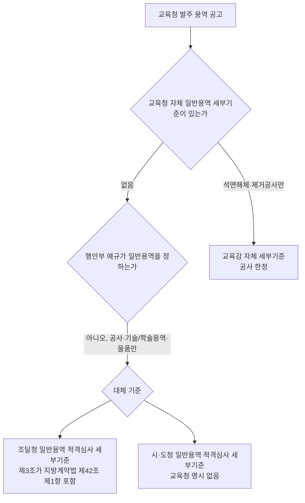

# 시·도교육청·교육지원청·공립 학교·유치원 용역 적격심사 적용 기준 원문 조사

> **작성일**: 2026-10-17
> **작업**: Orca Task `task_1d5a05e79ba5` (builder). 제품 코드와 규칙을 바꾸지 않고 원문만 확인한다.
> **정본 사양**: `.orca/capsules/task_edu_local_basis_20261017/capsule.yaml` (`ORCA_TASK_CAPSULE_V2`)
> **작업 브랜치**: `kwanbum217/orca-edu-local-basis`
> **범위**: 시·도교육청, 교육지원청, 공립 학교·유치원이 발주하는 **용역** 적격심사에 어떤 공식 기준이 적용되는지. 상위 7개 시·도(충청남도, 전북특별자치도, 부산광역시, 충청북도, 경상북도, 대구광역시, 세종특별자치시)의 교육청을 우선 조사했다.
> **확인 날짜**: 2026-10-17.
> **원문 저장 위치**: `.cache/edu_local_basis/` (커밋하지 않는 로컬 산출물). 이 문서는 `.cache/` 를 마크다운 링크로 걸지 않고 인라인 코드로만 언급한다.
> **결론**: 시·도교육청이 일반용역에 적용할 **자체 세부기준**을 둔 사례는 상위 7개 시·도에서 확인되지 않았다. 행정안전부 예규 「지방자치단체 입찰시 낙찰자 결정기준」은 **일반용역 심사기준을 담고 있지 않다**(시설공사·기술·학술연구용역·물품만 규정). 대신 조달청 일반용역 적격심사 세부기준 제3조가 **지방계약법 시행령 제42조 제1항 본문 일반용역 계약**을 심사대상으로 명시하고, 경상북도교육청은 자체 안내에서 일반용역 적용기준을 그 기준으로 적는다. 시·도청 예규가 같은 지역 교육청에도 적용된다고 적은 공식 조문은 확인되지 않았다. 코드와 규칙은 수정하지 않았다.

---

## 1. 목적과 결론

- 목적: 교육 계열 기관(시·도교육청, 교육지원청, 공립 학교·유치원)이 발주하는 용역 적격심사 공고에 어떤 공식 기준이 적용되는지 원문으로 확인한다. 선행 문서 [local_rule_gap_prep_20261015.md](local_rule_gap_prep_20261015.md) 4절이 `institution_sido` 가 시·도를 내지 못하는 991건 중 교육 계열 964건을 남긴 지점을, 코드를 바꾸기 전에 근거부터 확인하는 작업이다.
- 확인할 질문은 셋이다. 1) 시·도교육청 용역 적격심사에 교육청 자체 세부기준(예규·훈령·지침)이 있는가. 2) 없다면 행정안전부 예규 「지방자치단체 입찰시 낙찰자 결정기준」을 직접 적용하는가. 3) 같은 지역 시·도청 예규가 교육청에도 적용된다고 적은 공식 조문이 있는가.

| 질문 | 판정 | 핵심 근거 |
| --- | --- | --- |
| 1) 교육청 자체 용역 세부기준이 있는가 | 상위 7개 시·도에서 **일반용역 자체 세부기준 없음**(미확인). 다만 17개 시·도교육청이 공통으로 **석면해체·제거공사** 자체 세부기준은 둔다 | 5절·6절 |
| 2) 행안부 예규를 직접 적용하는가 | 일반용역에는 **직접 적용되지 않는다**. 행안부 예규 제2장은 시설공사·기술·학술연구용역·물품만 정한다. 대신 **조달청 일반용역 적격심사 세부기준**이 지방계약법 시행령 제42조 제1항 일반용역을 심사대상으로 명시한다 | 3.4절·3.5절 |
| 3) 시·도청 예규가 교육청에 적용된다는 조문이 있는가 | **없다**. 시행령 제42조 제4항은 심사기준을 정하는 주체를 "시·도지사"로, 적용 대상을 "시·도 및 그 시·도의 관할구역에 있는 시·군·자치구"로 한정하고 교육청·교육감을 적지 않는다 | 3.3절 |

- 판정 값은 다음 여섯 가지를 쓴다. **자체 기준 / 행안부 예규 직접 적용 / 시·도청 예규 적용 / 조달청 기준 적용 / 조달청 기준 적용(정황) / 미확인**. 정본 사양의 넷에 다섯째 값 `조달청 기준 적용` 을 추가하는 것은 코디네이터가 승인했고(2026-10-17), 승인 조건에 따라 조달청 기준 제3조를 원문 그대로 인용하고 교육청별 확정/정황을 나눴다.
- `확정` 은 그 교육청 명의의 공식 문서(공문·지침·공고 첨부 머리말)가 적용 기준을 적은 경우만이다. 자료실에 배포만 되어 있으면 `조달청 기준 적용(정황)` 으로 적고 근거 수준 열에 배포 위치를 남긴다.

---

## 2. 판정 기준

선행 문서 [local_annex_reread_20261015.md](local_annex_reread_20261015.md) 2절의 규칙을 그대로 적용했다.

1. 상업 페이지(bidpro, 비드큐, info21c, 모두입찰, korbid, igunsul, 블로그)의 계수·조문은 확정값으로 옮기지 않는다. 제목과 날짜 단서로만 쓴다.
2. 나라장터 첨부나 교육청 자료실 파일은 그 기관 명의 규정일 때만 원문으로 본다. 자료실 **배포**와 **적용 선언**은 다르다. 배포만 확인되면 정황으로 적는다.
3. 공식 출처는 국가법령정보센터(law.go.kr), 자치법규정보시스템(elis.go.kr), 행정안전부 누리집, 조달청 누리집, 교육청 공식 누리집이다.
4. 접속 실패, DNS 실패, 시간 초과는 문서가 없다는 증거가 아니다. 그 사실을 그대로 적는다.
5. 원문을 찾지 못한 것은 조사 결과이지 차단이 아니다. `미확인` 은 차단이 아니다.

---

## 3. 법적 틀 원문

### 3.1 지방계약법 제2조(적용범위)와 제3조(교육·과학 및 체육에 관한 사항의 적용)

법제처 법령해석 24-0673(2024. 10. 29.)이 두 조문을 다음과 같이 정리한다.

- 제2조: "지방계약법 제2조에서는 이 법은 지방자치단체가 계약상대자와 체결하는 수입 및 지출의 원인이 되는 계약 등에 대하여 적용한다고 규정하여 지방계약법의 적용 범위를 정하고 있는데"
- 제3조: "지방계약법 제3조에서 이 법에서 교육ㆍ과학 및 체육에 관한 사항에 관하여는 "지방자치단체의 장" 또는 "특별시장ㆍ광역시장ㆍ도지사"는 "교육감"으로 본다고 규정하고 있는 점에 비추어 볼 때, 지방계약법의 적용 범위에 지방자치단체의 장을 집행 및 대표기관으로 하여 체결되는 계약뿐만 아니라 교육감을 집행 및 대표기관으로 하여 교육청에서 체결되는 계약도 포함되는 것이 명확하므로"

### 3.2 교육청의 지위 — 법제처 법령해석 24-0673

같은 해석은 교육청과 공립학교의 법적 지위를 다음과 같이 정리한다.

- "지방자치단체는 법인으로서 '특별시, 광역시, 특별자치시, 도, 특별자치도' 및 '시, 군, 구'로 구분되고"
- "법인격을 갖는 하나의 지방자치단체(시ㆍ도)에 사무의 영역에 따라 지방자치단체의 장(시ㆍ도지사)과 교육감이 별개의 집행 및 대표기관으로 병존하는 한편, '교육청'은 교육감을 보조하는 기관 및 교육감 소속으로 설치된 기관으로서 별도의 법인격 없이 지방자치단체(시ㆍ도)의 기관으로 기능하는바"
- "공립학교는 「초ㆍ중등교육법」 제3조제2호 등에 따라 지방자치단체가 설립ㆍ경영하도록 하고 별도의 법인격을 가지고 있지 않아 지방자치단체의 기관으로 기능하는바"

- 즉 **교육청·공립학교는 별도 법인격 없는 시·도(지방자치단체)의 기관**이고, **교육 사무에서는 교육감이 지방계약법상 "지방자치단체의 장"으로 본다**.
- 공립 유치원도 「유아교육법」상 공립 유치원은 지방자치단체가 설립·경영하는 기관으로 같은 법리에 놓인다. 이 문서는 유치원에 대한 별도 조문을 확인하지 않았고, 공립학교와 같은 계열로만 적는다(9절).

### 3.3 시행령 제42조(재정지출의 부담이 되는 입찰에서의 낙찰자 결정)

현행 조문(시행 2024. 2. 13. 기준) 중 심사기준 위임 부분은 다음과 같다.

- 제42조 제2항: "제1항에 따른 계약이행능력의 심사는 해당 입찰자의 이행실적, 기술능력, 재무상태, 과거 계약이행 성실도, 자재 및 인력 조달가격의 적정성, 하도급관리계획 및 외주근로자 근로조건 이행계획의 적정성, 계약질서의 준수 정도, 과거 실적의 품질 정도 및 입찰가격 등을 종합적으로 고려하여 **행정안전부장관이 정하는 심사기준**에 따라 적격 여부를 심사하며, 그 심사 결과 적격하다고 인정되는 경우 그 입찰자를 낙찰자로 결정한다."
- 제42조 제3항: "**지방자치단체의 장**은 제2항에도 불구하고 공사 또는 물품ㆍ용역 등의 특성상 필요하다고 인정되는 경우에는 **행정안전부장관과의 협의를 거쳐** 행정안전부장관이 정한 심사기준과 달리하여 심사기준을 정할 수 있다."
- 제42조 제4항: "행정안전부장관이 별도로 심사기준을 정하지 아니한 경우에는 **시ㆍ도지사**가 특별시ㆍ광역시ㆍ특별자치시ㆍ도ㆍ특별자치도(이하 "시ㆍ도"라 한다) **및 그 시ㆍ도의 관할구역에 있는 시ㆍ군ㆍ자치구**(이하 "시ㆍ군ㆍ구"라 한다)에 적용하는 심사기준을 정할 수 있다. 이 경우 시ㆍ도지사는 해당 심사기준에 대해 15일 이상의 시행 유예기간을 두어야 한다."

- **제4항이 심사기준을 정하는 주체로 적은 것은 "시·도지사"이고, 적용 대상은 "시·도 및 관할 시·군·자치구"다. 교육청·교육감은 조문에 없다.** 이것이 3번 질문에 대한 직접 답이다.
- 제3항은 "지방자치단체의 장"이 행안부 협의를 거쳐 달리 정할 수 있다고 한다. 법 제3조에 따라 교육 사무에서 "지방자치단체의 장"은 교육감이므로, 교육감이 자체 세부기준을 정할 수 있는 통로는 제3항이다. 다만 행정안전부장관과의 **협의**가 조건이다.

### 3.4 행안부 예규 「지방자치단체 입찰시 낙찰자 결정기준」(제373호, 시행 2026. 7. 1.)은 일반용역을 담지 않는다

- 현행본은 행정안전부 예규 제373호(2026. 6. 29. 일부개정, 시행 '26.7.1.)다. 첨부 원문(HWPX)을 내려받아 본문을 추출했다(`.cache/edu_local_basis/mois_373_lowest.hwpx` → `.cache/edu_local_basis/mois373_text.txt`).
- 제2장 적격심사 기준의 목적 조는 적용 대상을 다음처럼 한정한다.

> 이 기준은 시행령 제42조 제2항에 따라 지방자치단체에서 집행하는 **시설공사, 기술·학술용역, 물품계약**에 적용할 적격심사 공통기준(이하 "공통기준"이라 한다)을 정함을 목적으로 하며, 시설공사, 기술·학술용역, 물품 계약별 구분하여 적용할 사항은 각 세부기준에서 별도로 정함을 목적으로 한다.

- 제2장의 하위 장은 **제2장의1 시설공사 적격심사 세부기준**, **제2장의2 기술·학술연구 용역 적격심사 세부기준**, **제2장의3 물품 적격심사 세부기준** 뿐이다(추출 본문 장 제목 대조).
- **일반용역(청소·경비·시설관리·폐기물처리·육상운송·보험·수리점검 등)을 정하는 장은 없다.** 따라서 일반용역에서 행안부 예규를 "직접 적용"한다는 판정은 성립하지 않는다.

### 3.5 조달청 일반용역 적격심사 세부기준 제3조는 지방계약법 일반용역을 포함한다

- 문서: 조달청 일반용역 적격심사 세부기준 [시행 2025. 9. 1.] [조달청공고 제2025-257호, 2025. 6. 26., 일부개정]. 출처: 국가법령정보센터 행정규칙(admRulSeq 2100000260962), 조달청 고시 게시판.
- 제3조(심사대상) 원문(그대로 인용):

> 이 세부기준에 따른 심사는 「국가계약법 시행령」 제42조제1항 및 **지방자치단체를 당사자로 하는 계약에 관한 법률 시행령」(이하 "「지방계약법 시행령」"이라 한다) 제42조 제1항 본문에 해당하는 용역계약 중 제2조의 일반용역 계약** 또는 그에 준하는 용역 계약에서 계약이행능력을 심사하여 낙찰자를 결정하는 입찰을 대상으로 한다. 다만, 주무부처에서 관련법령에 따라 별도의 심사기준을 정한 경우에는 그 기준에 따른다.

- 제2조 제1호는 일반용역을 "「지방계약법」 제5조에 따른 용역 중 … 학술연구용역, 청소용역, 시설물경비용역, 시설물관리용역, 소프트웨어용역, 폐기물처리용역, 육상운송용역, 보험용역 및 수리ㆍ점검용역 등 … 나머지 모든 종류의 용역"으로 정의한다.
- 제12조 제2항도 "지방계약법령을 적용받는 입찰에 한하여 「지방계약법 시행령」제92조에 따라 입찰참가자격 제한조치를 하여야 한다"고 적어, 이 기준이 지방계약 입찰까지 상정한다.
- 정리: 조달청 기준은 제1조 목적 조에서 "조달청에서 집행하는 일반용역 입찰"이라 하지만, **제3조가 심사대상을 지방계약법 시행령 제42조 제1항 본문 일반용역까지 확장**한다. 지방자치단체(교육청 포함)가 자체 일반용역 세부기준을 두지 않은 경우 이 기준을 준용하는 실무 근거가 된다.

---

## 4. 상위 7개 시·도교육청 판정 표

`근거 수준` 은 `확정`(교육청 명의 공식 문서가 적용을 적음)과 `정황`(자료실 배포 등 간접 단서만)으로 나눈다.

| 시·도교육청 | 자체 일반용역 세부기준 | 자체 석면해체·제거공사 세부기준 | 적용된다고 확인된 기준 | 판정 | 근거 수준 | 출처 |
| --- | --- | --- | --- | --- | --- | --- |
| 충청남도교육청 | 미확보 | 있음 (시행 2021.6.15) | 미확보 | 미확인 | - | cne.go.kr (자체 공사 기준 제목·시행일만 단서, 공식 URL 미확보) |
| 전북특별자치도교육청 | 미확보 | 있음 (고시 제2023-14호, 2023.6.14) | 조달청 일반용역 적격심사 세부기준(서식 배포) | 조달청 기준 적용(정황) | 정황 | jbe.go.kr 부서자료실 (재무과, 2022-10-04) |
| 부산광역시교육청 | 미확보 | 있음 (공고 제2023-364호, 2023.7.28 적용) | 미확보 | 미확인 | - | pen.go.kr 고시/공고 |
| 충청북도교육청 | 미확보 | 있음 (2025.7.1 시행) | 미확보 | 미확인 | - | cbe.go.kr 입찰자료실 |
| 경상북도교육청 | 미확보 | 미확보 | 조달청 일반용역 적격심사 세부기준 | 조달청 기준 적용 | 확정 | gbe.kr 학교지원종합자료실 (재무과) |
| 대구광역시교육청 | 미확보 | 있음 (2025.8.7 시행) | 미확보 (자료실에 행안부 예규 배포) | 미확인 | - | dge.go.kr 계약정보 자료실 |
| 세종특별자치시교육청 | 미확보 | 미확보 | 미확보 | 미확인 | - | sje.go.kr (적격심사 기준 원문 미확보) |

- **일반용역 자체 세부기준을 둔 교육청은 상위 7개에서 0곳**이다. `자체 기준` 판정 행은 넷 중 어디에도 서지 않았다.
- `확정` 행은 경상북도교육청 1건이다. 5.5절에 인용한다.
- 나머지 5곳은 `미확인` 이다. 원문을 찾지 못한 것은 조사 결과이며 차단이 아니다.

---

## 5. 시·도별 상세

### 5.1 충청남도교육청

| 항목 | 값 |
| --- | --- |
| 자체 용역 기준 | 미확보 |
| 자체 석면해체·제거공사 기준 | 충남교육청 석면 해체 제거공사 적격심사 세부기준, 시행 2021.6.15 (제목·시행일 단서만 확인, 공식 URL 미확보) |
| 시·도청 예규 | 충청남도 일반용역 적격심사 세부기준, 충청남도 공고 2026-1235호, 2026.7.13 입찰공고부터 적용 |
| 판정 | 미확인 |

- 충청남도 예규의 적용 범위 조문: "이 기준은 '지방자치단체를 당사자로 하는 계약에 관한 법률 시행령'(이하 "시행령"이라 한다) 제42조 제4항에 따라 **충청남도 및 관할 시·군**에서 집행하는 일반용역 계약에 적용할 적격심사 세부기준을 정함을 목적으로 한다." — **교육청·교육감은 명시되지 않는다.**
- 충남교육청 자체 문서로는 계약심사업무 처리규칙(자치법규, law.go.kr ordinSeq 1240679)이 확인되나 이는 **계약심사** 규칙이지 적격심사 세부기준이 아니다.
- 접속: 충남교육청 누리집(cne.go.kr)은 접속되나, 자체 용역 적격심사 세부기준 문서는 검색·자료실에서 확인하지 못했다.

### 5.2 전북특별자치도교육청

| 항목 | 값 |
| --- | --- |
| 자체 용역 기준 | 미확보 |
| 자체 석면해체·제거공사 기준 | 전라북도교육청 학교석면 해체·제거공사 적격심사 세부기준, 전라북도교육청 고시 제2023-14호, 2023.6.14 (시행 2023.6.14, 2023.7.1 이후 입찰공고분 적용) |
| 시·도청 예규 | 전북특별자치도 일반용역 적격심사 세부기준, 전북특별자치도 고시 제2024-10호, 2024.1.18 시행 |
| 교육청 조달청 기준 배포 | 있음 (부서자료실, 재무과) |
| 판정 | 조달청 기준 적용(정황) |

- 교육청 부서자료실 게시물 제목은 "조달청 일반용역 적격심사 세부기준 제5조1항제5호(여객운송용역) 적격심사 제출 서류 목록"이고, 첨부 파일명이 "[별표5]여객육상운송용역적격심사(**조달청일반용역적격심사세부기준**).hwp", "[별지2]적격심사자기평가및심사표(**조달청일반용역적격심사세부기준**).hwp" 등이다. 작성자는 **재무과**. 즉 교육청이 조달청 일반용역 기준 서식을 자기 업무에 맞춰 배포한 정황이다.
- 다만 그 문서가 "우리 교육청 용역 적격심사에는 조달청 기준을 적용한다"고 **선언**한 공문·지침은 확인하지 못했다. 그래서 `확정` 이 아니라 `조달청 기준 적용(정황)` 이다.
- 전북특별자치도 예규의 적용 범위: "제42조 제4항에 따라 전북특별자치도(시·군·구 등)가 집행하는 일반용역 계약에 적용할 적격심사 세부기준" — 교육청은 명시되지 않는다.

### 5.3 부산광역시교육청

| 항목 | 값 |
| --- | --- |
| 자체 용역 기준 | 미확보 |
| 자체 석면해체·제거공사 기준 | 부산광역시교육청 석면해체·제거공사 적격심사 세부기준, 부산광역시교육청 공고 제2023-364호, 2023.7.28 입찰공고분부터 적용 |
| 시·도청 예규 | 부산광역시 일반용역 적격심사 세부기준, 부산광역시 공고 제2025-1981호, 2025.6.10 (시행 2025.6.26) |
| 판정 | 미확인 |

- 부산광역시 예규의 적용 범위: "제42조 제4항에 따라 **부산광역시(소속 행정기관 및 구·군 포함)**에서 집행하는 일반용역 입찰의 낙찰자 결정에 적용할 적격심사 세부기준" — **교육청은 부산광역시 소속 행정기관이 아니므로 이 문구에 포함되지 않는다.**
- 상업 페이지 일부는 부산광역시교육청 공고의 적격심사기준을 "부산광역시교육청 적격심사 세부기준 적용"으로 표기하나, 규칙 1·2에 따라 **상업 페이지 표기는 확정값으로 쓰지 않는다.** 교육청 명의 원문 미확보다.
- 부산광역시교육청 누리집(pen.go.kr) 고시/공고에 자체 석면 공사 기준은 있으나, 일반용역 적격심사 세부기준 문서는 확인하지 못했다.

### 5.4 충청북도교육청

| 항목 | 값 |
| --- | --- |
| 자체 용역 기준 | 미확보 |
| 자체 석면해체·제거공사 기준 | 충청북도교육청 석면 해체ㆍ제거공사 적격심사 세부기준 (입찰자료실 게시: 2025.7.1 시행 개정, 2023.6.7 개정 공고 제2023-170호) |
| 시·도청 예규 | 충청북도 일반용역 적격심사 세부기준, 충청북도 공고 제2023-1428호, 2023.10.20 시행 |
| 판정 | 미확인 |

- 충청북도 예규의 적용 범위: "제42조 제4항에 따라 **충청북도 및 도의 관할구역에 있는 시·군**에서 발주하는 일반 용역에 적용할 적격심사 세부기준" — 교육청은 명시되지 않는다.
- 충청북도교육청 입찰자료실(cbe.go.kr) 전체 36건 중 적격심사 관련은 자체 석면 공사 기준 2건뿐이고, 일반용역 기준은 없다.

### 5.5 경상북도교육청 (확정)

| 항목 | 값 |
| --- | --- |
| 자체 용역 기준 | 미확보 |
| 자체 석면해체·제거공사 기준 | 미확보 |
| 적용 기준 (교육청 명의 안내) | **조달청 일반용역 적격심사 세부기준** |
| 시·도청 예규 | 경상북도 일반용역 등 적격심사 세부기준, 경상북도 예규 제1559호 (ELIS) |
| 판정 | 조달청 기준 적용 |
| 근거 수준 | 확정 |

- 경상북도교육청 학교지원종합자료실의 "입찰 및 개찰, 적격심사" 안내(담당부서 재무과, 업데이트 2026-03-31)는 적격심사 **적용기준**을 다음처럼 적는다.

> 용역 / 기술용역 / **낙찰자 결정기준 제3장(기술용역 적격심사 세부기준)**
> 용역 / 일반용역 / **조달청 일반용역 적격심사 세부기준**
> 조달청 일반용역 적격심사 세부기준 [조달청공고 제2025-257호, 2025. 6. 26. 시행: 2025. 9. 1.]

- 이것은 경상북도교육청 명의의 공식 안내 문서가 일반용역 적용기준을 조달청 기준으로 명시한 사례다. 규칙 2의 확정 조건(교육청 명의 공식 문서가 적용을 적음)에 해당한다.
- 같은 표에서 물품·공사 일부는 행안부 "낙찰자 결정기준"의 장을 인용하나, 일반용역만은 조달청 기준을 가리킨다. 이는 3.4절(행안부 예규에 일반용역 없음)과 일치한다.

### 5.6 대구광역시교육청

| 항목 | 값 |
| --- | --- |
| 자체 용역 기준 | 미확보 |
| 자체 석면해체·제거공사 기준 | 대구광역시교육청 석면해체·제거공사 적격심사 세부기준, 2025.8.7 시행 |
| 시·도청 예규 | 대구광역시 일반용역 적격심사 세부기준, 대구광역시 예규 제238호, 2026.5.11 시행 (ELIS) |
| 자료실 배포 | 행안부 「지방자치단체 입찰시 낙찰자 결정기준」 HWP 배포 |
| 판정 | 미확인 |

- 대구광역시교육청 알림마당 > 계약정보 > 계약정보 자료실에 "지방자치단체 입찰시 낙찰자 결정기준 [시행 2018.12.1.] [행정안전부 예규 제48호].hwp" 등 행안부 예규 파일을 배포한 이력이 있다. 다만 행안부 예규는 일반용역을 담지 않으므로(3.4절) 이것만으로 일반용역 적용 기준을 확정할 수 없다.
- 대구광역시 예규의 적용 범위: "제42조 제4항에 따라 **대구광역시에서 집행하는** 일반용역 계약에 적용할 적격심사 세부기준" — 교육청은 명시되지 않는다.
- 교육청 자체 석면 공사 기준(yesform 게시 목적 조)은 적용 대상을 "대구광역시교육청[소속기관 및 사립학교(사립유치원 제외)]에서 집행하는 석면해체·제거공사의 낙찰자 결정"으로 적어, 공사에 한정한다.

### 5.7 세종특별자치시교육청

| 항목 | 값 |
| --- | --- |
| 자체 용역 기준 | 미확보 |
| 자체 석면해체·제거공사 기준 | 미확보 |
| 시·도청 예규 | 세종특별자치시 일반용역 적격심사 세부기준, 세종특별자치시 예규 제32호, 2025.12.1 시행 (ELIS) |
| 판정 | 미확인 |

- 세종특별자치시 예규의 적용 범위: "제42조제4항에 따라 **세종특별자치시에서 집행하는** 일반용역 계약에 적용할 적격심사 세부기준" — 교육청은 명시되지 않는다.
- 세종특별자치시교육청 누리집(sje.go.kr)에서 자체 용역 적격심사 기준 문서는 확인하지 못했다(누리집 접속은 되나 자료 미확보).

---

## 6. 시·도청 일반용역 예규 적용 범위 조문 대조 (상위 7개)

각 예규는 시행령 제42조 제4항을 근거로 걸고, 적용 대상을 시·도 및 관할 시·군(구)으로 적는다. **어느 예규도 교육청·교육감을 명시하지 않는다.**

| 시·도 | 문서명 | 발령 번호 | 시행 | 적용 범위 조문(발췌) | 일반용역 입찰가격 평가 식 소재 |
| --- | --- | --- | --- | --- | --- |
| 충청남도 | 충청남도 일반용역 적격심사 세부기준 | 공고 2026-1235호 | 2026.7.13 입찰공고부터 | "충청남도 및 관할 시·군에서 집행하는 일반용역 계약" | 자체 별표(원문 별표 2·3·4, 선행 문서 local_annex_reread 4절) |
| 전북특별자치도 | 전북특별자치도 일반용역 적격심사 세부기준 | 고시 제2024-10호 | 2024.1.18 | "전북특별자치도(시·군·구 등)가 집행하는 일반용역 계약" | 자체 별표 |
| 부산광역시 | 부산광역시 일반용역 적격심사 세부기준 | 공고 2025-1981호 | 2025.6.26 | "부산광역시(소속 행정기관 및 구·군 포함)에서 집행하는 일반용역 입찰" | 자체 별표 |
| 충청북도 | 충청북도 일반용역 적격심사 세부기준 | 공고 2023-1428호 | 2023.10.20 | "충청북도 및 도의 관할구역에 있는 시·군에서 발주하는 일반 용역" | 자체 별표 |
| 경상북도 | 경상북도 일반용역 등 적격심사 세부기준 | 예규 제1559호 | ELIS 현행(histNo 008·009) | "제42조제1항 본문에 해당하는 용역계약 중 제2조의 용역 계약(일반용역, 단순노무용역, 정보통신용역, 폐기물처리…)" | 자체 별표 |
| 대구광역시 | 대구광역시 일반용역 적격심사 세부기준 | 예규 제238호 | 2026.5.11 | "대구광역시에서 집행하는 일반용역 계약" | 자체 별표 |
| 세종특별자치시 | 세종특별자치시 일반용역 적격심사 세부기준 | 예규 제32호 | 2025.12.1 | "세종특별자치시에서 집행하는 일반용역 계약" | 자체 별표 |

- 시·도 예규는 모두 **자체 별표**에 입찰가격 평점산식을 인쇄한다. 행안부 예규의 일반용역 준용 조항은 없다(행안부 예규에 일반용역 장 자체가 없음).
- 교육청 관할을 적은 예규는 0건이다. 시·도지사가 제4항으로 정한 기준이 교육감(교육청) 계약에 미치는지는 조문상 명시가 없어 해석 문제로 남는다(3.3절).

---

## 7. 코드 반영 시 무엇이 필요한가 (구현하지 않음)

이 절은 판단 근거만 적고 코드·규칙은 고치지 않는다.

- 현재 `institution_sido`(`src/app/services/demand_institutions.py`)는 `toplvl_instt_nm`(시·도 본청)을 기준으로 시·도를 내고, "교육청·공단처럼 본청이 아닌 값은 (None, None) 으로 두어 시·도 규칙에서 제외"한다. 그 결과 교육 계열 공고는 `LOCAL_RULE_NOT_FOUND` 로 간다.
- 원문 확인 결과가 코드 변경 방향에 주는 제약은 셋이다.
  1. **시·도청 예규를 교육청 공고에 자동으로 붙이는 근거가 없다.** 시행령 제42조 제4항은 주체를 시·도지사로, 대상을 시·도 및 관할 시·군·자치구로 한정하고 교육청을 적지 않는다(3.3절). `institution_sido` 가 교육청에 시·도를 돌려주도록 바꾸는 것만으로는 공식 근거가 서지 않는다.
  2. **행안부 예규를 일반용역에 직접 적용하는 근거도 없다.** 행안부 예규 제2장은 일반용역을 담지 않는다(3.4절).
  3. **현재 확인된 지방계약 근거는 조달청 일반용역 적격심사 세부기준 제3조**다. 이 조문이 지방계약법 시행령 제42조 제1항 본문 일반용역을 심사대상으로 명시하므로, 교육청이 자체 기준을 두지 않은 일반용역에 이 기준을 준용하는 경로가 가장 근거가 분명하다. 경상북도교육청 안내가 실제로 그렇게 적는다(5.5절).
- 따라서 새 규칙 집합을 만들 경우의 선택지는 다음뿐이다.
  - (가) 교육청(교육감) 자체 세부기준이 공문·지침으로 확인된 시·도만 그 기준으로 등록한다. 현재 상위 7개에서 0건이다.
  - (나) 조달청 일반용역 적격심사 세부기준을 교육청 일반용역 기본값으로 등록하고, 시·도청 예규를 붙이지 않는다.
  - (다) 소재 시·도 예규를 교육청에 적용할 공식 근거를 별도로 확보한 뒤에만 등록한다.
- 어느 안도 이 문서에서 확정하지 않는다. 판정은 `candidate` 다. 우선순위와 등록 방식은 사용자 결정과 별도 Task 로 진행한다.

---

## 8. 이 문서가 하지 않은 것

| 항목 | 상태 |
| --- | --- |
| 지역 규칙 등록 | 없음. `LOCAL_RULES` 및 `src/` 변경 없음 |
| 코드·규칙 수정 | 없음. `institution_sido` 및 판정 함수 미변경 |
| 우선순위 결정 | 없음. 어느 시·도를 먼저 등록할지 고르지 않음 |
| 발행 원장 | 없음. `data/reference/rule_coverage_ledger.yaml` 수정·재생성 없음 |
| 원문 신규 등록 | 없음. 받은 원문은 `.cache/edu_local_basis/` 에만 두고 커밋하지 않음 |
| 상위 7개 외 시·도 | 조사하지 않음(시간 범위) |
| 계수·배점 확정 | 없음. 일반용역 입찰가격 평가 식의 계수는 이 문서에서 확정하지 않음 |

---

## 9. 한계

| 항목 | 내용 |
| --- | --- |
| 자체 용역 기준 부재 | 상위 7개 교육청 모두 자체 일반용역 세부기준 원문을 찾지 못했다. "없다"가 아니라 "이 조사에서 확인되지 않았다"다. |
| 부산·대구 정황 | 상업 페이지 표기(부산)와 자료실 배포(대구)는 있으나 교육청 명의 적용 선언이 아니어서 확정하지 않았다. |
| 경북 단서 형태 | 5.5절 확정 근거는 교육청 누리집 안내(지침 성격)다. 공문 원본은 확인하지 않았다. |
| 유치원 | 공립 유치원에 대한 별도 조문을 확인하지 않았다. 공립학교와 같은 계열(시·도 기관)로만 적었다. |
| 법령 본문 | law.go.kr 개별 법령 페이지는 스크립트 렌더링으로 본문 직접 추출이 되지 않아, 법제처 법령해석 24-0673의 인용과 시행령 제42조 텍스트(공개 DB)로 대체했다. |
| 접속 | ELIS 교육자치법규 목록(elis.go.kr/edulaw/eduLawList)은 응답 시간 초과(504)로 본문을 받지 못했다. 이는 문서 부재의 증거가 아니다. |
| 범위 | 상위 7개 시·도만 조사했다. 나머지 시·도는 넓히지 않았다. |

---

## 10. 검증 실행

| 명령 | 결과 |
| --- | --- |
| `python3 scripts/validate_agent_rules.py --quiet` | `검증 통과: 21/21 건.` (종료 코드 0) |

---

## 11. 변경 파일

| 항목 | 값 |
| --- | --- |
| 이 작업의 커밋 산출물 | `docs/analysis/edu_local_rule_basis_20261017.md` 1개 |
| 코드·설정·패키지 | 변경 없음 |
| 원문·추출물 | `.cache/edu_local_basis/` 아래, 커밋하지 않음 |
| 완료 보고 | `.orca/capsules/task_1d5a05e79ba5/worker_done.json` (`.orca/` 는 gitignore 대상, 커밋하지 않음) |

---

## 12. 출처

- 국가법령정보센터 행정규칙 「조달청 일반용역 적격심사 세부기준」 [시행 2025.9.1.] [조달청공고 제2025-257호] (admRulSeq 2100000260962)
- 국가법령정보센터 행정규칙 「지방자치단체 입찰시 낙찰자 결정기준」 [시행 2026.7.1.] [행정안전부예규 제373호]
- 행정안전부 훈령·예규·고시 게시판 「지방자치단체 입찰 및 계약집행기준(제372호) 및 지방자치단체 입찰시 낙찰자 결정기준(제373호) 일부 개정」(2026.6.29.)
- 법제처 법령해석 24-0673 (2024.10.29.) — 교육청·공립학교의 지방계약법 적용
- 「지방자치단체를 당사자로 하는 계약에 관한 법률 시행령」 제42조 (시행 2024.2.13.)
- ELIS 대구광역시 일반용역 적격심사 세부기준 (alrNo 27000005004039)
- ELIS 세종특별자치시 일반용역 적격심사 세부기준 (alrNo 36110115281011)
- ELIS 경상북도 일반용역 등 적격심사 세부기준 (alrNo 47000006006048)
- 충청남도 계약정보공개시스템 / 충청남도 일반용역 적격심사 세부기준 (공고 2026-1235호)
- 부산광역시 입찰 계약 법규 (부산광역시 일반용역 적격심사 세부기준, 공고 2025-1981호)
- 경상북도교육청 학교지원종합자료실 「입찰 및 개찰, 적격심사」(재무과)
- 전북특별자치도교육청 부서자료실 (재무과, 2022-10-04, 조달청 일반용역 적격심사 세부기준 서식)
- 부산광역시교육청 고시/공고 (부산광역시교육청 석면해체·제거공사 적격심사 세부기준, 공고 제2023-364호)
- 전라북도교육청 고시 (전라북도교육청 학교석면 해체·제거공사 적격심사 세부기준, 고시 제2023-14호)
- 충청북도교육청 입찰자료실 (석면 해체·제거공사 적격심사 세부기준)
- 대구광역시교육청 알림마당 계약정보 자료실
- 충청남도교육청 계약심사업무 처리규칙 (law.go.kr ordinSeq 1240679)
