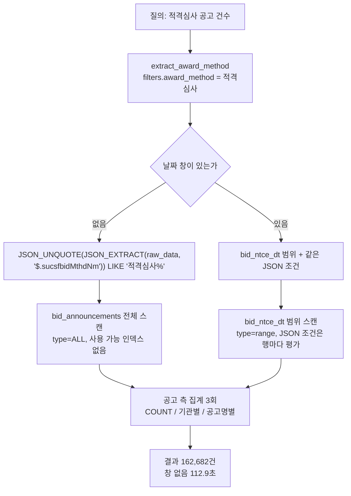

# 날짜 창이 없을 때 적격심사 건수 조건의 raw_data JSON 스캔 비용

> **작성일**: 2026-11-02
> **작성자**: Orca Worker (task_71f974178f18)
> **기준 브랜치**: `kwanbum217/eligibility-json-scan-20261102`
> **대상 코드**: `src/rag/structured_data.py`, `src/rag/query_planning.py`
> **범위**: 읽기 전용 조사 기록. 코드·스키마·마이그레이션·인덱스를 바꾸지 않는다.
> **결론**: 날짜 창이 없으면 공고 5,560,232행 전체를 훑어 112.9초가 걸리고, 요청 한 번에 같은 스캔이 3회 발행된다. 스키마를 지키는 대응은 창 하한 적용과 집계 단일화이며, 별도 컬럼·함수 인덱스는 스키마 변경이라 사용자 결정 사항으로 남긴다.

---

## 1. 요약

- `award_method=적격심사` 조건은 `raw_data.sucsfbidMthdNm` 을 JSON 추출해 접두 일치로 비교합니다. 값이 JSON 본문 안에만 있어 어떤 인덱스도 쓰지 못합니다.
- 날짜 창이 없으면 `bid_announcements` 전체 5,560,232행(데이터 28.0GB)을 스캔합니다. 실측 112.9초였고, 같은 조건으로 162,682건이 나옵니다.
- 건수 질의 한 번에도 공고 측 집계 세 개(`announcement_total`, `institution_ranking`, `announcement_ranking`)가 같은 조건을 각각 발행합니다. 병렬 실행이지만 DB 작업량은 단일 스캔의 약 3배입니다.
- 전체 162,682건은 모두 2024-01-01 이후 공고입니다. 창 하한을 2024-01-01 로 두면 결과가 그대로면서 112.9초가 35.0초로 줄어듭니다.
- 이번 작업은 조사 문서 한 장만 남깁니다. 스키마·코드·설정 변경은 하지 않았습니다.

---

## 2. 조건이 만들어지고 실행되는 경로

### 2.1 조건 생성

`src/rag/query_planning.py:1510` 의 `extract_award_method` 가 목록·건수·통계 의도를 가진 질의에서만 `filters["award_method"] = "적격심사"` 를 세웁니다. 정의를 묻는 질의는 기존 의미 검색 경로로 남습니다.

`src/rag/structured_data.py:618` 의 `_announcement_award_method_condition` 이 다음 조건을 만듭니다.

```sql
JSON_UNQUOTE(JSON_EXTRACT(raw_data, '$.sucsfbidMthdNm')) LIKE '적격심사%'
```

`src/rag/structured_data.py:677` 에서 이 조건이 `_announcement_conditions` 에 합쳐집니다. 날짜 창(`date_from`, `date_to`, `recent_days`, `relative_years`)이 없으면 이 JSON 조건만 남고, 조건을 좁힐 다른 술어가 없으면 테이블 전체가 대상이 됩니다.

### 2.2 실행 경로



---

## 3. 실행 계획과 스키마

### 3.1 EXPLAIN

| 조건 | type | key | 추정 rows | Extra |
| --- | --- | --- | ---: | --- |
| 날짜 창 없음 | `ALL` | 없음 | 2,133,888 | `Using where` |
| `bid_ntce_dt >= '2024-01-01'` | `range` | `bid_announcements_bid_ntce_dt_c42f1afb` | 1,066,944 | `Using index condition; Using where` |

날짜 창이 없을 때 `possible_keys` 가 비어 있습니다. JSON 식에는 쓸 인덱스가 없고, 옵티마이저는 전체 스캔을 고릅니다. `filtered` 는 두 경우 모두 100.0 으로, LIKE 선택도를 추정하지 못합니다.

`bid_announcements` 의 인덱스는 모두 일반 컬럼 조합입니다. `information_schema.statistics` 에 `expression` 이 있는 함수 인덱스는 없고, `raw_data` 를 포함한 인덱스도 없습니다.

### 3.2 행 규모

| 항목 | 값 | 출처 |
| --- | ---: | --- |
| 실제 행 수 | 5,560,232 | `SELECT COUNT(*)` |
| `information_schema.TABLE_ROWS` | 2,133,888 | 통계 추정값 |
| 데이터 크기 | 28,000,124,928 바이트 (28.0GB) | `information_schema.tables` |
| 인덱스 크기 | 4,080,205,824 바이트 (4.08GB) | `information_schema.tables` |
| 평균 행 길이 | 13,121 바이트 | `information_schema.tables` |
| 표본 `raw_data` 평균 길이 | 5,293 바이트 | 199,991행 표본 |
| MySQL 버전 / 버퍼 풀 | 8.0.46 / 2,147,483,648 바이트 (2GiB) | `VERSION()`, `@@innodb_buffer_pool_size` |

실제 행 수와 통계 추정값이 2.6배 차이납니다. `EXPLAIN` 의 `rows` 나 `TABLE_ROWS` 로 비용을 가늠하면 과소평가합니다.

연도 구간별 행 수는 다음과 같습니다.

| 구간 | 행 수 | 비고 |
| --- | ---: | --- |
| 2024-01-01 이후 | 1,420,819 | 2024년 507,230 + 2025년 506,785 + 2026년 406,804 |
| 2024-01-01 이전 또는 NULL | 4,139,413 | 전체에서 위 값을 뺀 값 |

---

## 4. 실측 비용

측정은 `uv run python scripts/db_readonly_query.py --sql ...` 로 한 문장씩 실행했습니다. 스크립트 기동·연결 오버헤드는 별도 측정에서 0.292초였습니다.

| 범위 | 스캔 행 수 | 실측 시간 | 결과 건수 | 비고 |
| --- | ---: | ---: | ---: | --- |
| 날짜 창 없음 | 5,560,232 | 112.876초 | 162,682 | 전체 스캔 |
| 2024-01-01 이전 또는 NULL | 4,139,413 | 100.637초 | 0 | 2024년 이전 적격심사 0건 확인 |
| 2024-01-01 이후 | 1,420,819 | 35.029초 | 162,682 | 창 없음과 결과 동일 |
| 최근 30일 | 약 40,000 | 1.125초 | 6,277 | `DATE_SUB(CURDATE(), INTERVAL 29 DAY)` |
| id 6,000,000~6,200,000 표본 | 199,991 | 5.660초 / 5.424초 | 1,215 | 같은 표본 재실행도 5.4초 |

### 4.1 해석

- 스캔 처리량은 행당 20~27마이크로초, 초당 약 4만 행으로 일정합니다. 표본 재실행이 5.66초에서 5.42초로 거의 줄지 않은 것은 비용이 디스크 I/O 가 아니라 행마다 JSON 을 파싱하는 CPU 작업임을 보여줍니다.
- 5,560,232행 × 5,293바이트 ≈ 29.4GB 로, 테이블 데이터 크기 28.0GB 와 일치합니다. 원본 JSON 을 사실상 전부 읽는 셈입니다.
- 2024년 이전 구간을 따로 세어도 0건입니다. `sucsfbidMthdNm` 값은 2024년 이후 공고에만 채워져 있으며, `src/rag/answer_format.py:216` 의 기존 안내 문구와 같은 사실입니다.
- 창을 좁히면 비용이 스캔 행 수에 거의 비례합니다. 최근 30일은 1.1초입니다.

### 4.2 요청 한 번에 반복되는 스캔

`retrieve_structured_data` 는 `src/rag/structured_data.py:3506` 에서 공고 측 집계 세 개를 항상 실행합니다.

| 집계 | 위치 | 조건 사용 |
| --- | --- | --- |
| `announcement_total` (COUNT) | `src/rag/structured_data.py:3410` | `announcement_conditions` |
| `institution_ranking` (기관별 GROUP BY) | `src/rag/structured_data.py:3446` | `announcement_conditions` |
| `announcement_ranking` (공고명별 GROUP BY) | `src/rag/structured_data.py:3472` | `announcement_conditions` |
| `axis_aggregate` | `src/rag/structured_data.py:3495` | `group_by` 가 있을 때만 |
| 표본 공고 | `src/rag/structured_data.py:2461` | 인덱스 정렬로 일부만 스캔 |
| 손상값 탐침 | `src/rag/structured_data.py:3464` | 마커가 없을 때만 |

`_snapshot_scope` 는 `award_method` 가 있으면 스냅샷을 쓰지 않습니다(`src/rag/structured_data.py:735`). 사전 집계 스냅샷에 이 조건이 없기 때문입니다. 따라서 위 세 집계는 모두 실시간 스캔입니다.

MySQL 에서는 병렬 집계가 켜져 있고(`src/rag/structured_data.py:2211`, 워커 4개), 세 스캔이 동시에 발행됩니다. 단일 스캔이 112.9초이므로 DB 작업량은 약 340초이며, 같은 테이블을 세 번 동시에 훑는 경합 때문에 첫 요청의 벽시계 시간은 단일 스캔 이상으로 봐야 합니다. 병렬 조합 자체는 이번 조사에서 실측하지 않았습니다.

집계 결과는 SQL 문장 단위로 1시간 캐시됩니다(`AGGREGATE_CACHE_TTL`, `src/rag/structured_data.py:1145`). 같은 질문을 한 시간 안에 반복하면 캐시가 응답하지만, 첫 요청은 항상 위 비용을 냅니다.

---

## 5. 스키마를 바꾸지 않는 대응 후보

이번 작업에서는 어떤 후보도 구현하지 않았습니다. 아래는 후속 판단용 기록입니다.

### 5.1 창 하한 2024-01-01 적용 (권고)

`award_method` 가 있고 날짜 창이 없을 때 `bid_ntce_dt >= '2024-01-01'` 을 자동으로 붙입니다.

| 항목 | 내용 |
| --- | --- |
| 스키마 변경 | 없음 |
| 결과 변화 | 현재 데이터에서 없음 (창 없음 162,682건 = 2024년 이후 162,682건, 2024년 이전 0건) |
| 비용 | 112.9초에서 35.0초로 감소 |
| 근거 | `src/rag/answer_format.py:216` 이 이미 2024년 이전 창의 불완전성을 안내 |
| 위험 | 과거 공고에 `sucsfbidMthdNm` 을 채우는 백필이 생기면 하한이 그 행을 조용히 제외 |

결과를 바꾸지 않으면서 비용만 3.2배 줄이는 가장 작은 변경입니다. 다만 35초는 여전히 대화형 응답으로 길어 단독 대응으로는 부족합니다.

### 5.2 날짜 창 필수화 (사용자 결정)

`award_method` 가 있을 때 날짜 창을 요구하고, 없으면 되묻거나 최근 구간을 명시적으로 안내합니다.

| 항목 | 내용 |
| --- | --- |
| 스키마 변경 | 없음 |
| 결과 변화 | 있음. 창을 기본값으로 채우면 답의 범위가 달라짐 |
| 비용 | 최근 30일 기준 실측 1.1초. 최근 90일은 약 3~4초로 추정 |
| 판단 | 답의 의미를 바꾸므로 제품 결정이 필요 |

### 5.3 공고 측 집계 단일 문장화 (코드만 변경)

`announcement_total` 과 `institution_ranking` 을 한 번의 스캔으로 합칩니다. MySQL 8 의 윈도 함수를 그룹 결과에 적용하면 기관별 건수와 전체 건수를 같은 문장에서 얻습니다.

```sql
SELECT dminstt_nm, COUNT(*) AS cnt, SUM(COUNT(*)) OVER () AS total
FROM bid_announcements
WHERE <공고 조건>
GROUP BY dminstt_nm
ORDER BY cnt DESC
LIMIT 5
```

| 항목 | 내용 |
| --- | --- |
| 스키마 변경 | 없음 |
| 결과 변화 | 없음 |
| 비용 | 공고 측 스캔 3회에서 2회로 감소. 약 340초에서 226초 |
| 한계 | 공고명별 집계는 다른 축이라 별도 스캔이 필요 |

### 5.4 집계 캐시 예열 또는 연장 (운영 조치)

야간 수집(02:00) 뒤 `award_method` 조건 문장들을 미리 실행해 1시간 캐시를 채웁니다. 사용자 요청은 캐시 적중으로 응답합니다.

| 항목 | 내용 |
| --- | --- |
| 스키마 변경 | 없음 |
| 결과 변화 | 없음 |
| 한계 | 첫 요청 비용을 없애는 것이 아니라 사용자에게서 운영 시간으로 옮기는 조치 |
| 위험 | 캐시 키가 리터럴 SQL 과 데이터셋 신원의 해시라 예열 문장이 실제 요청 문장과 정확히 같아야 함 |

### 5.5 별도 컬럼 또는 함수 인덱스 (사용자 결정, 미실시)

`sucsfbidMthdNm` 접두를 일반 컬럼에 두고 인덱스를 붙이거나, MySQL 8.0.46 이 지원하는 함수 인덱스를 JSON 식에 겁니다. JSON 본문 28GB 를 읽지 않고 인덱스 범위만 읽게 됩니다.

| 항목 | 내용 |
| --- | --- |
| 스키마 변경 | 있음. 컬럼 추가 또는 함수 인덱스 생성과 마이그레이션 필요 |
| G1 영향 | 스키마 보존 원칙과 충돌하므로 사용자 승인 없이는 불가 |
| 선택도 | 162,682 / 5,560,232 = 2.9%. 접두 일치 인덱스는 선택도가 높지 않아도 JSON 읽기를 없애는 효과가 큼 |
| 판단 | 이번 Task 범위 밖. 별도 마이그레이션 Task 로만 다룰 수 있음 |

### 5.6 피해야 할 판단

- `EXPLAIN` 의 `rows`(2,133,888)나 `information_schema.TABLE_ROWS` 로 용량을 산정하지 않습니다. 실제 행 수는 5,560,232 입니다.
- `LIMIT 5` 순위 질의는 조건을 먼저 평가해야 하므로 스캔을 줄여 주지 않습니다. 세 집계 모두 전체를 훑습니다.
- `raw_data` 타입 변경이나 JSON 분리는 G1 과 스키마 보존 원칙에 정면으로 충돌합니다.
- 이번 조사에서 인덱스·컬럼·마이그레이션을 추가하지 않았습니다.

---

## 6. 한계와 재검토 조건

### 6.1 이번 조사의 한계

- 코드, 설정, DB 스키마, 데이터를 바꾸지 않았습니다. 문서 한 장만 추가했습니다.
- 버퍼 풀을 비우는 조작은 쓰기·시스템 조작이라 하지 않았습니다. 측정값은 웜 상태이며, 콜드 상태는 더 느릴 수 있습니다. 기존 기록([`docs/analysis/rag_coldsql_root_cause_20260913.md`](rag_coldsql_root_cause_20260913.md))도 같은 테이블의 콜드 스캔이 웜보다 훨씬 느렸다고 보고합니다.
- 공고 측 세 집계의 병렬 조합은 실측하지 않았습니다. 단일 스캔 112.9초와 코드 경로로 작업량을 추정했습니다.
- 수치는 2026-11-02 데이터 기준입니다. 행 수와 값 분포가 바뀌면 다시 측정해야 합니다.

### 6.2 재검토 조건

- `sucsfbidMthdNm` 값이 2024년 이전 공고에도 채워지는 백필이 도입되면 5.1 의 결과 동일성 근거가 사라집니다.
- 5.2 나 5.5 를 채택하면 이 문서의 비용 수치를 새 계획으로 다시 측정해야 합니다.
- 공고 테이블이 28GB 에서 더 커지면 단일 스캔 시간이 선형으로 늘어납니다.

---

## 7. 재현 명령

모든 명령은 프로젝트 루트에서 실행하며, 한 번에 한 문장만 보냅니다.

```sh
uv run python scripts/db_readonly_query.py --sql "SELECT COUNT(*) FROM bid_announcements" --format json

uv run python scripts/db_readonly_query.py --sql "EXPLAIN SELECT COUNT(*) FROM bid_announcements WHERE JSON_UNQUOTE(JSON_EXTRACT(raw_data, '$.sucsfbidMthdNm')) LIKE '적격심사%'" --format json

uv run python scripts/db_readonly_query.py --sql "SELECT COUNT(*) FROM bid_announcements WHERE JSON_UNQUOTE(JSON_EXTRACT(raw_data, '$.sucsfbidMthdNm')) LIKE '적격심사%'" --format json

uv run python scripts/db_readonly_query.py --sql "SELECT COUNT(*) FROM bid_announcements WHERE bid_ntce_dt >= '2024-01-01' AND JSON_UNQUOTE(JSON_EXTRACT(raw_data, '$.sucsfbidMthdNm')) LIKE '적격심사%'" --format json
```

SQLAlchemy 가 만드는 실제 문장에는 `ESCAPE '\\'` 가 더 붙습니다. 인덱스가 없어 계획이 달라지지 않으므로 측정은 같은 조건으로 했습니다.

---

## 8. 결론

날짜 창이 없는 적격심사 건수 조건은 공고 5,560,232행의 JSON 을 전부 읽습니다. 실측 112.9초이고, 요청 한 번에 같은 스캔이 세 번 발행됩니다. 스키마를 바꾸지 않는 즉시 조치로는 2024-01-01 창 하한이 결과를 유지한 채 35.0초로 줄이며, 근본적인 응답성 확보는 날짜 창 필수화(사용자 결정) 또는 집계 단일화가 맡습니다. 별도 컬럼·함수 인덱스는 G1 과 충돌하므로 사용자 승인과 별도 마이그레이션 Task 없이는 진행하지 않습니다.
