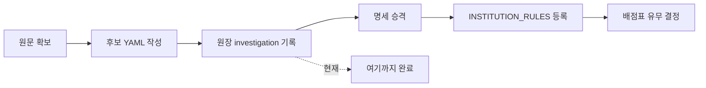

# 산림청·해양환경공단 기관 규칙 등록 조사 (등록 지점과 남은 확인 사항)

> **작성일**: 2026-10-15
> **작업**: 조사 전용. 코드(`INSTITUTION_RULES`)·기관 규칙 명세 YAML·커버리지 원장·후보 YAML 미수정
> **정본 사양**: `.orca/capsules/task_forest_koem_survey_20261015/capsule.yaml`
> **선행 문서**: [`institution_rules_apply_20261013.md`](institution_rules_apply_20261013.md), [`handoff_20261014_ocr_ledger_close.md`](../handoff/handoff_20261014_ocr_ledger_close.md)
> **판정**: 조사 완료. 코드 반영은 다음 Task 이며 이 문서는 그때 손댈 지점을 고정한다.

---

## 1. 요약

산림청과 해양환경공단은 조사 단계가 끝났습니다. 두 기관 모두 후보 YAML 에 확정 인용·구간 계수·통과점수가
들어 있고, 커버리지 원장 `investigation` 에 `status=confirmed`·`recommendation=add_to_registry` 로
기록되어 있습니다. 아직 코드에 넣지 않았으므로 **현재 두 기관의 자체 규칙은 계산 경로에 존재하지 않습니다.**

등록은 코드 한 곳(`INSTITUTION_RULES`)과 명세 한 곳(`institution_rules_20261013.yaml`)을 함께 고치는
작업이며, 기관 정량평가 배점표(`institution_quant_tables_20261013.yaml`)를 어디까지 채우느냐가 가장 큰
분기점입니다. 배점표를 만들지 않으면 한국가스공사 선례대로 `quant_table=False` 로 두어 정량점수 직접 입력을
유지해야 하는데, 시험 `test_evaluation_quant_institution.py:62` 가 "배점표 없는 규칙은 한국가스공사 2건뿐"을
단정하고 있어 배점표 없이 규칙만 추가하면 그 시험이 깨집니다.

| 항목 | 값 |
| --- | --- |
| 조사 대상 | 산림청, 해양환경공단 |
| 원장 investigation | 기록 완료(2026-10-14), 수정 불필요 |
| 후보 YAML 판정 | 둘 다 `confirmed` / `add_to_registry` |
| 코드 등록 | 미실시(이번 Task 범위 아님) |
| 등록 시 추가 구간(band) | 산림청 5 + 해양환경공단 4 = 9 |
| 배점표 | 두 기관 모두 미확보 |

---

## 2. 어디까지 왔는가



| 단계 | 산림청 | 해양환경공단 | 근거 |
| --- | --- | --- | --- |
| 원문 확보 | 완료(PDF·HWPX) | 완료(HWP 본문) | 후보 YAML `sources`·`attempted_paths` |
| 후보 YAML | 완료 | 완료 | `institution_rules_candidates_b_20261014.yaml`, `..._a_20261014.yaml` |
| 원장 investigation | 기록됨 | 기록됨 | `rule_coverage_ledger.yaml:16296`, `:1042` |
| 명세 승격 | 미실시 | 미실시 | 이번 Task 는 조사만 |
| 코드 등록 | 미실시 | 미실시 | `INSTITUTION_RULES` 에 두 기관 없음 |

- 원장 두 행은 `registry_status: unregistered` 이고 `investigation` 만 값이 있습니다. 원장 등록 상태는
  코드 등록 후 `scripts/report_rule_coverage.py` 재생성 때 바뀝니다(재생성은 Docker·DB 필요).
- 원장 식별자: 산림청 `dminstt_cd 1400000`(공고 6건), 해양환경공단 `dminstt_cd B553931`(공고 78건).
  후보 YAML 의 `institution_code` 는 두 기관 모두 `null` 이라 코드 등록 시 이 원장 코드를 쓸지 별도 확인이 필요합니다.

---

## 3. 기관별 확정 사실 (원문 포함 여부 포함)

| 항목 | 산림청 | 해양환경공단 |
| --- | --- | --- |
| 확정 인용(표준) | 산림청 산림사업 적격심사 세부기준, 산림청 예규 제728호, 2025-12-01 개정·시행(최초 제정 2013-01-28 예규 제613호) | 해양폐기물정화용역 적격심사 세부기준, 제정 2023-06-19, 개정·시행 2025-03-06 |
| status / recommendation | confirmed / add_to_registry | confirmed / add_to_registry |
| 구간 수 | 5 (별표 1~5) | 4 ([별표 1] 1~4호) |
| 통과점수 | 95 단일 (제5조① 이 사업규모와 무관하게 95 로 규정) | 구간별로 다름 — 제11조: 10억원 이상 90, 10억원 미만 95 |
| 적용 대상 조항 | 후보 노트는 제1조·제2조가 "산림청 및 소속기관"을 적용 주체로 적는다고 진술. 이 조사에서 조문 원문을 직접 확인하지는 않았음 | 제1조가 해양환경공단이 집행하는 해양폐기물정화용역(해양폐기물수거업)으로 적용을 한정함 |
| 소속기관 원문 포함 | 후보 노트 진술에는 포함(제1조·제2조). 조문 실확인 전 | 명시 확인되지 않음(한정 조항만 확인) |
| 낙찰하한율 출처 | 별표 1~5 인쇄 평탄 점수로 검산 | 원문이 하한율을 직접 인쇄하지 않아 역산식으로 산출 |
| 검산 | 평탄 대입값이 인쇄 점수와 정확히 일치 | 평탄 대입값이 인쇄 점수와 0.001점도 다르지 않음 |
| 서비스 범위 | 산림사업 전용. 일반용역(청소·경비 등) 자체 산식은 이 예규 범위 밖 | 해양폐기물정화용역 전용 |
| 준용 조항 | 제8조: 이 기준에 없는 사항은 기획재정부 계약예규·조달청 집행기준 | — |

### 3.1 산림청 구간 (별표 1~5)

| 구간 | 추정가격 | B | k | 기준비율 | 통과 | 하한율 | 평탄점수 |
| --- | --- | ---: | ---: | ---: | ---: | ---: | ---: |
| 별표 1 | 50억원 이상 | 50 | 2 | 88 | 95 | 85.495 | 45 |
| 별표 2 | 50억원 미만 10억원 이상 | 70 | 4 | 88 | 95 | 86.745 | 65 |
| 별표 3 | 10억원 미만 3억원 이상 | 80 | 20 | 88 | 95 | 87.745 | 75 |
| 별표 4 | 3억원 미만 1억원 이상 | 90 | 20 | 88 | 95 | 87.745 | 85 |
| 별표 5 | 1억원 미만 | 90 | 20 | 88 | 95 | 87.745 | 85 |

### 3.2 해양환경공단 구간 ([별표 1] 1~4호)

| 구간 | 추정가격 | B | k | 기준비율 | 통과 | 하한율 | 평탄점수 |
| --- | --- | ---: | ---: | ---: | ---: | ---: | ---: |
| 1호 | 10억원 이상 | 30 | 1 | 88 | 90 | 77.995 | 20 |
| 2호 | 10억원 미만 5억원 이상 | 50 | 2 | 88 | 95 | 85.495 | 45 |
| 3호 | 5억원 미만 2억원 이상 | 70 | 4 | 88 | 95 | 86.745 | 65 |
| 4호 | 2억원 미만 | 90 | 20 | 88 | 95 | 87.745 | 85 |

- 해양환경공단 규칙을 "해양환경공단 전체 규칙"으로 넓히면 안 됩니다. 제1조가 적용 대상을
  해양폐기물정화용역(해양폐기물수거업)으로 한정하므로, 규칙의 서비스 표기·설명에도 이 한정을 남겨야
  합니다. 한정 밖 공고는 이 규칙을 고르지 않고 종전 조달청 경로를 씁니다.

---

## 4. 나중에 넣을 때 손댈 지점

### 4.1 손댈 파일·함수

| 파일 | 손댈 지점 | 내용 |
| --- | --- | --- |
| `data/reference/institution_rules_20261013.yaml` | `institutions` 목록 | 두 기관 항목 승격(status confirmed, `name_aliases`, `effective_date`, `standard`, `bands`, `sources`). 후보 YAML 은 조사 산출물이라 정본 명세가 아님 |
| `src/app/services/evaluation_rules.py` | `INSTITUTION_RULES` tuple | `_institution_rule(...)` 2건 추가. 규칙 1건당 bands 를 `_inst_band(...)` 로 나열 |
| `src/app/services/evaluation_rules.py` | (변경 없음) `_axis_matches`, `_select_institution_rule`, `EXCLUDE_INSTITUTION_RULES_FOR_PPS_PROXY` | 기관 축 매칭·조달청 대행 배제·LOCAL 우선 로직은 그대로 재사용. 새 분기 불필요 |
| `data/reference/institution_quant_tables_20261013.yaml` + `src/app/services/evaluation_quant_institution.py` | 기관별 `rules`/`bands` | 배점표를 만들 경우에만. 미확보면 만들지 않고 `quant_table=False` 유지 |
| `docs/analysis/institution_rules_apply_20261013.md` | 요약표·반영 기관표 | 선례대로 등록 결과를 같은 형식으로 갱신 |
| `data/reference/rule_coverage_ledger.yaml` | 재생성 결과 | 손으로 고치지 않음. `scripts/report_rule_coverage.py` 재생성이 `registry_status` 를 바꿈 |

### 4.2 기존 `_institution_rule` 한 건의 필드 패턴

선례(`SERVC_INST_MOLIT_20180104_GENERAL`)를 그대로 따릅니다.

```python
_institution_rule(
    "SERVC_INST_<기관>_<YYYYMMDD>_<서비스>",   # rule_id (규칙 ID 문자열)
    institution_name="국토교통부",              # institution_name (표시명)
    institution_code="1613000",                 # institution_code (없으면 None)
    institution_aliases=("문화재청",),           # institution_aliases (정확 일치 별칭)
    subunit_name_prefixes=("국토교통부 ",),      # subunit_name_prefixes (원문 조항 근거 있을 때만)
    subunit_code_prefixes=("1613",),            # subunit_code_prefixes (같은 조건)
    service_type="GENERAL",                     # service_type (표기 선택 키)
    table_name="국토교통부 용역적격심사 (일반용역)", # table_name
    description="국토교통부훈령 제965호 별표 1 일반용역 4구간", # description
    effective_date="2018-01-04",                # effective_date (시행일 대조용)
    source=f"{_SRC_INST_CENTRAL}:66-111",       # source (규칙 근거)
    patterns=("일반용역",),                      # patterns (낙찰방법명·공고명 표기)
    bands=(                                      # bands
        _inst_band(
            "1000000000",     # upper (상한, None 이면 마지막 구간)
            "30",             # B (배점한도)
            "2",              # k (평점계수)
            "88",             # base_ratio (기준비율)
            "90",             # pass_score (통과점수)
            "82.995",         # lwlt_rate (인쇄 하한율)
            "별표 1 · 고시금액 이상 10억원 미만 일반용역",  # label
            f"{_SRC_INST_CENTRAL}:89,101,103",            # band source
        ),
    ),
    quant_table=True,        # 배점표 반영 가능하면 True, 아니면 False
)
```

- `_institution_rule` 은 bands 를 추정가격 오름차순으로 정렬하고, 규칙 대표 `lwlt_rate`·`base_rate` 는
  가장 낮은 구간 값을 씁니다. 실제 계산은 추정가격으로 고른 구간값이 정합니다.
- `quant_table=False` 이면 `quant_basis=QUANT_BASIS_AGENCY_DOCUMENT_NOT_LOADED` 가 되어 정량점수 직접
  입력을 요구합니다(한국가스공사 선례).
- 두 기관 모두 통과점수를 `_inst_band` 의 `pass_score` 로 구간별 반영하면 됩니다. 산림청은 5구간 모두 95,
  해양환경공단은 1호만 90·나머지 95 라 `threshold_bands` 가 자동으로 구간별 값을 갖습니다.

### 4.3 등록 전 확정해야 할 입력값

| 항목 | 산림청 | 해양환경공단 |
| --- | --- | --- |
| `service_type` | 미정(예: `FOREST`) | 미정(예: `MARINE_WASTE`) |
| `patterns` | 실제 낙찰방법명 표기 확인 필요. 후보의 `service_types` 는 설명문 형태라 토큰으로 못 씀 | `해양폐기물정화용역` 계열 표기 |
| `institution_code` | 후보 `null`. 원장 본청 코드 `1400000` 사용 여부 확인 | 후보 `null`. 원장 코드 `B553931` 사용 여부 확인 |
| `effective_date` | 2025-12-01 | 2025-03-06 |
| `quant_table` | 배점표 미확보 → `False` 유력 | 배점표 미확보 → `False` 유력 |

---

## 5. 별칭: 정확 일치로 넣을 것과 접두로 넓히면 안 되는 것

현재 매칭은 `_institution_name_matches`(공백 제거 정확 일치)와, 원문 적용범위 조항이 하위 조직을 명시한
기관에만 선언하는 `subunit_name_prefixes` 2차 판정으로 나뉩니다. 접두·부분 일치는 다른 기관 오탐 때문에
기본 금지입니다.

### 5.1 정확 일치로 넣을 별칭

| 기관 | 본청명 | 정확 일치로 넣을 후보 별칭 |
| --- | --- | --- |
| 해양환경공단 | 해양환경공단 | 지사 12곳(제주·군산·대산·동해·마산·목포·부산·여수·울산·인천·평택·포항), 해양환경교육원, 해양환경조사연구원 |
| 산림청 | 산림청 | 지방산림청 5곳(남부·북부·동부·서부·중부), 국립자연휴양림관리소, 남부지방산림청 영덕국유림관리소, 남부지방산림청 순천국유림관리소, 산림항공본부, 국립수목원, 국립산림품종관리센터 |

- 이 별칭들은 `name_aliases`(정확 일치)로만 넣습니다. 후보 YAML 의 별칭 목록이 곧 이 정확 일치 목록입니다.

### 5.2 원문 확인 없이 접두로 넓히면 안 되는 별칭

| 후보 | 금지 이유 |
| --- | --- |
| `"산림청 "` 접두로 지방산림청·국유림관리소 전체 확장 | 후보 노트가 제1조·제2조에 "산림청 및 소속기관"을 적는다고 하나, 이 조사에서 조문 원문을 직접 확인하지 않았습니다. 접두 확장은 원문 적용범위 조항이 확인된 기관(국토교통부·환경부·한국석유공사 3곳)에만 선언되어 있습니다. 확인 전에는 정확 일치 별칭으로만 처리 |
| `"해양환경공단 "` 접두로 지사 전체 확장 | 제1조는 적용 대상을 업무 종류(해양폐기물정화용역)로 한정할 뿐 지사 등 소속기관 포함을 명시한 것으로 확인되지 않았습니다. 접두 확장 금지 |
| "지방산림청", "국유림관리소", "해양환경공단 지사"를 접두 키워드로 승격 | 별칭에 이런 말이 들어 있다는 사실은 접두 매칭 근거가 아닙니다. 접두 매칭으로 바꾸라는 뜻이 아닙니다 |

- 원장에는 후보 별칭에 없는 하위 조직(예: 산림청 북부지방산림청 인제국유림관리소, 산림청 동부지방산림청
  평창국유림관리소, 산림청 서부지방산림청 순천국유림관리소)도 있습니다. 이들은 정확 일치 별칭에도 없어
  접두 확장 없이는 종전 조달청 경로를 유지합니다. 접두 확장을 하려면 원문 적용범위 조문 확인이 선행입니다.

---

## 6. 건수·규칙 ID 를 단정하는 시험 (수정 대상으로만 기록, 이번엔 미수정)

이번 Task 는 시험 파일을 고치지 않습니다. 아래는 코드 등록 Task 에서 함께 갱신해야 하는 지점입니다.

| 파일:행 | 단정 내용 | 등록 시 영향 |
| --- | --- | --- |
| `tests/test_institution_rules.py:151` | `len(confirmed) == 10` | 명세에 두 기관을 confirmed 로 넣으면 12 로 갱신 |
| `tests/test_institution_rules.py:174` | `code_total == 140` | 구간 9개 추가로 149 로 갱신 |
| `tests/test_institution_rules.py:50-61` | `EXPECTED_CODES`(기관명→수요기관 코드) 10곳 | 두 기관 코드 추가 |
| `tests/test_institution_rules.py:4,8,149` | docstring "confirmed 기관 10곳", 시험명 "확인 기관 10곳" | 문구 갱신 |
| `tests/test_institution_rules.py:177,225` | YAML 라벨·source·시행일·별칭 대조 | 명세에 항목을 넣으면 구조상 자동 대조됨 |
| `tests/test_evaluation_quant_institution.py:60` | `len(table_ids) == 65` | 배점표를 추가하면 갱신 |
| `tests/test_evaluation_quant_institution.py:62-65` | `other_ids == {KOGAS GENERAL, KOGAS FACILITY}` | 배점표 없이 두 규칙을 추가하면 이 단정이 깨짐. 배점표를 함께 만들거나 단정·시험을 갱신해야 함 |
| `tests/test_evaluation_quant_institution.py:4` | docstring "(기관 10곳, 규칙 67개, 구간 136개)" | 배점표 추가 시 갱신 |
| `tests/test_evaluation_rules_scope_axis.py:255-265` | 모든 기관 규칙이 `patterns`·`price_bands`·`threshold_bands` 보유 | 건수 단정은 없으나 새 규칙도 비어 있으면 안 됨 |
| `tests/test_evaluation_rules_scope_axis.py:268-281` | 배점표 없으면 `QUANT_BASIS_AGENCY_DOCUMENT_NOT_LOADED` | `quant_table=False` 유지 시 자동 충족 |

- 명세 `data/reference/institution_quant_tables_20261013.yaml` 자체도 기관 수·규칙 수를 갖고 있어, 배점표를
  추가하면 같은 값(65·67·136 등)을 맞춰야 합니다.

---

## 7. 남은 확인 사항 (이번 판정은 차단 아님)

아래는 조사 결론이 아니라 등록 Task 착수 전에 확정해야 하는 입력입니다. 미구현이므로 차단으로 적지 않습니다.

| 확인 항목 | 내용 |
| --- | --- |
| 산림청 적용범위 조문 | 제1조·제2조 원문에서 "산림청 및 소속기관" 적용 주체를 직접 확인. 소속기관 접두 확장 여부 결정 |
| 산림청 낙찰방법명 표기 | `patterns` 로 쓸 실제 낙찰방법명(공고 `sucsfbidMthdNm`·`bidNtceNm`) 확인 |
| 기관 정량 배점표 | 두 기관 별표의 심사항목·배점한도 미확보. 확보 시 배점표 추가, 미확보면 `quant_table=False` |
| 수요기관 코드 | 후보 `institution_code=null`. 원장 코드(1400000 / B553931) 사용 여부와 본청 코드 확정 |
| 원장 재생성 | 코드 등록 후 `scripts/report_rule_coverage.py` 재생성(Docker·DB 필요)으로 `registry_status` 갱신 |
| 산림청 PDF 행 번호 | 원문 PDF 는 `scripts/extract_score_params.extract_document_text` 가 읽지 못하고 `pdfplumber` 로 읽습니다. 후보 YAML 의 PDF 행 번호는 빌더 CLI 리더 기준이라 pdfplumber 행과 다릅니다. 행 번호를 다시 세지 않습니다 |

---

## 8. 검증

| 항목 | 결과 |
| --- | --- |
| 규칙 검증 | `python3 scripts/validate_agent_rules.py --quiet` 통과(21/21) |
| 코드·명세·원장 diff | 없음(조사 문서 1건만 커밋) |
| DB 조회 | 없음(이번 조사는 파일 근거만 사용) |

---

## 9. 참고 파일

| 파일 | 용도 |
| --- | --- |
| `data/reference/institution_rules_candidates_a_20261014.yaml` | 해양환경공단 확정 후보 |
| `data/reference/institution_rules_candidates_b_20261014.yaml` | 산림청 확정 후보 |
| `data/reference/institution_rules_20261013.yaml` | 등록 대상 정본 명세(승격 위치) |
| `data/reference/rule_coverage_ledger.yaml` | investigation 기록(산림청 16296, 해양환경공단 1042) |
| `src/app/services/evaluation_rules.py` | `_institution_rule`(2946), `INSTITUTION_RULES`(3022), `_axis_matches`(5991), `_select_institution_rule`(5653) |
| `docs/analysis/institution_rules_apply_20261013.md` | R2 등록 선례(형식·검증 절차) |
