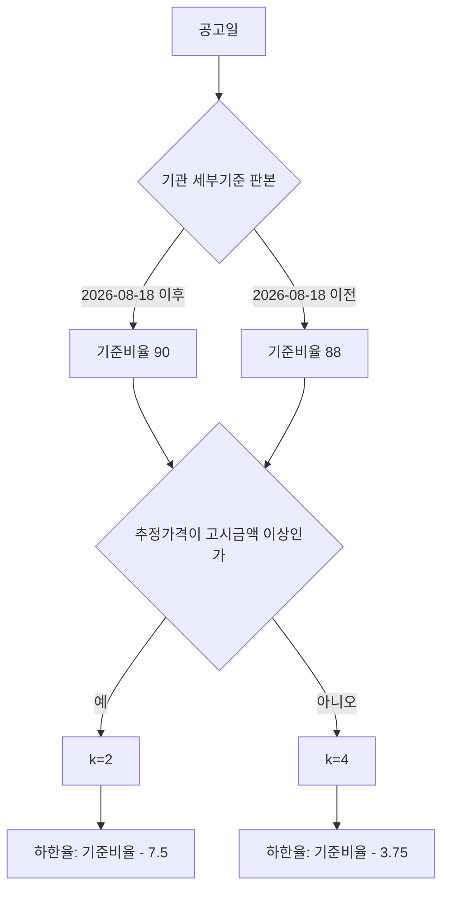

# 기관 규칙 불일치 13건 원문 대조

> **작성일**: 2026-11-07
> **대상**: [`docs/analysis/lwlt_notice_vs_rule_audit_20261106.md`](lwlt_notice_vs_rule_audit_20261106.md) 4.6절의 기관 규칙 불일치 13건
> **비교 축**: 공고 `raw_data.sucsfbidLwltRate`(공고값) 대 기관 규칙의 선택 구간 낙찰하한율(규칙값)
> **정본**: 기관 세부기준 원문(공고 첨부), `src/app/services/evaluation_rules_institution.py`, `src/app/services/evaluation_rules.py:654`
> **코드 수정**: 없음. 수정 방안은 4절에 비교만 두었고 어느 것도 선택하지 않았습니다.
> **판정 요지**: 13건 중 12건은 규칙 쪽 값이 낡거나 구간 축이 빠진 것이고, 1건은 공고가 조달청 띠 기준을 적용한 것입니다.
> **재현**: 부록 A

---

## 1. 요약

### 1.1 판정 표 (13건)

공고값과 규칙값은 모두 소수 3자리입니다. 기초금액은 `raw_data.asignBdgtAmt`(배정예산금액, 부가가치세 포함)이며 추정가격의 1.1배입니다. 단가계약 공고의 예비가격기초금액은 단가총액이라 구간 판정에 쓸 수 없습니다(2.4절).

| # | 공고번호 | 공고일 | 기관 | 세부유형 | 추정가격 | 기초금액 | 규칙 ID | 선택 구간 | 규칙값 | 공고값 | 차이 | 원인 라벨 |
| --- | --- | --- | --- | --- | ---: | ---: | --- | --- | ---: | ---: | ---: | --- |
| 1 | `R26BK01369593` | 2026-03-04 | 한국지역난방공사 | 폐기물처리 | 82,080,000 | 90,288,000 | `SERVC_INST_KDHC_20260101_WASTE` | 별표 4 · 고시금액 미만 | 84.245 | 87.745 | +3.500 | (다) |
| 2 | `R26BK01634862` | 2026-07-15 | 한국농어촌공사 | 임대차 | 312,290,909 | 343,520,000 | `SERVC_INST_KRC_20260624_LEASE` | 별표 8 · 5억원 미만 | 86.245 | 82.495 | -3.750 | (가) |
| 3 | `R26BK01730527` | 2026-09-22 | 한국지역난방공사 | 폐기물처리 | 336,358,000 | 369,993,800 | `SERVC_INST_KDHC_20260101_WASTE` | 별표 4 · 고시금액 이상 5억원 미만 | 80.495 | 82.495 | +2.000 | (가) |
| 4 | `R26BK01745985` | 2026-09-28 | 한국지역난방공사 | 폐기물처리 | 336,358,000 | 369,993,800 | `SERVC_INST_KDHC_20260101_WASTE` | 별표 4 · 고시금액 이상 5억원 미만 | 80.495 | 82.495 | +2.000 | (가) |
| 5 | `R26BK01761398` | 2026-10-07 | 한국지역난방공사 | 임대차 | 2,201,127,273 | 2,421,240,000 | `SERVC_INST_KDHC_20260101_LEASE` | 별표 8 · 5억원 이상 | 80.495 | 82.495 | +2.000 | (가) |
| 6 | `R26BK01764999` | 2026-10-12 | 한국지역난방공사 | 폐기물처리 | 336,358,000 | 369,993,800 | `SERVC_INST_KDHC_20260101_WASTE` | 별표 4 · 고시금액 이상 5억원 미만 | 80.495 | 82.495 | +2.000 | (가) |
| 7 | `R26BK01766196` | 2026-10-12 | 한국지역난방공사 | 폐기물처리 | 336,358,000 | 369,993,800 | `SERVC_INST_KDHC_20260101_WASTE` | 별표 4 · 고시금액 이상 5억원 미만 | 80.495 | 82.495 | +2.000 | (가) |
| 8 | `R26BK01764484` | 2026-10-13 | 한국농어촌공사 | 학술연구 | 395,065,745 | 434,572,320 | `SERVC_INST_KRC_20260624_ACADEMIC` | 별표 1 · 5억원 미만 | 86.245 | 82.495 | -3.750 | (가) |
| 9 | `R26BK01768949` | 2026-10-13 | 한국농어촌공사 | 학술연구 | 395,065,745 | 434,572,320 | `SERVC_INST_KRC_20260624_ACADEMIC` | 별표 1 · 5억원 미만 | 86.245 | 82.495 | -3.750 | (가) |
| 10 | `R26BK01784481` | 2026-10-21 | 한국농어촌공사 | 학술연구 | 395,065,745 | 434,572,320 | `SERVC_INST_KRC_20260624_ACADEMIC` | 별표 1 · 5억원 미만 | 86.245 | 82.495 | -3.750 | (가) |
| 11 | `R26BK01793057` | 2026-10-27 | 한국지역난방공사 | 폐기물처리 | 437,000,000 | 480,700,000 | `SERVC_INST_KDHC_20260101_WASTE` | 별표 4 · 고시금액 이상 5억원 미만 | 80.495 | 82.495 | +2.000 | (가) |
| 12 | `R26BK01793641` | 2026-10-27 | 한국농어촌공사 | 학술연구 | 395,065,745 | 434,572,320 | `SERVC_INST_KRC_20260624_ACADEMIC` | 별표 1 · 5억원 미만 | 86.245 | 82.495 | -3.750 | (가) |
| 13 | `R26BK01813749` | 2026-11-05 | 한국지역난방공사 | 소프트웨어(비대상) | 461,818,182 | 508,000,000 | `SERVC_INST_KDHC_20260101_SW` | 별표 3 · 고시금액 이상 5억원 미만 | 80.495 | 82.495 | +2.000 | (가) |
| 합계 | 13건 | - | - | - | - | - | - | - | - | - | - | - |

`R26BK01764484` 는 차수 000과 001이 모두 같은 값이며, 대표 공고(최신 차수 001) 한 건만 셌습니다.

2026-11-06 감사 4.6절은 폐기물 6건 가운데 5건만 공고값 82.495로 적었습니다. 나머지 1건이 위 표의 1번(`R26BK01369593`, 87.745)입니다. 4.6절이 적은 `규칙 84.245`는 규칙의 대표값이고, 실제 선택 구간값은 표의 84.245(1번)와 80.495(3, 4, 6, 7, 11번)입니다.

### 1.2 원인 집계

| 원인 라벨 | 건수 | 해당 기관·세부유형 |
| --- | ---: | --- |
| (가) 규칙 구간값 오류 | 12 | 한국지역난방공사 폐기물 5, 임대차 1, 소프트웨어 1 / 한국농어촌공사 임대차 1, 학술연구 4 |
| (나) 구간 선택 오류 | 0 | - |
| (다) 공고가 다른 기준 적용 | 1 | 한국지역난방공사 폐기물 1 |
| (라) 미확인 | 0 | - |
| 합계 | 13 | - |

### 1.3 판정

1. **한국지역난방공사 7건은 기관 세부기준 개정판이 규칙에 없다.** 공고일이 2026-08-18 이후인 7건은 공고에 `일반용역적격심사세부기준(2026.8.18. 시행)`이 첨부되어 있고, 그 판본의 별표 3·4·8은 기준비율을 88에서 90으로 올렸습니다. 규칙에 등록된 2026-01-01판은 기준비율 88이라 80.495를 냅니다. 공고값 82.495는 2026-08-18판의 90 기준 대입값과 정확히 일치합니다.
2. **한국농어촌공사 5건은 구간 축이 하나 빠졌다.** 이 기관 별표의 k는 `고시금액 이상/미만` 행에서 정해지는데(2 또는 4), 등록 규칙은 `5억원 미만` 구간 전체에 k=4를 붙였습니다. 공고가 지목한 `5억원 미만 고시금액 이상` 칸의 값은 k=2의 82.495인데 규칙은 86.245를 냅니다. 추정가격과 기초금액 중 어느 것을 써도 판정은 같습니다.
3. **`R26BK01369593` 1건만 공고가 기관 세부기준 밖의 띠를 적용했다.** 낙찰방법명이 `추정가격 2억원 미만인 용역`이고, 공고값 87.745는 조달청 일반용역 2억원 미만 띠 규칙의 상수와 같습니다. 이 공고에는 기관 세부기준 대신 환경부 고시가 첨부되어 있습니다.

### 1.4 표 밖 관측

같은 기관·세부유형에서 13건 밖의 불일치가 2건 더 있습니다. `R26BK01635339`(평택지사, 기타용역, 2026-07-15, 규칙 84.995 대 공고 87.745)와 `R26BK01708025`(수원사업소, 기타용역, 2026-09-01, 규칙 80.495 대 공고 82.495)입니다. 이 2건은 2026-11-06 `RULE_NOT_FOUND` 보완으로 기관 규칙이 새로 등록되면서 드러난 건이라 2026-11-06 감사의 13건에는 들어 있지 않습니다. `R26BK01708025`는 1.3의 1번(2026-08-18판 기준비율 90)과 같은 방향이지만, `R26BK01635339`는 2026-08-18 이전 공고이고 공고값 87.745가 별표 9의 어느 계수로도 나오지 않아 별도 조사가 필요합니다. 이 문서의 13건 표와 집계에는 두 건을 넣지 않았습니다.

---

## 2. 원문 근거

### 2.1 한국지역난방공사 판본 세 개

기관 규칙은 `src/app/services/evaluation_rules_institution.py`에 판본별로 등록되어 있습니다. 한국지역난방공사는 2026-01-01판과 2023-07-19판만 있고, 공고가 실제로 쓰는 2026-08-18판은 없습니다.

| 판본 | 규칙 등록 | 원문 확보 | 기준비율 | k (고시금액 이상/미만) | B (5억원 이상/미만) | 통과점수 | 산출 하한율 |
| --- | --- | --- | ---: | --- | --- | ---: | --- |
| 2026-01-01판 | `SERVC_INST_KDHC_20260101_*` | 로컬 사본 `.txt` | 88 | 2 / 4 | 60 / 70 | 85 | 80.495 / 84.245 |
| 2026-04-13판 | 없음 | 미확보 | 88 (간접) | 2 / 4 | 60 / 70 | 85 | 80.495 / 84.245 (간접) |
| 2026-08-18판 | 없음 | 공고 첨부 PDF | 90 | 2 / 4 | 60 / 70 | 85 | 82.495 / 86.245 |

- **2026-01-01판**: `data/sources/qualification/files/kdhc/762d7992a046_kdhc_eq.txt`의 별표 4는 `[EQ: 평점(점)=배점한도-2 x |( 88/100 - 입찰가격/예정가격 ) x 100|]`(911행), `-4 x`(912행)를, 별표 3은 561~566행, 별표 8은 1628~1634행에 같은 구조로 인쇄합니다. 평탄 문장은 95.5퍼센트와 91.75퍼센트입니다(912~917행, 1628~1634행). 규칙 상수는 이 판본을 옮긴 것입니다(`SERVC_INST_KDHC_20260101_WASTE` 1533~1575행, `_SW` 1455~1497행, `_LEASE` 1733~1775행).
- **2026-08-18판**: 나라장터 공고 `R26BK01730527` 첨부 `5. 일반용역적격심사세부기준(260818).pdf`(72쪽)입니다. 표제가 `개정 2026. 8. 18.`이고, 부칙은 `이 세부기준은 2026년 8월 18일부터 입찰공고되어 실시되는 용역계약의 적격심사 낙찰자 선정에 적용한다`이며 `일반용역적격심사세부기준(2026.04.13.)`을 폐지합니다. 별표 3·4·8의 입찰가격 평점 계산식은 `배점한도 - 2 x |(90/100 - 입찰가격/예정가격) x 100|`(고시금액 이상)과 `- 4 x`(고시금액 미만)이고, 평탄 문장은 97.5퍼센트와 93.75퍼센트입니다. 제10조 통과점수는 85점(소프트웨어 경쟁제품과 여객 육상운송은 88점) 그대로입니다.
- **2026-04-13판**: 2026-08-18판 부칙이 폐지 대상으로 지목하지만 원문은 이 작업 트리에 없습니다. 2026-07-20 공고 `R26BK01639821`(학술연구, 추정가격 404,210,000)과 2026-08-11 공고 `R26BK01677929`(소프트웨어, 450,000,000)의 공고값이 80.495인 점으로 보아 이 판본은 기준비율 88을 유지한 것으로 보입니다. 다만 원문 미확보이므로 이 문서에서 확정하지 않습니다.

기준비율과 평탄 문장은 서로 맞물립니다. 기준비율 88에 k=2를 적용하면 평탄 문장은 95.5퍼센트(88 + 7.5), k=4는 91.75퍼센트(88 + 3.75)가 됩니다. 기준비율 90판의 97.5퍼센트와 93.75퍼센트도 같은 방식입니다. 그래서 평탄 문장만 인쇄되어 있어도 기준비율이 88인지 90인지 구분할 수 있습니다.

### 2.2 한국농어촌공사 계수

기관 원문 파일은 이 작업 트리에 없고, `data/sources/qualification/files/krc/`에는 홈페이지 HTML 한 건만 있습니다. 계수는 [`docs/analysis/servc_formula_userfiles_agency_20261004.md`](servc_formula_userfiles_agency_20261004.md) 4.2절의 전사 기록으로 확인했습니다.

| 별표 | 용역 | B (5억원 이상/미만) | k (고시금액 이상/미만) | 기준비율 | 평탄 문장 | 통과점수 |
| --- | --- | ---: | --- | ---: | --- | ---: |
| 별표 1 | 학술연구용역 | 60 / 70 | 2 / 4 | 90 | 97.5 / 93.75퍼센트 | 85 |
| 별표 8 | 임대차 | 70 / 70 | 2 / 4 | 90 | 97.5 / 93.75퍼센트 | 85 |

`data/reference/institution_rules_20261013.yaml`도 같은 계수를 적고 있으면서, 408~444행의 밴드 선언은 k를 `5억원 미만`에 4로 고정합니다. 416행 note는 `k·기준비율·평탄은 고시금액 이상/미만 행에서 읽었다`고 적어, 기록 안에서도 축과 값이 어긋납니다.

### 2.3 하한율 산식과 값

적격심사 종합평점은 `다른 심사분야 취득점수 + 입찰가격 평점`이고, 통과점수는 85점입니다. B를 입찰가격 배점한도라 하면 다른 분야 만점은 `100 - B`이고, 다른 분야에서 만점을 받는다고 가정할 때 통과에 필요한 입찰가격 평점은 `85 - (100 - B) = B - 15`입니다. 입찰가격 평점은 `B - k x |기준비율 - 투찰률|`이므로 다음이 성립합니다.

```
k x |기준비율 - 투찰률| <= 15
투찰률 >= 기준비율 - 15 / k
```

B가 양변에서 소거되므로 **하한율은 k와 기준비율로만 결정됩니다.** 공고 하한율은 이 경계값을 0.005 단위로 내린 값입니다.

| 기관·판본 | 기준비율 | k | 경계 투찰률 | 등록·공고 값 |
| --- | ---: | ---: | ---: | ---: |
| 한국지역난방공사 2026-01-01판 | 88 | 2 | 80.5 | 80.495 |
| 한국지역난방공사 2026-01-01판 | 88 | 4 | 84.25 | 84.245 |
| 한국지역난방공사 2026-08-18판 | 90 | 2 | 82.5 | 82.495 |
| 한국지역난방공사 2026-08-18판 | 90 | 4 | 86.25 | 86.245 |
| 한국농어촌공사 2026-06-24판 | 90 | 2 | 82.5 | 82.495 |
| 한국농어촌공사 2026-06-24판 | 90 | 4 | 86.25 | 86.245 |

이 표가 13건의 값을 모두 설명합니다. 한국지역난방공사 7건의 공고값 82.495는 2026-08-18판 k=2의 값이고, 한국농어촌공사 5건의 공고값 82.495도 k=2의 값입니다. 규칙이 낸 80.495와 84.245는 기준비율 88판의 k=2와 k=4, 86.245는 기준비율 90판의 k=4 값입니다.



### 2.4 금액 기준: 추정가격인가 기초금액인가

- 공고 낙찰방법명이 `추정가격 5억원 미만`, `추정가격 고시금액 이상`처럼 **추정가격**을 명시합니다.
- 기관 세부기준의 구간표도 `추정가격` 열과 행으로 되어 있습니다(2.1, 2.2절).
- 규칙 코드도 `presmpt_prce`를 `_normalized_price`로 넘겨 구간을 고릅니다(`src/app/services/evaluation_rules.py:2571`, `:2580`, `:654`).
- 기초금액(`asignBdgtAmt`)은 추정가격의 1.1배(부가가치세 포함)입니다. 13건 중 `R26BK01813749`만 추정가격 461,818,182(5억원 미만)와 기초금액 508,000,000(5억원 이상)이 5억원 경계를 사이에 두고 갈립니다. 이 건의 별표 3은 5억원 이상과 미만 모두 B만 다르고 k가 2로 같아, 기초금액으로 구간을 골라도 하한율은 82.495로 같습니다.
- 단가계약 공고(예: `R26BK01730527`)의 예비가격기초금액은 품목별 단가의 합(단가총액 1,721,500원)이라 추정가격과 직접 비교할 수 없습니다. 이런 공고도 구간 판정은 추정가격으로 합니다.
- 따라서 **13건 어느 것도 금액 기준을 기초금액으로 바꾸어 판정이 달라지지 않습니다.** 기초금액 기준 오류로 설명되는 건은 없습니다.

### 2.5 근거 등급

| 등급 | 대상 | 내용 |
| --- | --- | --- |
| 확인 | 한국지역난방공사 2026-08-18판 계수·평탄 문장·통과점수 | 공고 첨부 PDF 원문 행을 직접 읽었습니다. 하한율 자체는 인쇄되어 있지 않습니다. |
| 확인 | 한국지역난방공사 2026-01-01판 계수·평탄 문장 | 로컬 사본 추출문의 계산식·문장 행을 직접 읽었습니다. |
| 부분 | 13건의 규칙값과 공고값 비교 | 하한율은 원문 계수에 대입해 산출한 값입니다. 공고값은 `raw_data` 필드와 공고문 인쇄값으로 확인했습니다. |
| 부분 | 한국농어촌공사 계수 | 기관 원문 파일이 작업 트리에 없어 전사 기록과 공고문 인용으로만 확인했습니다. |
| 미확인 | 한국지역난방공사 2026-04-13판 | 원문 미확보. 간접 근거만 있습니다. |

역산·대입으로 얻은 80.495, 84.245, 82.495, 86.245 가운데 세부기준 원문에 인쇄된 값은 없습니다. 82.495는 공고문에 인쇄된 값이지만 세부기준 원문의 인쇄값은 아니므로, 규칙값과의 비교 근거 등급은 부분으로 두었습니다.

---

## 3. 공고 인용

### 3.1 한국지역난방공사 폐기물 `R26BK01730527`

공고 첨부 `1. 입찰공고_사업장폐기물.pdf`에서 직접 인용합니다.

- `8. 낙찰자 결정 방법 / 가. 본 용역은 적격심사 낙찰제로서 우리공사 "일반용역적격심사세부기준"에 의하여 낙찰자를 결정하므로 동 기준을 반드시 사전 열람하여야 합니다.`
- `나. 개찰결과 낙찰하한율 (82.495%) 이상 최저가격 입찰한 자 순으로 적격심사하여 종합평점 85점 이상인 업체를 낙찰자로 결정합니다.`
- `라. 본 입찰의 적격심사에 적용되는 주요 세부기준 / ① 평가기준: 별표 [4] "폐기물처리용역 적격심사 추정가격 5억원미만" 적용 / ② 심사항목: 수행능력 30점(이행실적+경영상태+기술능력±신인도) + 입찰가격 70점`
- `1. 공고명 ... 2. 용역개요 가. 연간 발주예상금액: 369,993,800원 (부가가치세 포함) / 나. 예비가격기초금액 단가총액: 1,721,500원 (처리비, 운반비, 부가세 포함)`
- `- 평가기준금액: 336,358,000원 (부가가치세 제외)`

공고가 스스로 `우리공사 일반용역적격심사세부기준`과 `별표 4`, `5억원 미만`을 지목했고, 같은 공고의 첨부가 2026-08-18판입니다. 따라서 82.495는 공고 오류가 아니라 2026-08-18판의 정상값이고, 규칙 쪽 80.495가 낡은 값입니다. 같은 첨부는 `R26BK01745985`, `R26BK01764999`, `R26BK01766196`에도 `5. 일반용역적격심사세부기준(260818).pdf`로, `R26BK01793057`에는 `일반용역적격심사세부기준(26.8.18).hwp`로 붙어 있습니다.

### 3.2 한국농어촌공사 임대차 `R26BK01634862`

공고 첨부 `공고문(한국농어촌공사 공고 제2026-144호)_KRC안전패트롤 업무용차량(EV6,8대)임차 용역.pdf`에서 직접 인용합니다.

- `4. 낙찰자 결정방법 / 1) (낙찰자 결정방법) 적격심사 - 한국농어촌공사 "일반용역적격심사세부기준"(입찰공고일 현재용)`
- `2) (적격심사 평가기준) ① 한국농어촌공사 "일반용역적격심사세부기준"(입찰공고일 현재용) 제4조제1항제8호에 따라 [별표8]의 임대차 적격심사(추정가격 고시금액 이상)를 적용합니다. ② 낙찰하한율: 82.495%`
- `5) 추정가격: 금312,290,909원(부가세제외) / 4) 사업예산: 금343,520,000원(부가세포함)`

공고가 기관 세부기준 별표 8의 `추정가격 고시금액 이상` 칸을 지목하고 82.495를 인쇄했습니다. 등록 규칙은 같은 칸에 86.245를 선언합니다.

### 3.3 한국농어촌공사 학술연구 `R26BK01768949`

공고 첨부 `공고문_한국농어촌공사 공고 제2026-223호_스마트물관리앱 전용 단말기 이동 통신 용역.pdf`에서 직접 인용합니다.

- `4. 낙찰자 결정방법 / 1) (낙찰자 결정방법) 적격심사 - 한국농어촌공사 "일반용역 적격심사 세부기준"(입찰공고일 현재용) 제4조제1항제1호 학술연구용역 평가기준 [별표1] (추정가격 5억원 미만 고시금액 이상) 를 적용합니다.`
- `82.495%` (낙찰하한율로 인쇄)
- `5) 추정가격: 금395,065,745원(부가세제외) / 4) 사업예산: 금434,572,320원(부가세포함)`

공고가 지목한 칸은 `5억원 미만`과 `고시금액 이상`을 함께 만족하는 칸입니다. 등록 규칙에는 `5억원 미만` 축만 있어 이 칸을 k=4로 처리했고, 그래서 86.245가 나왔습니다.

### 3.4 한국지역난방공사 폐기물 `R26BK01369593`

이 건은 공고문 파일이 HWP뿐이라 본문을 직접 열지 못했고, `raw_data`와 첨부 목록으로 확인했습니다.

- `raw_data.sucsfbidMthdNm`: `적격심사제-추정가격 2억원 미만인 용역`
- `raw_data.bidNtceNm`: `수원 친환경에너지 개선사업 주기기 구매 건설폐기물 처리용역(건설오니)`
- `raw_data.sucsfbidLwltRate`: `87.745`
- 첨부: `1. 입찰공고.hwp`, `2. 과업내용서(수원 건설오니).hwp`, `3. 산출내역서(수원 건설오니).xlsx`, `4. 용역계약특수조건(수원 건설오니).hwp`, `5. (환경부고시) 건설폐기물처리용역 적격업체 평가기준(2025.10.01).pdf`

87.745는 `src/app/services/evaluation_rules.py:952-968`의 `SERVC_QUAL_POST_20260526_ATTACH_12`가 선언한 값과 같고, 그 규칙의 패턴이 바로 `추정가격 2억원 미만인 용역`입니다. 첨부된 환경부 고시는 자체 산식(배점한도 30·50·60, 기준 100)과 통과점수 95점을 쓰므로 87.745를 만들지 않습니다. 따라서 이 공고는 기관 세부기준 별표 4가 아니라 조달청 일반용역 2억원 미만 띠 값을 쓴 것으로 판정했습니다. 낙찰방법명에 세부유형이 없어 규칙이 공고명으로 폐기물 유형을 추론한 점도 함께 남깁니다.

### 3.5 인용하지 못한 것

- `R26BK01761398`(임대차)과 `R26BK01813749`(소프트웨어)의 공고문은 HWP라 본문을 직접 인용하지 못했습니다. 다만 두 공고의 첨부 목록에 `일반용역적격심사세부기준(2026.08.18. 시행)` HWP가 있어, 세부기준 판본은 3.1절의 PDF와 같습니다.
- 한국지역난방공사 2026-04-13판 원문, 한국농어촌공사 세부기준 원문 파일은 이 작업 트리에 없습니다.

---

## 4. 수정 방안 비교 (고치지 않음)

이 절은 선택지를 비교만 하고 어느 것도 결정하지 않습니다. 13건 모두 공고값이 우선 적용되어 현재 점수 계산 결과는 바뀌지 않습니다. 아래 방안은 규칙 기본값, 경고 문구, 공고값 결측 시 동작에만 영향을 줍니다.

### 4.1 선택지

| 방안 | 내용 | 손대는 곳 | 장점 | 단점 |
| --- | --- | --- | --- | --- |
| (A) 판본·값 추가 | 한국지역난방공사 2026-08-18판 규칙을 추가하고(시행일 2026-08-18, 기존 2026-01-01판은 superseded), 한국농어촌공사 밴드를 `고시금액` 축으로 둘로 나눈다 | `evaluation_rules_institution.py`, `data/reference/institution_rules_20261013.yaml` | 값·구간표가 원문과 맞고 변경 범위가 작다 | 2026-04-13판을 확인하지 않으면 4~8월 구간이 다시 어긋날 수 있다. 밴드 나누기는 기존 2구간 가정을 깬다 |
| (B) 구간 스키마 확장 | `PriceBand`에 k·기준비율 축을 명시하고 `select_price_band`를 B 축(5억원)과 k 축(고시금액) 두 축으로 고른다 | `evaluation_rules.py`, `evaluation_rules_core.py`, 기관 규칙 생성부 | 축을 잃는 오류를 구조적으로 막는다 | 규칙 스키마·직렬화·원장 검증까지 파급이 크고, 기존 규칙 전량 재검증이 필요하다 |
| (C) 공고값 우선 유지 + 경고 | 규칙 값은 두고, 공고값과 규칙값이 다를 때 근거 판본을 경고에 남기고 불일치를 지표로 집계한다 | `evaluation_rules.py` 경고부, 조사 스크립트 | 계산 동작을 바꾸지 않는다 | 규칙 기본값은 계속 틀린 값을 말한다. 공고값 결측 시 그대로 틀린 계산이 된다 |
| (D) 원문 추가 수집 후 결정 | 2026-04-13판과 한국농어촌공사 원문 파일을 확보한 뒤 (A)~(C)를 정한다 | 조사 문서·`data/sources` | 근거가 가장 두텁다 | 확보 전까지는 아무것도 바뀌지 않는다 |

### 4.2 방안별로 달라지는 건수

| 방안 | 값이 바뀌는 13건 | 비고 |
| --- | ---: | --- |
| (A) | 12 | 한국지역난방공사 7건은 신판 값 82.495로, 한국농어촌공사 5건은 k=2 값 82.495로 맞는다 |
| (B) | 12 | (A)를 포함하되 구간 선택 자체를 두 축으로 바꾼다 |
| (C) | 0 | 경고·지표만 늘어난다 |
| (D) | 0 | 조사가 끝난 뒤 결정된다 |

`R26BK01369593`은 (A)로도 값이 맞지 않습니다. 이 건은 규칙 값이 아니라 규칙 선택(낙찰방법명에 세부유형이 없어 공고명으로 폐기물 유형을 추론) 문제이므로 별도 결정이 필요합니다.

### 4.3 공통 전제

- 어떤 방안도 `sucsfbidLwltRate` 우선 원칙을 바꾸지 않습니다. 공고값이 있으면 계속 공고값을 씁니다.
- 기존 사용자 결정(조달청 대행 배제, 시행일 불일치 차단 유지, 전남만 조달청 준용, 산림청 미등록)은 이 조사에서 뒤집지 않습니다.
- `data/reference/institution_rules_20261013.yaml`은 코드 규칙의 근거 기록이므로, 값을 고치는 방안을 택하면 두 곳을 함께 고쳐야 합니다.

---

## 5. 사용자 결정 항목

| # | 항목 | 선택지 | 판단에 필요한 것 |
| --- | --- | --- | --- |
| 1 | 한국지역난방공사 2026-08-18판 등록 | (A) 등록하고 2026-01-01판을 superseded 처리, (B) 2026-04-13판까지 확인 후 등록, (C) 등록하지 않고 경고만 | 2026-04-13판 원문 확보 여부. 확보하지 못하면 (A)도 4~8월 구간을 설명하지 못한다 |
| 2 | 한국농어촌공사 밴드 축 | (A) `5억원 미만` 밴드를 `고시금액` 기준으로 둘로 분리, (B) `PriceBand`에 k 축을 추가해 전 기관 공통 처리, (C) 현행 유지 | 다른 기관에서도 B 축과 k 축이 다른 별표가 있는지 조사 범위 |
| 3 | 기관 규칙 판본 관리 | (A) 판본마다 규칙 ID를 추가, (B) 한 규칙에 `effective_date` 구간 목록을 두는 구조로 개편 | 규칙 ID 증가와 원장 집계에 미치는 영향 |
| 4 | 낙찰방법명에 세부유형이 없는 공고(`R26BK01369593`) | (A) 현행처럼 공고명·조달분류로 유형 추론, (B) 추론 시 경고를 남기고 조달청 띠 값을 함께 표시, (C) 차단 | 같은 유형의 다른 공고(대구 단순노무 3건 등)와 정책을 맞출지 여부 |
| 5 | 불일치 지표 운영 | (A) 규칙 ID·판본별 불일치율을 정기 집계, (B) 집계하지 않음 | 운영 지표 저장 위치와 주기 |

---

## 부록 A. 재현

### A.1 공고 수집

`scripts/db_readonly_query.py`만 사용했습니다. `docker exec`, `mysql` 직접 호출은 쓰지 않았습니다.

```sh
uv run python scripts/db_readonly_query.py --sql "SELECT bid_ntce_no, bid_ntce_ord, category, dminstt_nm, cntrct_mthd_nm, presmpt_prce, raw_data FROM bid_announcements WHERE category='Servc' AND bid_ntce_dt >= '2025-11-06' AND bid_ntce_dt < '2026-11-07' AND (dminstt_nm LIKE '%지역난방공사%' OR dminstt_nm LIKE '%농어촌공사%')" --format json --limit 0
```

### A.2 판정 재현

공고 JSON을 로컬에서 읽어 `resolve_evaluation_rule_from_raw_data`와 `_band_lwlt_rate`를 그대로 호출했습니다. 감사 스크립트와 같은 대표 공고 선정(공고번호·업무구분별 최신 차수)을 썼고, 결과는 다음과 같습니다.

| 규칙 ID | 비교 가능 | 일치 | 불일치 |
| --- | ---: | ---: | ---: |
| `SERVC_INST_KDHC_20260101_WASTE` | 9 | 3 | 6 |
| `SERVC_INST_KRC_20260624_ACADEMIC` | 4 | 0 | 4 |
| `SERVC_INST_KDHC_20260101_LEASE` | 1 | 0 | 1 |
| `SERVC_INST_KDHC_20260101_SW` | 1 | 0 | 1 |
| `SERVC_INST_KRC_20260624_LEASE` | 1 | 0 | 1 |
| 합계 | 16 | 3 | 13 |

### A.3 공고 첨부 내려받기

`raw_data`의 `stdNtceDocUrl`, `ntceSpecDocUrl1~9`를 1초 간격으로 내려받아 `.cache/inst13/`에 두었습니다. 커밋하지 않았습니다.

| 파일 | 출처 | 용도 |
| --- | --- | --- |
| `kdhc_20260818.pdf` | `R26BK01730527` `ntceSpecDocUrl8` | 2026-08-18판 별표 3·4·8 계수 |
| `kdhc_notice_R26BK01730527.pdf` | `R26BK01730527` `ntceSpecDocUrl4` | 하한율 82.495와 별표 4 지목 인용 |
| `krc_lease_R26BK01634862.pdf` | `R26BK01634862` `ntceSpecDocUrl1` | 별표 8 지목과 82.495 인용 |
| `krc_academic.pdf` | `R26BK01768949` `ntceSpecDocUrl2` | 별표 1 지목과 82.495 인용 |
| `env_cdw_20251001.pdf` | `R26BK01369593` `ntceSpecDocUrl7` | 환경부 고시 산식 대조 |

---

## 부록 B. 한계

1. **규칙값은 대입 산출값입니다.** 기관 별표는 낙찰하한율을 인쇄하지 않고 계수와 평탄 문장만 인쇄합니다. 이 문서의 80.495, 84.245, 82.495, 86.245는 모두 2.3절 산식에 대입한 값입니다.
2. **한국농어촌공사 원문 파일을 확보하지 못했습니다.** 계수는 전사 기록과 공고문 인용에 의존합니다. 원문을 확보하면 2.2절 표를 다시 대조해야 합니다.
3. **2026-04-13판이 미확인입니다.** 2026-04-13부터 2026-08-17까지 공고의 규칙 값이 2026-01-01판과 같은지는 7~8월 공고 2건의 값으로 간접 추정한 것입니다.
4. **표 밖 2건(기타용역)은 판정하지 않았습니다.** 원인 가설만 1.4절에 적었습니다.
5. **공고문 HWP 2건은 열지 못했습니다.** `R26BK01761398`, `R26BK01813749`는 첨부 목록과 `raw_data`로만 확인했습니다.
6. **13건 밖의 기관 규칙은 보지 않았습니다.** 이 문서는 2026-11-06 감사의 4.6절 13건만 다룹니다.
