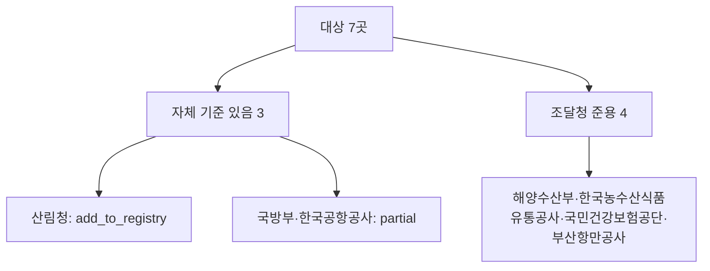

# 규칙 명단 미등록 국가계약 기관 7곳 용역 적격심사 자체 기준 조사 (B군)

> **작성일**: 2026-10-14
> **작업**: Orca Task `task_2f34700c8e26` (builder), Run `run_43cef2f8bd69`, Dispatch `ctx_c3b88fd1517e`
> **정본 사양**: `.orca/capsules/task_icb_institution_candidates/capsule.yaml` (`ORCA_TASK_CAPSULE_V2`)
> **산출물**: 본 문서와 [institution_rules_candidates_b_20261014.yaml](../../data/reference/institution_rules_candidates_b_20261014.yaml)
> **대상**: 규칙 명단 [institution_rules_20261013.yaml](../../data/reference/institution_rules_20261013.yaml) 에 없는 국가계약 기관 7곳 — 부산항만공사, 한국공항공사, 국방부(국군재정관리단 포함), 해양수산부(지방해양수산청 포함), 산림청(지방산림청·국립자연휴양림관리소 포함), 한국농수산식품유통공사, 국민건강보험공단
> **역할 경계**: 코드·설정·패키지·기존 명단을 변경하지 않았다. 본 문서와 후보 명세 YAML 두 파일만 커밋한다.
> **원문 취급**: 내려받은 첨부·원문은 `.cache/inst_candidates/` 아래에만 두었고 커밋하지 않는다(`.cache` 는 gitignore 대상).
> **판정 규칙**: [servc_formula_collection_central_20261004.md](servc_formula_collection_central_20261004.md:31) 2절의 10개 규칙을 그대로 따른다. 계수 생략 시 평탄 대입이 인쇄 점수와 맞을 때만 k=1 이고, 대입값이 인쇄 점수와 0.01점이라도 다르면 미확정이다. 접속 실패를 기준 없음으로 단정하지 않는다.

---

## 1. 결론

| # | 기관 | 공고 수(1년) | 자체 기준 | 원문 확보 | recommendation | 근거 요약 |
| ---: | --- | ---: | :---: | :---: | --- | --- |
| 1 | 산림청 | 136 | 있음 | 확보 | add_to_registry | 자체 예규 제728호(2025-12-01). 별표 1~5 B·k·기준비율·평탄점수·통과점수 확인, 검산 전부 일치 |
| 2 | 국방부 | 114 | 있음 | 확보 | partial | 자체 훈령 제2987호(2024-12-03). 별표 1 배점한도 30·50·70·90 확인. 배점한도 30 은 계수 미인쇄로 k 미확정, 구간 라벨은 추정 |
| 3 | 한국공항공사 | 174 | 있음 | 부분 | partial | 자체 적격심사 세부기준 존재(첨부가 "우리 공사 적격심사기준" 인용). 전사 규정·통과점수 미확보, 개별 공고 첨부만 확인 |
| 4 | 해양수산부 | 255 | 없음 | - | pps_standard_applies | 조달청 기술용역·일반용역 기준 별표를 그대로 첨부(파일명에 "조달청" 명기) |
| 5 | 한국농수산식품유통공사 | 50 | 없음 | - | pps_standard_applies | 공고 첨부가 "조달청 일반용역 적격심사 세부기준(조달청공고)" 공고번호·시행일까지 명기 |
| 6 | 국민건강보험공단 | 50 | 없음 | - | pps_standard_applies | 공고서 본문이 "조달청 적격심사 세부기준"을 인용, 자체 기준 첨부 없음 |
| 7 | 부산항만공사 | 88 | 없음 | - | pps_standard_applies | 공고문이 "조달청 일반용역 적격심사 세부기준(제2026-390호)" 및 적용 [별표6]까지 명기 |

- add_to_registry 1곳, partial 2곳, pps_standard_applies 4곳이다. 원문을 확보하지 못해 source_unavailable 로 남긴 기관은 없다.
- 확정 구간은 산림청 5개뿐이다. 국방부·한국공항공사는 자체 기준의 존재는 확인했으나 전사 규정 또는 구간 라벨·통과점수가 확정되지 않아 band 를 `status: partial` 로 두었다.

---

## 2. 조사 방법과 수집 경로

| 항목 | 값 |
| --- | --- |
| DB 조회 | `uv run python scripts/db_readonly_query.py --sql "<단일 SELECT>"` (읽기 전용, 운영 DB 쓰기 없음) |
| 첨부 수집 | `procurement.bid_announcements` 의 `raw_data.ntceSpecDocUrl1~10`·`ntceSpecFileNm1~10` 을 `JSON_UNQUOTE(JSON_EXTRACT(...))` 로 추출, `https://www.g2b.go.kr` 첨부만 내려받음(요청 간 1초) |
| 본문 추출 | 저장소 `scripts/extract_score_params.py` 의 `extract_document_text` (HWP·HWPX·HWPML) |
| PDF 판독 | PDF 는 위 추출기가 지원하지 않아 문서 리더로 텍스트를 읽었다(예: 산림청 별표 PDF, 부산항만공사 공고문 PDF) |
| 행정규칙 | 국가법령정보센터 `law.go.kr` 행정규칙 검색 및 `flDownload.do` |
| 금지 준수 | 운영 DB 쓰기·docker 조작 없음, 새 Python 라이브러리 추가 없음, 상업 게시판 계수 전재 없음(제목·개정일 단서만) |

내려받은 주요 파일(모두 `.cache/inst_candidates/` 아래, 커밋하지 않음):

| 기관 | 파일 | 형식 | 비고 |
| --- | --- | --- | --- |
| 산림청 | `kfs/R26BK01716646_f5.hwpx` | HWPX | 예규 본문(제1조~부칙) |
| 산림청 | `law/kfs_byl.pdf` | PDF 27쪽 | law.go.kr `flSeq=158265701`, 별표 1~6 |
| 국방부 | `mnd/R26BK01300416_f7.hwp` | HWP | 기술용역 적격심사기준에 관한 훈령(2024-12-03) |
| 국방부 | `mnd/out/f1_0.hwpx` | HWPX | 국군재정관리단 입찰공고문(26-A130), 훈령 적용 문구 |
| 한국공항공사 | `kac/R26BK01721579_f4.hwpx` | HWPX | 기술용역 적격심사 세부기준(고시금액 미만) |
| 한국공항공사 | `kac/R26BK01754057_f4.hwp` | HWP | 기술용역 적격심사 기준(배점한도 70) |
| 한국공항공사 | `kac/R26BK01733618_f3.hwpx` | HWPX | 용역 적격심사 세부기준(건설폐기물처리용역) |
| 한국공항공사 | `kac/R26BK01717869_f4.hwpx` | HWPX | 시설분야용역 적격심사 항목·배점한도 |
| 해양수산부 | `mof/R26BK01764937_f4.hwpx` | HWPX | [별표 1] 조달청 기술용역 적격심사 세부기준 |
| 해양수산부 | `mof/R26BK01737194_f4.hwpx` | HWPX | [별표 7] 조달청 일반용역 적격심사 세부기준(수리·점검) |
| 해양수산부 | `mof/R26BK01676624_f4.hwpx` | HWPX | 건설폐기물처리용역 적격업체 평가기준 [별표] |
| 국민건강보험공단 | `nhis/R26BK01766450_f3.hwp` | HWP | 입찰공고서, 조달청 기준 인용 문구 |
| 부산항만공사 | `bpa/R26BK01689561_f2.pdf` | PDF | 공고문, 조달청 기준·[별표6] 인용 |

---

## 3. 기관별 조사 결과

### 3.1 산림청 — add_to_registry

**시도 경로**

| 경로 | 응답 | 결과 |
| --- | --- | --- |
| 나라장터 첨부 스윕(Servc 낙030001, `산림청%`, 2025-10-14 이후) | DB | `R26BK01716646-000` 등에 예규 원문 HWPX 첨부 확인 |
| 국방부·산림청 공고 첨부 내려받기(`산림청 산림사업 적격심사 세부기준(예규)(제728호)(20251201).hwpx`) | 200 | 본문(제1조~부칙) 확인 |
| 국가법령정보센터 행정규칙 `flDownload.do?flSeq=158265701` | 200 | 별표 1~6 PDF 27쪽 확보 |
| 국가법령정보센터 행정규칙 `admRulSeq=2100000208674` | 200 | 문서 식별(제정 2013-01-28 예규 제613호, 개정 2025-12-01 예규 제728호) |

**확인한 기준 문서**

| 항목 | 값 |
| --- | --- |
| 문서명 | 산림청 산림사업 적격심사 세부기준 |
| 문서번호·시행일 | 예규 제728호, 2025-12-01 개정·시행 (부칙 제1조 발령일부터 시행) |
| 적용 범위 | 산림청 및 소속기관이 발주하는 산림사업(제1조·제2조) |
| 통과점수 | 종합평점 95점 이상(제5조①). 규모별로 달라지지 않음 |
| 근거 | `.cache/inst_candidates/kfs/R26BK01716646_f5.hwpx`, `.cache/inst_candidates/law/kfs_byl.pdf` |

**구간별 검산** (평점 = B − k × |기준/100 − 입찰가격/예정가격| × 100)

| 별표(추정가격) | B | k | 기준 | 평탄 문장(원문) | 통과점수 | 인쇄점수 | 대입값 | 역산 하한율 | 판정 |
| --- | ---: | ---: | ---: | --- | ---: | ---: | ---: | ---: | --- |
| 별표 1 (50억원 이상) | 50 | 2 | 88 | 90.5% 이상 45점 | 95 | 45 | 50−2×2.5 = 45.000 | 85.495 | 일치 |
| 별표 2 (50억원 미만 10억원 이상) | 70 | 4 | 88 | 89.25% 이상 65점 | 95 | 65 | 70−4×1.25 = 65.000 | 86.745 | 일치 |
| 별표 3 (10억원 미만 3억원 이상) | 80 | 20 | 88 | 88.25% 이상 75점 | 95 | 75 | 80−20×0.25 = 75.000 | 87.745 | 일치 |
| 별표 4 (3억원 미만 1억원 이상) | 90 | 20 | 88 | 88.25% 이상 85점 | 95 | 85 | 90−20×0.25 = 85.000 | 87.745 | 일치 |
| 별표 5 (1억원 미만) | 90 | 20 | 88 | 88.25% 이상 85점 | 95 | 85 | 90−20×0.25 = 85.000 | 87.745 | 일치 |

- 원문 인용: 별표 1 은 `kfs_byl.pdf:222,226,231`, 별표 2 는 `:222,224,231`, 별표 3 은 `:265,267`, 별표 4 는 `:306,310,314`, 별표 5 는 `:353,357,362` 다.
- 다섯 별표 모두 평탄 대입값이 인쇄 점수와 정확히 일치한다(규칙 7).
- 제8조는 이 기준에 없는 사항은 기획재정부 계약예규와 조달청 집행기준을 적용한다고 정한다.

### 3.2 국방부(국군재정관리단 포함) — partial

**시도 경로**

| 경로 | 응답 | 결과 |
| --- | --- | --- |
| 나라장터 첨부 스윕(Servc, `국방부%` 및 `국군재정관리단`, 2025-10-14 이후) | DB | `R26BK01300416-000` 에 훈령 원문 HWP 첨부 확인 |
| 훈령 내려받기(`7. 기술용역 적격심사기준에 관한 훈령(2024.12.03.).hwp`) | 200 | 별표 1 평가기준표 4개의 배점한도·평점산식 확인 |
| 국군재정관리단 `R26BK01759112-000` 첨부 zip 판독 | 200 | 입찰공고문에 "국방부 기술용역적격심사기준에 관한 훈령을 적용" 문구 확인 |
| 국가법령정보센터 `admRulInfoP.do?admRulSeq=2100000253350` | 200 | 제1조·제2조 본문 일부와 연혁(제2762호, 2023-01-11)만 확인. 별표 본문 텍스트는 확보 실패 |

**확인한 기준 문서**

| 항목 | 값 |
| --- | --- |
| 문서명 | 기술용역 적격심사기준에 관한 훈령 |
| 문서번호·시행일 | 국방부훈령 제2987호(첨부 표제 기준), 2024-12-03 개정·시행. law.go.kr 연혁에는 제2762호(2023-01-11)가 조회됨 |
| 적용 범위 | 국방부 본부·소속기관·국직부대·국직기관·합참·각군이 집행하는 기술용역입찰(제1조·제2조) |
| 통과점수 | 추정가격 30억원 이상 85점, 30억원 미만 10억원 이상 90점, 10억원 미만 95점(제9조) |
| 일반용역 | 별도 "일반용역 적격심사기준에 관한 훈령"(국방부훈령 제3176호, 2026-06-22)을 둔다(원문 미확보, 검색 단서만) |
| 근거 | `.cache/inst_candidates/mnd/R26BK01300416_f7.hwp`, `.cache/inst_candidates/mnd/out/f1_0.hwpx` |

**구간별 확인값**

| 평가기준표(구간 라벨 추정) | B | k | 기준 | 평탄 문장(원문) | 통과점수(제9조) | 인쇄점수 | 대입값 | 판정 |
| --- | ---: | ---: | ---: | --- | ---: | ---: | ---: | --- |
| 기준표 1 (10억원 이상) | 30 | 미확정 | 88 | 없음 | 30억 이상 85 / 10억~30억 90 | 없음 | 산출 불가 | 미확정(규칙 5, 계수 미인쇄) |
| 기준표 2 (고시금액 이상 10억원 미만) | 50 | 2 | 88 | 90.5% 이상 45점 | 95 | 45 | 50−2×2.5 = 45.000 | 일치 |
| 기준표 3 (고시금액 미만, 사업수행능력평가 대상) | 70 | 4 | 88 | 89.25% 이상 65점 | 95 | 65 | 70−4×1.25 = 65.000 | 일치 |
| 기준표 4 (고시금액 미만, 사업수행능력평가 비대상) | 90 | 미확인 | 미확인 | 미확인 | 95 | 인쇄 없음 | 산출 불가 | 미확인 |

- 원문 인용: 기준표 1 은 `R26BK01300416_f7.hwp:17,20,21`, 기준표 2 는 `:58,61`, 기준표 3 은 `:68,71`, 기준표 4 는 `:73,81` 이다. 통과점수는 같은 파일 제9조 문장이다.
- 기준표 1 은 산식이 `30 − (88/100 − 입찰가격/예정가격) × 100` 으로 인쇄되어 계수 자리가 없고 평탄 문장도 없다. 규칙 5에 따라 k=1 로 두지 않는다(방위사업청 별표 1 과 같은 형태).
- 기준표 4 는 배점한도 90 만 인쇄되고 "평점산식 참조"만 있어 산식 행을 읽지 못했다.
- 구간 라벨(추정가격 경계)은 훈령 별표 1 본문에서 직접 인쇄를 확인하지 못했고, 제9조 통과점수 경계와 조달청 기술용역 기준 구조, 다른 국방부 공고의 "추정가격 5억원 미만 고시금액 이상인 용역" 적용 문구로 대응시킨 것이다. 그래서 네 구간 모두 `status: partial` 로 두었다.

### 3.3 한국공항공사 — partial

**시도 경로**

| 경로 | 응답 | 결과 |
| --- | --- | --- |
| 나라장터 첨부 스윕(Servc 낙030001, `한국공항공사%`, 2025-10-14 이후) | DB | "적격심사 세부기준"·"적격심사기준"·"기술용역 적격심사세부기준" 명칭 첨부 다수(김포·김해·제주·대구·양양·청주·울산 등) |
| 첨부 4건 내려받아 본문 판독 | 200 | 산식·배점한도 확인. 본문이 "우리공사 적격심사기준"·"우리 공사 기술용역 적격심사 세부기준"·"우리공사 일반용역 적격심사 세부기준 [별표 2]"를 인용 |
| 공사 홈페이지·전자조달 규정/자료실 | 200 | 전사 규정(지침) 원문 게시 위치 확인 실패 |
| 웹 검색 | 200 | 상업·교육 게시판에 전사 규정 전문 게시물 다수(개정 2026-03-02, 2026-08-14 등). 규칙 1에 따라 계수 전재 없이 제목·개정일 단서만 기록 |

**확인한 기준 문서**

| 항목 | 값 |
| --- | --- |
| 문서명 | 한국공항공사 일반용역 적격심사 세부기준 / 기술용역 적격심사 세부기준 / 시설분야용역 적격심사 세부기준 |
| 문서번호·시행일 | 전사 규정 원문 미확보로 확정 불가. 개별 공고 첨부에서 "우리 공사 적격심사기준" 인용만 확인 |
| 근거 | `.cache/inst_candidates/kac/R26BK01721579_f4.hwpx`, `R26BK01754057_f4.hwp`, `R26BK01733618_f3.hwpx`, `R26BK01717869_f4.hwpx` |

**개별 공고 첨부에서 읽은 값**

| 첨부(공고) | 용역 유형 | B | k | 기준 | 평탄 문장(원문) | 인쇄점수 | 대입값 | 판정 |
| --- | --- | ---: | ---: | ---: | --- | ---: | ---: | --- |
| `R26BK01721579_f4` (인천ACC 정밀안전점검) | 기술용역 | 90 | 20 | 90 | 90.25% 이상 85점 | 85 | 90−20×0.25 = 85.000 | 일치 |
| `R26BK01754057_f4` (김해 국제선 승강시설 CM) | 기술용역 | 70 | 4 | 90 | 91.25% 이상 65점 | 65 | 70−4×1.25 = 65.000 | 일치 |
| `R26BK01733618_f3` (대구 폐아스콘 처리) | 용역 | 70 | 20 | 88 | 88.25% 이상 65점 | 65 | 70−20×0.25 = 65.000 | 일치 |
| `R26BK01717869_f4` (김포 소음대책 지원) | 시설분야용역 | 70 | 5 | 93 | 96% 이상은 96%인 경우의 점수 | 미인쇄 | 산출 불가 | 미확정(원문 미인쇄) |

- 규칙 2에 따라 개별 공고 배점표는 전사 규정이 아니다. 따라서 위 값은 기관 자체 문서에서 읽은 관측값이며, 통과점수를 확정하지 못해 후보 YAML 에서 `status: partial` 로 두었다.
- 값이 문서마다 다르다(기술용역 B=90·k=20·기준 90, 기술용역 B=70·k=4·기준 90, 용역 B=70·k=20·기준 88, 시설분야용역 B=70·k=5·기준 93). 전사 규정의 구간표 없이 하나의 규칙으로 확정할 수 없다.

### 3.4 해양수산부(지방해양수산청 포함) — pps_standard_applies

**시도 경로**

| 경로 | 응답 | 결과 |
| --- | --- | --- |
| 나라장터 첨부 스윕(Servc 낙030001, `해양수산부%` 및 `%지방해양수산청%`, 2025-10-14 이후) | DB | 조달청 기준 별표 첨부 다수. 자체 기준 명칭 첨부 없음 |
| `R26BK01764937_f4` 판독 | 200 | 파일명 "[별표 1] 심사항목 및 배점한도(조달청 기술용역 적격심사 세부기준)" |
| `R26BK01737194_f4` 판독 | 200 | 파일명 "[별표 7] 수리·점검용역 적격심사(조달청 일반용역 적격심사 세부기준)" |
| `R26BK01676624_f4` 판독 | 200 | "[별표] 평가항목 및 배점기준(제2조 관련)(건설폐기물처리용역 적격업체 평가기준)" |
| 국가법령정보센터 행정규칙(해양수산부) | 200 | 해양수산부 명의 용역 적격심사 세부기준 미확인 |

**확인값(조달청 기준이므로 명단에 넣지 않음)**

| 첨부 | 기준 | B | k | 기준비율 | 평탄 문장 | 대입값 | 판정 |
| --- | --- | ---: | ---: | ---: | --- | ---: | --- |
| `R26BK01764937_f4` | 조달청 기술용역 [별표 1] 고시금액 미만 | 90 | 20 | 90 | 90.25% 이상 85점 | 90−20×0.25 = 85.000 | 일치 |
| `R26BK01737194_f4` | 조달청 일반용역 [별표 7] 수리·점검용역 | 60/70 | 2/4 | 90 | 97.5% / 93.75% | 규모별 상이 | 조달청 값 |
| `R26BK01676624_f4` | 건설폐기물처리용역 적격업체 평가기준 (2억원 미만) | 70 | 20 | 88 | 88.25% 이상 65점 | 70−20×0.25 = 65.000 | 일치 |

- 세 첨부 모두 파일 제목에 조달청 기준 또는 그 별표임이 명기된다. 자체 기준을 만들었다는 근거는 확인되지 않았다.

### 3.5 한국농수산식품유통공사 — pps_standard_applies

**시도 경로**

| 경로 | 응답 | 결과 |
| --- | --- | --- |
| 나라장터 첨부 스윕(Servc 낙030001, `한국농수산식품유통공사%`, 2025-10-14 이후) | DB | 다수 공고가 "조달청 일반용역 적격심사 세부기준(조달청공고)" PDF 첨부 |
| 첨부 파일명 대조(물류·보험·블렌딩·정선 등) | DB | 공고 제2026-260호(2026-05-26), 제2026-390호(2026-07-27) 두 판본만 확인 |
| 국가법령정보센터 행정규칙(한국농수산식품유통공사) | 200 | 공사 명의 용역 적격심사 세부기준 미확인 |

- 예: `R26BK01748192-000`, `R26BK01725506-000` 은 "5. 조달청 일반용역 적격심사 세부기준(조달청공고)(제2026-390호)(20260727).pdf", `R26BK01708399-000` 은 제2026-260호 PDF 를 첨부한다.
- 첨부 PDF 는 조달청 기준이므로 계수 전재 없이 제목·공고번호·시행일만 기록했다.

### 3.6 국민건강보험공단 — pps_standard_applies

**시도 경로**

| 경로 | 응답 | 결과 |
| --- | --- | --- |
| 나라장터 첨부 스윕(Servc 낙030001, `국민건강보험공단%`, 2025-10-14 이후) | DB | 첨부는 입찰공고서·과업지시서·공내역서류. 적격심사 세부기준·별표 첨부 없음 |
| `R26BK01766450_f3` (입찰공고서) 본문 판독 | 200 | "입찰방법 : 제한경쟁 / 적격심사 / 총액계약" 및 "그 외 조달청 적격심사 세부기준에서 정하는 적격심사를 위해 필요한 자료 일부" 문구 확인 |
| 국가법령정보센터 행정규칙(국민건강보험공단) | 200 | 공단 명의 용역 적격심사 세부기준 미확인 |

- 공고서 본문이 조달청 기준 적용을 명시하므로 자체 기준 없음으로 판정한다. 접속 실패가 아니라 원문 근거다.

### 3.7 부산항만공사 — pps_standard_applies

**시도 경로**

| 경로 | 응답 | 결과 |
| --- | --- | --- |
| 나라장터 첨부 스윕(Servc 낙030001, `부산항만공사%`, 2025-10-14 이후) | DB | 용역 공고 첨부는 공고문·사업수행능력평가(PQ) 기준·설계서뿐. 자체 적격심사 세부기준 첨부 없음 |
| `R26BK01689561-000` 공고문 PDF 판독 | 200 | "조달청 일반용역 적격심사 세부기준(조달청공고 제2026-390호, 2026.07.27.)에 의거 적격심사", "[별표6] 보험용역 적격심사(추정가격 5억원 미만)" 적용 명시 |
| `R26BK01768734-000` 공고문 PDF·HWP 판독 | 200 | 적격심사 기준 인용 없음. "공고문에 언급되지 않은 사항은 국가계약법령·계약예규" 문구만 확인 |
| 공사 홈페이지(`www.busanpa.com`) | 200 | 규정·자료실의 적격심사 세부기준 문서 경로 확인 실패 |
| 웹 검색 | 200 | 공사 자체 용역 적격심사 세부기준 문서 미확인(검색 결과는 부산광역시 기준) |

- 공고문이 조달청 기준과 적용 별표까지 특정하므로 자체 기준 없음으로 판정한다. 공사(공사 범주) 공고도 "[붙임1] 조달청 입찰참가자격사전심사기준(지침)"을 첨부한다.

---

## 4. 명단 반영 시 주의점

| 항목 | 내용 |
| --- | --- |
| 별칭 충돌 | 대상 7곳의 기관명·별칭은 기존 명단 18곳의 이름·별칭과 겹치지 않는다(대조 완료). 다만 `국방부%` 접두는 국군재정관리단·한국국방연구원·각 군단 등 부속기관을 함께 잡는다. 수요기관 축(`dminsttNm`)을 그대로 쓰면 부속기관명이 별칭 목록에 없을 때 매칭이 빗나가므로 별칭 목록에 실제 `dminstt_nm` 표기를 넣어야 한다. |
| 조달청 대행 공고 비율 | 4곳(해양수산부·한국농수산식품유통공사·국민건강보험공단·부산항만공사)은 조달청 기준을 준용한다. 이들은 기관 규칙을 만들면 오히려 조달청 별표와 충돌할 수 있으므로 `RULE_NOT_FOUND` 경로를 유지해 조달청(ALL) 규칙으로 처리되게 하는 편이 맞다. |
| 산림청 적용 범위 | 산림청 기준은 "산림사업" 전용이다(제1조·제2조). 산림청 발주 일반용역(청소·경비 등)에 이 기준을 적용하면 안 된다. 나라장터 Servc 공고 중 산림사업에 해당하는 공고만 이 규칙을 적용하도록 용역 유형 판정이 필요하다. 또한 구간이 50억/10억/3억/1억 경계라 조달청 일반용역 구간(고시/5억/10억/30억)과 다르다. |
| 국방부·한국공항공사 미확정 | 두 기관은 자체 기준의 존재는 확실하나 확정 구간이 0개다. 명단에 넣으려면 국방부는 전사 훈령 별표 1 의 구간 라벨을, 한국공항공사는 전사 규정(일반용역·기술용역·시설분야용역) 원문을 추가로 확보해야 한다. 확보 전에는 `RULE_NOT_FOUND` 로 두는 편이 조달청 기준 오적용을 막는다. |
| 기존 기관과의 관계 | 한국공항공사는 인천국제공항공사·인천공항시설관리(주)(이미 기관 규칙 보유)와 별개 법인이다. `한국공항공사%` 접두가 인천공항공사 공고를 잡지 않도록 주의한다. 산림청 국립수목원·국립산림과학원 등 부속기관은 산림사업 발주가 적어 실제 매칭 빈도가 낮을 수 있다. |
| 공고 수 기준 | `announcements_last_year` 는 코디네이터 집계(2026-10-14) 값이다. 참고로 별도 실측(`COUNT(DISTINCT bid_ntce_no)`)은 부산항만공사 78, 한국공항공사 192, 국방부 132, 해양수산부 533, 산림청 256, 한국농수산식품유통공사 61, 국민건강보험공단 80 이었다(집계 조건 차이). |

---

## 5. 검증

| 항목 | 값 |
| --- | --- |
| 규칙 검증 | `python3 scripts/validate_agent_rules.py --quiet` |
| 문서 링크 시험 | `uv run pytest tests/test_validate_doc_links.py -q` |
| YAML 파싱 | `python3 -c "import yaml; yaml.safe_load(open('data/reference/institution_rules_candidates_b_20261014.yaml'))"` |
| 후보 스키마 대조 | 기존 명단 institutions 항목 키 12개 + 판정 필드 4개 = 16개를 7곳 모두 보유(누락 0) |
| 하한율 검산 | k·통과점수·기준비율이 있는 5개 행(산림청)과 2개 행(국방부 partial)의 `lwlt_rate` 가 `base_ratio − (100 − pass_score)/k` 의 .995 표기와 일치 |
| 코드 변경 | 없음. `src/`, 테스트, DB 스키마, Meilisearch 색인, Docker 관련 파일 미변경 |
| 변경 파일 | `docs/analysis/institution_candidates_b_20261014.md`, `data/reference/institution_rules_candidates_b_20261014.yaml` |
| 작업 브랜치 | `kwanbum217/orca-icb` (`main` 직접 커밋 없음) |

---

## 6. 참고

- [institution_rules_candidates_b_20261014.yaml](../../data/reference/institution_rules_candidates_b_20261014.yaml) — 후보 명세
- [institution_rules_20261013.yaml](../../data/reference/institution_rules_20261013.yaml) — 기존 기관 규칙 명단(이번 작업에서 미변경)
- [institution_rule_inventory_20261013.md](institution_rule_inventory_20261013.md) — 기관별 인벤토리와 판정 설계
- [servc_formula_collection_central_20261004.md](servc_formula_collection_central_20261004.md) — 판정 규칙 10개와 중앙부처·공단 9곳
- [partial_institution_sources_20261013.md](partial_institution_sources_20261013.md) — 기존 partial 기관 원문 재수집
- `.cache/inst_candidates/` — 내려받은 원문과 추출 텍스트(커밋하지 않음)
