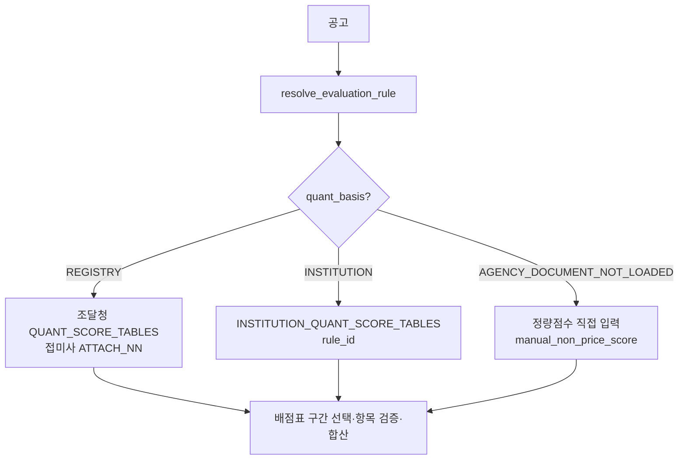

# 기관 정량평가 배점표 서빙 반영 (Q3)

> **작성일**: 2026-10-13
> **작업**: Orca Task `task_5a70e8aa8d69` (builder)
> **정본 사양**: `.orca/capsules/task_5a70e8aa8d69/capsule.yaml` (`ORCA_TASK_CAPSULE_V2`)
> **선행 명세**: [institution_quant_tables_20261013.yaml](../../data/reference/institution_quant_tables_20261013.yaml)(Q2) · [institution_quant_tables_20261013.md](institution_quant_tables_20261013.md)
> **규칙 정본**: [institution_rules_apply_20261013.md](institution_rules_apply_20261013.md)(R2)
> **범위**: 기관 규칙이 적용된 공고의 평가 API·화면이 정량점수 직접 입력 대신 그 기관의 배점표(심사항목별 배점한도)로 입력·검증·합산

---

## 1. 요약

Q2 명세(기관 10곳, 규칙 67개, 구간 136개)를 서빙 코드에 반영했습니다. 기관 10곳의 확정
규칙 65개·구간 131개를 `src/app/services/evaluation_quant_institution.py` 의
`INSTITUTION_QUANT_SCORE_TABLES`(rule_id 키 `QuantScoreTable`)로 생성하고, 이 규칙들의
`quant_basis` 를 `INSTITUTION` 으로 바꿨습니다. 이제 기관 규칙이 적용된 공고는 배점표
심사항목을 그대로 입력받아 배점한도로 검증·합산합니다.

명세가 부분인 한국가스공사 규칙 2개는 배점표를 확정할 수 없어 종전처럼 정량점수 직접
입력을 유지합니다. 조달청·LOCAL 규칙의 배점표 조회와 평가 결과는 하나도 바뀌지 않습니다.

| 항목 | 값 |
| --- | --- |
| 기관 배점표 반영 규칙 | 65개 (10곳 중 한국가스공사 제외) |
| 반영 구간(band) | 131개 (Q2 136구간 - 한국가스공사 5구간) |
| 직접 입력 유지 규칙 | 2개 (한국가스공사 GENERAL·FACILITY) |
| 조달청·LOCAL 배점표 변경 | 없음 (`QUANT_SCORE_TABLES` 14키 그대로) |
| DB 스키마·데이터 변경 | 없음 |

---

## 2. 반영 구조

| 파일 | 내용 |
| --- | --- |
| `src/app/services/evaluation_quant_institution.py` | 생성본. `INSTITUTION_QUANT_SCORE_TABLES`(rule_id 키). `is_institution=True` |
| `scripts/build_institution_quant_tables.py` | Q2 YAML 에서 생성. `--check` 로 커밋본과 명세 일치를 고정 |
| `src/app/services/evaluation_rules.py` | `QUANT_BASIS_INSTITUTION` 추가, `QuantScoreBand.upper_bound`·`QuantScoreTable.is_institution` 추가, 기관 규칙 `quant_basis` 전환, `quant_score_table_for_rule` 의 rule_id 조회, 기관 구간 선택 |
| `src/app/api/v1/evaluations.py` | 기관 배점표 입력 검증(`_resolve_institution_quant_inputs`), 기관 표는 조달청 별표 10·11 입력표를 노출하지 않음 |
| `src/app/templates/bids/detail.html` | 기관 표의 신인도 행을 "배점표 없음"으로 표시 |

- 조회 분기: `quant_score_table_for_rule` 은 `quant_basis == INSTITUTION` 이면 생성 모듈에서
  `rule.rule_id` 로 표를 찾습니다. 순환 임포트를 피하려고 조회 시점에 지연 임포트합니다.
- 생성 정본: 소스에서 YAML 을 읽지 않습니다(`src` 에서 pyyaml 미의존). 값을 바꾸려면 Q2 YAML 을
  고치고 `scripts/build_institution_quant_tables.py` 를 다시 실행합니다.

---

## 3. 항목 키: 조달청 스키마와 다른 점

기관 표의 심사항목을 입력 키로 옮긴 결과입니다. 의미가 같으면 조달청 키
(`performance`·`management`·`technical_capacity`·`labor_plan`·`reputation`·`price`·
`disqualification`·`insurance_payment_ability`·`after_service`·`technical_credit`)를 그대로
쓰고, 조달청 표에 없던 항목은 새 키를 둡니다.

| 기관 원문 항목명 | 입력 키 | 조달청과 다른 점 |
| --- | --- | --- |
| 이행실적 · 수행실적 · 당해/해당 용역 수행능력 | `performance` | 국토교통부·환경부는 수행능력을 한 덩어리(배점한도)로만 인쇄해 하위 분해가 없음 |
| 경영상태(신용평가등급) · 경영상태 | `management` | 조달청은 `credit_grade` 선택이지만 기관은 원문 등급표가 달라 **점수 직접 입력**(`score`) |
| 기술능력(기술인력 보유·안전성 정도·장비 보유상황) | `technical_capacity` | 의미 동일 |
| 기술능력(기술신용평가등급) | `technical_credit` | 의미 동일 |
| 기술능력 나. 기술 보유상황 | `technical_asset` | **신설** |
| 근로조건 이행계획의 적정성 | `labor_plan` | 의미 동일 |
| 신인도 | `reputation` | 배점한도 숫자가 없어 입력 불가(합계 제외) |
| 입찰가격 | `price` | 계산 경로 유지 |
| 결격사유 | `disqualification` | 감점, 합계 제외 |
| 보험금 지급능력(지급여력비율) | `insurance_payment_ability` | 의미 동일 |
| 사후관리(A/S) | `after_service` | 의미 동일 |
| Ⅰ. 조사이행능력(전문성) | `research_capacity` | **신설**(국가유산청) |
| 준비상태 | `readiness` | **신설**(한국수력원자력) |
| 준비상태(근로기준법 준수확약) | `readiness_labor` | **신설** |
| 준비상태(경비지도사 보유) | `readiness_guard` | **신설**, 원문 판정 항목(`absent`) |
| 1. 사업경험 가. 이행실적 | `performance_business` | **신설**(인천국제공항공사 아웃소싱) |
| 1. 사업경험 나. 매출액 | `revenue` | **신설** |
| 사업관리능력 | `project_management` | **신설** |

- 기관 표는 조달청 별표 10(신용평가등급 점수표)·별표 11(신인도 항목표)을 쓰지 않습니다.
  경영상태는 배점한도 안에서 점수로 직접 입력하고, 신인도는 명세에 배점한도 숫자가 없어
  입력을 막고 합계에서 제외합니다(추정 금지). 그래서 응답의 `credit_grades`·
  `reputation_items` 는 기관 표에서 빈 배열입니다.
- `management_grade`·`management_score`·`reputation_items`·`credibility_score` 를 기관 표에
  보내면 조용히 무시하지 않고 `QUANT_ITEM_NOT_IN_TABLE` 로 계산을 막습니다.

---

## 4. 구간 판정: 추정가격 경계

기관 배점표는 조달청 별표처럼 5억원 이상/미만 두 구간이 아니라 고시금액·1억·2억·2.5억·5억·
10억·30억 등 기관 원문 구간을 씁니다. `QuantScoreBand.upper_bound` 에 원문 표기의 상한을
옮겨(생성 스크립트가 `N억원 미만`·`고시금액 미만` 만 해석, 추정 금지) `select_quant_band` 이
추정가격으로 그 구간을 고릅니다. 구간이 여러 개인데 추정가격이 없으면 임의로 고르지 않고
사유와 함께 계산을 막습니다. 생성본은 구간을 상한 오름차순으로 정렬합니다.

---

## 5. 직접 입력으로 남긴 규칙과 사유

| 규칙 | 사유 |
| --- | --- |
| `SERVC_INST_KOGAS_20260709_GENERAL` | 별표 9 가 심사분야 구조만 인쇄하고 배점한도 숫자는 본문 제16조①에 있음. 입찰가격 배점한도 B 가 추정가격이 아니라 용역수행능력 계량화 정도(100%/70% 이상/70% 미만/별표10 준용)로 갈려 단일 추정가격 축으로 확정 불가 |
| `SERVC_INST_KOGAS_20260709_FACILITY` | 시설분야도 같은 별표 9 미확정 사안 |

- 두 규칙은 `quant_basis=AGENCY_DOCUMENT_NOT_LOADED` 로 두어 평가 API 가 종전처럼
  `manual_non_price_score` 직접 입력을 요구합니다(`LOCAL_QUANT_REQUIRED`).
- Q2 명세의 `quant_table_status` 가 `confirmed` 인 규칙만 표를 만듭니다(생성 스크립트가
  `confirmed` 만 순회). `partial` 기관은 애초에 규칙 레지스트리에 없습니다.

---

## 6. 화면 변화

- 적용 별표가 기관 표이면 정량평가 입력표가 기관 심사항목과 배점한도로 그려집니다. 항목은
  숫자 입력란(0~배점한도)이며, 경영상태는 조달청 등급 선택 콤보가 아니라 숫자 입력입니다.
- 기관 표는 `credit_grades`·`reputation_items` 가 빈 배열이라 조달청 별표 10·11 입력 섹션을
  그리지 않습니다. 신인도 행은 원문 신인도표 미반영을 알리기 위해 "배점표 없음"으로
  표시합니다.
- 구간 라벨은 기관 원문 표기(예: "추정가격 고시금액 이상 10억원 미만인 용역")를 그대로
  보여 줍니다.

---

## 7. 검증

| 항목 | 값 |
| --- | --- |
| 생성 일치 | `uv run python scripts/build_institution_quant_tables.py --check` |
| 배점표 시험 | `uv run pytest tests/test_evaluation_quant_institution.py -q` (규칙·구간·항목 값 YAML 대조, 구간 선택, 조달청 불변) |
| 평가 API 시험 | `uv run pytest tests/test_evaluations_api.py -q` (기관 표 입력·합산, 한도 초과 차단, 한국가스공사 직접 입력 유지) |
| 규칙 축 시험 | `uv run pytest tests/test_evaluation_rules_scope_axis.py -q` (quant_basis 와 표 레지스트리 정합) |
| 전량 시험 | `uv run pytest tests/ -q -m 'not data_assets'` |
| 타입 | `uv run mypy src` |
| 규칙 검증 | `python3 scripts/validate_agent_rules.py --quiet` |
| 조달청 불변 | `QUANT_SCORE_TABLES` 14키 유지, `quant_score_table_for_rule` 이 조달청 규칙에서 같은 객체 반환 |

---

## 8. 남은 리스크와 후속

| 항목 | 내용 |
| --- | --- |
| 기관 경영상태 등급표 | 원문 등급표(예: 국가유산청 별지 1-3)를 코드화하지 않아 배점한도 안에서 점수 직접 입력입니다. 등급표 자동 환산은 후속 과업입니다. |
| 기관 신인도표 | 원문 신인도표(별표 10·11·13 등)가 명세에 숫자로 없어 입력을 막았습니다. 합계 검산은 신인도·결격사유 제외 규약과 맞습니다. |
| 세부 평가기준 | Q2 명세의 `details`(등급별 점수)는 배점한도 표에 넣지 않았습니다. 등급 선택 UI 는 후속 과업입니다. |
| 한국가스공사 B 축 | 용역유형(계량화 정도) 축 설계가 필요합니다. 확정 전까지 직접 입력입니다. |

---

## 9. 참고

- [institution_quant_tables_20261013.yaml](../../data/reference/institution_quant_tables_20261013.yaml) — Q2 기계 판독 명세
- [institution_quant_tables_20261013.md](institution_quant_tables_20261013.md) — Q2 명세 해설
- [institution_rules_apply_20261013.md](institution_rules_apply_20261013.md) — R2 기관 규칙 반영
- `src/app/services/evaluation_quant_institution.py` — 생성된 기관 배점표 상수
- `scripts/build_institution_quant_tables.py` — 생성·검증 스크립트
