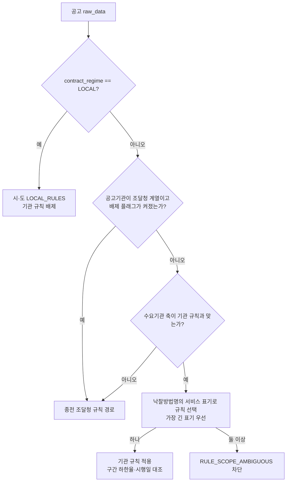

# 기관 자체 적격심사 규칙 반영 (R2)

> **작성일**: 2026-10-13
> **작업**: R2. 기관 규칙 레지스트리 반영과 수요기관·공고기관 판정
> **정본 명세**: [`data/reference/institution_rules_20261013.yaml`](../../data/reference/institution_rules_20261013.yaml) (R1)
> **코드 정본**: [`src/app/services/evaluation_rules.py`](../../src/app/services/evaluation_rules.py) 의 `INSTITUTION_RULES`·`_select_institution_rule`
> **선행 문서**: [`institution_rule_inventory_20261013.md`](institution_rule_inventory_20261013.md) 5~7절

---

## 1. 요약

R1 명세에서 `status=confirmed` 인 기관 11곳의 bands 를 `RULE_SCOPE_INSTITUTION` 규칙 70개,
구간 144개로 옮겼습니다. 값은 명세의 B·k·기준비율·통과점수·하한율·구간 경계를 그대로 쓰고
새로 추정하지 않았습니다. 판정 축은 수요기관(`dminsttNm`·`dminsttCd`)이며, 공고기관이
조달청·지방조달청 계열이면 수요기관 기관 규칙을 배제하고 종전 조달청 경로를 씁니다.
`partial` 5곳과 `unresolved` 3곳은 넣지 않아 종전 조달청 규칙 경로를 그대로 씁니다.

| 항목 | 값 |
| --- | --- |
| 반영 기관 | 11곳 |
| 기관 규칙 | 70개 |
| 기관 구간(band) | 144개 (R1 확인 band 147개 중 한국수력원자력 별표 9·10 3개 병합) |
| 판정 우선순위 | 기관 > 시·도(LOCAL) > 조달청 |
| 대행 배제 플래그 | `EXCLUDE_INSTITUTION_RULES_FOR_PPS_PROXY = True` |
| DB 스키마·데이터 변경 | 없음 |

---

## 2. 반영 기관과 규칙

| 기관 | 수요기관 코드 | 규칙 수 | 구간 수 | 시행일 | 규칙 ID |
| --- | --- | ---: | ---: | --- | --- |
| 국토교통부 | 1613000 | 2 | 5 | 2018-01-04 | `SERVC_INST_MOLIT_20180104_GENERAL`, `..._SUPERVISION` |
| 국가유산청 | 1833100 | 1 | 5 | 2024-05-17 | `SERVC_INST_KHS_20240517_BURIAL` |
| 환경부 | 1482000 | 1 | 4 | 2025-11-11 | `SERVC_INST_ME_20251111_TECH` |
| 한국농어촌공사 | B552149 | 10 | 20 | 2026-06-24 | `SERVC_INST_KRC_20260624_*` |
| 한국가스공사 | B551210 | 2 | 5 | 2026-07-09 | `SERVC_INST_KOGAS_20260709_*` |
| 한국수력원자력 | 없음(이름만) | 11 | 23 | 2026-06-19 | `SERVC_INST_KHNP_20260619_*` |
| 한국지역난방공사 | B550373 | 11 | 22 | 2026-01-01 | `SERVC_INST_KDHC_20260101_*` |
| 한국석유공사 | B410005 | 8 | 16 | 2019-09-30 | `SERVC_INST_KNOC_20190930_*` |
| 인천국제공항공사 | B551177 | 11 | 18 | 2025-01-01 | `SERVC_INST_IIAC_20250101_*` |
| 인천공항시설관리 | Z043894 | 12 | 22 | 2025-09-01 | `SERVC_INST_IIAFM_20250901_*` |
| 해양환경공단 | B553931 | 1 | 4 | 2025-03-06 | `SERVC_INST_KOEM_20250306_MARINE_WASTE` |

- 해양환경공단은 2026-10-15 등록분입니다. 낙찰방법 표기가 용역 종류를 특정하지 못한 산림청은
  등록하지 않았으며, 조회 근거와 판정은 [`forest_koem_register_gap_20261015.md`](forest_koem_register_gap_20261015.md)
  에 있습니다.

- 수요기관 코드는 DB `procurement.g2b_demand_institutions` 로 확인한 값입니다.
  한국수력원자력은 기관표에 본청 행이 없어 이름 매칭만 씁니다.
- `name_aliases`(예: 국가유산청-문화재청, 환경부-기후에너지환경부)는 이름 매칭에 씁니다.
- 규칙 `source` 에 명세의 `sources`(문서:행)를, 구간 `source` 에 명세 band 의 `source` 를
  적었습니다.

---

## 3. 판정 흐름



### 3.1 수요기관 축

- 규칙과 공고 양쪽에 코드가 있으면 코드 일치로만 판정합니다.
- 어느 한쪽이라도 코드가 없으면 공백 제거 이름 또는 `name_aliases` 정확 일치로 판정합니다.
- 접두·부분 문자열 일치는 쓰지 않습니다(다른 기관 오탐 방지). 지역본부·지사 등 이름과
  코드가 다른 하위 조직은 기관 규칙 대상이 아니며 종전 조달청 경로를 씁니다.

### 3.2 서비스 표기 선택

- 낙찰방법명과 공고명에서 규칙의 서비스 표기(예: `기타용역`, `시설분야용역`)를 찾아,
  가장 긴 표기가 맞는 규칙 하나를 고릅니다. 한국가스공사 공고에서 `시설분야용역` 은
  `용역` 보다 길어 시설분야 규칙이 선택됩니다.
- 경쟁제품 대상/비대상, 기술분야/일반분야처럼 원문이 변형을 나눈 규칙은 변형 표기를 함께
  가진 표기로만 매칭합니다. 변형 표기가 없는 공고는 기관 규칙을 고르지 않고 종전 조달청
  경로로 갑니다.
- 인천국제공항공사·인천공항시설관리의 별표 8 임대차용역처럼 원문이 k=2·k=4 두 구간을 같은
  추정가격 축에 인쇄해 구분 근거가 없는 경우에는 두 규칙이 같은 길이로 매칭되어
  `RULE_SCOPE_AMBIGUOUS` 로 차단합니다.

### 3.3 공고기관(조달청 대행) 배제

- 공고기관(`ntceInsttNm`·`ntceInsttCd`)이 조달청·지방조달청 계열이면 수요기관 기관 규칙을
  배제하고 종전 조달청 규칙 경로를 씁니다. 조달청 계열 판정은 이름에 `조달청` 포함 또는
  코드가 `1230` 대역인지로 합니다(실측: 조달청 서울지방조달청 `1230121`).
- 배제 플래그는 상수입니다. 끄면 대행 공고도 수요기관 기관 규칙을 씁니다.

```python
EXCLUDE_INSTITUTION_RULES_FOR_PPS_PROXY = True
```

- 이 배제를 확정하는 조문은 확인되지 않아 잠정 기본안이며(선행 문서 5.3절), 배제 시
  응답에 `공고기관이 조달청 대행이라 수요기관 기관 규칙을 배제하고 조달청 기준을
  적용합니다.` 경고를 남깁니다.

### 3.4 지방계약(LOCAL) 우선

- 계약방법에 지방 표기가 있으면 조달청 규칙과 기관 규칙을 모두 배제하고 시·도 규칙
  (`LOCAL_RULES`)만 씁니다(종전 동작 유지).

### 3.5 시행일 대조와 하한율

- 기관 규칙도 시행일을 대조합니다. 공고일이 기관 규칙 시행일보다 앞서면
  `RULE_REGIME_MISMATCH` 로 차단합니다.
- 공고 하한율이 있으면 언제나 공고값이 우선합니다. 없으면 추정가격으로 고른 구간의 인쇄
  하한율을 쓰고, 구간별 하한율이 다른데 추정가격이 없으면 추정가격 입력을 요구합니다.
- 기관 정량평가 배점표는 아직 반영하지 않아(`quant_basis=AGENCY_DOCUMENT_NOT_LOADED`)
  평가 API 는 정량점수(`manual_non_price_score`) 직접 입력을 요구합니다. 최저투찰금액은
  기관 규칙 하한율로 계산됩니다.

---

## 4. 명세 해석과 값 매핑

| 항목 | 처리 |
| --- | --- |
| 구간 경계 | 명세 `upper` 를 `PriceBand.upper_bound` 로 옮김(미만 규약 일치). 명세 순서와 무관하게 오름차순 정렬 |
| 고시금액 | 2026년 고시금액 230,000,000원(`notice_amount_for_year(2026)`) |
| 국토교통부·환경부 band 1 | 원문 표기가 "고시금액 미만"이고 명세 `lower` 에 고시금액이 적혀 있어 상한을 고시금액으로 해석 |
| 한국가스공사 B 30/50/70 | 용역수행능력 계량화 정도에 따라 갈려 한 값으로 확정하지 않고 `max_price_score=None` 과 사유를 구간 근거에 기록. k·기준비율·통과점수·하한율은 확정 |
| 국토교통부 감리용역 | 원문이 상한(10억원)까지 인쇄한 단일 구간이라 `bounded_price_top` 을 선언해 그대로 옮겼습니다. 그보다 큰 추정가격은 구간을 고르지 못해 차단되며, 기존 규칙의 "마지막 구간은 상한 없음" 검사는 그대로입니다 |
| 한국수력원자력 별표 9·10 | 구간 값이 같아 `SERVC_INST_KHNP_20260619_TRANSPORT_AGENCY` 한 규칙으로 병합(표기 `별표 9·10`) |
| 임대차 k=2·k=4 | 구분 근거가 없어 두 규칙으로 등록하고 함께 매칭되면 차단 |
| 값 스케일 | `base_ratio` 는 0~1 로 변환(88 → 0.88), 하한율·통과점수는 인쇄값 그대로 |
| 규칙 대표값 | 규칙 `lwlt_rate`·`base_rate` 는 가장 낮은 구간 값. 실제 계산은 추정가격으로 고른 구간값 |

---

## 5. 하위 조직 커버리지 실측 (2026-10-13)

기관 규칙은 수요기관 이름·코드가 정확히 일치할 때만 적용하므로, 지역본부·지사 등 하위 조직
공고는 종전 조달청 경로를 씁니다. `scripts/db_readonly_query.py` 로 센 공고 수입니다.

| 기관 | 전체 공고 | 이름 정확 일치 | 하위 조직 | 비고 |
| --- | ---: | ---: | ---: | --- |
| 국토교통부 | 89,281 | 8,910 | 80,371 | 지방국토관리청·국토관리사무소 |
| 국가유산청 | 12,179 | 2,801 | 9,378 | 국립문화유산연구원·궁능유적본부 등(문화재청 표기 포함) |
| 환경부 | 26,649 | 4,779 | 21,870 | 기후에너지환경부 유역환경청·연구원 등 |
| 한국농어촌공사 | 113,777 | 3,295 | 110,482 | 지역본부·지사 |
| 한국가스공사 | 393 | 136 | 257 | — |
| 한국수력원자력 | 516 | 0 | 516 | 실제 수요기관명이 `한국수력원자력(주)…`·`한국수력원자력주식회사` 라 YAML 이름·별칭과 정확 일치하지 않음 |
| 한국지역난방공사 | 13,257 | 3,592 | 9,665 | 지사·사업소 |
| 한국석유공사 | 275 | 273 | 2 | 지사 |
| 인천국제공항공사 | 1,434 | 1,434 | 0 | — |
| 인천공항시설관리 | 262 | 262 | 0 | 코드 없는 38건은 이름이 `인천공항시설관리 주식회사` 라 이름 매칭 불가(코드 Z043894 224건은 코드 매칭) |

- "이름 정확 일치" 는 공백 제거 후 기관명(또는 별칭)과 같은 공고 수입니다. 실제 적용은
  수요기관 코드가 규칙 코드와 같으면 코드로, 코드가 없으면 이름으로 판정합니다.
- 전체 공고 수에는 용역이 아닌 공사·물품 공고가 포함되어 있어, 위 수치는 기관 규칙 적용
  가능 공고의 상한입니다.

---

## 6. 남은 기관과 사유

`status` 가 confirmed 가 아닌 기관은 규칙으로 넣지 않았습니다.

| 기관 | status | 사유 |
| --- | --- | --- |
| 방위사업청 | partial | 10억원 이상 구간 계수 생략으로 k 미확정 |
| 한국철도공사 | partial | 승강기 점검보수용역 한정 자체 기준. 전사 일반용역은 조달청 준용 |
| 한국도로공사 | partial | 현행 판(2022-10-01) 원문 미확보, 별표 1-1·2 미확정 |
| 한국전력기술 | partial | 별표 1-1·1-5 k 미확정 |
| 한국수자원공사 | partial | 별표 5·6·7의2·7의3·8 값 불일치(0.010~0.025점), 별표 7의1 k 미확정 |
| 한국토지주택공사 | unresolved | 자체 세부기준 원문 미확보(조달청 기준 준용) |
| 한전 전력연구원 | unresolved | 자체 원문 미확보 |
| 한전KPS | unresolved | 자체 원문 미확보 |

---

## 7. 검증

| 항목 | 값 |
| --- | --- |
| 값 대조 시험 | `uv run pytest tests/test_institution_rules.py -q` (YAML 을 읽어 기관·구간별 B·k·기준비율·통과점수·하한율·경계 대조) |
| 판정 시험 | (나) 이름·코드·별칭 매칭, (다) 조달청 대행 배제, (라) LOCAL 배제, (마) partial·unresolved 유지, (바) 평가 API 끝단 최저투찰금액 |
| 기존 시험 | `uv run pytest tests/test_institution_rules.py tests/test_evaluation_rules_scope_axis.py tests/test_evaluation_rules_pre.py tests/test_local_band_lwlt.py tests/test_audit_servc_lwlt_coverage.py tests/test_evaluation_rules_meta_api.py tests/test_evaluations_api.py -q` |
| 전량 시험 | `uv run pytest tests/ -q -m 'not data_assets'` |
| 타입 | `uv run mypy src` |
| 규칙 검증 | `python3 scripts/validate_agent_rules.py --quiet` |
| DB 조회 | `uv run python scripts/db_readonly_query.py --sql "<질의>"` (읽기 전용) |

---

## 8. 남은 리스크와 후속

| 항목 | 내용 |
| --- | --- |
| 한국가스공사 B 미확정 | 용역수행능력 계량화 정도에 따라 30/50/70 이 갈려 가격점수는 사용자 입력이 필요합니다. 하한율은 확정값으로 계산됩니다. |
| 임대차 k=2·k=4 | 인천국제공항공사·인천공항시설관리 별표 8 은 구분 근거가 없어 차단됩니다. 원문 세부 구간 확인이 필요합니다. |
| 한국수력원자력 이름 매칭 | 실제 수요기관명이 `한국수력원자력(주)…` 라 이름 매칭이 성립하지 않습니다. 기관표 본청 코드 또는 별칭 보강이 필요합니다. |
| 기관 정량 배점표 | 기관 적격심사 세부기준의 심사항목 배점한도는 아직 미반영이라 정량점수 직접 입력이 필요합니다. |
| 메타 엔드포인트 문구 | `SERVC_RULE_META_SCOPE_NOTE` 는 사실에 맞게 고쳤고, `list_evaluation_rules_meta` docstring 의 종전 문구는 이번 범위에서 손대지 않았습니다(후속 정리 대상). |
| 하위 조직 | 지역본부·지사 공고는 종전 조달청 경로입니다. 기관별 하위 조직 규칙이 필요하면 별도 명세가 필요합니다. |

---

## 9. 변경 파일

| 파일 | 내용 |
| --- | --- |
| `src/app/services/evaluation_rules.py` | `INSTITUTION_RULES`(69규칙·140구간), 수요기관·공고기관 판정, 대행 배제 플래그, `_axis_matches` 코드·이름·별칭 판정, `PriceBand.max_price_score` 선택화, `bounded_price_top` 선언 |
| `src/app/api/v1/evaluations.py` | `SERVC_RULE_META_SCOPE_NOTE` 의 기관 산식 문장 수정 |
| `tests/test_institution_rules.py` | 신규. (가)~(바) 판정 시험 |
| `tests/test_evaluation_rules_scope_axis.py` | 기관 축 코드·이름·별칭 판정 시험 추가 |
| `tests/test_evaluation_rules_meta_api.py` | scope_note·기관 규칙 목록 제외·기관 matched_rule 시험 추가 |
| `tests/test_audit_servc_lwlt_coverage.py` | 기관 낙찰방법명 하한율 필수 분류 시험 추가 |
| `docs/analysis/institution_rules_apply_20261013.md` | 본 문서 |
