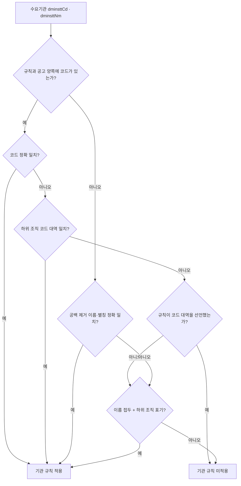

# 기관 하위 조직 적용 반영 (R4)

> **작성일**: 2026-10-13
> **작업**: R4. 하위 조직 적용이 원문으로 확인된 3곳(국토교통부·환경부·한국석유공사)의 기관 규칙 확장
> **정본 설계**: [institution_subunit_scope_20261013.md](institution_subunit_scope_20261013.md) 5~6절
> **코드 정본**: [src/app/services/evaluation_rules.py](../../src/app/services/evaluation_rules.py) `EvaluationRule`·`_axis_matches`·`INSTITUTION_RULES`
> **선행 문서**: [institution_rules_apply_20261013.md](institution_rules_apply_20261013.md) (R2)
> **기준 커밋**: `main` `66e6aa30`, 작업 브랜치 `kwanbum217/r4-subunit-match`

---

## 1. 요약

S1 조사(5절 매칭 설계)대로 하위 조직 적용이 원문으로 확인된 3곳만 기관 규칙을 하위 조직
공고까지 확장했습니다. 정확 일치(코드 일치 또는 공백 제거 이름·별칭 일치)를 먼저 시도하고,
실패했을 때만 하위 조직 확장을 시도합니다. 나머지 7곳은 확장 선언이 없어 종전 정확 일치
동작을 그대로 유지합니다.

| 항목 | 값 |
| --- | --- |
| 확장 기관 | 국토교통부·환경부·한국석유공사 3곳 |
| 확장 선언 규칙 | 11개 (국토교통부 2, 환경부 1, 한국석유공사 8) |
| 새 선언 필드 | `EvaluationRule.subunit_name_prefixes`, `EvaluationRule.subunit_code_prefixes` (기본 빈 튜플) |
| 판정 위치 | `_axis_matches` `RULE_SCOPE_INSTITUTION` 분기(정확 일치 실패 뒤 2차 판정) |
| 기존 경로 변경 | 본청·조달청 대행·LOCAL·시행일 대조·동일 길이 다중 매칭 차단 유지 |
| DB 스키마·데이터 변경 | 없음 |

- 2025-06-01 이후 용역(`category='Servc'`) 공고에서 기관 축이 새로 일치하는 건은
  국토교통부 4,460 · 환경부 2,161 · 한국석유공사 0이고, 그중 낙찰방법명·공고명 서비스
  표기까지 맞는 건은 국토교통부 10 · 환경부 73 · 한국석유공사 0입니다(4절).
- 배점표(B·k·T)와 하한율은 R2 값을 그대로 쓰고 새로 추정하지 않았습니다. 서비스 유형
  한정은 현행 낙찰방법명·공고명 표기 매칭(`patterns`)을 그대로 씁니다(설계 6절 4항).

---

## 2. 확장 선언

| 기관 | 이름 접두(공백 경계) | 코드 대역(우선) | 확장 규칙 |
| --- | --- | --- | ---: |
| 국토교통부 | `국토교통부 ` | `1613` | 2 (`GENERAL`, `SUPERVISION`) |
| 환경부 | `기후에너지환경부 `, `환경부 ` | `1482` | 1 (`TECH`) |
| 한국석유공사 | `한국석유공사 ` | 없음 | 8 (별표 5~11, 일반용역) |

- 선언 근거는 S1 조사 2~3절의 적용 범위 조항입니다. 국토교통부는 제2조 "본부 및 소속기관",
  환경부는 제2조 "본부 및 소속기관", 한국석유공사는 제2조⑤⑥ "본사 및 지사, 또는 사무소" +
  제3조①입니다.
- 코드 대역 출처는 S1 조사 4.3절 실측입니다. 국토교통부 정식명 `1613000`·소속기관
  `1613164`~`1613800`, 환경부 정식명 `1482000`·소속기관 `1482021`~`1482309`가 `1613`·`1482`
  대역을 공유합니다. 한국석유공사는 정식명 `B410005`와 지사 코드(`Z000647`~`Z005480`)가
  대역을 공유하지 않습니다.
- 확장은 `INSTITUTION` 규칙에만 선언할 수 있고(선언 검증), 비확장 기관 7곳은 필드가 빈
  튜플입니다. 시험 `test_subunit_expansion_is_declared_only_for_three_institutions` 가 이
  범위를 고정합니다.

---

## 3. 판정 규칙 (구현)



- 정확 일치가 먼저이고(코드가 양쪽에 있으면 코드 정확 일치, 아니면 이름·별칭 정확 일치),
  실패했을 때만 하위 조직 판정을 합니다. 본청 공고와 기존 7곳 판정은 바뀌지 않습니다.
- 이름 접두는 원문 표기의 공백 경계에서만 성립합니다(`국토교통부 대전지방국토관리청` O,
  `국토교통부대전지방국토관리청`·`한국석유공사미포함기관` X). 접두 뒤 첫 토막이 하위 조직
  표기(`지역본부`·`지사`·`사업소`·`본부`·`지방국토관리청`·`국토관리사무소`·`유역환경청`·
  `지방환경청` 포함 또는 `청`·`원`·`소`로 끝남)일 때만 인정합니다.
- 코드가 양쪽에 있으면 코드가 이름보다 우선합니다. 코드 대역을 선언한 국토교통부·환경부는
  대역 밖 코드를 이름 접두로 되돌리지 않습니다(설계 5.2절 3항, 오탐 차단). 대역을 선언하지
  않은 한국석유공사는 이름 접두가 유일한 하위 조직 신호라 코드가 달라도 접두를 봅니다
  (설계 5.1절 "대역이 없는 한국석유공사는 이름 접두만 씁니다").
- LOCAL 계약은 기관 규칙을 배제하고(시·도 우선), 조달청 대행
  (`EXCLUDE_INSTITUTION_RULES_FOR_PPS_PROXY`)은 수요기관 기관 규칙을 배제하며, 시행일
  대조(`RULE_REGIME_MISMATCH`)와 동일 길이 다중 매칭 차단(`RULE_SCOPE_AMBIGUOUS`)은 종전
  그대로 적용됩니다. 하위 조직 공고에도 같은 차단·우선순위가 걸리는 것을 시험으로 고정했습니다.

---

## 4. 실측 (2025-06-01 이후 용역 공고)

`procurement.bid_announcements` 를 `scripts/db_readonly_query.py` 로 셌습니다. 공고 수는
기관 규칙 적용 가능 공고의 상한이고, 실제 적용은 서비스 표기 매칭·시행일 대조·추정가격
구간 선택까지 통과한 공고로 더 좁아집니다.

### 4.1 기관 축 신규 일치와 서비스 표기 일치

```sql
SELECT '국토교통부' AS inst, COUNT(*) AS axis_n,
       SUM(CASE WHEN JSON_UNQUOTE(JSON_EXTRACT(raw_data,'$.sucsfbidMthdNm'))
                     LIKE '적격심사제%' THEN 1 ELSE 0 END) AS qual_n
FROM procurement.bid_announcements
WHERE category='Servc' AND bid_ntce_dt >= '2025-06-01'
  AND (
    (COALESCE(JSON_UNQUOTE(JSON_EXTRACT(raw_data,'$.dminsttCd')),'') <> ''
     AND JSON_UNQUOTE(JSON_EXTRACT(raw_data,'$.dminsttCd')) LIKE '1613%'
     AND JSON_UNQUOTE(JSON_EXTRACT(raw_data,'$.dminsttCd')) <> '1613000')
    OR
    (COALESCE(JSON_UNQUOTE(JSON_EXTRACT(raw_data,'$.dminsttCd')),'') = ''
     AND dminstt_nm REGEXP '^국토교통부 ')
  )
UNION ALL
SELECT '환경부', COUNT(*),
       SUM(CASE WHEN JSON_UNQUOTE(JSON_EXTRACT(raw_data,'$.sucsfbidMthdNm'))
                     LIKE '적격심사제%' THEN 1 ELSE 0 END)
FROM procurement.bid_announcements
WHERE category='Servc' AND bid_ntce_dt >= '2025-06-01'
  AND (
    (COALESCE(JSON_UNQUOTE(JSON_EXTRACT(raw_data,'$.dminsttCd')),'') <> ''
     AND JSON_UNQUOTE(JSON_EXTRACT(raw_data,'$.dminsttCd')) LIKE '1482%'
     AND JSON_UNQUOTE(JSON_EXTRACT(raw_data,'$.dminsttCd')) <> '1482000')
    OR
    (COALESCE(JSON_UNQUOTE(JSON_EXTRACT(raw_data,'$.dminsttCd')),'') = ''
     AND (dminstt_nm REGEXP '^기후에너지환경부 ' OR dminstt_nm REGEXP '^환경부 '))
  )
UNION ALL
SELECT '한국석유공사', COUNT(*),
       SUM(CASE WHEN JSON_UNQUOTE(JSON_EXTRACT(raw_data,'$.sucsfbidMthdNm'))
                     LIKE '적격심사제%' THEN 1 ELSE 0 END)
FROM procurement.bid_announcements
WHERE category='Servc' AND bid_ntce_dt >= '2025-06-01'
  AND dminstt_nm REGEXP '^한국석유공사 ';
```

| 기관 | 기관 축 신규 일치 | 적격심사제 계열 | 서비스 표기 일치(규칙 선택 가능) |
| --- | ---: | ---: | ---: |
| 국토교통부 | 4,460 | 2,228 | 10 (일반용역·감리용역) |
| 환경부 | 2,161 | 277 | 73 (기술용역) |
| 한국석유공사 | 0 | 0 | 0 |

- 서비스 표기 일치는 낙찰방법명·공고명을 공백 제거 후 `일반용역`·`감리용역`(국토교통부),
  `기술용역`(환경부)으로 센 값입니다. 국토교통부 소속기관 공고 다수는 낙찰방법명이
  `적격심사제-관리규정외 수기심사`·`제한적최저가(낙찰하한율)`·`시설분야용역` 등이라 기관
  규칙 표기와 맞지 않아 종전 경로로 갑니다(설계 5.2절 4항 실측과 일치).
- 기관 축 신규 일치 중 이름 접두만으로 잡히는 건(코드 미기재)은 2025-06-01 이후 국토교통부·
  환경부 모두 0건이라, 위 수치는 코드 대역 실측과 이름 접두 실측이 사실상 같습니다.
- 한국석유공사 지사 공고 2건(전체 기간)은 모두 공사(`Cnstwk`)라 용역 규칙 대상이 아닙니다
  (설계 3.1·4.2절 실측과 일치).

### 4.2 참고: 구 표기 `환경부 ` 접두와 코드

```sql
SELECT COUNT(*) AS n,
       SUM(CASE WHEN JSON_UNQUOTE(JSON_EXTRACT(raw_data,'$.sucsfbidMthdNm'))
                     LIKE '적격심사제%' THEN 1 ELSE 0 END) AS qual_n
FROM procurement.bid_announcements
WHERE category='Servc' AND bid_ntce_dt >= '2025-06-01'
  AND dminstt_nm REGEXP '^환경부 ';
```

- 2025-06-01 이후 용역 86건, 그중 적격심사제 1건·기술용역 표기 0건입니다. 이 86건의 수요기관
  코드는 `1481019`·`1481195`·`1481185` 로 `1482` 대역 밖이라, 코드 우선 규칙(설계 5.2절
  3항)에 따라 현재는 기관 규칙 대상이 아닙니다. 6절 남은 리스크로 남깁니다.

---

## 5. 검증

| 항목 | 값 |
| --- | --- |
| 판정·값 시험 | `uv run pytest tests/test_institution_rules.py tests/test_evaluation_rules_scope_axis.py -q` (57 passed) |
| 전량 시험 | `uv run pytest tests/ -q -m 'not data_assets'` (7442 passed, 41 skipped, 3 deselected) |
| 타입 | `uv run mypy src` (Success: no issues found in 132 source files) |
| 규칙 검증 | `python3 scripts/validate_agent_rules.py --quiet` (21/21 통과) |
| DB 조회 | `uv run python scripts/db_readonly_query.py --sql "<질의>" --format table` (읽기 전용) |

- 신규 시험은 (사) 절에 10건입니다. 하위 조직 매칭(이름 접두/코드 대역), 코드 대역 우선,
  접두 뒤 비하위 토막 제외, 대역 밖 코드 제외, 근거 부족 기관 비매칭, LOCAL·조달청 대행
  배제 유지, 시행일 대조 유지를 고정합니다.

---

## 6. 남은 리스크와 후속

| 항목 | 내용 |
| --- | --- |
| 구 표기 `환경부 ` 코드 | 구 표기 공고의 코드가 `1481xxx`(실측)로 `1482` 대역 밖이라 코드 우선 규칙으로 제외됩니다. 2025-06-01 이후 용역 중 적격심사제 1건·기술용역 0건이라 현재 영향은 작지만, 대역에 구 표기를 포함할지는 원문·기관표 확인 후 결정해야 합니다. |
| 한국석유공사 지사 코드 | 지사 코드(`Z000647`~`Z005480`)가 정식명 대역과 달라 이름 접두만 씁니다. 코드가 있는 지사 공고도 이름 접두가 성립하면 매칭되도록 두었고, 실측 지사 공고 2건은 모두 공사라 용역 적용 대상이 아닙니다. |
| 서비스 유형 판정 | 국토교통부·환경부 훈령의 적용 용역 유형(설계·감리·건설사업관리·정밀안전진단(점검)·지도제작 등)은 낙찰방법명·공고명 표기 매칭에 의존합니다. 표기가 없는 공고는 종전 경로입니다. |
| 메타 API 문구 | `SERVC_RULE_META_SCOPE_NOTE`(`src/app/api/v1/evaluations.py`)에는 하위 조직 문장을 아직 반영하지 않았습니다(이번 Task 쓰기 범위 밖, 후속 정리 대상). |
| 기관 정량 배점표 | R2 와 동일하게 심사항목 배점표는 미반영이라 정량점수 직접 입력이 필요합니다. |

---

## 7. 참고

- [institution_subunit_scope_20261013.md](institution_subunit_scope_20261013.md) — S1. 하위 조직 적용 범위 조사와 매칭 설계
- [institution_rules_apply_20261013.md](institution_rules_apply_20261013.md) — R2. 기관 규칙 반영
- [institution_rule_inventory_20261013.md](institution_rule_inventory_20261013.md) — R1. 기관별 산식 인벤토리
- [src/app/services/evaluation_rules.py](../../src/app/services/evaluation_rules.py) — 규칙 레지스트리와 판정
