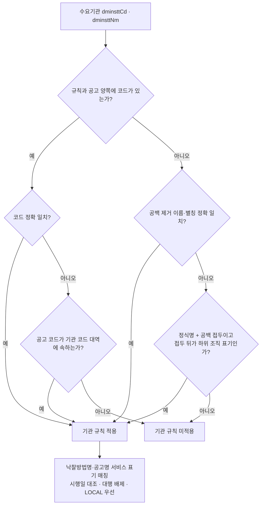

# 기관 하위 조직(지역본부·지사·사업소·소속기관) 적용 범위와 매칭 설계

> **작성일**: 2026-10-13
> **작업**: 기관 규칙(R2) 적용 확인 기관 10곳의 하위 조직 적용 범위 조사와 매칭 설계 (코드 변경 없음)
> **정본 사양**: `.orca/capsules/task_1f94c7e74aef/capsule.yaml` (`ORCA_TASK_CAPSULE_V2`)
> **기준 커밋**: `main` `d602f308` (R2 병합 포함), 작업 브랜치 `kwanbum217/s1-institution-subunit-scope`
> **선행 문서**: [institution_rules_apply_20261013.md](institution_rules_apply_20261013.md) (R2), [institution_rule_inventory_20261013.md](institution_rule_inventory_20261013.md) (R1)
> **정본 명세**: [institution_rules_20261013.yaml](../../data/reference/institution_rules_20261013.yaml) (R1)
> **원문 위치**: R1·R2 수집 원문은 `.orca/capsules/task_889fe5b87a19/external/`, `.orca/capsules/task_4103791c2123/external/`, `.orca/capsules/task_afb66751579d/external/`, `.orca/capsules/task_ac5c1133322a/external/` 아래에 있다. 이 경로는 gitignore 대상이라 커밋하지 않는다.

---

## 1. 요약

기관 규칙(R2)이 적용되는 확인 기관 10곳의 적격심사 기준 원문에서 **적용 범위 조항(제1조 목적·제2조 적용범위·제2조 정의·제3조 심사대상)** 을 확인했습니다. 그 결과 하위 조직(지역본부·지사·사업소·소속기관)이 적용 주체로 원문에 명시된 기관은 **국토교통부·환경부·한국석유공사 3곳**입니다. 나머지 7곳은 적용 주체가 법인·기관 전체("우리공사", "당공사", "공사", "한수원", "시설관리")로만 적혀 있거나(6곳), 적용 주체가 기관 하위 조직이 아니라 사업시행자 지위로 규정되어 있어(국가유산청 1곳) **근거 부족**으로 두었습니다. 추정으로 하위 조직을 포함하지 않았습니다.

| 판정 | 기관 | 근거 |
| --- | --- | --- |
| 적용 | 국토교통부, 환경부, 한국석유공사 | 적용 범위·정의 조항에 `본부 및 소속기관`, `본사 및 지사, 또는 사무소` 명시 |
| 근거 부족 | 국가유산청, 한국농어촌공사, 한국가스공사, 한국수력원자력, 한국지역난방공사, 인천국제공항공사, 인천공항시설관리 | 적용 주체가 법인 전체이거나 사업시행자 지위로만 규정 |

- 매칭 설계는 **적용 판정 3곳에 한해서만** 하위 조직을 기관 규칙 대상에 포함합니다. 나머지 7곳은 종전 정확 일치(코드 일치 또는 공백 제거 이름 일치) 동작을 유지합니다.
- 하위 조직 포함 방식은 **정식 기관명 + 공백 접두**(이름 축)와 **기관 코드 대역**(코드 축)의 조합이며, 코드 대역이 있는 국토교통부·환경부는 코드 대역을 우선하고, 대역이 없는 한국석유공사는 이름 접두만 씁니다.
- DB 실측(2026-10-13)에서 하위 조직 공고 수는 국토교통부 80,371 · 환경부 21,870 · 한국석유공사 2입니다.

---

## 2. 기관별 판정 표

`하위 조직 공고 수` 는 `scripts/db_readonly_query.py` 로 `procurement.bid_announcements` 를 센 값입니다(4절에 질의 원문). `전체` 는 정식명 접두 공고, `정확` 은 공백 제거 이름 정확 일치 공고입니다.

| 기관 | 정식명(접두) | 적용 범위 조항(원문 인용) | 소속 | 적용 주체에 하위 조직 명시 | 판정 | 전체 | 정확 | 하위 조직 |
| --- | --- | --- | --- | :---: | :---: | ---: | ---: | ---: |
| 국토교통부 | 국토교통부 | 제2조(적용범위) "국토교통부 **본부 및 소속기관**에서 집행하는 설계용역, 감리용역, 건설사업관리용역, 정밀안전진단용역, 지도제작용역 등의 입찰·계약" | `.orca/capsules/task_889fe5b87a19/external/molit/molit_yongyeok_2018-01-04.txt:15` | 예 | 적용 | 89,281 | 8,910 | 80,371 |
| 환경부 | 기후에너지환경부 | 제2조(적용범위) "기후에너지환경부 **본부 및 소속기관**에서 집행하는 기본계획용역, 설계용역, 감리용역, 건설사업관리용역, 정밀안전점검(진단)용역, 지도제작용역 등의 입찰ㆍ계약" | `.orca/capsules/task_889fe5b87a19/external/me/me_techyongyeok_2025-11-11.txt:4` | 예 | 적용 | 26,649 | 4,779 | 21,870 |
| 한국석유공사 | 한국석유공사 | 제2조⑤⑥ "계약담당부서"·"계약의뢰부서"를 "우리공사의 계약(용역사업)을 담당하는 **본사 및 지사, 또는 사무소**의 부서"로 정의, 제3조① "이 기준은 제2조에서 정하는 용역에 대하여 적용" | `.orca/capsules/task_afb66751579d/external/extracted/knoc_2026_full.txt:31`, `:32`, `:34` | 예 | 적용 | 275 | 273 | 2 |
| 국가유산청 | 국가유산청, 문화재청 | 제1조(목적) "매장유산 조사용역 입찰에서 낙찰자를 결정할 때에 적용할 … 세부기준", 제2조7호 "사업시행자"란 국가계약법을 적용·준용하여 매장유산 조사용역을 입찰 공고하는 정부·공공기관·민간 사업자 | `.orca/capsules/task_889fe5b87a19/external/khs/khs_yongyeok_2024-05-17.txt:10`, `:19` | 아니오(사업시행자 지위) | 근거 부족 | 12,179 | 2,801 | 9,378 |
| 한국농어촌공사 | 한국농어촌공사 | 제1조(목적) "한국농어촌공사(이하 "우리공사"라 한다)가 **집행하는** 일반용역 입찰의 낙찰자 결정에 적용할 … 세부기준" | `.orca/capsules/task_4103791c2123/external/extracted/ekr_yongyeok_20260624.txt:4` | 아니오(법인 전체) | 근거 부족 | 113,777 | 3,295 | 110,482 |
| 한국가스공사 | 한국가스공사 | 제1조(목적)① "한국가스공사(이하 "당공사"라 한다)가 … 시설공사 및 용역계약에 적용할 적격심사세부기준" | `.orca/capsules/task_ac5c1133322a/external/extracted/한국가스공사 전문.txt:3` | 아니오(법인 전체) | 근거 부족 | 393 | 136 | 257 |
| 한국수력원자력 | 한국수력원자력 | 제1조(목적) "한국수력원자력주식회사(이하 "한수원"이라 한다)가 **시행하는** 일반용역 계약업무에 적용할 … 세부기준" | `.orca/capsules/task_4103791c2123/external/extracted/khnp_yongyeok_20260619.txt:8` | 아니오(법인 전체) | 근거 부족 | 516 | 0 | 516 |
| 한국지역난방공사 | 한국지역난방공사 | 제1조(목적) "이 기준은 **우리공사**에서 집행하는 일반용역 입찰의 낙찰자 결정에 적용할 … 세부기준", 제3조 "다만, 수요부서에서 관련법령에 따라 별도의 심사기준을 정한 경우에는 그 기준에 따른다" | `.orca/capsules/task_4103791c2123/external/extracted/kdhc_yongyeok_2026-01-01.txt:6`, `:43` | 아니오(법인 전체) | 근거 부족 | 13,257 | 3,592 | 9,665 |
| 인천국제공항공사 | 인천국제공항공사 | 제1조(목적) "인천국제공항공사(이하 "공사"라 한다)에서 집행하는 일반용역의 낙찰자 결정에 적용할 … 세부기준" | `.orca/capsules/task_afb66751579d/external/extracted/iia_17529.txt:12` | 아니오(법인 전체) | 근거 부족 | 1,434 | 1,434 | 0 |
| 인천공항시설관리 | 인천공항시설관리 | 제1조(목적) "인천공항시설관리(주)(이하 "시설관리"라 한다)에서 집행하는 일반용역 입찰의 낙찰자 결정에 적용할 … 세부기준" | `.orca/capsules/task_4103791c2123/external/extracted/iia_full.txt:6` | 아니오(법인 전체) | 근거 부족 | 262 | 0 | 262 |

- 국가유산청 행의 `전체`·`정확`·`하위 조직` 은 정식명 `국가유산청` 과 별칭 `문화재청` 두 접두의 합입니다(3,692+8,487 / 836+1,965 / 2,856+6,522).
- 환경부 행은 `기후에너지환경부`(정확 4,779)와 구 `환경부` 소속기관 접두(정확 일치 0)의 합입니다. 약칭 `환경부` 정확 일치 공고는 없고 전부 소속기관 표기입니다.
- 한국수력원자력·인천공항시설관리·환경부(구 표기)의 하위 조직 수가 전체와 같은 것은, 실제 수요기관명이 `한국수력원자력(주)…`·`인천공항시설관리 주식회사`·`환경부 …` 처럼 정식명·별칭과 정확 일치하지 않아 전부 접두(하위 조직)로 잡히기 때문입니다.

---

## 3. 기관별 판정 사유

### 3.1 적용 3곳

**국토교통부** — 제2조(적용범위)가 적용 주체를 "국토교통부 **본부 및 소속기관**"으로 명시합니다. 소속기관(지방국토관리청·국토관리사무소·지방항공청·홍수통제소 등)은 수요기관명이 `국토교통부 …` 형태로 접두를 유지하므로 접두·코드 대역 매칭이 성립합니다. 다만 제2조는 적용 대상을 "설계용역, 감리용역, 건설사업관리용역, 정밀안전진단용역, 지도제작용역 등"으로 한정합니다. 실측에서 `국토교통부 대전지방국토관리청 충주국토관리사무소` 의 시설분야·폐기물처리용역 공고는 낙찰방법 적용기준에 `조달청 일반용역 적격심사 세부기준`·`건설폐기물처리용역 적격업체 평가기준` 을 적었습니다. 소속기관이 별도 기준을 둘 수 있다는 이 실측은 4절 설계의 **서비스 유형 한정** 조건으로 반영합니다.

**환경부** — 제2조(적용범위)가 적용 주체를 "기후에너지환경부 **본부 및 소속기관**"으로 명시합니다. 소속기관(유역환경청·지방환경청·국립환경과학원 등)이 `기후에너지환경부 …` 접두를 유지합니다. 적용 대상은 "기본계획용역, 설계용역, 감리용역, 건설사업관리용역, 정밀안전점검(진단)용역, 지도제작용역 등"입니다. 참고로 R2 는 환경부 규칙을 기술용역(별표 1) 하나로만 등록했습니다.

**한국석유공사** — 제1조가 "우리공사에서 집행하는 제반 용역입찰"을, 제2조⑤⑥이 그 집행 조직을 "본사 및 지사, 또는 사무소의 부서"로 정의합니다. 제3조①이 "이 기준은 제2조에서 정하는 용역에 대하여 적용"한다고 하므로 지사·사무소가 집행하는 용역에 본 기준이 적용됨이 원문으로 확인됩니다. 실측 하위 조직 공고 2건은 모두 공사(지사 방폭등기구 교체 등)라 용역 규칙 적용 대상은 아닙니다.

### 3.2 근거 부족 7곳

- **국가유산청**: 적용 주체가 기관 하위 조직이 아니라 "사업시행자"(제2조7호) 지위로 규정됩니다. 국가유산청 소속기관이 사업시행자가 되어 매장유산 조사용역을 집행하면 이 고시가 적용될 수 있으나, 그 적용 여부는 공고별로 사업시행자 지위를 확인해야 하고 원문이 소속기관을 적용 주체로 특정하지 않으므로 이번 매칭 설계에서는 제외합니다.
- **한국농어촌공사·한국가스공사·한국수력원자력·한국지역난방공사·인천국제공항공사·인천공항시설관리**: 적용 주체가 "우리공사"·"당공사"·"한수원"·"공사"·"시설관리" 등 법인 전체로만 적혀 있고, 지사·지역본부·사업소를 명시한 정의·적용 조항이 없습니다. 한국지역난방공사는 제3조 단서가 "수요부서에서 별도의 심사기준을 정한 경우"를 인정해, 법인 전체 조항만으로 하위 조직 적용을 단정할 수 없습니다. 원문 근거가 없으므로 추정하지 않고 근거 부족으로 둡니다.

---

## 4. 하위 조직 공고 실측 (2026-10-13)

`procurement.bid_announcements` 를 `scripts/db_readonly_query.py` 로 셌습니다. 전체 공고 수에는 용역이 아닌 공사·물품 공고가 포함되어 있어 기관 규칙 적용 가능 공고의 상한입니다.

### 4.1 전체·정확·하위 조직 수 질의

```sql
SELECT COUNT(*) AS total,
       SUM(REPLACE(dminstt_nm,' ','') = '<정식명>') AS exact_n
FROM procurement.bid_announcements
WHERE REPLACE(dminstt_nm,' ','') LIKE '<정식명>%';
```

국가유산청은 `<정식명>` 자리에 `국가유산청`·`문화재청`, 환경부는 `기후에너지환경부`·`환경부` 를 각각 넣어 합산했습니다. 하위 조직 수는 `total - exact_n` 입니다.

### 4.2 낙찰방법 분포 질의 (적격심사 대상 상한)

```sql
SELECT COUNT(*) AS sub_n,
       SUM(JSON_UNQUOTE(JSON_EXTRACT(raw_data,'$.sucsfbidMthdNm')) LIKE '적격심사제%') AS ok_n
FROM procurement.bid_announcements
WHERE REPLACE(dminstt_nm,' ','') LIKE '<정식명>%'
  AND REPLACE(dminstt_nm,' ','') <> '<정식명>';
```

| 적용 기관 | 하위 조직 공고 | 적격심사제 계열 | 비고 |
| --- | ---: | ---: | --- |
| 국토교통부 | 80,371 | 8,593 | 상한. 서비스 유형 한정으로 실제는 더 좁음 |
| 환경부 | 21,870 | 710 | 상한 |
| 한국석유공사 | 2 | 1 | 단, 지사 공고 2건 모두 공사(용역 0) |

한국석유공사 하위 조직 공고 2건은 `한국석유공사 서산지사 UPS 및 소방엔진펌프 축전지 교체공사`(수의시담), `한국석유공사 거제지사 2차 3차기지 방폭등기구 및 가로등기구 교체공사`(적격심사제)로 용역이 아닙니다.

### 4.3 기관 코드 대역 질의

```sql
SELECT dminstt_cd, dminstt_nm
FROM procurement.g2b_demand_institutions
WHERE dminstt_nm LIKE '<정식명>%'
ORDER BY dminstt_cd;
```

| 기관 | 정식명 코드 | 하위 조직 코드 형태 | 코드 대역 |
| --- | --- | --- | --- |
| 국토교통부 | `1613000` | `1613164`~`1613800` (지방국토관리청·국토관리사무소·지방항공청 등) | `1613` 대역 공유 |
| 환경부 | `1482000` | `1482021`~`1482309` (유역환경청·지방환경청·국립환경과학원 등), 구 표기 `1480xxx` | `1482` 대역 공유 |
| 한국석유공사 | `B410005` | `Z000647`~`Z005480` (지사·건설사무소 등) | 공유 대역 없음 |
| 한국농어촌공사 | `B552149` | `D150xxx`~`D153xxx`·`D645xxx`·`Z000xxx`·`ZI01068` | 공유 대역 없음 |
| 한국가스공사 | `B551210` | `Z001012`~`Z045320`·`ZZ05621`~`ZZ07509` | 공유 대역 없음 |
| 한국수력원자력 | `Z003617`·`Z005401` | `Z000167`~`Z022050` | 공유 대역 없음 |
| 한국지역난방공사 | `B550373`·`ZZ07682` | `D325001`~`D325xxx` | 하위 조직이 `D325` 대역 공유(정식명 코드와는 다름) |
| 인천국제공항공사 | `B551177` | 없음 | — |
| 인천공항시설관리 | `Z043894` | 없음 | — |
| 국가유산청 | `1833100` | `1833112`~`1833204` (궁능유적본부·국립문화유산연구원 등), 구 표기 `1550xxx` | `1833` 대역 공유 |

- 코드 대역은 이름 접두보다 정밀한 하위 조직 신호입니다. 다만 공기업(한국농어촌공사·한국가스공사·한국수력원자력·한국석유공사)은 정식명 코드와 하위 조직 코드가 같은 대역을 쓰지 않아 코드 대역만으로는 하위 조직을 식별할 수 없습니다.
- 표기 형태: 하위 조직 수요기관명은 `정식명 + 공백 + 하위 조직명` 입니다(예: `한국농어촌공사 경기지역본부`, `국토교통부 대전지방국토관리청 충주국토관리사무소`, `기후에너지환경부 원주지방환경청`). 한국수력원자력만 `(주)`·`주식회사` 가 접두에 붙는 변형이 있습니다(예: `한국수력원자력(주) 월성원자력본부`, `한국수력원자력주식회사 괴산수력발전소`).

---

## 5. 매칭 설계 (적용 판정 3곳 한정)

현행 R2 는 `_axis_matches`(`src/app/services/evaluation_rules.py:5910`)의 `RULE_SCOPE_INSTITUTION` 분기에서 규칙과 공고 양쪽에 코드가 있으면 코드 정확 일치, 없으면 공백 제거 이름·별칭 정확 일치로만 판정합니다. 설계는 **정확 일치를 먼저 시도하고, 실패했을 때만 하위 조직 확장을 시도**합니다.



### 5.1 기관별 하위 조직 확장 선언

| 기관 | 이름 접두(공백 경계) | 코드 대역(우선) | 적용 서비스 유형 |
| --- | --- | --- | --- |
| 국토교통부 | `국토교통부 ` | `1613` (정식명 `1613000`) | 설계·감리·건설사업관리·정밀안전진단·지도제작 용역(제2조) |
| 환경부 | `기후에너지환경부 `, `환경부 ` | `1482` (정식명 `1482000`) | 기본계획·설계·감리·건설사업관리·정밀안전점검(진단)·지도제작 용역(제2조) |
| 한국석유공사 | `한국석유공사 ` | 없음 | 제반 용역입찰(제1조) |

- 국토교통부·환경부는 코드 대역이 정식명 코드와 하위 조직 코드를 함께 덮으므로 코드 대역을 1차 신호로 씁니다. 이름 접두는 코드가 없는 공고(`dminsttCd` 미기재)의 보조 신호입니다.
- 한국석유공사는 공유 대역이 없어 이름 접두만 씁니다. `한국석유공사 ` 접두는 다른 기관명과 겹치지 않습니다.

### 5.2 다른 기관 오탐을 막는 조건

1. **접두는 공백 경계에서만 성립합니다.** 수요기관명 원문이 `정식명 + 공백 + 하위 조직명` 일 때만 하위 조직으로 인정합니다. 예를 들어 `한국석유공사미포함기관` 같은 부분 문자열 일치는 성립하지 않습니다.
2. **접두 뒤 토큰이 하위 조직 표기여야 합니다.** 공백 접두 뒤 첫 토큰이 `지역본부`·`지사`·`사업소`·`본부`·`지방국토관리청`·`국토관리사무소`·`유역환경청`·`지방환경청`·`청`·`원`·`소` 등 하위 조직 표기이거나, 원문 표기에서 공백이 유지된 경우에만 인정합니다. 정식명 뒤에 공백 없이 다른 단어가 붙는 표기는 확장하지 않습니다.
3. **코드가 있으면 코드 대역이 이름보다 우선합니다.** 공고 코드가 기관 코드 대역 밖이면 이름이 접두와 같더라도 제외합니다(다른 기관 오탐 차단). 코드가 없으면 이름 접두만 씁니다.
4. **서비스 유형을 원문 적용 범위로 제한합니다.** 국토교통부·환경부는 훈령이 정한 용역 유형(설계·감리·건설사업관리·정밀안전진단(점검)·지도제작 등)의 낙찰방법명 표기가 맞을 때만 적용합니다. 소속기관이 조달청·별도 기준을 인용한 공고(실측: 지방국토관리청 시설분야·폐기물처리용역)는 종전 경로로 보냅니다.
5. **기존 우선순위·차단을 유지합니다.** `LOCAL` 계약은 기관 규칙을 배제하고(시·도 우선), 조달청 대행(`EXCLUDE_INSTITUTION_RULES_FOR_PPS_PROXY`)은 수요기관 기관 규칙을 배제하며, 시행일 대조(`RULE_REGIME_MISMATCH`)와 동일 길이 다중 매칭 차단(`RULE_SCOPE_AMBIGUOUS`)을 그대로 적용합니다.
6. **정확 일치 규칙은 불변입니다.** 한국농어촌공사·한국가스공사·한국수력원자력·한국지역난방공사·인천국제공항공사·인천공항시설관리·국가유산청은 하위 조직 확장을 선언하지 않아 종전 정확 일치 동작을 유지합니다.

### 5.3 예상 추가 적용 공고 수

| 기관 | 하위 조직 공고(상한) | 적격심사제 계열 | 예상 추가 적용(용역·서비스 유형 한정) |
| --- | ---: | ---: | --- |
| 국토교통부 | 80,371 | 8,593 | ≤ 8,593 |
| 환경부 | 21,870 | 710 | ≤ 710 |
| 한국석유공사 | 2 | 1 | 0 (하위 조직 공고가 모두 공사) |

- 상한은 4.2절 질의의 `ok_n`(낙찰방법명이 `적격심사제%`)입니다. 실제 추가 적용은 5.2절의 서비스 유형 한정·시행일 대조·추정가격 구간 선택까지 통과한 공고로 더 좁아집니다.
- 국토교통부·환경부 하위 조직 공고 다수는 낙찰방법명이 `제한적최저가(낙찰하한율)`·`공고서참조`·각종 수의계약이라 적격심사 규칙 대상이 아닙니다.

---

## 6. R4 구현 계획 (코드 변경은 별도 Task)

| # | 변경 지점 | 내용 |
| ---: | --- | --- |
| 1 | `EvaluationRule`(`src/app/services/evaluation_rules.py`) | 하위 조직 확장 필드 추가: `subunit_name_prefixes: tuple[str, ...]`, `subunit_code_prefixes: tuple[str, ...]` (기본값 빈 튜플) |
| 2 | `_axis_matches`(`:5910`) `RULE_SCOPE_INSTITUTION` 분기 | 정확 일치 실패 시 하위 조직 판정 추가: ① 코드 대역 일치, ② 이름 접두 + 하위 조직 표기 |
| 3 | `INSTITUTION_RULES` | 국토교통부 규칙에 접두 `국토교통부 `·대역 `1613`, 환경부 규칙에 접두 `기후에너지환경부 `·`환경부 `·대역 `1482`, 한국석유공사 규칙에 접두 `한국석유공사 ` 선언 |
| 4 | 서비스 유형 한정 | 규칙 선택은 현행 낙찰방법명·공고명 표기 매칭을 그대로 사용(별도 코드 불필요) |
| 5 | 시험 `tests/test_institution_rules.py` | 하위 조직 매칭, 코드 대역 우선, 접두 뒤 비하위 토큰 제외, 대역 밖 코드 제외, LOCAL·대행 배제 유지, 시행일 대조 유지 시험 추가 |
| 6 | 문서 | `SERVC_RULE_META_SCOPE_NOTE` 에 하위 조직 적용 문장 반영(메타 API 문구) |

- 기존 정확 일치 규칙·차단·우선순위는 손대지 않습니다. 하위 조직 확장은 정확 일치 실패 뒤의 2차 판정으로만 동작합니다.
- 공고 코드는 `resolve_evaluation_rule_from_raw_data`(`:6560`)가 `raw_data.dminsttCd` 에서 읽는 값을 그대로 씁니다.

---

## 7. 검증

| 항목 | 값 |
| --- | --- |
| 규칙 검증 | `python3 scripts/validate_agent_rules.py --quiet` |
| 문서 링크 시험 | `uv run pytest tests/test_validate_doc_links.py -q` |
| DB 조회 | `uv run python scripts/db_readonly_query.py --sql "<질의>" --format json --limit <N>` (읽기 전용) |
| 코드 변경 | 없음. `src/app/services/evaluation_rules.py`, 테스트, DB 스키마, Meilisearch 색인 미변경 |
| 변경 파일 | `docs/analysis/institution_subunit_scope_20261013.md` (문서 1개) |
| 작업 브랜치 | `kwanbum217/s1-institution-subunit-scope` (`main` 직접 커밋 없음) |

---

## 8. 남은 리스크와 후속

| 항목 | 내용 |
| --- | --- |
| 근거 부족 7곳 | 법인 전체 적용 주체 조항이 하위 조직을 포함하는지는 별도 사규·내부 위임전결 규정이 있어야 확정됩니다. 원문 근거가 확보되면 적용 판정을 갱신합니다. |
| 국가유산청 | 소속기관이 사업시행자 지위로 조사용역을 집행하는 경우의 적용 여부는 공고별 사업시행자 확인이 필요합니다. |
| 국토교통부·환경부 서비스 유형 | 훈령 적용 유형(설계·감리·건설사업관리·정밀안전진단(점검)·지도제작) 판정은 낙찰방법명 표기에 의존합니다. 표기가 없는 공고는 종전 경로입니다. |
| 한국수력원자력 이름 변형 | `(주)`·`주식회사` 표기 변형이 있어 접두 확장 시 별도 정규화가 필요하나, 이번에는 근거 부족으로 확장하지 않습니다. |
| 한국지역난방공사 코드 대역 | 하위 조직이 `D325` 대역을 공유하나 정식명 코드(`B550373`)와 다릅니다. 근거가 확보되면 코드 대역 신호로 쓸 수 있습니다. |
| 기관 정량 배점표 | 기관 규칙은 아직 정량평가 배점표를 반영하지 않아 정량점수 직접 입력이 필요합니다(R2 동일). |

---

## 9. 참고

- [institution_rules_apply_20261013.md](institution_rules_apply_20261013.md) — R2 기관 규칙 반영과 하위 조직 커버리지 실측
- [institution_rule_inventory_20261013.md](institution_rule_inventory_20261013.md) — R1 기관별 산식 인벤토리
- [institution_rules_20261013.yaml](../../data/reference/institution_rules_20261013.yaml) — 기계 판독 명세
- `src/app/services/evaluation_rules.py` — 규칙 레지스트리(`INSTITUTION_RULES`·`_axis_matches`·`_select_institution_rule`)
