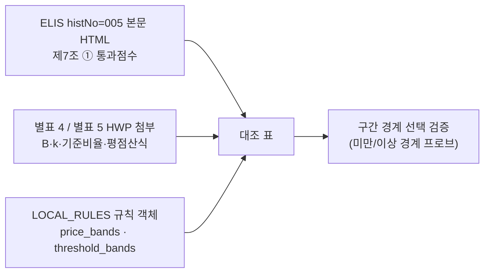

# 전라남도 구판 적격심사 규칙 경계값 원문 재대조 (2026-10-17)

> 작성일: 2026-10-17
> 대상 규칙: `SERVC_LOCAL_JEONNAM_20230302_ATTACH_4_1_4`(폐기물처리용역), `SERVC_LOCAL_JEONNAM_20230302_ATTACH_5_1_4`(육상운송용역)
> 원문: 전라남도 일반용역 적격심사 세부기준 (전라남도 예규 제1075호, 시행 2023-03-02), 자치법규정보시스템 histNo=005
> 규칙 정의: `src/app/services/evaluation_rules.py` 의 `LOCAL_RULES`
> 판정: candidate — 대조 항목 전부 일치, 불일치 0건, 차단 사유 없음

---

## 1. 조사 목적과 배경

J 리뷰어는 근거 문서(`docs/analysis/jngj_predecessor_apply_20261017.md`)의 원문 인용과 코드를 대조했을 뿐, ELIS 원문을 직접 다시 열지는 않았다. 이번 조사는 원문을 직접 내려받아 별표 4-1-4(폐기물)·5-1-4(육상운송)와 본문 제7조를 열어 두 규칙의 구간 경계·B(배점한도)·k(평점계수)·기준비율·통과점수를 한 칸씩 맞춰 본다.

| 구분 | 내용 |
| --- | --- |
| 대조 대상 | 두 규칙의 `price_bands`(`upper_bound`, `max_price_score`, `multiplier`, `base_rate`)와 `threshold_bands`(`upper_bound`, `pass_threshold`) 전부 |
| 범위 밖 | 낙찰하한율(원문 미인쇄·역산값이라 대조 대상 아님), 코드·규칙·원장·`CURRENT_STATE.md` 수정(하지 않음) |
| 산출물 | 이 문서 한 편. 코드는 수정하지 않았고, 불일치가 나오면 여기에만 기록한다. |

---

## 2. 원문 확보 경로

- 원문 출처: 자치법규정보시스템 `https://www.elis.go.kr/allalr/selectAlrBdtOne?alrNo=46000007006065&histNo=005`
- `histNo=005` 가 시행 2023-03-02 일부개정본(예규 제1075호)이며, `histNo=001` 은 시행 2015-10-01 제정본이다. 이번 대조는 `histNo=005` 로 한정했다. ELIS 연혁 화면 원문:

```text
전라남도 일반용역 적격심사 세부기준 [시행 2023.03.02]
(일부개정) 2023-03-02 예규 제 1075호 어려운 용어 정비를 위한 전라남도 일반용역 적격심사 세부기준 등 일부개정예규
...
전라남도 일반용역 적격심사 세부기준 [시행 2015.10.01]
(제정) 2015-10-01 예규 제 1050호
...
전라남도 일반용역 적격심사 세부기준 [시행 2026.07.16]
(폐지) 2026-07-01 예규 제 3호 전남광주통합특별시 일반용역 적격심사 세부지침
```

- 본문은 HTML로 확보했고, 별표 4·5 는 첨부(HWP 5.x)로 내려받아 텍스트화했다. 내려받은 원문과 변환 파일은 `.cache/elis/` 아래에 두었으며 커밋하지 않는다(`.gitignore` 의 `*.cache`).
- 코드 값은 `uv run python` 으로 규칙 객체를 그대로 출력해 표에 옮겼다. 판정 흐름은 아래와 같다.



---

## 3. 별표 4-1-4 폐기물처리용역 대조 (`ATTACH_4_1_4`)

### 3.1 price_bands

| 항목(코드 `upper_bound` / 구간) | 코드 값 (B / k / 기준비율) | 원문 값 | 원문 인용 | 일치 |
| --- | --- | --- | --- | --- |
| 100,000,000 (1억원 미만) | 90 / 20 / 0.88 | 90 / 20 / 88 | `Ⅱ. 입찰가격 … 1억원 미만 90`, `1억원 미만 평점 = 90 - 20 × (88/100 - 입찰가격/예정가격) × 100` | 일치 |
| 500,000,000 (5억원 미만 1억원 이상) | 80 / 20 / 0.88 | 80 / 20 / 88 | `5억원 미만 1억원 이상 80`, `평점 = 80 - 20 × (88/100 - 입찰가격/예정가격) × 100` | 일치 |
| 1,000,000,000 (10억원 미만 5억원 이상) | 30 / 1 / 0.88 | 30 / 1(계수 생략) / 88 | `5억원 이상 30`, `평점 = 30 - (88/100 - 입찰가격/예정가격) × 100` | 일치 |
| 3,000,000,000 (30억원 미만 10억원 이상) | 30 / 1 / 0.88 | 30 / 1(계수 생략) / 88 | 위 `5억원 이상` 행과 동일(원문에 10억원 경계 없음) | 일치 |
| 없음 (추정가격 30억원 이상) | 30 / 1 / 0.88 | 30 / 1(계수 생략) / 88 | 위와 동일(원문에 30억원 경계 없음) | 일치 |

원문 심사항목 및 배점한도 표(Ⅱ. 입찰가격) 원문 인용:

```text
구   분 | 심사분야 | 배점한도(점)
5억원 이상 | 5억원 미만~ 1억원 이상 | 1억원 미만
...
Ⅱ. 입찰가격 | 30 | 80 | 90
합  계 | 100 | 100 | 100
```

원문 입찰가격 평점산식 표(4. 입찰가격) 원문 인용:

```text
5억원 이상      평점 = 30 - (88/100 - 입찰가격/예정가격) × 100
5억원 미만 1억원 이상  평점 = 80 - 20 × (88/100 - 입찰가격/예정가격) × 100
1억원 미만      평점 = 90 - 20 × (88/100 - 입찰가격/예정가격) × 100
주 1) ｜ ｜는 절대값 표시임.
주 2) 추정가격이 5억원 이상인 용역의 경우 입찰가격이 예정가격 이하로서 예정가격의 100분의 93 이상인 경우의 평점은 25점으로,
     추정가격 5억원 미만 1억원 이상인 용역의 경우 입찰가격이 예정가격의 100분의 88.25 이상인 경우 평점은 75점으로,
     추정가격 1억원 미만인 용역의 경우 입찰가격이 예정가격의 100분의 88.25이상인 경우의 평점은 85점으로 한다.
주 3) 입찰가격을 예정가격으로 나눈 결과 소수점 이하의 숫자가 있는 경우에는 소수점 다섯째 자리에서 반올림한다.
```

- 원문 셀의 글리프는 괄호(U+0028/U+0029)지만, 주 1)이 "｜｜는 절대값 표시"라고 밝히고 주 2)의 예시(5억원 이상 93% → 25점 = 30 - (93 - 88), 5억원 미만 1억원 이상 88.25% → 75점 = 80 - 20 × 0.25)가 절대값 해석과 일치한다. 따라서 원문 산식은 코드 표기 `30 - 1 × |88 - 입찰가격/예정가격 × 100|` 와 같은 식이며, 5억원 이상 행의 계수 1은 인쇄되지 않아 코드 `multiplier=1` 이 그 실질값이다.

### 3.2 threshold_bands

| 항목(코드 `upper_bound` / 구간) | 코드 값 (`pass_threshold`) | 원문 값 | 원문 인용 | 일치 |
| --- | --- | --- | --- | --- |
| 1,000,000,000 (추정가격 10억원 미만) | 95 | 95 | `10억 원 미만인 용역은 95점 이상` | 일치 |
| 3,000,000,000 (30억원 미만 10억원 이상) | 90 | 90 | `30억 원 미만 10억 원 이상인 용역은 90점 이상` | 일치 |
| 없음 (추정가격 30억원 이상) | 85 | 85 | `추정가격 30억 원 이상 용역은 85점 이상` | 일치 |

---

## 4. 별표 5-1-4 육상운송용역 대조 (`ATTACH_5_1_4`)

### 4.1 price_bands

| 항목(코드 `upper_bound` / 구간) | 코드 값 (B / k / 기준비율) | 원문 값 | 원문 인용 | 일치 |
| --- | --- | --- | --- | --- |
| 500,000,000 (추정가격 5억원 미만) | 80 / 2 / 0.88 | 80 / 2 / 88 | `Ⅱ. 입찰가격 … 5억원 미만 80`, `5억원 미만 평점 = 80 - 2 × (88/100 - 입찰가격/예정가격) × 100` | 일치 |
| 1,000,000,000 (10억원 미만 5억원 이상) | 60 / 2 / 0.88 | 60 / 2 / 88 | `5억원 이상 60`, `평점 = 60 - 2 × (88/100 - 입찰가격/예정가격) × 100` | 일치 |
| 3,000,000,000 (30억원 미만 10억원 이상) | 60 / 2 / 0.88 | 60 / 2 / 88 | 위 `5억원 이상` 행과 동일(원문에 10억원 경계 없음) | 일치 |
| 없음 (추정가격 30억원 이상) | 60 / 2 / 0.88 | 60 / 2 / 88 | 위와 동일(원문에 30억원 경계 없음) | 일치 |

원문 심사항목 및 배점한도 표(Ⅱ. 입찰가격) 원문 인용:

```text
구   분 | 심사분야 | 배점한도(점)
5억원 이상 | 5억원 미만
...
Ⅱ. 입찰가격 | 60 | 80
합  계 | 100 | 100
```

원문 입찰가격 평점산식 표(7. 입찰가격) 원문 인용:

```text
5억원 이상   평점 = 60 - 2 × (88/100 - 입찰가격/예정가격) × 100
5억원 미만   평점 = 80 - 2 × (88/100 - 입찰가격/예정가격) × 100
주 1) ｜ ｜는 절대값 표시임.
주 2) 입찰가격이 예정가격 이하로서 예정가격의 100분의 90.5 이상인 경우 입찰가격이 예정가격의 100분의 90.5인 경우의 점수로 평가한다.
주 3) 입찰가격을 예정가격으로 나눈 결과 소수점 이하의 숫자가 있는 경우에는 소수점 다섯째 자리에서 반올림한다.
```

### 4.2 threshold_bands

| 항목(코드 `upper_bound` / 구간) | 코드 값 (`pass_threshold`) | 원문 값 | 원문 인용 | 일치 |
| --- | --- | --- | --- | --- |
| 1,000,000,000 (추정가격 10억원 미만) | 95 | 95 | `10억 원 미만인 용역은 95점 이상` | 일치 |
| 3,000,000,000 (30억원 미만 10억원 이상) | 90 | 90 | `30억 원 미만 10억 원 이상인 용역은 90점 이상` | 일치 |
| 없음 (추정가격 30억원 이상) | 85 | 85 | `추정가격 30억 원 이상 용역은 85점 이상` | 일치 |

---

## 5. 통과점수 본문 제7조 ① 대조

별표 4·5 어느 쪽도 통과점수를 따로 정하지 않으므로 두 규칙 모두 본문 제7조 ①이 근거다. 원문 인용:

```text
제7조(낙찰자 결정) ① 계약담당자는 예정가격 이하로서 최저가로 입찰한 자 순으로 심사하여 종합평점이 추정가격 30억 원 이상 용역은 85점 이상,
30억 원 미만 10억 원 이상인 용역은 90점 이상, 10억 원 미만인 용역은 95점 이상인 자를 낙찰자로 결정한다.
(다만, 시설분야용역의 경우 추정가격에 상관없이 95점 이상인 자를 낙찰자로 결정한다)
```

| 구간 경계 | 코드 `threshold_bands` | 원문 값 | 일치 |
| --- | --- | --- | --- |
| 10억원 미만 / 10억원 이상 | 10억원 미만 T=95 | 95 | 일치 |
| 30억원 미만 / 30억원 이상 | 30억원 미만 10억원 이상 T=90 | 90 | 일치 |
| 최상위 구간 | 30억원 이상 T=85 | 85 | 일치 |

---

## 6. 구간 경계 선택 검증

코드가 `미만/이상` 경계를 맞게 고르는지 실제 선택 결과로 확인했다(추정가격 기준, `uv run python` 프로브).

| 추정가격(원) | `ATTACH_4_1_4` 선택 (price → threshold) | `ATTACH_5_1_4` 선택 (price → threshold) |
| --- | --- | --- |
| 99,999,999 | 1억원 미만 B=90/k=20 → 10억원 미만 T=95 | 5억원 미만 B=80/k=2 → 10억원 미만 T=95 |
| 100,000,000 | 5억원 미만 1억원 이상 B=80/k=20 → T=95 | 5억원 미만 B=80/k=2 → T=95 |
| 500,000,000 | 10억원 미만 5억원 이상 B=30/k=1 → T=95 | 10억원 미만 5억원 이상 B=60/k=2 → T=95 |
| 1,000,000,000 | 30억원 미만 10억원 이상 B=30/k=1 → 30억원 미만 10억원 이상 T=90 | 30억원 미만 10억원 이상 B=60/k=2 → T=90 |
| 3,000,000,000 | 추정가격 30억원 이상 B=30/k=1 → 30억원 이상 T=85 | 추정가격 30억원 이상 B=60/k=2 → 30억원 이상 T=85 |

경계값이 정확히 경계에 설 때 "이상" 구간으로 올라가는 동작이 원문 문구와 일치한다(1억원, 5억원, 10억원, 30억원 전부).

---

## 7. 불일치 항목

없다. 대조 항목(구간 경계, B, k, 기준비율 88, 통과점수) 18개 행 전부 원문과 일치한다. 다만 아래는 불일치는 아니지만 원문과 코드 표기가 달라 기록해 둔다.

| 구분 | 내용 | 판정 |
| --- | --- | --- |
| 코드 내부 세분 | 원문 별표 4·5 평점산식 표에는 10억원·30억원 경계가 인쇄돼 있지 않다. 코드는 제7조 ① 통과점수 경계에 맞춰 5억원 이상 띠를 10억원·30억원으로 세분했는데, 세 구간의 B·k·기준비율이 동일해 산식 결과는 바뀌지 않는다. | 불일치 아님 |
| 계수 1 생략 | 원문 5억원 이상 행은 계수 `1 ×`를 인쇄하지 않는다(`30 - (88/100 - 입찰가격/예정가격) × 100`). 코드 `multiplier=1` 은 그 실질값이다. | 불일치 아님 |
| 주 2) 요약 표기 | 코드 `source`/`score_table_source` 는 원문 주 2)를 "투찰률 93% 이상 25점·88.25% 이상 75점·88.25% 이상 85점"으로 요약한다. 인용된 값 자체는 원문과 일치하나 구간 한정 문구는 생략돼 있다. | 불일치 아님 |
| 표제 표기 | 원문 별표 표제는 `[별표 4]`, `[별표 5]` 이고 `[별표 4-1-4]`/`[별표 5-1-4]` 는 규칙 ID(`ATTACH_4_1_4`, `ATTACH_5_1_4`)에 담긴 코드 내부 표기다. | 불일치 아님 |
| 폐지 시점 | 코드 `superseded_date=2026-07-16` 은 ELIS 연혁의 "전남광주통합특별시 일반용역 적격심사 세부지침(2026-07-01, 시행 2026-07-16)" 전환과 부합한다. | 불일치 아님 |
| 범위 밖 | 5억원 이상 상한 문구(주 2))와 코드 `bounded_price_top=false` 필드의 관계는 이번 대조 범위(구간 경계·B·k·기준비율·통과점수)가 아니므로 판정하지 않았다. | 판정 보류 |

낙찰하한율(`lwlt_rate`)은 원문에 인쇄되지 않아 역산값이므로 대조 대상이 아니다. 역산에 쓰인 "88 - (100 - T) / k" 가정은 위 표의 B·k·T와 정합적이지만, 이 문서의 일치 판정에는 포함하지 않았다.

---

## 8. 재현 절차

| 단계 | 명령 |
| --- | --- |
| 본문 HTML | `curl -L "https://www.elis.go.kr/allalr/selectAlrBdtOne?alrNo=46000007006065&histNo=005" -o .cache/elis/jeonnam_1075_hist005.html` |
| 별표 4·5 HWP | 페이지 메타의 CSRF 토큰으로 `/allalr/attListDownAajx` POST 후 `/allalr/attListDown?alrNo=46000007006065&histNo=005&attlistSn=004|005&chkTime=...` GET |
| HWP 텍스트화 | `uvx --from pyhwp --with six hwp5txt .cache/elis/annex4.bin` / `uvx --from pyhwp --with six --with lxml hwp5html .cache/elis/annex4.bin --output .cache/elis/annex4_html` (별표 5 동일) |
| 코드 값 | `uv run python -c "..."` 로 `LOCAL_RULES` 에서 두 규칙의 `price_bands`/`threshold_bands` 출력 |
| 문서 링크 검증 | `python3 scripts/validate_doc_links.py --quiet` |

---

## 9. 결론

- 별표 4-1-4(폐기물)와 별표 5-1-4(육상운송)의 구간 경계, B, k, 기준비율 88, 통과점수는 ELIS 원문(예규 제1075호, 시행 2023-03-02, histNo=005)과 전부 일치한다.
- 원문 대비 차이는 코드 내부 세분(10억원·30억원 경계), 계수 1 생략 표기, 주 2) 요약 표기뿐이며 값에는 영향이 없다.
- 판정: candidate. 불일치 0건, 차단 사유 없음. 코드·규칙·원장은 수정하지 않았다.
