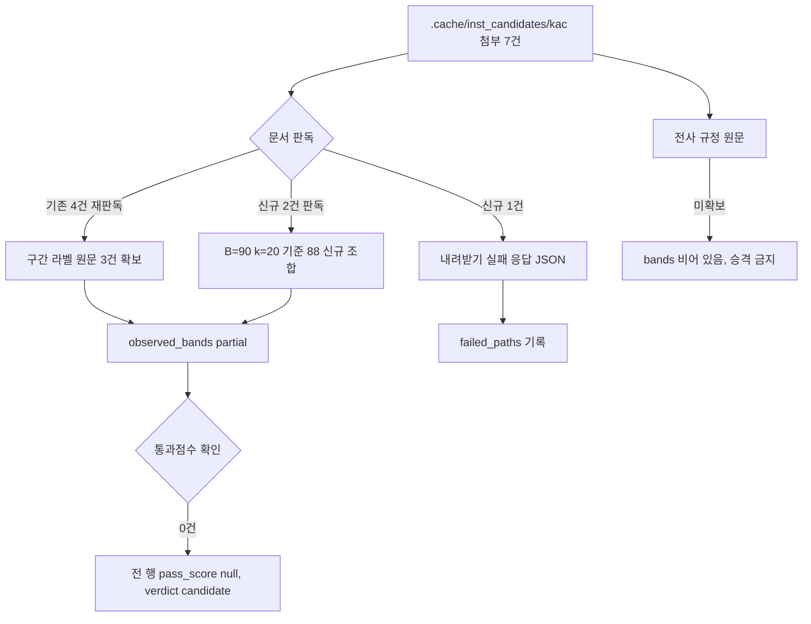

# 한국공항공사 적격심사 세부기준 구간 라벨·통과점수 추가 수집

> **작성일**: 2026-10-15
> **작업**: `task_a782350d0a01` (Run `run_cfe18fe34fa6`)
> **대상**: 한국공항공사 (`data/reference/institution_rules_candidates_b_20261014.yaml`, status: partial)
> **산출물**: [data/reference/kac_partial_followup_20261015.yaml](../../data/reference/kac_partial_followup_20261015.yaml)
> **판정**: candidate (통과점수 미확정, 차단 사유 없음)

---

## 1. 요약

한국공항공사가 조달청 기준이 아니라 자체 적격심사 세부기준을 적용한다는 사실과 개별 공고 첨부의 계수 일부는 2026-10-14 에 이미 확인했습니다. 이번 회차는 `.cache/inst_candidates/kac/` 에 내려받아 두었으나 아직 판독하지 않았던 첨부 3건을 추가로 읽었습니다.

| 구분 | 결과 |
| --- | --- |
| 새로 판독한 첨부 | 3건 (`R26BK01743888_f3.hwp`, `R26BK01766558_f4.hwp`, `R26BK01743642_f3.hwp`) |
| 그중 문서로 읽힌 건 | 2건 |
| 문서가 아니었던 건 | 1건 (`R26BK01743642_f3.hwp` 는 내려받기 실패 응답 JSON) |
| 새로 읽은 계수 조합 | 1건 (B=90·k=20·기준 88) |
| 재확인된 계수 조합 | 1건 (B=90·k=20·기준 90) |
| 통과점수 확보 | 0건 |
| 전사 규정 원문 확보 | 미확보 |

핵심 결론은 두 가지입니다. 첫째, 통과점수는 확보한 첨부 7건 어디에도 없습니다. 첨부는 모두 평가항목·배점한도·산식만 담고 낙찰자 결정 조항을 담지 않습니다. 둘째, 전사 규정(지침) 원문을 확보하지 못했으므로 전사 구간표를 채우지 못했고, 개별 공고 관측값을 전사 구간표로 승격하지 않았습니다.

---

## 2. 새로 확정한 값

여기서 "확정"은 나라장터 첨부 원문 문장으로 값을 직접 읽은 것만 뜻합니다. 확정한 것은 구간 라벨과 계수이며, 통과점수는 한 건도 확정하지 못했습니다.

### 2.1 새로 읽은 구간 라벨

| # | 문서 | 구간 라벨 원문 | 구간 해석 | 출처 파일 |
| --- | --- | --- | --- | --- |
| 1 | 기술용역 적격심사 세부 평가기준 | `■ 추정가격이 고시금액 미만(건축사법에 따른 설계 또는 시설물의 안전 및 유지관리에 관한 특별법에 따른 정밀점검/정밀안전진단은 1억원 미만)인 용역` | 상한 고시금액 | `R26BK01721579_f4.hwpx` |
| 2 | 건설폐기물 처리용역 적격업체 평가기준(환경부고시) | `※ 건설폐기물 처리용역 적격업체 평가기준(환경부고시) 추정가격 2억원 미만인 용역` | 상한 2억원 | `R26BK01733618_f3.hwpx` |
| 3 | 시설분야용역 적격심사 항목 및 배점한도 | `추정가격 5억원 미만` | 상한 5억원 | `R26BK01717869_f4.hwpx` |
| 4 | 적격심사 세부 평가기준 (건설공사 안전점검 수행기관 지정) | `ㅇ 수행능력 평가방법 및 세부평가기준 (1억원 미만)` | 상한 1억원(수행능력 절 제목에만 인쇄) | `R26BK01766558_f4.hwp` (신규) |

1~3번은 기존 후보 명세가 "구간 라벨 원문 표기"·"개별 공고 첨부"로 뭉뚱그려 두었던 것을 원문 문장으로 확정한 것입니다. 4번은 이번 회차 신규 판독이며, `(1억원 미만)` 표기가 수행능력 평가방법 절 제목에만 인쇄되어 입찰가격 산식 행과 직접 결합되지 않으므로 하한·상한을 확정하지 않았습니다.

### 2.2 새로 읽은 계수

| # | 문서 | B | k | 기준비율 | 평탄 조건 | 평탄 점수 | 신규 여부 | 출처 파일 |
| --- | --- | --- | --- | --- | --- | --- | --- | --- |
| 1 | 적격심사 세부기준 「대구공항 기계설비 성능점검 용역」 | 90 | 20 | 90 | 예정가격의 90.25% 이상 | 85 | 재확인 | `R26BK01743888_f3.hwp` (신규 판독) |
| 2 | 적격심사 세부 평가기준 (안전점검 수행기관 지정) | 90 | 20 | 88 | 인쇄 없음 | 인쇄 없음 | 신규 조합 | `R26BK01766558_f4.hwp` (신규 판독) |

1번은 `R26BK01721579_f4.hwpx` 와 값이 같아 B=90·k=20·기준 90 조합이 독립 공고에서 한 번 더 확인된 것입니다. 2번의 B=90·k=20·기준 88 조합은 기존 관측 4건에 없던 값입니다. 다만 두 건 모두 전사 규정 원문이 아니라 개별 공고 첨부에서 읽은 관측값이므로 전사 구간표로 승격하지 않았습니다.

---

## 3. 여전히 미확정인 값

| 항목 | 상태 | 사유 |
| --- | --- | --- |
| 적격 통과점수 (종합평점 기준) | 미확정 | 첨부 7건 어디에도 `종합평점이 N점 이상` 형태의 문구가 없음. 첨부는 낙찰자 결정 조항을 담지 않음 |
| 전사 규정(지침) 원문 | 미확보 | 공사 홈페이지·전자조달 게시 위치를 확인하지 못함 |
| 전사 구간표 (`bands`) | 미작성 | 전사 규정 원문이 없어 비어 있음 |
| 기술용역 추정가격 구간별 계수표 | 부분 | 개별 공고 3종 관측(B=90·k=20·기준 90, B=70·k=4·기준 90, B=90·k=20·기준 88)뿐이고 전사 표가 아님 |
| `R26BK01754057`, `R26BK01743888`, `R26BK01766558` 의 구간 라벨 | 미인쇄 | 문서에 추정가격 구간 표기가 인쇄되지 않음 |
| `R26BK01717869` 의 평탄 점수 | 미인쇄 | 평탄 조건만 인쇄되고 점수는 인쇄되지 않음 |

통과점수가 0건이므로 관측 행 6건은 모두 `status: partial` 이고 `pass_score` 는 전 행 `null` 입니다. 확정 판정을 받은 행은 없습니다.

---

## 4. 개별 공고 첨부 관측값 전체

| # | 구간·문서 | 용역 유형 | B | k | 기준비율 | 평탄 | 통과점수 | status | 출처 파일 |
| --- | --- | --- | --- | --- | --- | --- | --- | --- | --- |
| 1 | 추정가격이 고시금액 미만인 용역 | 기술용역 | 90 | 20 | 90 | 90.25% 이상 85점 | null | partial | `R26BK01721579_f4.hwpx` |
| 2 | 기술용역 적격심사 기준 (구간 라벨 미인쇄) | 기술용역 | 70 | 4 | 90 | 91.25% 이상 65점 | null | partial | `R26BK01754057_f4.hwp` |
| 3 | 추정가격 2억원 미만인 용역 | 용역 | 70 | 20 | 88 | 88.25% 이상 65점 | null | partial | `R26BK01733618_f3.hwpx` |
| 4 | 추정가격 5억원 미만 | 시설분야용역 | 70 | 5 | 93 | 96% 이상(점수 미인쇄) | null | partial | `R26BK01717869_f4.hwpx` |
| 5 | 대구공항 기계설비 성능점검 용역 (구간 라벨 미인쇄) | 기술용역 | 90 | 20 | 90 | 90.25% 이상 85점 | null | partial | `R26BK01743888_f3.hwp` |
| 6 | 안전점검 수행기관 지정 (1억원 미만 절 제목) | 시설분야용역 | 90 | 20 | 88 | 인쇄 없음 | null | partial | `R26BK01766558_f4.hwp` |

전 행이 개별 공고 첨부에서 읽은 관측값입니다. 전사 규정 원문에서 읽은 값이 아니므로 전사 구간표에 합치지 않았고, 통과점수를 확인하지 못했으므로 어느 행도 `confirmed` 로 올리지 않았습니다.

---

## 5. 시도한 경로와 실패한 경로

### 5.1 시도한 경로 (성공)

| 경로 | 방법 | 결과 |
| --- | --- | --- |
| 미판독 첨부 3건 판독 | `scripts/extract_score_params.py` 의 `extract_document_text` 로 캐시 파일을 직접 읽음 | 2건에서 구간 라벨·산식·평탄 문장 확인, 1건은 문서 아님 |
| 기존 4건 재판독 | 같은 함수로 구간 라벨 문장을 정확히 인용 | 구간 라벨 원문 3건 확보 |
| 통과점수 문구 탐색 | 7건 평문 전량에 `parse_pass_threshold` 와 `종합평점`·`낙찰자`·`이상인 자`·`낙찰하한` 패턴 적용 | 문구 0건 |

### 5.2 실패한 경로

| 경로 | 결과 |
| --- | --- |
| `R26BK01743642_f3.hwp` 판독 | 확장자는 `.hwp` 이나 내용이 163바이트 JSON 입니다. 원문은 `{"ErrorMsg":"파일이 존재하지 않습니다.","reason":"Unprocessable Entity","path":"/pn/pnp/pnpe/UntyAtchFile/downloadFile.do","ErrorCode":-1,"locale":"ko"}` 로, 내려받기 실패 응답이 저장된 것입니다. 문서가 아니므로 산식·라벨을 읽을 수 없습니다. |
| 전사 규정(지침) 원문 확보 | 공사 홈페이지·전자조달 게시 위치를 확인하지 못했습니다. 전사 규정 원문이 없어 전사 구간표를 채우지 못했습니다. |
| 상업·교육 게시판 게시물 | 개정일 단서(개정 2026-03-02, 2026-08-14 등)만 확인되었고 계수는 전재하지 않았습니다. 이 문서와 YAML 의 어떤 값도 그 출처를 쓰지 않았습니다. |

---

## 6. 판정과 범위 준수

| 점검 항목 | 결과 |
| --- | --- |
| `confirmed` 행 수 | 0건 (통과점수를 확인한 행이 없음) |
| 상업 게시판·추정만으로 적은 확정값 | 0건 |
| 전사 구간표로 승격한 개별 공고 관측값 | 0건 |
| 기관 규칙 코드·커버리지 원장·기존 후보 YAML 수정 | 0건 |
| 수정·커밋 파일 | 본 문서와 `data/reference/kac_partial_followup_20261015.yaml` 2건 |

판정은 candidate 이고 차단 사유는 없습니다. 통과점수와 전사 규정 원문은 다음 회차로 넘기며, 근거가 없다는 사실 자체를 blocked 로 적지 않았습니다.
