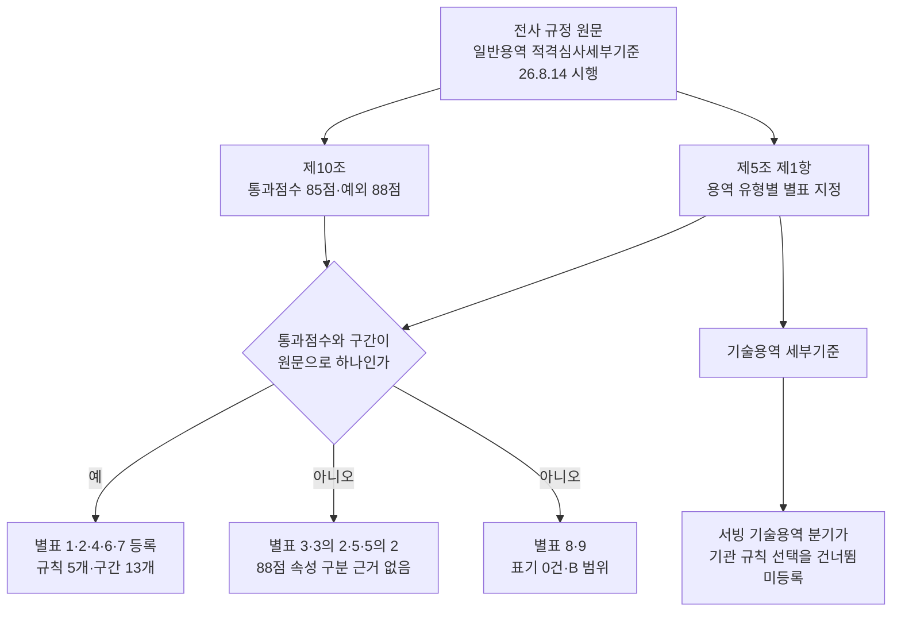

# 한국공항공사 일반용역 적격심사 기관 규칙 등록

> **작성일**: 2026-10-17
> **작업**: `task_019f035bf688` (Run `run_7fc80bfcde31`)
> **대상**: 한국공항공사 (`data/reference/institution_rules_20261013.yaml`)
> **정본 사양**: `.orca/capsules/task_kac_register_20261017/capsule.yaml`
> **선행 문서**: [`kac_regulation_followup_20261015.md`](kac_regulation_followup_20261015.md), [`institution_rules_apply_20261013.md`](institution_rules_apply_20261013.md)
> **판정**: candidate (별표 5개 등록, 미등록 별표의 사유 기록, 차단 사유 없음)

---

## 1. 요약

한국공항공사 일반용역 적격심사세부기준(최종 개정 2026-08-05 지침 제792호, 2026-08-14 이후 입찰공고분 적용)의 별표 가운데 **통과점수와 구간이 원문으로 하나로 정해지는 별표 5개**를 `INSTITUTION_RULES` 와 정본 명세에 등록했습니다. 등록한 것은 별표 1(학술연구용역)·별표 2(시설분야용역)·별표 4(폐기물처리용역)·별표 6(보험용역)·별표 7(수리·점검용역)이며 규칙 5개, 구간 13개입니다.

통과점수가 공고 속성에 따라 85점과 88점으로 갈리는 별표 3·별표 3의 2(소프트웨어용역)와 별표 5·별표 5의 2(육상운송용역), 배점한도가 범위로만 인쇄되는 별표 9(지정형 용역), 표기 자체가 0건인 별표 8(임대차용역), 그리고 기술용역은 등록하지 않고 그 이유를 이 문서에 남겼습니다.

| 항목 | 값 |
| --- | --- |
| 확인 기관 | 12곳 (한국공항공사 추가) |
| 등록 규칙 | 5개 |
| 등록 구간 | 13개 |
| 등록 별표 | 별표 1·2·4·6·7 |
| 미등록 별표 | 별표 3·3의 2·5·5의 2·8·9 |
| 수요기관 코드 | B551178 |
| 시행일 | 2026-08-14 |
| 배점표 | 미반영(`quant_table=False`, 정량점수 직접 입력 유지) |

---

## 2. 조회 결과

`scripts/db_readonly_query.py` 의 읽기 전용 SELECT 만 사용했습니다. 조회 조건은 `category = 'Servc' AND dminstt_nm LIKE '한국공항공사%' AND raw_data->>'$.sucsfbidMthdCd' = '낙030001'`(적격심사제)이며 총 1510건입니다.

### 2.1 수요기관 코드와 이름

| 수요기관 코드 | 수요기관 이름 | 공고 수 |
| --- | --- | ---: |
| B551178 | 한국공항공사 | 355 |
| Z013741 | 한국공항공사 김포공항 | 364 |
| Z003852 | 한국공항공사 제주공항 | 303 |
| Z003838 | 한국공항공사 김해공항 | 234 |
| Z003854 | 한국공항공사 항로시설본부 인천항공교통시설단 | 59 |
| Z003848 | 한국공항공사 청주공항 | 55 |
| Z003849 | 한국공항공사대구공항 | 30 |
| Z003853 | 한국공항공사 항공기술훈련원 | 25 |
| Z003844 | 한국공항공사 포항경주공항 | 21 |
| Z003841 | 한국공항공사 여수공항 | 15 |
| Z003842 | 한국공항공사 울산공항 | 14 |
| Z015677 | 한국공항공사 무안공항 | 8 |
| Z003851 | 한국공항공사 원주지사 | 7 |
| Z003850 | 한국공항공사 광주공항 | 7 |
| Z003847 | 한국공항공사 군산지사 | 5 |
| Z003839 | 한국공항공사 양양공항 | 3 |
| Z003843 | 한국공항공사 사천지사 | 3 |
| D067524 | 한국공항공사 항로시설본부 | 2 |

- 코드 `B551178` 의 공고 이름이 `한국공항공사` 로 같아 `institution_code` 로 등록했습니다.
- 나머지 17개 이름은 조회 결과의 **정확 일치 이름만** `institution_aliases` 로 넣었습니다. 이름을 토막내는 접두 확장(`subunit_name_prefixes`·`subunit_code_prefixes`)은 넣지 않았습니다.
- 하위 조직 공고는 코드가 `Z0…`·`D067524` 대역이라 규칙 코드(`B551178`)와 달라, **코드가 있는 공고에서는 코드 불일치로 매칭되지 않습니다.** 정확 일치 별칭은 코드가 없는 공고에서만 동작합니다(해양환경공단과 같은 한계).

### 2.2 유형별 토큰 후보

기관 규칙은 낙찰방법명(`sucsfbidMthdNm`)과 공고명(`bidNtceNm`)을 이어 붙인 텍스트에서 규칙 표기를 찾습니다(`evaluation_rules.py` 의 `_select_institution_rule`). 그래서 두 열의 표기를 함께 셌습니다.

| 용역 유형 | 후보 토큰 | 낙찰방법명 표기 (건수) | 공고명 표기 (건수) | 등록 |
| --- | --- | --- | --- | --- |
| 학술연구용역 | `학술연구용역` | `적격심사제-학술연구용역 적격심사 추정가격 고시금액 미만` (13) | `학술연구` 0 | 별표 1 등록 |
| 시설분야용역 | `시설분야용역` | `적격심사제-시설분야용역 적격심사 추정가격 5억원 미만` (22), `… 5억원 이상` (3) | `시설분야` 2 (전기시설분야·항행시설분야) | 별표 2 등록 |
| 폐기물처리용역 | `폐기물처리용역적격심사` | `적격심사제-폐기물처리용역 적격심사 추정가격 고시금액미만` (21), `… 5억원미만-추정가격 고시금액이상` (1), `… 5억원이상` (1) | `폐기물처리용역` 3, `건설폐기물` 144 | 별표 4 등록(토큰 한정) |
| 보험용역 | `보험용역`, `보험` | `적격심사제-보험용역 적격심사 추정가격 5억원미만` (8), `… 5억원이상` (5) | `보험` 50 | 별표 6 등록 |
| 수리·점검용역 | `수리점검용역` | `적격심사제-수리ㆍ점검용역 적격심사 고시금액 미만` (7) | `수리` 0 | 별표 7 등록 |
| 소프트웨어용역 | 없음 | `적격심사제-소프트웨어용역(중소기업자간 경쟁제품 대상) 적격심사 추정가격 5억원 미만` (3), `… 5억원 이상` (2) | `소프트웨어` 0 | 미등록 |
| 육상운송용역 | 없음 | 0 | `여객` 62, `화물` 15 (여객터미널·화물청사 등 시설 표기) | 미등록 |
| 임대차용역 | 없음 | 0 | 0 | 미등록 |
| 지정형 용역 | `지정형` | `적격심사제-수요기관 지정형 적격심사 추정가격 고시금액 미만` (2) | 0 | 미등록 |
| 기술용역 | 해당 없음 | `적격심사제-…기술용역 평가기준` 계열 245 | 다수 | 미등록 |
| 유형 미특정 | 없음 | `적격심사제-추정가격 2억원 미만인 용역` (15), `적격심사제-추정가격 5억원 미만 2억원 이상인 용역` (8), `적격심사제-관리규정외 수기심사(총점입력)` (21) | — | 미등록 |

- 매칭은 규칙 표기와 공고 텍스트에서 공백·구분자를 지운 뒤 부분 문자열로 대조합니다(`_normalize_institution_text`). 그래서 규칙 표기는 원문 표기에서 구분자를 뗀 형태로 적었습니다(`수리ㆍ점검용역` → `수리점검용역`).
- `적격심사`, `일반용역`, `협상에 의한 계약`, `기술용역` 처럼 다른 유형에도 붙는 토큰은 쓰지 않았습니다.
- 유형 미특정 표기(`추정가격 2억원 미만인 용역` 등)는 어느 별표인지 정해지지 않아 등록하지 않았습니다.

---

## 3. 등록한 별표와 구간

### 3.1 구간이 정해지는 방식

- 배점한도 B 는 별표의 `추정가격 5억원 이상 / 추정가격 5억원 미만` 두 열로 인쇄됩니다.
- 평점계수 k 와 기준비율은 같은 별표 `사업예산규모` 표의 `추정가격 고시금액 이상 / 미만` 두 행으로 인쇄됩니다.
- 두 축이 만나 구간이 **셋**(고시금액 미만 / 고시금액 이상 5억원 미만 / 5억원 이상)으로 정해집니다. 고시금액은 2026년 230,000,000원(`notice_amount_for_year(2026)`)입니다.
- 별표 2·별표 6 은 산식이 고시금액으로 나뉘지 않고 단일 행으로 인쇄되어 구간이 **둘**(5억원 미만 / 5억원 이상)입니다.
- 통과점수는 제10조가 정한 85점입니다. 등록한 5개 별표의 구간 13개는 모두 통과점수가 85점 하나입니다.

### 3.2 하한율 계산

하한율 = 기준비율 − (100 − 통과점수) ÷ k 를 소수 둘째 자리까지 버린 뒤 0.005 를 뺀 `.995` 표기로 적었습니다(해양환경공단과 같은 관행).

| 별표 | 기준비율 | k | 통과점수 | 계산 | 하한율 |
| --- | ---: | ---: | ---: | --- | ---: |
| 별표 1·4·7 (고시금액 미만) | 90 | 4 | 85 | 90 − 3.75 = 86.25 | 86.245 |
| 별표 1·4·7 (고시금액 이상) | 90 | 2 | 85 | 90 − 7.5 = 82.5 | 82.495 |
| 별표 2 | 93 | 5 | 85 | 93 − 3 = 90 | 89.995 |
| 별표 6 | 88 | 0.375 | 85 | 88 − 40 = 48 | 47.995 |

- 원문에 인쇄된 평탄 조건(`예정가격의 N% 이상인 경우`)의 N 은 기준비율 + (100 − 통과점수) ÷ k 로, 위 하한율과 기준비율을 사이에 두고 짝을 이룹니다. 별표 1·4·7 은 `97.5% / 93.75%`, 별표 2 는 `96%`, 별표 6 은 128% 라 인쇄되지 않았습니다(원문에 평탄 조건 없음). 그래서 별표 6 의 하한율 47.995 는 인쇄값이 아니라 관행식 계산값이며, 원문 평탄 조건이 없다는 사실을 명세의 `flat_score: null`·`price_cap_rate: null` 로 남겼습니다.

### 3.3 등록 구간표

| 규칙 ID | 별표 | 추정가격 구간 | B | k | 기준비율 | 통과점수 | 하한율 |
| --- | --- | --- | ---: | ---: | ---: | ---: | ---: |
| `SERVC_INST_KAC_20260814_ACADEMIC` | 별표 1 학술연구용역 | 고시금액 미만 | 70 | 4 | 90 | 85 | 86.245 |
| `SERVC_INST_KAC_20260814_ACADEMIC` | 별표 1 학술연구용역 | 고시금액 이상 5억원 미만 | 70 | 2 | 90 | 85 | 82.495 |
| `SERVC_INST_KAC_20260814_ACADEMIC` | 별표 1 학술연구용역 | 5억원 이상 | 40 | 2 | 90 | 85 | 82.495 |
| `SERVC_INST_KAC_20260814_FACILITY` | 별표 2 시설분야용역 | 5억원 미만 | 70 | 5 | 93 | 85 | 89.995 |
| `SERVC_INST_KAC_20260814_FACILITY` | 별표 2 시설분야용역 | 5억원 이상 | 60 | 5 | 93 | 85 | 89.995 |
| `SERVC_INST_KAC_20260814_WASTE` | 별표 4 폐기물처리용역 | 고시금액 미만 | 70 | 4 | 90 | 85 | 86.245 |
| `SERVC_INST_KAC_20260814_WASTE` | 별표 4 폐기물처리용역 | 고시금액 이상 5억원 미만 | 70 | 2 | 90 | 85 | 82.495 |
| `SERVC_INST_KAC_20260814_WASTE` | 별표 4 폐기물처리용역 | 5억원 이상 | 60 | 2 | 90 | 85 | 82.495 |
| `SERVC_INST_KAC_20260814_INSURANCE` | 별표 6 보험용역 | 5억원 미만 | 70 | 0.375 | 88 | 85 | 47.995 |
| `SERVC_INST_KAC_20260814_INSURANCE` | 별표 6 보험용역 | 5억원 이상 | 60 | 0.375 | 88 | 85 | 47.995 |
| `SERVC_INST_KAC_20260814_REPAIR` | 별표 7 수리·점검용역 | 고시금액 미만 | 70 | 4 | 90 | 85 | 86.245 |
| `SERVC_INST_KAC_20260814_REPAIR` | 별표 7 수리·점검용역 | 고시금액 이상 5억원 미만 | 70 | 2 | 90 | 85 | 82.495 |
| `SERVC_INST_KAC_20260814_REPAIR` | 별표 7 수리·점검용역 | 5억원 이상 | 60 | 2 | 90 | 85 | 82.495 |

- 값의 출처는 전사 규정 원문을 읽은 `data/reference/kac_regulation_followup_20261015.yaml` 의 `bands` 이며, 코드와 명세 구간의 `source` 는 `docs/analysis/kac_regulation_followup_20261015.md:4.2` 입니다.
- `quant_table=False` 로 두어 기관 정량평가 배점표는 반영하지 않았고, 정량점수 직접 입력을 유지합니다.

### 3.4 별표 4 의 토큰을 낙찰방법명으로 한정한 이유

제5조 제1항 제4호가 폐기물처리용역을 별표 4 로 지정하지만, **제4-1호는 건설폐기물처리용역을 별표가 아니라 환경부 고시(건설폐기물의 재활용촉진에 관한 법률 제15조 제3항)로 돌립니다.** 조회에서 공고명에 `건설폐기물` 을 포함한 적격심사 용역 공고가 144건 있었고, 이 공고명들은 정규화하면 `폐기물처리용역` 을 부분 문자열로 포함합니다(예: `김포공항 건설폐기물 처리용역`).

그래서 별표 4 규칙의 표기를 `폐기물처리용역` 이 아니라 낙찰방법명에서 읽은 `폐기물처리용역적격심사` 로 한정했습니다. 이 표기는 23건(21+1+1)의 실제 폐기물처리용역 공고 낙찰방법명에 모두 있고, 건설폐기물 공고 144건에는 없습니다. 표기를 넓히면 건설폐기물 공고에 별표 4 값이 잘못 적용되므로 한정이 필요했습니다.

---

## 4. 등록하지 않은 별표와 이유

| 별표 | 용역 유형 | 사유 |
| --- | --- | --- |
| 별표 3, 별표 3의 2 | 소프트웨어용역 | 제10조가 `소프트웨어용역의 중소기업자간 경쟁제품` 의 통과점수를 88점으로 따로 두고, 제5조 제1항 제3호가 `별표 3 또는 별표 3의 2` 로 대안을 지정합니다. 그런데 조회에는 `적격심사제-소프트웨어용역(중소기업자간 경쟁제품 대상) …` 표기 5건만 있고 **비대상 표기가 0건**이며, 어느 표가 대상/비대상에 붙는지 원문 문장으로 확정되지 않습니다. 통과점수(85 또는 88)와 별표(k·기준비율이 다름)를 함께 가릴 근거가 없어 등록하지 않았습니다. |
| 별표 5, 별표 5의 2 | 육상운송용역 | 제10조가 `여객 육상운송용역` 을 88점으로 두고 제5조 제1항 제5호가 대안을 지정합니다. 조회의 `여객` 62건·`화물` 15건은 `여객터미널`·`화물청사` 등 공항 시설 표기라 육상운송용역을 특정하지 못하고, 낙찰방법명에는 육상운송 표기가 0건입니다. 어느 표가 여객/화물에 붙는지도 확정되지 않아 등록하지 않았습니다. |
| 별표 8 | 임대차용역 | 적격심사 용역 공고에 임대차 표기가 0건이라 규칙을 선택할 토큰이 없습니다. |
| 별표 9 | 지정형 용역 | 낙찰방법명에 `수요기관 지정형` 표기가 2건 있습니다. 다만 제5조 제1항 제9호가 배점을 입찰공고에서 설정하도록 정해 배점한도가 `60점 이상 70점 이하` 범위로만 인쇄되어 B 를 하나로 확정하지 못해 등록하지 않았습니다. |
| (기술용역 세부기준) | 기술용역 | 기술용역은 별도 세부기준이고, 서빙은 기술용역 공고에서 기관 규칙 선택 전에 공고 하한율 규칙(`SERVC_TECH_QUAL_ANNOUNCEMENT_LWLT`)을 돌려주며 `evaluation_rules.py:6547` 조건이 기관 규칙 선택을 건너뜁니다. 등록해도 쓰이지 않아 등록하지 않았습니다. |

- 위 별표를 등록하지 않았으므로 해당 공고는 종전 조달청 판정 경로를 그대로 씁니다. 근거가 없다는 사실 자체를 차단 사유로 적지 않았습니다.

---

## 5. 바꾸지 않은 것

| 대상 | 상태 |
| --- | --- |
| `data/reference/rule_coverage_ledger.yaml` | 수정하지 않음(병합 뒤 코디네이터가 재생성) |
| `docs/context/CURRENT_STATE.md` | 수정하지 않음 |
| DB 스키마·데이터 | 변경 없음(읽기 전용 SELECT 만 실행) |
| `data/reference/kac_regulation_followup_20261015.yaml` | 수정하지 않음(원문 판독값 정본) |
| `data/reference/institution_quant_tables_20261013.yaml` | 수정하지 않음(배점표 미확보) |
| `.cache/inst_candidates/kac/` 원문 HWP | 커밋하지 않음(`.cache` 는 gitignore 대상) |
| 기존 규칙 ID·구간 값 | 삭제·변경 없음(한국가스공사·해양환경공단 포함) |

---

## 6. 검증

| 항목 | 명령 | 결과 |
| --- | --- | --- |
| 값·판정 시험 | `uv run pytest tests/test_institution_rules.py tests/test_evaluation_quant_institution.py tests/test_evaluation_rules_meta_api.py tests/test_evaluation_rules_scope_axis.py -q -m 'not data_assets'` | 86 passed |
| 전량 시험 | `uv run pytest tests/ -q -m 'not data_assets'` | 통과 |
| 타입 | `uv run mypy src` | 통과 |
| 규칙 검증 | `python3 scripts/validate_agent_rules.py --quiet` | 통과 |

- 값 대조 시험은 정본 명세 YAML 을 읽어 확인 기관 12곳의 구간 값(B·k·기준비율·통과점수·하한율·경계)을 코드와 대조하며, 구간 합계는 157개입니다(기존 144 + 한국공항공사 13).
- 기존 규칙 ID 는 지우지 않았고, 배점표가 없는 규칙 집합(`quant_basis=AGENCY_DOCUMENT_NOT_LOADED`) 단정에 한국공항공사 규칙 5개 ID 를 더했습니다.

---

## 7. 변경 파일

| 파일 | 내용 |
| --- | --- |
| `src/app/services/evaluation_rules.py` | `INSTITUTION_RULES` 에 한국공항공사 규칙 5개·구간 13개 추가, `_SRC_INST_KAC`·`_KAC_INSTITUTION_ALIASES` 추가, 확인 기관 수 주석 갱신 |
| `data/reference/institution_rules_20261013.yaml` | 정본 명세에 한국공항공사 기관 항목(구간 13개, status confirmed) 추가 |
| `src/app/api/v1/evaluations.py` | `SERVC_RULE_META_SCOPE_NOTE` 와 메타 docstring 의 확인 기관 수 12곳 |
| `tests/test_institution_rules.py` | 기관 수 12곳·구간 합계 157, 수요기관 코드 추가, 한국공항공사 선택·미등록 시험 추가 |
| `tests/test_evaluation_quant_institution.py` | 배점표 없는 규칙 집합에 한국공항공사 규칙 ID 추가 |
| `tests/test_evaluation_rules_meta_api.py` | scope_note 확인 기관 수 12곳 |
| `docs/analysis/institution_rules_apply_20261013.md` | 반영 기관표에 한국공항공사 추가, 건수 갱신 |
| `docs/analysis/kac_register_20261017.md` | 본 문서 |

---

## 8. 남은 사항

| 항목 | 내용 |
| --- | --- |
| 통과점수 88점 별표 | 소프트웨어용역(중소기업자간 경쟁제품)·여객 육상운송용역의 88점 예외는 제10조 원문으로 확인되지만, 제5조 제1항의 `별표 3 또는 별표 3의 2`·`별표 5 또는 별표 5의 2` 대안 가운데 어느 표가 그 속성에 붙는지가 미확정입니다. 원문 세부 조문이나 개별 공고 첨부로 그 대응이 확정되면 그때 등록합니다. |
| 별표 9 지정형 용역 | 배점한도가 공고에서 설정되어 기관 규칙으로 고정할 수 없습니다. |
| 하위 조직 공고 | 공항·지사 코드가 `Z0…`·`D067524` 대역이라 규칙 코드와 달라 코드가 있는 공고에서는 매칭되지 않습니다. 원문이 하위 조직을 적용 주체로 명시한 근거가 없어 접두 확장도 하지 않았습니다. |
| 배점표 | 심사항목 배점한도는 미확보라 정량점수 직접 입력이 필요합니다. |
| 별표 6 하한율 | 47.995 는 관행식 계산값이며 원문에 평탄 조건이 인쇄되지 않았습니다. 원문 판독으로 확인되면 값과 근거를 다시 적습니다. |
