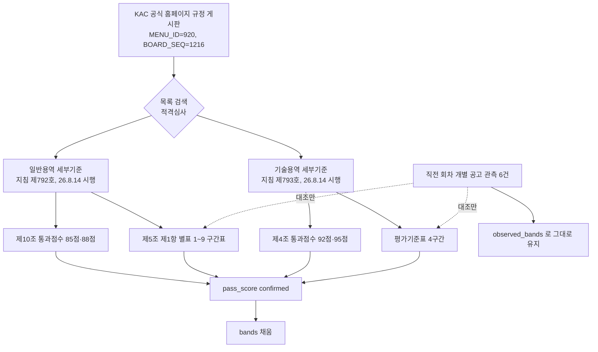

# 한국공항공사 전사 적격심사 규정 원문과 종합평점 통과점수 추가 수집

> **작성일**: 2026-10-15
> **작업**: `task_b2bd77c664cf` (Run `run_5631fae373c0`)
> **대상**: 한국공항공사 (`data/reference/institution_rules_candidates_b_20261014.yaml`, status: partial)
> **선행**: `data/reference/kac_partial_followup_20261015.yaml` (개별 공고 첨부 7건 판독, 통과점수 0건)
> **산출물**: [data/reference/kac_regulation_followup_20261015.yaml](../../data/reference/kac_regulation_followup_20261015.yaml)
> **판정**: candidate (전사 규정 원문과 통과점수 확보, 차단 사유 없음)

---

## 1. 요약

직전 회차(`task_a782350d0a01`)는 나라장터 개별 공고 첨부 7건만 읽어 통과점수 0건, 전사 규정 원문 미확보로 끝났고 그 결과 `bands` 를 비워 두었습니다. 이번 회차는 경로를 바꿔 한국공항공사 공식 홈페이지의 규정 게시판(열린경영 > 입찰정보 > 규정 및 계약조건)에서 **전사 규정 원문 두 건을 직접 내려받아** 읽었습니다.

| 구분 | 결과 |
| --- | --- |
| 전사 규정 원문 확보 | 2건 (일반용역, 기술용역 적격심사세부기준) |
| 종합평점 통과점수 확보 | 확보 (일반용역 제10조 85점·예외 88점, 기술용역 제4조 92점·95점) |
| 전사 별표 구간표 확보 | 일반용역 [별표 1]~[별표 9] 11개 표, 기술용역 평가기준표 4구간 |
| 개별 공고 관측값 재판독 | 0건 (범위에서 제외) |
| 직전 회차 파일 수정 | 0건 |
| 기관 규칙 코드·원장 수정 | 0건 |

핵심 결론은 세 가지입니다.

첫째, 한국공항공사는 조달청 기준이 아니라 **자체 전사 규정**을 적용하며, 그 원문이 공사 공식 홈페이지 규정 게시판에 공개되어 있습니다. 직전 회차가 "게시 위치 확인 실패"로 남긴 부분이 이번 회차에 해소되었습니다.

둘째, **종합평점 통과점수를 원문 문장으로 확정**했습니다. 일반용역은 제10조가 85점(소프트웨어용역의 중소기업자간 경쟁제품, 여객 육상운송용역은 88점)으로, 기술용역은 제4조가 용역규모별로 92점(추정가격 10억원 이상)·95점(10억원 미만)으로 정합니다.

셋째, 비어 있던 **전사 구간표를 원문에서 채웠습니다**. 일반용역 세부기준은 제5조 제1항이 용역 유형별로 [별표 1]~[별표 9]를 지정하고, 각 별표가 입찰가격 배점한도와 평점산식을 인쇄합니다. 직전 회차가 개별 공고에서 관측한 값들이 이 전사 표와 일치함을 확인했습니다.

---

## 2. 전사 규정 원문 확보 경로

### 2.1 게시 위치

| 항목 | 값 |
| --- | --- |
| 사이트 | KAC 한국공항공사 공식 홈페이지 > 열린경영 > 입찰정보 > 규정 및 계약조건 |
| 목록 URL | `https://www.airport.co.kr/www/cms/frCon/index.do?MENU_ID=920` |
| 게시판 파라미터 | `BOARD_SEQ=1216`, `SITE_NO=2`, `CATE_SEQ=1154` |
| 목록 API | `POST https://www.airport.co.kr/www/ajaxf/frBoardSvc/bbsViewList.do` |
| 첨부 다운로드 | `GET https://www.airport.co.kr/ajaxa/fileCpnt/fileDown.do?gbn=b03&BOARD_SEQ=1216&SITE_NO=2&BBS_SEQ=<BBS_SEQ>&FILE_SEQ=<FILE_SEQ>` |

목록 API 를 제목 검색어 `적격심사` 로 호출하면 13건이 검색됩니다. 게시판 전체 목록에는 일반용역·기술용역·물품구매(내자)·시설공사 적격심사세부기준이 함께 게시되어 있습니다.

### 2.2 내려받은 원문 두 건

| 구분 | 일반용역 | 기술용역 |
| --- | --- | --- |
| 기준명 | 일반용역 적격심사세부기준 | 기술용역 적격심사세부기준 |
| 최종 개정 | 2026-08-05 지침 제792호 | 2026-08-05 지침 제793호 |
| 직전 개정 | 2026-02-27 지침 제777호 | 2026-02-27 지침 제778호 |
| 제정 | 2009-11-20 | 2009-11-20 |
| 시행 | 2026-08-14 이후 입찰공고분 | 2026-08-14 이후 입찰공고분 |
| 게시물 | `BBS_SEQ=3553810` | `BBS_SEQ=3553809` |
| 게시물 제목 | 일반용역 적격심사세부기준('26.8.14. 입찰공고부터 시행) | 기술용역 적격심사세부기준('26.8.14. 입찰공고부터 시행) |
| 게시일·부서 | 2026-08-06, 자산계약부 | 2026-08-06, 자산계약부 |
| 첨부(전문) | 일반용역 적격심사세부기준 개정(안) 전문(260814시행).hwp | 기술용역 적격심사세부기준 개정(안) 전문(260814시행).hwp |
| 첨부(신구대비표) | 일반용역 적격심사세부기준 개정(안) 신구대비표(260814시행).hwpx | 기술용역 적격심사세부기준 개정(안) 신구대비표(260814시행).hwpx |
| 캐시 파일 | `.cache/inst_candidates/kac/gen_general_260814.hwp` (217KB) | `.cache/inst_candidates/kac/tech_general_260814.hwp` (164KB) |

첨부 이름이 `개정(안)` 으로 인쇄되지만, 게시물이 해당 시행일의 현행 기준으로 게시한 전문입니다. 기술용역 원문 부칙은 `부칙<26. 8. 5.> -이 기준은 2026년 8월 14일 이후 입찰공고하는 적격심사 대상용역부터 적용한다.` 로 인쇄됩니다.

### 2.3 시설분야용역의 위치 정정

직전 회차 후보 명세는 `standard` 를 "일반용역 / 기술용역 / 시설분야용역 적격심사 세부기준" 세 갈래로 적었습니다. 원문 제5조 제1항은 시설분야용역 평가기준을 **일반용역 적격심사세부기준 [별표 2]** 로 지정합니다. 즉 시설분야용역은 별도 전사 규정이 아니라 일반용역 세부기준의 별표입니다. 게시판에서도 시설분야용역 명의 게시물은 검색되지 않았습니다(0건).

---

## 3. 확정한 값 · 종합평점 통과점수

여기서 "확정"은 전사 규정 원문 문장으로 값을 직접 읽은 것만 뜻합니다.

### 3.1 일반용역 · 제10조

| 항목 | 값 |
| --- | --- |
| 조문 | 제10조(낙찰자 결정) |
| 통과점수 | **85점** |
| 예외 | 소프트웨어용역의 중소기업자간 경쟁제품 **88점**, 여객 육상운송용역 **88점** |

> 제10조(낙찰자 결정) 최저가 입찰자에 대한 심사결과 종합평점이 85점(다만, 소프트웨어용역의 중소 기업자간 경쟁제품, 여객 육상운송용역은 88점)이상이면 낙찰자로 결정한다.`<개정 14.11.18, 20.05.12, 22.11.01>`

### 3.2 기술용역 · 제4조

| 추정가격 구간 | 통과점수 |
| --- | --- |
| 10억원 이상인 용역 | **92점** |
| 10억원 미만인 용역 | **95점** |

> 제4조(낙찰자결정 및 적격심사제출서류 등) 예정가격 이하로서 최저가 입찰자부터 심사하여 종합평점이 용역규모별 적격통과점수(추정가격이 10억원 이상인 용역은 92점, 추정가격이 10억원 미만인 용역은 95점)이상인 최저가 입찰자를 낙찰자로 결정한다.`<개정 13.1.31, 19.5.17>`

기술용역 제4조는 통과점수를 10억원 경계로만 규정하는데, 이 경계가 별표 평가기준표의 첫 경계와 같습니다. 그래서 네 구간 중 추정가격 10억원 이상 구간만 92점이고 나머지 세 구간은 95점입니다. 라벨과 통과점수를 같은 조문에서 함께 읽었으므로 네 구간 모두 confirmed 로 두었습니다.

### 3.3 직전 회차와의 차이

| 항목 | 직전 회차 | 이번 회차 |
| --- | --- | --- |
| 통과점수 | 전 행 null, status unconfirmed | 85점·88점(일반), 92점·95점(기술) 확정 |
| 전사 규정 원문 | 미확보 | 확보 (2건) |
| 전사 구간표 `bands` | 빈 목록 | 일반용역 11개 별표, 기술용역 4구간 |
| 게시 위치 | 미확인 | 공사 공식 홈페이지 규정 게시판 확인 |

---

## 4. 확정한 값 · 전사 구간표

### 4.1 일반용역 세부기준의 구조

제5조 제1항이 용역 유형별로 [별표]를 지정합니다.

| 호 | 용역 유형 | 적용 별표 |
| --- | --- | --- |
| 1 | 학술연구용역 | [별표 1] |
| 2 | 시설분야용역 | [별표 2] |
| 3 | 소프트웨어용역 | [별표 3] 또는 별표 3의 2 |
| 4 | 폐기물처리용역 | [별표 4] |
| 4-1 | 건설폐기물처리용역 | 건설폐기물의 재활용촉진에 관한 법률 제15조 제3항에 의한 평가기준(환경부 고시) |
| 5 | 육상운송용역 | [별표 5] 또는 별표 5의2 |
| 6 | 보험용역 | 별표 6 |
| 7 | 수리·점검용역 | 별표 7 |
| 8 | 임대차 용역 | 별표 8 |
| 9 | 지정형 용역 | 별표 9 |

각 별표는 입찰가격 배점한도를 `추정가격 5억원 이상 / 추정가격 5억원 미만` 두 열로 인쇄하고, 평점산식을 `사업예산규모` 표에서 `추정가격 고시금액 이상 / 미만` 두 행으로 인쇄합니다.

### 4.2 일반용역 [별표 1]~[별표 9] 입찰가격 구간표

| 별표 | 용역 유형 | B (5억원 이상) | B (5억원 미만) | 산식 (고시금액 이상) | 산식 (고시금액 미만) | 평탄 조건 |
| --- | --- | --- | --- | --- | --- | --- |
| [별표 1] | 학술연구용역 | 40 | 70 | k=2, 기준 90 | k=4, 기준 90 | 97.5% / 93.75% |
| [별표 2] | 시설분야용역 | 60 | 70 | k=5, 기준 93 (단일) | 같음 | 96% |
| [별표 3] | 소프트웨어용역 | 60 | 70 | k=2, 기준 90 | k=4, 기준 90 | 97.5% / 93.75% |
| [별표 3의 2] | 소프트웨어용역(대안) | 60 | 70 | k=4, 기준 93 (단일) | 같음 | 96% |
| [별표 4] | 폐기물처리용역 | 60 | 70 | k=2, 기준 90 | k=4, 기준 90 | 97.5% / 93.75% |
| [별표 5] | 육상운송용역 | 60 | 70 | k=4, 기준 93 (단일) | 같음 | 96% |
| [별표 5의 2] | 육상운송용역(대안) | 60 | 70 | k=2, 기준 90 | k=4, 기준 90 | 97.5% / 93.75% |
| [별표 6] | 보험용역 | 60 | 70 | k=0.375, 기준 88 (단일) | 같음 | 인쇄 없음 |
| [별표 7] | 수리·점검용역 | 60 | 70 | k=2, 기준 90 | k=4, 기준 90 | 97.5% / 93.75% |
| [별표 8] | 임대차용역 | 70 | 열 없음 | k=2, 기준 90 | k=4, 기준 90 | 97.5% / 93.75% |
| [별표 9] | 지정형 용역 | 60점 이상 70점 이하 | 열 없음 | k=2, 기준 90 | k=4, 기준 90 | 97.5% / 93.75% |

읽는 법과 한계는 다음과 같습니다.

- **B** 는 별표의 `입찰가격` 행에서 읽은 값입니다. [별표 1]만 40/70 이고 나머지는 60/70 입니다.
- **산식** 은 `평점(점) = 배점한도 − k × |(기준비율/100 − 입찰가격/예정가격) × 100|` 이며, 기준비율과 계수를 원문에서 읽었습니다. 고시금액 이상 행은 k 가 작고 미만 행은 큽니다. [별표 2], [별표 3의 2], [별표 5], [별표 6] 은 구간으로 나뉘지 않고 단일 산식입니다.
- **평탄 조건** 은 "예정가격의 N% 이상인 경우에는 예정가격의 N%인 경우의 점수로 평가" 문장에서 읽은 N 입니다. 원문은 조건만 인쇄하고 그 조건에서의 **점수는 인쇄하지 않아** `flat_score` 를 null 로 두었습니다.
- **통과점수** 는 별표 표에 인쇄되지 않고 제10조에만 있습니다. 그래서 별표 구간표의 `pass_score` 는 제10조에서 읽은 85점(소프트웨어용역 중소기업자간 경쟁제품·여객 육상운송용역은 88점)입니다.
- **[별표 9]** 는 제5조 제1항 제9호가 지정형 용역의 배점을 입찰공고에서 설정하도록 정해 "60점 이상 70점 이하" 범위만 인쇄됩니다.
- **[별표 8]** 은 표 머리의 배점한도가 한 열만 인쇄되어 B 를 단일값 70 으로 두었습니다.

### 4.3 기술용역 평가기준표 4구간

| 구간 | 추정가격 | B | k | 기준비율 | 평탄 조건 | 평탄 점수 | 통과점수 |
| --- | --- | --- | --- | --- | --- | --- | --- |
| 1 | 10억원 이상 | 30 | 1 | 90 | 98% 이상 | 22 | 92 |
| 2 | 10억원 미만 5억원 이상 | 50 | 2 | 90 | 92.5% 이상 | 45 | 95 |
| 3 | 5억원 미만 고시금액 이상 | 70 | 4 | 90 | 91.25% 이상 | 65 | 95 |
| 4 | 고시금액 미만 | 90 | 20 | 90 | 90.25% 이상 | 85 | 95 |

원문 구간 제목은 다음과 같이 인쇄됩니다.

> 1. 추정가격이 10억원 이상인 용역
> 2. 추정가격이 10억원 미만 5억원 이상인 용역
> 3. 추정가격이 5억원 미만 고시금액 이상(건축사법에 따른 설계 또는 시설물의 안전 및 유지관리에 관한 특별법에 따른 정밀점검/정밀안전진단은 5억원 미만 1억원 이상)인 용역
> 4. 추정가격이 고시금액 미만(건축사법에 따른 설계 또는 시설물의 안전 및 유지관리에 관한 특별법에 따른 정밀점검/정밀안전진단은 1억원 미만)인 용역

1구간은 평점산식이 `평점=30-｜(90/100 - 입찰가격/예정가격) ×100｜` 로 인쇄되어 계수 곱셈 항이 없습니다. k 를 1 로 두면 평탄 대입값 `30 − 1 × |0.90 − 0.98| × 100 = 22` 가 인쇄 점수 22 와 일치합니다. 나머지 구간도 대입값이 인쇄 점수와 정확히 일치합니다(50−2×2.5=45, 70−4×1.25=65, 90−20×0.25=85).

---

## 5. 개별 공고 관측값과의 대조

직전 회차가 개별 공고 첨부에서 읽은 관측값을 전사 구간표로 **승격하지 않았습니다**. 대신 이미 확보한 전사 표에 그 값이 대응하는지만 확인했습니다.

| 직전 회차 관측 (개별 공고) | 대응하는 전사 구간 | 대조 결과 |
| --- | --- | --- |
| 시설분야용역 B=70·k=5·기준 93·96% 이상 (R26BK01717869) | 일반용역 [별표 2] · 추정가격 5억원 미만 | 일치 |
| 기술용역 B=90·k=20·기준 90·90.25% 이상 85점 (R26BK01721579, R26BK01743888) | 기술용역 평가기준표 4 · 고시금액 미만 | 일치 |
| 기술용역 B=70·k=4·기준 90·91.25% 이상 65점 (R26BK01754057) | 기술용역 평가기준표 3 · 5억원 미만 고시금액 이상 | 일치 |
| 용역 B=70·k=20·기준 88·88.25% 이상 65점 (R26BK01733618) | 전사 별표 아님 (건설폐기물처리용역 환경부 고시) | 전사 규정 범위 밖으로 확인 |

대조는 세 건 모두 일치했습니다. 관측값은 직전 회차 파일의 `observed_bands` 에 그대로 남겨 두었고, 이 파일의 `bands` 에는 전사 규정 원문에서 읽은 값만 담았습니다.

---

## 6. 여전히 미확정인 값

| 항목 | 상태 | 사유 |
| --- | --- | --- |
| 일반용역 [별표 1]~[별표 9]의 평탄 점수 | 미확정 | 원문이 평탄 조건 문장만 인쇄하고 조건에서의 점수를 인쇄하지 않음 |
| 일반용역 [별표 9]의 단일 B | 미확정 | 지정형 용역은 배점을 입찰공고에서 설정하도록 정해 "60점 이상 70점 이하" 범위만 인쇄 |
| 일반용역 [별표 8]의 추정가격 5억원 경계 | 미확정 | 표 머리에 배점한도 열이 하나만 인쇄되어 B 를 단일값 70 으로 둠 |
| 일반용역 세부기준 부칙 문단 | 미확인 | 레코드 텍스트에서 부칙 문단을 찾지 못함. 시행일은 게시물 제목과 첨부 파일명으로 확인 |
| 건설폐기물처리용역 구간표 | 해당 없음 | 전사 규정 별표가 아니라 환경부 고시를 지정하므로 이 세부기준의 별표 구간표에 없음 |

통과점수와 전사 규정 원문은 확보되었으므로 `bands` 를 채웠고, 위 항목은 다음 회차로 넘깁니다. 근거가 없다는 사실 자체를 blocked 로 적지 않았습니다.

---

## 7. 시도한 경로와 실패한 경로

### 7.1 시도한 경로 (성공)

| 경로 | 방법 | 결과 |
| --- | --- | --- |
| KAC 공식 홈페이지 규정 게시판 | 목록 API 를 제목 검색어 `적격심사` 로 호출 | 13건 확인, 용역 유형 4건(일반·기술 각 2건) 확인 |
| 전사 규정 원문 판독 | 첨부 `전문` HWP 다운로드 후 `extract_score_params.py` 의 표 행·평문·레코드 텍스트 추출 | 제10조·제4조 문장과 별표 산식 표 확보 |
| 레코드 단위 문단 추출 | `_ole_streams` / `_hwp_records` / `_hwp_record_text` | 평문 통짜 디코딩이 놓친 제10조·제4조와 별표 산식 회수 |

### 7.2 실패한 경로

| 경로 | 결과 |
| --- | --- |
| KAC 게시판에서 `시설분야용역` 검색 | 결과 0건. 원문 제5조 제1항 제2호가 시설분야용역을 일반용역 [별표 2]로 지정하므로 별도 전사 규정이 없음 |
| 일반용역 세부기준 부칙 문단 추출 | 레코드 텍스트에서 `부칙` 문단을 찾지 못함. 시행일은 게시물 제목과 첨부 파일명 `(260814시행)` 으로 확인 |
| 기술용역 세부기준 평문 통짜 디코딩 | Section0 스트림을 UTF-16LE 로 통째로 디코딩하면 레코드 크기가 어긋나 본문 대부분이 깨짐. 레코드 단위 판독으로 대체 |

### 7.3 조회했으나 정본이 아니었던 경로

| 경로 | 결과 |
| --- | --- |
| 국가법령정보센터 행정규칙 (한국공항공사) | 공사는 공기업이라 적격심사 세부기준이 행정규칙으로 등록되어 있지 않음. 전사 규정 게시판이 정본 |
| 알리오 내부규정 (`/occasional/findRuleList.json`) | 한국공항공사 내부규정 71건(정관·인사규정·공사감독규정 등)을 확인했으나 적격심사 세부기준은 목록에 없음 |
| 나라장터 개별 공고 첨부의 낙찰자 결정 조항 | 이번 회차에 재판독하지 않음. 직전 회차가 첨부 7건에서 통과점수 0건을 확인했고, 전사 규정 원문에서 통과점수를 확보했으므로 범위에서 제외 |
| 상업·교육 게시판 게시물 | 사용하지 않음. 일반용역·시설공사 세부기준 전문을 게시한 글이 검색되었으나 계수와 통과점수를 전재하지 않았음 |

---

## 8. 판정과 범위 준수

| 점검 항목 | 결과 |
| --- | --- |
| `confirmed` 행마다 공식 원문 인용 | 있음 (통과점수 2건, 전사 구간표 15행 모두 quote 보유) |
| 상업 게시판·추정만으로 적은 확정값 | 0건 |
| 개별 공고 관측값을 전사 구간표로 승격 | 0건 (대조만 수행) |
| 직전 회차 파일(`kac_partial_followup`) 수정 | 0건 |
| 기관 규칙 코드(`src/app`)·커버리지 원장 수정 | 0건 |
| 수정·커밋 파일 | 본 문서와 `data/reference/kac_regulation_followup_20261015.yaml` 2건 |
| 원문 캐시 파일 커밋 | 0건 (`.cache` 는 gitignore 대상) |

판정은 candidate 이고 차단 사유는 없습니다. 전사 규정 원문과 종합평점 통과점수를 확보했으므로 직전 회차가 남긴 최대 공백이 해소되었습니다.
