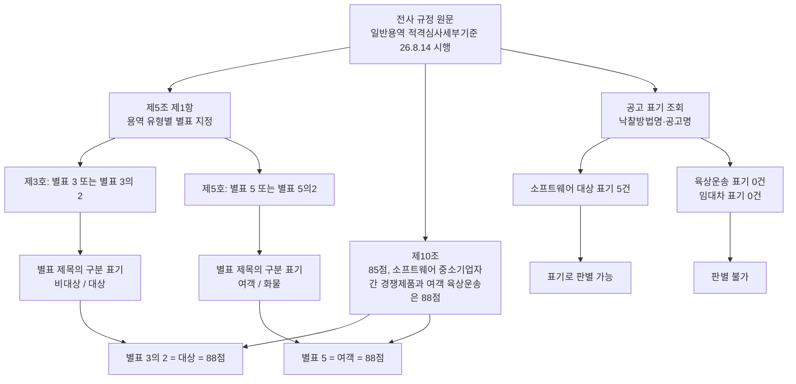

# 한국공항공사 미등록 별표(3·3의 2·5·5의 2·8·9)의 등록 근거 조사

> **작성일**: 2026-10-17
> **작업**: `task_8cbe96d546de`
> **정본 사양**: `.orca/capsules/task_kac_unregistered_annex_20261017/capsule.yaml`
> **대상**: 한국공항공사 일반용역 적격심사세부기준 (2026-08-05 지침 제792호, 2026-08-14 이후 입찰공고분)
> **선행 문서**: [`kac_register_20261017.md`](kac_register_20261017.md), [`kac_regulation_followup_20261015.md`](kac_regulation_followup_20261015.md), [`kac_partial_followup_20261015.md`](kac_partial_followup_20261015.md)
> **판정**: candidate (원문과 공고 표기에서 등록 근거 확인, 규칙 미등록, 차단 사유 없음)

---

## 1. 요약

2026-10-17 에 한국공항공사 별표 1·2·4·6·7 이 기관 규칙으로 등록되었고, 별표 3·3의 2·5·5의 2·8·9 는 근거가 확정되지 않아 빠졌습니다. 이번 회차는 그 여섯 별표의 **등록 근거를 원문과 공고 표기에서 찾는 조사**이며, 규칙은 등록하지 않았습니다.

핵심 결과는 세 가지입니다.

첫째, **별표 3 과 별표 3의 2, 별표 5 와 별표 5의 2 를 가르는 적용 구분 조문은 원문에 없습니다.** 제5조 제1항 제3호와 제5호는 각각 `별표 3 또는 별표 3의 2`, `별표 5 또는 별표 5의2` 로만 적고 어느 쪽을 쓸지 정하지 않습니다. 다만 **구분 자체는 별표 제목에 인쇄되어 있습니다.** 별표 3 은 `소프트웨어용역(중소기업간 경쟁제품 비대상)`, 별표 3의 2 는 `소프트웨어용역(중소기업간 경쟁제품 대상)`, 별표 5 는 `여객 육상운송용역`, 별표 5의 2 는 `화물 육상운송용역` 입니다. 제10조가 88점 예외를 `소프트웨어용역의 중소기업자간 경쟁제품`, `여객 육상운송용역` 으로 두므로 **별표 3의 2 와 별표 5 가 88점, 별표 3 과 별표 5의 2 가 85점** 으로 대응됩니다.

둘째, **통과점수 85/88 을 공고 표기로 가를 수 있는지는 별표마다 다릅니다.** 소프트웨어용역 대상(별표 3의 2, 88점)은 낙찰방법명에 `소프트웨어용역(중소기업자간 경쟁제품 대상)` 이 인쇄된 5건이 있어 **표기로 판별 가능**합니다. 소프트웨어용역 비대상(별표 3, 85점), 여객 육상운송(별표 5, 88점), 화물 육상운송(별표 5의 2, 85점)은 한국공항공사 공고 모집단에 표기가 **0건**이라 **판별 불가**입니다.

셋째, **별표 9 의 배점 범위는 공고가 값을 정하는 구조입니다.** 별표 9 의 입찰가격 배점한도는 `60점 이상` / `70점 이하` 두 셀로만 인쇄되고, 제5조가 `제1항제9호에 따라 [별표 9]를 적용하여 심사하고자 하는 경우에는 아래 각 호에 따라 심사기준을 설정하여야 한다` 고 정한 뒤 `입찰공고 시 조정 및 설정 내용을 명시하여야 한다` 고 적습니다. 별표 8 의 공고 표기 0건은 재확인했습니다.

| 항목 | 값 |
| --- | --- |
| 조사 대상 별표 | 별표 3, 3의 2, 5, 5의 2, 8, 9 |
| 적용 구분 조문 | 없음 (제5조 제1항 제3호·제5호는 대안 병기만) |
| 별표 제목의 구분 표기 | 있음 (비대상/대상, 여객/화물) |
| 통과점수 대응 | 별표 3의 2·별표 5 = 88점, 별표 3·별표 5의 2 = 85점 |
| 85/88 표기 판정 | 별표 3의 2 = 표기로 판별 가능, 나머지 3개 = 판별 불가 |
| 별표 9 배점 결정 | 공고가 정함 (범위 60~70, 제5조가 설정 요건과 공고 명시 의무를 규정) |
| 별표 8 공고 표기 | 0건 (재확인) |
| 등록한 규칙 | 0개 (조사 전용) |



---

## 2. 원문 재확보 경로

### 2.1 게시물과 첨부

선행 회차가 확인한 것과 같은 게시물만 원문으로 보았습니다.

| 항목 | 값 |
| --- | --- |
| 사이트 | 한국공항공사 공식 홈페이지 > 열린경영 > 입찰정보 > 규정 및 계약조건 (`MENU_ID=920`) |
| 게시물 | 일반용역 적격심사세부기준('26.8.14. 입찰공고부터 시행), `BBS_SEQ=3553810`, 2026-08-06, 자산계약부 |
| 첨부 1 | 일반용역 적격심사세부기준 개정(안) 전문(260814시행).hwp (`FILE_SEQ=1`) |
| 첨부 2 | 일반용역 적격심사세부기준 개정(안) 신구대비표(260814시행).hwpx (`FILE_SEQ=2`) |
| 캐시 경로 | `.cache/inst_candidates/kac/gen_general_260814.hwp`, `.cache/inst_candidates/kac/gen_general_260814_compare.hwpx` |
| 캐시는 커밋하지 않음 | `.cache` 는 gitignore 대상이며, 본 문서의 값은 캐시 원문에서 읽은 문장입니다 |

### 2.2 내려받은 파일의 무결성

| 파일 | 크기(바이트) | SHA-256 |
| --- | ---: | --- |
| `gen_general_260814.hwp` | 222208 | `1157b860e85725b09ba8e64a2edeeb88e71d30580669f59dfb77bb0e2a3bb249` |
| `gen_general_260814_compare.hwpx` | 79118 | `c885e90397782c7bb0ccf1927984e5e3415c2fe45afa579a82dc4a22d0623a90` |

전문 HWP 의 크기 222208 바이트는 선행 회차가 `data/reference/kac_regulation_followup_20261015.yaml` 에 기록한 값과 같습니다.

### 2.3 판독 방법

`scripts/extract_score_params.py` 의 `_ole_streams` / `_hwp_records` / `_hwp_record_text` 로 문단을 읽었고, 신구대비표는 `extract_document_text` 로 읽었습니다. 아래 인용의 `문단 N` 은 `_hwp_record_text` 가 돌려준 문단 순서입니다. 평문 통짜 UTF-16LE 디코딩은 선행 회차와 같이 정렬 오차로 문장이 깨지므로 쓰지 않았습니다.

---

## 3. 별표 3·3의 2·5·5의 2 의 적용 구분

### 3.1 제5조 제1항 원문 인용

> `3. 소프트웨어용역 평가기준 : 별표 3 또는 별표 3의 2<개정 20.05.12>` (문단 76)
> `5. 육상운송용역 평가기준 : 별표 5 또는 별표 5의2<개정 20.05.12>` (문단 79)
> `8. 임대차 용역 평가기준 : 별표 8<신설 23.07.20>` (문단 82)
> `9. 지정형 용역 평가기준 : 별표 9<신설 23.07.20>` (문단 83)

- 제3호와 제5호는 대안을 `또는` 으로 병기할 뿐, **어느 쪽을 적용할지 정하는 문장이 없습니다.**
- HWP 조판에서 별표 참조에 제어문자가 끼어 `汫별표 3汫h` 형태로 읽히므로 인용에서는 제어문자를 제거하고 `별표 3` 으로 적었습니다.
- 같은 규정 안에서 별표 선택 기준을 정한 다른 문장을 찾지 못했습니다. `중소기업간 경쟁제품`·`중소기업자간 경쟁제품` 이 나오는 문단은 정의(문단 36·37), 제10조(문단 133·134·135), 별표 제목(문단 486·631) 뿐입니다.

### 3.2 적용 구분 조문 유무

| 질문 | 판정 | 근거 |
| --- | --- | --- |
| 별표 3 과 별표 3의 2 의 적용 구분 조문이 있는가 | **없음** | 제5조 제1항 제3호가 `별표 3 또는 별표 3의 2` 로만 적고 선택 기준을 정하지 않음 |
| 별표 5 와 별표 5의 2 의 적용 구분 조문이 있는가 | **없음** | 제5조 제1항 제5호가 `별표 5 또는 별표 5의2` 로만 적음 |

구분 조문은 없지만, **어느 별표가 어느 속성용인지는 별표 제목에 인쇄되어 있습니다.** 그래서 `어느 표가 어느 공고에 붙는지` 는 별표 제목과 제10조를 이어 읽으면 정해집니다.

### 3.3 별표 제목에 인쇄된 구분 표기 (원문 인용)

> `[별표 3] (제5조 제1항 제3호 관련) <개정 13.1.31,14.11.18,15.7.29,18.4.6,19.5.17,20.05.12,21.8.17,23.07.20,26.2.27.,26.8.5.>` (문단 485)
> `소프트웨어용역(중소기업간 경쟁제품 비대상) 적격심사 항목 및 배점한도` (문단 486)

> `[별표 3의 2] (제5조 제1항 제3호 관련) <개정 13.1.31, 14.11.18, 15.7.29, 18.4.6, 20.05.12, 21.8.17, 23.07.20, 26.2.27, 26.8.5.>` (문단 630)
> `소프트웨어용역(중소기업간 경쟁제품 대상) 적격심사 항목 및 배점한도` (문단 631)

> `[별표 5] (제5조 제1항 제5호 관련) <개정 13.1.31, 14.11.18, 15.7.29, 18.4.6, 19.5.17, 21.8.17, 22.11.01, 23.07.20, 26.2.27, 26.8.5.>` (문단 931)
> `여객 육상운송용역 적격심사 항목 및 배점한도` (문단 932)

> `[별표 5의 2] (제5조 제1항 제5호 관련) <개정 21.8.17,23.07.20,26.2.27., 26.8.5.>` (문단 1087)
> `화물 육상운송용역 적격심사 항목 및 배점한도` (문단 1088)

### 3.4 제10조 통과점수 원문 인용

> `제10조(낙찰자 결정) 최저가 입찰자에 대한 심사결과 종합평점이 85점(다만, 소프트웨어용역의 중소 기업자간 경쟁제품, 여객 육상운송용역은 88점)이상이면 낙찰자로 결정한다.<개정 14.11.18, 20.05.12, 22.11.01>` (문단 133)

같은 조 뒤 두 문단도 같은 예외를 반복합니다.

> `동일가격의 최저가 입찰자가 2인 이상으로서 적격심사 결과 종합평점이 85점(단, 소프트웨어용역의 중소기업간 경쟁제품, 여객 육상운송용역은 88점)이상인 자 중에서 최고점수인 자를 낙찰자로 결정한다.` (문단 134)
> `최저가 입찰자에 대한 심사결과 종합평점이 85점(단, 소프트웨어용역의 중소기업자간 경쟁제품, 여객 육상운송용역은 88점) 미만인 경우 ... 차 순위 최저가 입찰자 순서로 심사하여 낙찰자를 결정한다.<개정 13.1.31, 14.11.18, 20.05.12, 22.11.01, 26.2.27.>` (문단 135)

### 3.5 별표와 속성·통과점수 대응

| 별표 | 별표 제목 원문 (속성) | 통과점수 | 평점산식 (고시금액 이상 / 미만) | 입찰가격 배점한도 |
| --- | --- | ---: | --- | --- |
| 별표 3 | 소프트웨어용역(중소기업간 경쟁제품 **비대상**) | 85 | k=2 기준 90 / k=4 기준 90 | 60점(5억원 이상) / 70점(5억원 미만) |
| 별표 3의 2 | 소프트웨어용역(중소기업간 경쟁제품 **대상**) | **88** | k=4 기준 93 (단일) | 60점 / 70점 |
| 별표 5 | **여객** 육상운송용역 | **88** | k=4 기준 93 (단일) | 60점 / 70점 |
| 별표 5의 2 | **화물** 육상운송용역 | 85 | k=2 기준 90 / k=4 기준 90 | 60점 / 70점 |

- 통과점수 열은 제10조에서, 나머지 열은 별표 표와 산식 문단에서 읽었습니다. 값의 상세는 `data/reference/kac_regulation_followup_20261015.yaml` 의 `bands` 와 같습니다.
- **두 쌍 모두 통과점수와 산식이 함께 갈립니다.** 별표 3 계열은 기준 90 의 k=2/k=4 이고 별표 3의 2 는 기준 93 의 k=4 이며, 별표 5 는 기준 93 의 k=4, 별표 5의 2 는 기준 90 의 k=2/k=4 입니다. 어느 별표인지 확정되지 않으면 통과점수뿐 아니라 하한율도 함께 어긋납니다.
- 별표 3·3의 2·5·5의 2 의 산식 문단은 각각 문단 539·544 (별표 3), 983 (별표 5), 1137·1142 (별표 5의 2) 이고, 별표 3의 2 는 `평점(점) = 배점한도 4 × ( 93 입찰가격 )× 100 100 예정가격` 조판이라 `TIMES vert` 형태로 읽히지 않습니다.

### 3.6 신구대비표 대조

`gen_general_260814_compare.hwpx` 의 신·구 두 열 모두 같은 제목을 인쇄하므로, 위 구분 표기는 이번 개정으로 생긴 것이 아니라 개정 전후에 함께 있던 표기입니다.

| 별표 | 신구대비표에 인쇄된 제목 |
| --- | --- |
| 별표 3 | 소프트웨어용역(중소기업자간 경쟁제품 비대상) 적격심사 항목 및 배점한도 |
| 별표 3의 2 | 소프트웨어용역(중소기업간 경쟁제품 대상) 적격심사 항목 및 배점 한도 |
| 별표 5 | 여객 육상운송용역 적격심사 항목 및 배점 한도 |
| 별표 5의 2 | 화물 육상운송용역 적격심사 항목 및 배점한도 |
| 별표 8 | 임대차 용역 적격심사 |
| 별표 9 | 지정형 용역 적격심사 |

신구대비표에는 같은 개정에서 `조달청 기준(조달청 공고 제2026-260호('26.5.29.)) 개정사항 반영`, `낙찰하한율 변경` 문장도 함께 인쇄됩니다. 별표 참조 조문(제5조 제1항 제3호·제5호)의 문구는 신구대비표에서 다루지 않습니다.

---

## 4. 통과점수 85/88 의 공고 표기 판정

### 4.1 조회 조건

`scripts/db_readonly_query.py` 의 읽기 전용 SELECT 만 사용했습니다.

| 항목 | 값 |
| --- | --- |
| 테이블·조건 | `bid_announcements`, `category = 'Servc'` AND `dminstt_nm LIKE '한국공항공사%'` AND `raw_data->>'$.sucsfbidMthdCd' = '낙030001'` |
| 기간 | 제한 없음 (전량) |
| 공고 차수 | 공고번호·업무구분별 최신 차수만 (원장과 같은 규칙) |
| 원행 수 / 최신 차수 수 | 1510건 / 1303건 |
| 조회 열 | `raw_data->>'$.sucsfbidMthdNm'` (낙찰방법명), `raw_data->>'$.bidNtceNm'` (공고명) |

### 4.2 한국공항공사 공고 표기 집계

| 표기 문자열 | 낙찰방법명 | 공고명 |
| --- | ---: | ---: |
| `소프트웨어용역(중소기업자간 경쟁제품 대상)` | 5 (5억원 미만 3, 5억원 이상 2) | 0 |
| `소프트웨어용역(중소기업자간 경쟁제품 비대상)` | 0 | 0 |
| `육상운송` | 0 | 0 |
| `운송` | 0 | 0 |
| `임대차` | 0 | 0 |
| `지정형` | 2 (`수요기관 지정형 적격심사  추정가격 고시금액 미만`) | 0 |
| `여객` | 0 | 62 (최신 차수 56) |
| `화물` | 0 | 15 (최신 차수 13) |

- 공고명의 `여객`·`화물` 은 모두 시설 명칭입니다. 최신 차수 기준 `여객` 56건 중 `터미널` 이 없는 13건도 `여객청사`, `여객 철골주차장`, `공용여객처리시스템` 이고, `화물` 13건 중 `화물청사` 가 없는 3건은 `화물터미널` 입니다. 육상운송용역을 지시하는 표기는 공고명에 없습니다.
- 소프트웨어 낙찰방법명 5건의 공고명은 `김포공항 기계통합제어센터 통신장비 기술지원 용역`(2건), `통합경영정보시스템(ERP) 라이선스 3자 유지보수`(2건), `공항시설물 통합지리정보시스템 DB 최신화 용역`(1건)입니다. 공고명에 `소프트웨어` 표기는 0건이라 용역 유형은 낙찰방법명에서만 드러납니다.
- 지정형 낙찰방법명 2건의 공고명은 `2026년 citation m2 해외비행 운항지원 용역`, `2026~2028 회계연도 회계자문 및 지원용역` 입니다.

### 4.3 표기 판정

판정 값은 `표기로 판별 가능`, `판별 불가`, `미확인` 셋 중 하나이며, 한국공항공사 공고 모집단(최신 차수 1303건)을 기준으로 했습니다.

| 별표 | 속성 | 통과점수 | 원문 근거 | 공고 표기 근거 | 판정 |
| --- | --- | ---: | --- | --- | --- |
| 별표 3 | 소프트웨어 비대상 | 85 | 제5조 제1항 제3호 `별표 3 또는 별표 3의 2`, 별표 3 제목 `소프트웨어용역(중소기업간 경쟁제품 비대상)`, 제10조 85점 | 낙찰방법명 0건, 공고명 0건 | **판별 불가** |
| 별표 3의 2 | 소프트웨어 대상 | 88 | 별표 3의 2 제목 `소프트웨어용역(중소기업간 경쟁제품 대상)`, 제10조 `소프트웨어용역의 중소 기업자간 경쟁제품 ... 은 88점` | 낙찰방법명 `적격심사제-소프트웨어용역(중소기업자간 경쟁제품 대상) 적격심사 ...` 5건 | **표기로 판별 가능** |
| 별표 5 | 여객 육상운송 | 88 | 제5조 제1항 제5호 `별표 5 또는 별표 5의2`, 별표 5 제목 `여객 육상운송용역`, 제10조 `여객 육상운송용역은 88점` | 낙찰방법명 0건, 공고명 0건 | **판별 불가** |
| 별표 5의 2 | 화물 육상운송 | 85 | 별표 5의 2 제목 `화물 육상운송용역`, 제10조 85점 | 낙찰방법명 0건, 공고명 0건 | **판별 불가** |

- **별표 3의 2 는 원문 조문과 공고 표기가 같은 속성을 지시합니다.** 별표 제목의 `중소기업간 경쟁제품 대상` 과 낙찰방법명의 `중소기업자간 경쟁제품 대상` 이 같은 속성을 가리키고, 제10조가 그 속성을 88점으로 둡니다. 그래서 공고 표기만 보고 88점 대상을 골라낼 수 있습니다.
- **나머지 세 별표는 판별 불가입니다.** 별표 3 의 비대상 표기는 한국공항공사 공고에 0건이고, 육상운송은 낙찰방법명·공고명 어디에도 0건입니다. 표기가 없으므로 85점과 88점을 이 공고 모집단 안에서 가를 수 없습니다.
- 표기가 0건이라는 사실은 조사 결과이며 차단 사유가 아닙니다. 별표 3 의 85점 쪽은 한국공항공사가 표기한 공고 자체가 없어 등록 대상 공고도 없습니다.

### 4.4 전국 표기 대조

판별 불가의 사유가 표기 관행이 아니라 한국공항공사의 공고 모집단에 있음을 확인하기 위해, 같은 조건에서 기관 필터만 뺀 전국 291,216건을 조회했습니다.

| 전국 낙찰방법명 표기 | 건수 | 구성 |
| --- | ---: | --- |
| `소프트웨어용역(중소기업자간 경쟁제품 대상)` | 400 | 5억원 미만 372, 5억원 이상 28 |
| `소프트웨어용역(중소기업자간 경쟁제품 비대상)` | 260 | 고시금액미만 202, 5억원 미만-고시금액 이상 30, 5억원 이상 23, 고시금액 미만 4, 5억원 미만 - 고시금액 이상 1 |
| `여객 육상운송용역` | 2859 | 5억원미만 2718, 5억원이상 135, 5억원 미만 6 |
| `화물 육상운송용역` | 362 | 고시금액미만 211, 5억원이상 85, 5억원미만-고시금액이상 61, 고시금액 미만 3, 5억원 이상 2 |
| `임대차` | 734 | 고시금액 미만 528, 고시금액 이상 206 |
| `수요기관 지정형` | 480 | 고시금액 미만 386, 고시금액 이상 94 |

- 나라장터 낙찰방법명에는 **대상/비대상과 여객/화물 네 가지 표기가 모두 인쇄됩니다.** 즉 표기 형식 자체는 두 쌍을 가를 수 있고, 한국공항공사 모집단에는 그중 일부만 나타납니다.
- 별표 8 의 `임대차` 표기도 전국에는 734건 있습니다. 한국공항공사 공고에만 0건입니다.

---

## 5. 별표 8 (임대차 용역)

### 5.1 원문 구조

> `[별표 8] (제5조 제1항 제8호 관련)<신설 23.07.20,26.2.27., 26.8.5.>` (문단 1410)
> `임대차 용역 적격심사` (문단 1411)
> `1. 심사항목 및 배점한도` (문단 1412)

- 표 머리가 `구 분 | 심사분야 | 심 사 항 목 | 배점한도` 한 열이고, 입찰가격 행의 배점한도는 `70` 하나입니다(문단 1431~1433). 추정가격 5억원 경계 열이 인쇄되지 않아 B 는 단일값 70 입니다.
- 평점산식은 `평점(점)=배점한도-2 TIMES vert ( {90} over {100} - {입찰가격} over {예정가격} ) TIMES 100 vert`(문단 1452)와 `평점(점)=배점한도-4 ...`(문단 1458) 두 행이고, 예외사항은 `예정가격의 97.5%이상` 과 `예정가격의 93.75%이상` 입니다.
- 제10조에 임대차 용역 예외가 없으므로 통과점수는 85점입니다.

### 5.2 공고 표기 0건 재확인

| 표기 | 한국공항공사 | 전국 |
| --- | ---: | ---: |
| 낙찰방법명 `임대차` | 0 | 734 |
| 공고명 `임대차` | 0 | — |

0건을 재확인했습니다. 별표 8 은 한국공항공사 공고 모집단에서 규칙을 선택할 표기 자체가 없습니다.

---

## 6. 별표 9 (지정형 용역)

### 6.1 배점 범위 문장

> `[별표 9] (제5조 제1항 제9호 관련)<신설 23.07.20,26.2.27., 26.8.5.>` (문단 1497)
> `지정형 용역 적격심사` (문단 1498)

별표 9 의 입찰가격 행은 다음과 같이 인쇄됩니다.

> `.입찰가격` (문단 1533)
> `입찰가격 평점 계산식 참조` (문단 1534)
> `60점 이상` (문단 1535)
> `70점 이하` (문단 1536)

- 배점한도가 단일값이 아니라 **`60점 이상 70점 이하` 범위**로 인쇄됩니다. 같은 별표의 다른 심사항목도 `10점 이상 30점 이하`(문단 1512·1513), `30점 이하`(문단 1521), `10점 이하`(문단 1524·1526·1529), `5점 이하`(문단 1532) 처럼 상한 또는 범위로 인쇄됩니다.
- 평점산식과 예외사항은 다른 별표와 같습니다. `배점한도-2 ... {90} over {100}`(문단 1554, `예정가격의 97.5% 이상`), `배점한도-4 ... {90} over {100}`(문단 1560, `예정가격의 93.75% 이상`).

### 6.2 범위 안에서 공고마다 값을 정하는 조문

있습니다. 제5조가 [별표 9] 적용 시 심사기준 설정 의무를 정하고, 설정 내용을 입찰공고에 명시하도록 합니다.

> `용역의 특성, 사용목적 및 내용 등에 따라 심사분야별(입찰가격은 제외)배점 한도를 20% 범위 내에서 가ㆍ감 조정할 수 있으며, 심사항목별(신인도 제외) 세부사항을 추가하거나 제외할 수 있다. 다만, 제1항제9호에 따라 [별표 9]를 적용하여 심사하고자 하는 경우에는 아래 각 호에 따라 심사기준을 설정하여야 한다.<개정 23.07.20>` (문단 84)
> `1. 해당용역수행능력과 입찰가격을 조합한 배점 합계(신인도, 결격사유 제외)가 100점 만점이 되도록 심사항목과 심사항목별 배점을 구성하여야 한다.` (문단 85)
> `3. 심사항목별 배점은 배점한도 내에서 양의 정수로만 설정하여야 한다.` (문단 87)
> `제2항에 따른 배점한도 조정, 심사항목별 세부사항을 추가ㆍ제외 및 [별표 9]에 따라 심사항목과 배점을 설정하는 경우에는 입찰공고 시 조정 및 설정 내용을 명시하여야 한다.<신설 23.07.20>` (문단 89)
> `계약담당자는 적격심사로 구매 요청한 용역에 대해서 제1항 제1호부터 제8호까지의 평가기준을 우선 적용하여야 하며, 구매요청 용역이 제1항 제1호부터 제8호까지의 평가기준에 해당되지 않은 경우에 한하여 제9호의 지정형 용역 평가기준을 적용할 수 있다.<신설 23.07.20>` (문단 90)

- 문단 84 는 같은 조 뒤 문단(문단 89)이 `제2항에 따른 배점한도 조정` 이라고 되받으므로 제5조 제2항에 해당하고, 문단 85~88 이 그 각 호입니다.
- 정리하면 별표 9 의 입찰가격 배점한도는 **별표가 범위(60~70)만 인쇄하고, 실제 값은 제5조 제2항에 따라 공고가 정하여 입찰공고에 명시**합니다. 그래서 별표 9 는 기관 규칙으로 B 를 하나로 고정할 수 없습니다.

### 6.3 한국공항공사 공고 표기

| 표기 | 한국공항공사 | 전국 |
| --- | ---: | ---: |
| 낙찰방법명 `수요기관 지정형 적격심사` | 2 (`추정가격 고시금액 미만`) | 480 |
| 공고명 `지정형` | 0 | — |

- 한국공항공사 지정형 공고 표기 2건은 있습니다. 다만 배점한도 값은 입찰공고 문면에 실리므로 공고 첨부를 확보해야 읽을 수 있고, 이번 회차에는 첨부를 내려받지 않았습니다.
- 제5조가 `제1항 제1호부터 제8호까지의 평가기준을 우선 적용` 하도록 정하므로, 지정형은 위 1~8호 어디에도 해당하지 않는 용역에만 붙습니다.

---

## 7. 현재 판정 상태 (참고)

미등록 별표에 해당하는 공고가 지금 어느 경로로 판정되는지 확인하기 위해, 정본 집계 스크립트를 지시된 인자로만 돌렸습니다.

```
uv run python scripts/report_rule_coverage.py --months 12 --category Servc \
  --method-code 낙030001 --min-announcements 1 \
  --output .cache/task_kac_unregistered_annex_20261017.yaml
```

| 항목 | 값 |
| --- | --- |
| 조회 창 | 2025-10-17 ~ 2026-10-17 (12개월) |
| 전국 공고 | 31,417건, 기관 3,438곳 |
| 한국공항공사 기관 | 6곳, 192건 |
| 한국공항공사 적용 범위 | `PPS_DEFAULT` 150건, `BLOCKED` 41건, `INSTITUTION` 1건 |

- 12개월 창의 한국공항공사 192건은 4.1 의 전량 1303건과 창이 달라 값이 다릅니다.
- 한국공항공사 등록 규칙 5개(별표 1·2·4·6·7)가 선택된 `INSTITUTION` 은 1건이고, 나머지는 종전 경로입니다. 이번에 조사한 여섯 별표는 규칙이 없으므로 소프트웨어·육상운송·임대차·지정형 공고는 조달청 기본 경로를 그대로 씁니다.
- 발행 원장 `data/reference/rule_coverage_ledger.yaml` 은 덮지 않았습니다.

---

## 8. 바꾸지 않은 것

| 대상 | 상태 |
| --- | --- |
| 기관 규칙 코드 `src/app/services/evaluation_rules.py` | 수정하지 않음 (규칙 미등록) |
| `data/reference/institution_rules_20261013.yaml` | 수정하지 않음 |
| `data/reference/rule_coverage_ledger.yaml` | 수정하지 않음 |
| `data/reference/kac_regulation_followup_20261015.yaml` 외 기존 후보 YAML | 수정하지 않음 |
| `docs/context/CURRENT_STATE.md` | 수정하지 않음 |
| DB 스키마·데이터 | 변경 없음 (읽기 전용 SELECT 만 실행) |
| `.cache/inst_candidates/kac/` 원문 HWP·HWPX | 커밋하지 않음 (`.cache` 는 gitignore 대상) |

---

## 9. 검증

| 항목 | 명령 | 결과 |
| --- | --- | --- |
| 규칙 검증 | `python3 scripts/validate_agent_rules.py --quiet` | 통과 |
| 변경 파일 범위 | `git diff --name-only main...HEAD` | 본 문서 1건 |
| DB 접근 | `uv run python scripts/db_readonly_query.py --sql ...` | 읽기 전용 SELECT 만 사용 |
| 표기 판정 근거 | 상업 게시판·블로그 값 사용 0건 | 원문 첨부와 나라장터 공고 표기만 사용 |

---

## 10. 변경 파일

| 파일 | 내용 |
| --- | --- |
| `docs/analysis/kac_unregistered_annex_20261017.md` | 본 문서 (조사 전용, 규칙 미등록) |

---

## 11. 남은 사항

| 항목 | 내용 |
| --- | --- |
| 별표 3의 2 등록 | 원문 조문과 공고 표기가 같은 속성을 지시하므로 등록 근거가 갖춰졌습니다. 등록은 별도 작업입니다. |
| 별표 3·5·5의 2 | 한국공항공사 공고 모집단에 표기가 0건이라 이 기관의 공고 표기만으로는 등록 근거를 세울 수 없습니다. 표기 없이 등록하면 조달청 판정을 덮어쓸 위험이 있습니다. |
| 별표 8 | 공고 표기 0건. 등록 대상 공고가 없습니다. |
| 별표 9 | 배점한도 값을 공고가 정하므로 기관 규칙으로 B 를 고정할 수 없습니다. 개별 공고 첨부를 확보하면 공고별 값은 읽을 수 있습니다. |
| 지정형 공고 첨부 | 한국공항공사 지정형 표기 2건의 낙찰방법명에는 추정가격 구간만 있고 배점한도 값이 없습니다. 값은 공고서에 있으므로 다음 회차에서 첨부를 확인할 수 있습니다. |
| 표기 판정 창 | 본 문서의 85/88 판정은 기간 제한 없는 전량(최신 차수 1303건) 기준입니다. 창을 좁히면 표기 건수는 줄지만 0건 여부는 달라지지 않습니다. |
