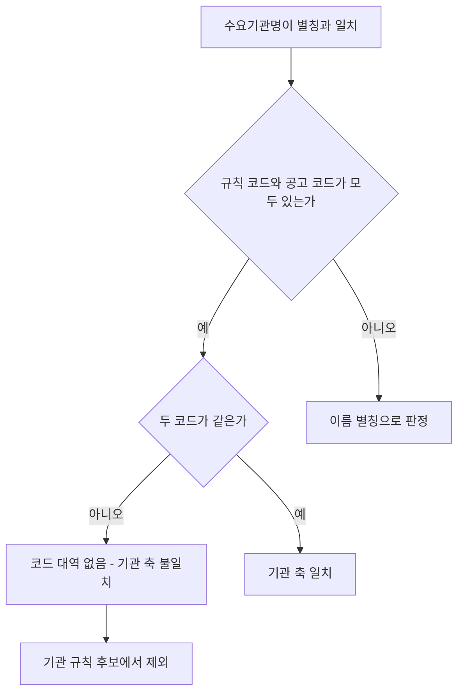

# 해양환경공단 지사 코드 불일치 규모 (적격심사 낙찰방법 읽기 전용 조회)

> **작성일**: 2026-10-15
> **작업**: 읽기 전용 DB 조회. 기관 규칙 코드·기관 규칙 명세·발행 원장 미수정
> **정본 사양**: `.orca/capsules/task_koem_branch_code_gap_20261015/capsule.yaml`
> **선행 문서**: [`forest_koem_register_gap_20261015.md`](forest_koem_register_gap_20261015.md), [`forest_koem_registry_survey_20261015.md`](forest_koem_registry_survey_20261015.md)
> **판정**: candidate (규칙 코드 변경 없음, 문서만 추가)

---

## 1. 요약

`scripts/db_readonly_query.py` 로 적격심사제 낙찰방법(`sucsfbidMthdCd = 낙030001`, 용역 `Servc`) 공고를
조회했습니다. 수요기관명이 해양환경공단이거나 등록 별칭과 (공백 제거 후) 같은 공고는 834건이고, 그중
수요기관 코드가 `B553931` 인 것은 638건, `Z0` 로 시작하는 것은 193건, 그 밖의 코드는 3건입니다.

| 항목 | 건수 |
| --- | ---: |
| 수요기관명이 해양환경공단 또는 등록 별칭인 적격심사제 용역 공고 | 834 |
| 그중 수요기관 코드 `B553931` | 638 |
| 그중 수요기관 코드 `Z0` 시작 | 193 |
| 그중 그 밖의 코드 | 3 |
| 그중 수요기관 코드 없음 | 0 |

- 본청(`B553931`) 638건을 뺀 나머지 196건은 모두 별칭 이름이고, 코드가 `B553931` 과 다릅니다.
  기관 축 판정은 코드가 양쪽에 있으면 코드 일치만 보고 이름 별칭을 보지 않으므로
  (`src/app/services/evaluation_rules.py:6084` 의 `_axis_matches`), 이 196건은 코드 불일치로
  기관 규칙 후보에 오르지 못합니다.
- 등록 패턴(`해양폐기물정화`)이 공고명·낙찰방법명에 있는 건수는 834건 중 233건이며, 모두 `B553931`
  행입니다. `Z0` 행과 그 밖의 코드 행에서는 0건입니다.

---

## 2. 조회 조건과 방법

```sh
uv run python scripts/db_readonly_query.py --sql "<읽기 전용 SELECT>"
```

| 항목 | 값 |
| --- | --- |
| 진입점 | `scripts/db_readonly_query.py` (SELECT 전용, READ ONLY 트랜잭션) |
| 테이블 | `bid_announcements` (`raw_data` 는 JSON 컬럼) |
| 업무구분 | `category = 'Servc'` |
| 낙찰방법 | `raw_data.sucsfbidMthdCd = '낙030001'` (적격심사제) |
| 수요기관명 | `REPLACE(dminstt_nm, ' ', '')` 가 본청·등록 별칭 15개와 같은 행 |
| 수요기관 코드 | `raw_data.dminsttCd` |

- 등록 별칭 15개는 본청 1개와 기관 규칙 `SERVC_INST_KOEM_20250306_MARINE_WASTE` 의
  `institution_aliases` 14개(지사 12곳·해양환경교육원·해양환경조사연구원)입니다.
- 매칭 함수가 공백을 제거하므로(`_cleaned_institution_name`), 조회도 공백을 제거한 이름으로
  대조했습니다. DB 실제 표기에는 공백이 두 칸인 행이 있습니다.
- 스크립트가 요구한 환경 변수는 프로세스 환경에만 두었고 값은 이 문서와 커밋에 적지 않았습니다.

---

## 3. 등록 별칭 공고 규모 (요구 1)

수요기관명·코드별 건수입니다.

| 수요기관명 (DB 표기) | 수요기관 코드 | 건수 |
| --- | --- | ---: |
| 해양환경공단 | B553931 | 638 |
| 해양환경공단  제주지사 | Z008105 | 30 |
| 해양환경공단 여수지사 | Z001414 | 27 |
| 해양환경공단 마산지사 | Z012433 | 25 |
| 해양환경공단 평택지사 | Z012452 | 20 |
| 해양환경공단 동해지사 | Z012462 | 17 |
| 해양환경공단 목포지사 | Z013818 | 17 |
| 해양환경공단 울산지사 | Z012448 | 17 |
| 해양환경공단 부산지사 | Z005306 | 14 |
| 해양환경공단 군산지사 | Z012450 | 9 |
| 해양환경공단 대산지사 | Z012463 | 8 |
| 해양환경공단 인천지사 | Z007550 | 5 |
| 해양환경공단 포항지사 | Z008063 | 3 |
| 해양환경공단 해양환경조사연구원 | D491254 | 3 |
| 해양환경공단 해양환경교육원 | Z025015 | 1 |

- 지사 12곳 합계는 192건이고, 여기에 교육원 1건·조사연구원 3건을 더하면 196건입니다.
- `해양환경공단  제주지사` 는 DB 표기에 공백이 두 칸입니다(공백 제거 대조라 별칭과 맞습니다).

---

## 4. 별칭 이름과 코드 대조 (요구 2)

별칭 행 14개의 수요기관명·코드·건수입니다. 본청 1건을 뺀 14행 모두 코드가 `B553931` 과 다릅니다.

| 수요기관명 (DB 표기) | 수요기관 코드 | 건수 |
| --- | --- | ---: |
| 해양환경공단  제주지사 | Z008105 | 30 |
| 해양환경공단 여수지사 | Z001414 | 27 |
| 해양환경공단 마산지사 | Z012433 | 25 |
| 해양환경공단 평택지사 | Z012452 | 20 |
| 해양환경공단 동해지사 | Z012462 | 17 |
| 해양환경공단 목포지사 | Z013818 | 17 |
| 해양환경공단 울산지사 | Z012448 | 17 |
| 해양환경공단 부산지사 | Z005306 | 14 |
| 해양환경공단 군산지사 | Z012450 | 9 |
| 해양환경공단 대산지사 | Z012463 | 8 |
| 해양환경공단 인천지사 | Z007550 | 5 |
| 해양환경공단 포항지사 | Z008063 | 3 |
| 해양환경공단 해양환경조사연구원 | D491254 | 3 |
| 해양환경공단 해양환경교육원 | Z025015 | 1 |

- 조사연구원 `D491254` 는 지사 12곳·교육원의 `Z0` 대역이 아닌 유일한 별칭 행입니다(3건).
- 코드가 없는 별칭 행은 0건입니다. 등록 별칭 이름은 모두 수요기관 코드를 함께 갖고 있어,
  기관 축이 코드 비교로 끝나고 이름 별칭 판정까지 가지 않습니다.



---

## 5. 접두를 넣었을 때의 조회 결과 (요구 3)

두 종류의 접두를 각각 선언했다고 가정하고, 그때 기관 축 후보에 함께 들어오는 다른 기관을
조회했습니다. 아래는 조회 결과이며 접두 추가를 권고하는 문장이 아닙니다.

| 접두 종류 | 접두 값 | 함께 붙는 다른 기관 (해양환경공단 계열 제외) |
| --- | --- | --- |
| 이름 접두 (`subunit_name_prefixes`) | `해양환경공단` | 0개 기관명, 0건 |
| 코드 접두 (`subunit_code_prefixes`) | `Z0` | 1,712개 기관명(1,713개 코드), 32,081건 |

- 이름 접두 `해양환경공단` 으로 넓혀도 새로 붙는 다른 기관은 없습니다. 이름이 `해양환경공단` 으로
  시작하는 적격심사제 용역 공고는 등록 별칭 15개가 전부입니다.
- 코드 접두 `Z0` 로 넓히면 기관 축 후보가 32,081건(1,712개 기관명)으로 늘어납니다. 이 후보 중
  공고명·낙찰방법명에 등록 패턴(`해양폐기물정화`)이 있는 건수는 0건입니다.
- 별칭 14행의 코드는 모두 `Z0` 로 시작하나, 조사연구원 `D491254` 는 `Z0` 대역이 아닙니다.

---

## 6. 등록 패턴 일치 건수 (조회 결과)

| 구분 | 전체 | 등록 패턴 포함 |
| --- | ---: | ---: |
| 코드 `B553931` | 638 | 233 |
| 코드 `Z0` 시작 | 193 | 0 |
| 그 밖의 코드 | 3 | 0 |
| 합계 | 834 | 233 |

- 등록 패턴은 `해양폐기물정화` 하나이고, 매칭은 공고명과 낙찰방법명에서 공백·구분자를 지운 뒤
  부분 문자열로 봅니다(`_institution_match_score`, `_normalize_institution_text`).
- 233건은 모두 본청 코드 `B553931` 행입니다. `Z0` 지사 행과 조사연구원 행의 낙찰방법명·공고명에는
  등록 패턴이 없습니다. 따라서 현재 등록 패턴 하나만으로는, 지사 행이 코드 불일치를 벗어나더라도
  기관 규칙이 선택되는 건수는 0건입니다.
- 지사 적격심사제 공고의 공고명은 수리·점검용역, 시설분야용역, 기술용역(건설사업관리·실시설계) 등이며
  해양폐기물정화 표기가 없습니다.

---

## 7. 검증

| 항목 | 결과 |
| --- | --- |
| 규칙 검증 | `python3 scripts/validate_agent_rules.py --quiet` 통과 |
| 변경 파일 | `git diff --name-only main...HEAD` 가 이 문서 1건 |
| 규칙·명세·원장 diff | 없음 |
| DB 접근 | `scripts/db_readonly_query.py` SELECT 만 사용 |
| 서버 쓰기 | 없음(READ ONLY 트랜잭션) |

---

## 8. 참고 파일

| 파일 | 용도 |
| --- | --- |
| `src/app/services/evaluation_rules.py` | `INSTITUTION_RULES`(해양환경공단 규칙), `_axis_matches`, `_institution_match_score` |
| `scripts/db_readonly_query.py` | 읽기 전용 조회 진입점 |
| `docs/analysis/forest_koem_register_gap_20261015.md` | 해양환경공단 규칙 등록 결과·7절 지사 코드 공고 |
| `docs/analysis/forest_koem_registry_survey_20261015.md` | 별칭 정확 일치 목록(5.1), 접두 금지(5.2) |
