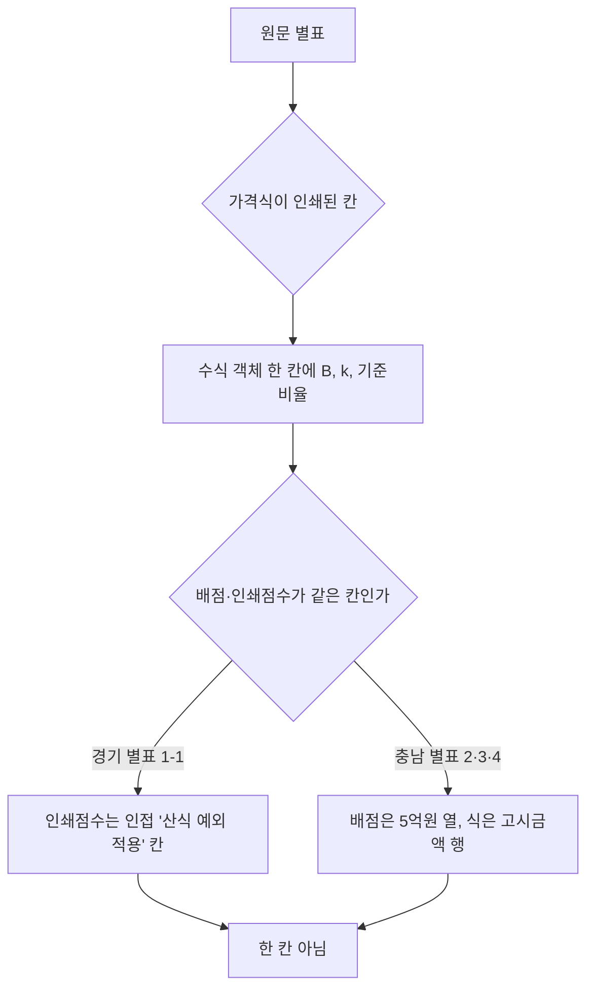

# 경기도 별표 1-1과 충청남도 별표 2·3·4 현행 원문 재독

> **작성일**: 2026-10-15
> **작업**: Orca Task `task_5589ba69a27d` (builder). 제품 코드와 규칙을 바꾸지 않고 원문만 다시 읽는다.
> **정본 사양**: `.orca/capsules/task_local_annex_reread_20261015/capsule.yaml` (`ORCA_TASK_CAPSULE_V2`)
> **작업 브랜치**: `kwanbum217/orca-local-annex-reread`
> **범위**: 경기도 일반용역 적격심사 세부기준 지침 별표 1-1(단순노무), 충청남도 일반용역 적격심사 세부기준 별표 2·3·4. 그 밖의 별표와 다른 시·도는 다시 읽지 않았다.
> **원문 저장 위치**: `.cache/local_annex_reread/` (커밋하지 않는 로컬 산출물). 이 문서는 `.cache/` 를 마크다운 링크로 걸지 않고 인라인 코드로만 언급한다.
> **확인 날짜**: 2026-10-15.
> **결론**: 두 원문 모두 인쇄된 가격식과 배점·점수가 같은 칸에 있지 않다. 경기도는 B·k·기준비율이 수식 한 칸에 있고 인쇄 점수는 인접 칸에 있다. 충청남도는 배점 열이 추정가격 5억원 기준인데 식의 구간은 고시금액 기준이라 서로 다른 칸에 있다. 어느 시·도를 먼저 등록할지는 고르지 않았고, `LOCAL_RULES` 와 `evaluation_rules.py` 를 수정하지 않았다.

---

## 1. 요약

| 대상 | 현행 원문 | 번호·시행 | 가격식이 인쇄된 칸 | 배점 열 금액 기준 | 식의 금액 기준 | 같은 칸 여부 |
| --- | --- | --- | --- | --- | --- | --- |
| 경기도 별표 1-1 단순노무 | 경기도 일반용역 적격심사 세부기준 지침 | 예규 제751호, 시행 2026.04.15 | `입찰가격 평점산식` 칸(수식 객체) | 추정가격 10억/5억/2억 구간(인쇄점수 25/45/65/85는 인접 칸) | 금액 기준 없음(기준비율 89) | 아님. 인쇄 점수가 인접 칸 |
| 충청남도 별표 2 정보통신 | 충청남도 일반용역 적격심사 세부기준 | 공고 2026-1235호, 시행 2026.07.13 적용 | `① 입찰가격 평점산식` 각주 표(수식 객체) | 추정가격 5억원 이상 60 / 미만 70 | 추정가격 고시금액 이상 / 미만 | 아님. 배점 열과 식이 다른 칸 |
| 충청남도 별표 3 폐기물처리 | 위와 같음 | 공고 2026-1235호 | 위와 같음 | 추정가격 5억원 이상 60 / 미만 70 | 추정가격 고시금액 이상 / 미만 | 아님. 배점 열과 식이 다른 칸 |
| 충청남도 별표 4 육상운송 | 위와 같음 | 공고 2026-1235호 | 위와 같음 | 추정가격 5억원 이상 60 / 미만 70 | 추정가격 고시금액 이상 / 미만 | 아님. 배점 열과 식이 다른 칸 |

- 공통: 평점 산식은 `평점(점) = 배점한도 − k × |(기준/100 − 입찰가격/예정가격) × 100|` 이다.
- 경기도 별표 1-1 과 충청남도 별표 2·3·4 모두 원문이 자체 별표에 산식을 직접 인쇄하고 있고, 조달청 별표 숫자를 옮긴 곳은 없다.

---

## 2. 판정 기준

선행 수집 문서(`servc_formula_collection_local_20261004.md` 2절)의 규칙을 그대로 적용했다.

1. 상업 페이지(bidpro, 비드큐, info21c, 모두입찰, korbid, igunsul, 블로그)의 계수는 베끼지 않는다. 제목과 날짜 단서만 쓴다.
2. 나라장터 첨부는 파일 머리말이 그 기관 규정일 때만 원문이다. 개별 공고 배점표는 전사 규정이 아니다.
3. 조달청 준용 조항만 있으면 조항, 개정 표시, 시행일만 인용한다. 조달청 별표 숫자를 그 기관 계수로 옮기지 않는다.
4. `평점 = B − k × |(기준/100 − 입찰가격/예정가격) × 100|`. B는 그 별표의 입찰가격 배점한도다.
5. 계수가 생략되고 평탄 대입이 인쇄 점수와 맞을 때만 `k=1`. 평탄 문장이 없으면 `k=1`로 두지 않는다.
6. 평탄 비율과 낙찰하한율로 k를 역산하지 않는다.
7. 대입 결과가 인쇄 점수와 다르면 그 행은 미확정이다. 원문이 비율만 적고 점수를 인쇄하지 않으면 대입값을 적고 원문이 그렇게 말한다고 밝힌다.
8. 배점 열의 금액 기준과 식의 금액 기준이 다르면 하나의 계수 짝으로 확정하지 않는다. 5억원 배점과 고시금액 구간을 숫자만 같다고 묶지 않는다.
9. 접속 실패, DNS 실패, 시간 초과는 문서가 없다는 증거가 아니다.
10. 가격식은 원문 같은 칸에 인쇄된 B, k, 기준비율만 적는다.

---

## 3. 경기도 별표 1-1 (단순노무용역)

### 3.1 현행 판본

| 항목 | 값 |
| --- | --- |
| 문서명 | 경기도 일반용역 적격심사 세부기준 지침 |
| 현행 번호·시행일 | `[시행 2026.04.15]` (일부개정) 2026-04-15 예규 제751호 (경기도 예규 용어 등 일괄정비규정) |
| 직전 번호·시행일 | `[시행 2025.08.08]` (일부개정) 2025-07-18 예규 제748호 |
| 출처 URL | ELIS `https://www.elis.go.kr/allalr/selectAlrBdtOne?alrNo=41000006005065&histNo=006` (현행). 별표 첨부 묶음 `https://www.elis.go.kr/allalr/attZipDown?alrNo=41000006005065&histNo=006` |
| 확인 날짜 | 2026-10-15 |
| 원본 파일 | `.cache/local_annex_reread/gg_hist006/att000.hwp` (`[별표 1-1] 단순노무 용역 적격심사 세부기준.hwp`, 67,584 B) |
| 추출물 | `.cache/local_annex_reread/gg_byp11_html/index.xhtml` (`GG11`), `.cache/local_annex_reread/gg_byp11_rec.json` |

- ELIS 연혁 목록의 최신본은 histNo `006`(예규 제751호, 시행 2026.04.15)이다. 직전본 histNo `005`(예규 제748호, 시행 2025.08.08)도 함께 받았다.
- **두 판본의 별표 1-1 파일은 바이트가 같다.** histNo 005·006 의 `att000.hwp` MD5 가 모두 `949a80c7c9394e599b0cdaaf9cfac871` 이다. 즉 현행 제751호의 별표 1-1 수치는 제748호와 동일하다.
- 별표 1-1 파일 머리말 `GG11` = `[별표 1-1] <개정 2024.4.8., 2025.1.14.>`, `단순노무 용역 적격심사 세부기준`.

### 3.2 배점한도 표

`GG11` 의 첫 표에서 입찰가격 행은 다음과 같다.

| 구 분 | 10억원 이상 | 10억원 미만 5억원 이상 | 5억원 미만 2억원 이상 | 2억원 미만 |
| --- | ---: | ---: | ---: | ---: |
| 입찰가격 | 30 | 50 | 70 | 90 |

- 같은 표의 다른 행: 계 100, 해당 용역 수행 능력 소계 67/47/27/10, 지역참여 3/3/3/-, 신인도 +6.5~△5.0.

### 3.3 가격식 칸과 인쇄 점수 칸

`GG11` 의 `2. 입찰가격 평점 산식` 표는 열이 `구 분 | 입찰가격 평점산식 | 산식 예외 적용 | 낙찰하한율` 네 개다. 각 구간 행에서:

- **`입찰가격 평점산식` 칸**: 수식 객체가 들어 있다. hwp5html 텍스트로는 빈 칸으로 나오고, HWP 레코드(`HWPTAG_CTRL_EQEDIT`)를 UTF-16LE 로 디코딩하면 다음이 나온다.
  - `평점=30-5 TIMES  LEFT | ( {89} over {100} - {입찰가격} over {예정가격} ) TIMES 100 RIGHT |`
  - 같은 형식으로 `평점=50-5 …`, `평점=70-5 …`, `평점=90-5 …` 네 개다.
- **`산식 예외 적용` 칸**: 인쇄 점수가 들어 있다. `- 투찰률이 89.95% 이상인 경우 평점은 25점으로 함` (다른 행은 45점/65점/85점).
- **`낙찰하한율` 칸**: 네 행 모두 `87.995%`.

| 구간 | B | k | 기준비율 | 인쇄 점수 | 대입값 | 판정 |
| --- | ---: | ---: | ---: | ---: | ---: | --- |
| 10억원 이상 | 30 | 5 | 89 | 25 | 30−5×0.95 = **25.25** | 인쇄 25 와 불일치 0.25 |
| 10억원 미만 5억원 이상 | 50 | 5 | 89 | 45 | **45.25** | 불일치 0.25 |
| 5억원 미만 2억원 이상 | 70 | 5 | 89 | 65 | **65.25** | 불일치 0.25 |
| 2억원 미만 | 90 | 5 | 89 | 85 | **85.25** | 불일치 0.25 |

### 3.4 한 칸 여부

- B(=30/50/70/90), k(=5), 기준비율(=89)은 **`입찰가격 평점산식` 한 칸** 안의 수식 객체에 함께 들어 있다.
- 인쇄 점수(25/45/65/85)는 **인접한 `산식 예외 적용` 칸**에 있다. 따라서 `B, k, 기준비율, 인쇄 점수` 네 가지는 **한 칸에 있지 않다.**
- 인쇄 점수와 수식 대입값은 0.25점 어긋난다. 원문 자체의 불일치이며, 규칙 7·6 에 따라 반올림이나 역산으로 확정하지 않는다.

---

## 4. 충청남도 별표 2·3·4

### 4.1 현행 판본

| 항목 | 값 |
| --- | --- |
| 문서명 | 충청남도 일반용역 적격심사 세부기준 |
| 현행 번호 | 충청남도 공고 2026-1235호 (행정안전부 협의 2026. 06. 16., 게시 2026-06-17) |
| 시행 | 부칙 `이 세부기준은 행정안전부장관 협의 완료 후 2026년 7월 13일 입찰공고부터 적용한다.` |
| 출처 URL | 공고 `https://www.chungnam.go.kr/cnportal/province/province/view.do?nttId=2178926&menuNo=500487`. 게시판 PDF `https://www.chungnam.go.kr/gyeyak/cmmn/file/fileDown.do?menuNo=6700013&atchFileId=dd868a05c35b441cafd18d2c027572ea&fileSn=1&bbsId=B0000503` |
| 확인 날짜 | 2026-10-15 |
| 원본 파일 | `.cache/local_annex_reread/cn_2026_1235.hwpx` (175,644 B, 공고 첨부), `.cache/local_annex_reread/cn_2026_1235.pdf` (733,629 B, 45쪽, 게시판 PDF) |
| 추출물 | `.cache/local_annex_reread/cn_section0.xml` (HWPX 본문), `.cache/local_annex_reread/cn_pdf.txt` (`CNPDF`, PDF 텍스트) |

- HWPX 머리말 = `충청남도 공고 2026-1235호`, `행정안전부 협의(2026. 06. 16.)`.
- 별표 2 = 정보통신용역(중소기업간 경쟁제품 비대상), 별표 3 = 폐기물처리용역, 별표 4 = 육상운송용역.
- 게시판·공고 모두 같은 공고 번호이며, 이후 대체 공고는 확인되지 않았다.

### 4.2 배점 열과 식의 금액 기준

세 별표의 배점한도 표는 입찰가격 행이 **추정가격 5억원 기준 두 열**이다. 각주 ① `입찰가격 평점산식` 은 **별도의 각주 표**로, 사업예산규모를 **추정가격 고시금액 기준 두 행**으로 나눈다.

| 별표 | 배점한도 표의 입찰가격 열 | ① 입찰가격 평점산식 각주 표의 구간 | k | 기준비율 | 낙찰하한율 | 평탄 점수 |
| --- | --- | --- | ---: | ---: | ---: | --- |
| 별표 2 정보통신 | 추정가격 5억원 이상 60 / 미만 70 | 추정가격 고시금액 이상 | 2 | 88 | 80.495% | 미인쇄(비율만) |
| 별표 2 정보통신 | 추정가격 5억원 이상 60 / 미만 70 | 추정가격 고시금액 미만 | 4 | 88 | 84.245% | 미인쇄(비율만) |
| 별표 3 폐기물처리 | 추정가격 5억원 이상 60 / 미만 70 | 추정가격 고시금액 이상 | 2 | 88 | 80.495% | 미인쇄(비율만) |
| 별표 3 폐기물처리 | 추정가격 5억원 이상 60 / 미만 70 | 추정가격 고시금액 미만 | 4 | 88 | 84.245% | 미인쇄(비율만) |
| 별표 4 육상운송 | 추정가격 5억원 이상 60 / 미만 70 | 추정가격 고시금액 이상 | 2 | 88 | 80.495% | 미인쇄(비율만) |
| 별표 4 육상운송 | 추정가격 5억원 이상 60 / 미만 70 | 추정가격 고시금액 미만 | 4 | 88 | 84.245% | 미인쇄(비율만) |

- HWPX 셀 구조(`cn_section0.xml`): 배점한도 표의 `Ⅲ. 입찰가격` 행은 `※ 입찰가격 평점산식 참조` 와 `60 | 70` 두 칸이다. 각주 ① 표는 `사업예산규모 | 평점산식 | 예외사항` 세 열이고, 사업예산규모 열이 `추정가격 고시금액 이상`/`미만` 두 행이다.
- `CNPDF` 인용: `○ 평점(점) = 배점한도  2 ×( ... 입찰가격 ... ) × 100`(`k=2`, 고시금액 이상), `○ 평점(점) = 배점한도  4 × ...`(`k=4`, 고시금액 미만). 분수 앞 숫자는 `88` 이다. 예외사항은 `예정가격의 95.5%이상`/`91.75%이상` 비율만 인쇄되고 점수는 인쇄되지 않는다.
- 평점산식 칸의 피감수는 숫자 B가 아니라 문자 `배점한도` 다. B(60/70)는 배점한도 표의 다른 칸에 있다.

### 4.3 한 칸 여부

- 배점 열의 금액 기준은 **추정가격 5억원** 이상/미만이고, 식의 금액 기준은 **추정가격 고시금액** 이상/미만이다. 두 기준은 **서로 다른 칸(다른 표)** 에 있다.
- 규칙 8 에 따라 `5억원 배점 열`과 `고시금액 식 구간`을 숫자만 같다고 **하나의 계수 짝으로 확정하지 않는다.** 두 축(B 60/70, k 2/4)을 병기만 한다.
- 아울러 B 는 식 칸에 숫자로 인쇄되지 않았으므로(B 자리에 `배점한도`), 같은 칸에 인쇄된 B·k·기준비율 조합 자체가 성립하지 않는다.

### 4.4 범위 밖 관찰 (등록 근거 아님)

- 별표 2의 1(정보통신, 중소기업간 경쟁제품 대상)은 각주 ① 이 한 행(`낙찰하한율 87.995%`, `k=4`, 기준비율 91, 예외 94%)으로 인쇄되어 두 배점 열(60/70)에 함께 걸린다. 요구 범위가 아니므로 이 문서는 수치만 적고 판정하지 않는다.
- 별표 3 뒤 `(참고 예시) 생활폐기물수집운반대행 적격심사 항목 및 배점한도` 는 `k=5`, 기준비율 91, 낙찰하한율 87.995% 로 인쇄된다. 역시 요구 범위 밖이다.

---

## 5. 이 문서가 하지 않은 것

| 항목 | 상태 |
| --- | --- |
| 지역 규칙 등록 | 없음. `LOCAL_RULES` 및 `src/` 변경 없음 |
| 판정 | `candidate` 다. 어느 시·도를 등록할지 고르지 않음 |
| 우선순위 결정 | 없음 |
| 발행 원장 | 없음. `data/reference/rule_coverage_ledger.yaml` 수정·재생성 없음 |
| 대구광역시 일반 별표 | 다루지 않음 |
| 광주광역시·전라남도 | 다루지 않음 |
| 원문 신규 등록 | 없음. 받은 원문은 `.cache/local_annex_reread/` 에만 두고 커밋하지 않음 |

---

## 6. 한계

| 항목 | 내용 |
| --- | --- |
| 경기도 불일치 | 별표 1-1 인쇄 점수와 수식 대입값이 0.25점 어긋난다. 원문 자체의 불일치이며 확정하지 않았다. |
| 충남 짝 | 배점 열(5억원)과 식 구간(고시금액)이 달라 계수 짝을 닫지 않았다. 두 기준의 관계는 원문에 인쇄되어 있지 않다. |
| 충남 점수 | 별표 2·3·4 는 평탄 구간을 비율로만 인쇄하고 점수를 인쇄하지 않는다(규칙 7). |
| 판본 | 경기도는 histNo 006(제751호)을 현행으로 보았다. 별표 1-1 파일 MD5 가 직전 제748호와 같아 별표 수치는 동일하다. |
| 범위 | 별표 2의 1, 별표 3 참고 예시, 별표 5 이하는 다시 읽지 않았다. |

---

## 7. 검증 실행

| 명령 | 결과 |
| --- | --- |
| `python3 scripts/validate_agent_rules.py --quiet` | `검증 통과: 21/21 건.` (종료 코드 0) |

---

## 8. 변경 파일

| 항목 | 값 |
| --- | --- |
| 이 작업의 커밋 산출물 | `docs/analysis/local_annex_reread_20261015.md` 1개 |
| 코드·설정·패키지 | 변경 없음 |
| 원문·추출물 | `.cache/local_annex_reread/` 아래, 커밋하지 않음 |
