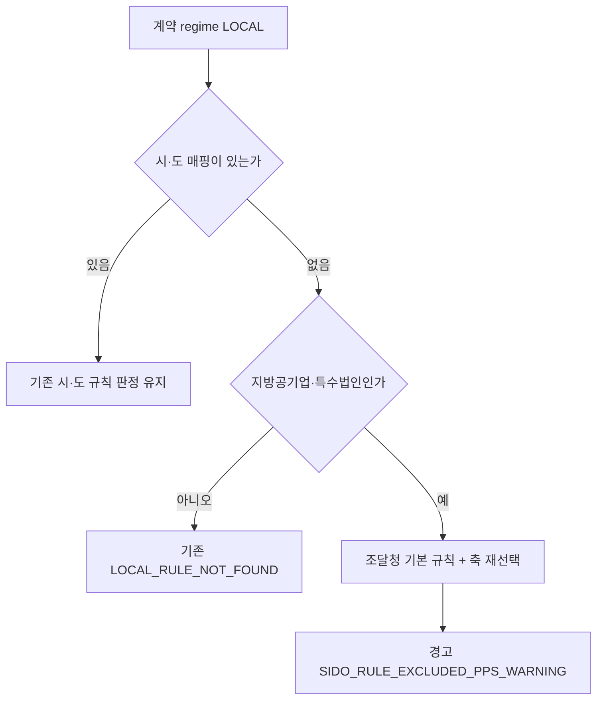

# 지방공기업·특수법인 조달청 기준 경로 전환 판정 회귀 (2026-11-06)

> **작성일**: 2026-11-06
> **작업**: Orca Task `task_5abcdecbaa45` (builder, `run_8734173629f4`). 선행 구현이며 사용자 결정 전이라 병합하지 않는다.
> **정본 사양**: `.orca/task_local_entity_pps_20261106/capsule.yaml` (`ORCA_TASK_CAPSULE_V2`)
> **작업 브랜치**: `kwanbum217/local-entity`
> **선행 근거**: `kwanbum217/mapping-law` 브랜치의 `docs/analysis/local_mapping_gap_applicable_law_20261106.md` 4.2·4.3절
> **측정 창**: 2025-11-06 ~ 2026-11-06, 업무구분 `Servc`, 낙찰방법 코드 `낙030001`, 공고번호·업무구분별 최신 차수

---

## 1. 원인

시·도 매핑 공백 20건이 지방계약(LOCAL) 경로로 들어가 `LOCAL_RULE_NOT_FOUND` 가 되는 흐름은 다음과 같습니다.

| 단계 | 코드 | 동작 |
| --- | --- | --- |
| 1 | `src/app/services/demand_institutions.py:270` `classify_contract_regime` | 기관 유형 `지방공기업` 을 `LOCAL` 로 판정합니다. 기존 시험 단언을 바꾸지 않기 위해 이번 변경에서도 유지합니다 |
| 2 | `src/app/services/demand_institutions.py:335` `institution_sido` | `toplvl_instt_nm` 이 시·도 본청일 때만 시·도를 돌려줍니다. 서대문구도시관리공단·적십자 혈액원·전남개발공사·제주관광공사(Z020113)는 본청이 시·도가 아니라 `(None, None)` 입니다 |
| 3 | `src/app/services/evaluation_rules.py:3401` LOCAL 분기 | `contract_regime == "LOCAL"` 이면 `_select_local_rule` 로 시·도 후보를 고릅니다 |
| 4 | `src/app/services/evaluation_rules.py:2262` `_select_local_rule` | 시·도 코드가 없어 `region_rules` 가 비고 `LOCAL_RULE_NOT_FOUND` 를 돌려줍니다(`evaluation_rules.py:2379-2381`) |
| 5 | `src/app/services/evaluation_rules.py:2875` `extract_contract_regime` | 공고의 계약방법명에 "지방" 표기가 없어 기관 판정 `LOCAL` 을 그대로 씁니다. 20건의 계약방법명은 제한경쟁·일반경쟁·지명경쟁입니다 |

즉 원인은 **기관 유형 `지방공기업` 을 지방계약으로 분류한 뒤, 시·도 매핑이 없어 시·도 별표를 고르지 못한 것**입니다. 20건의 공고문은 모두 조달청 일반용역 적격심사 세부기준을 인용하므로, 시·도 후보를 만들지 않고 조달청 기본 규칙으로 해석해야 합니다.

---

## 2. 구현

| 파일 | 변경 | 내용 |
| --- | --- | --- |
| `src/app/services/demand_institutions.py` | `is_sido_rule_excluded` 추가(:249) | 기관 유형 필드 `jrsdctn_div_nm` 를 우선하고, 필드가 비어 있을 때만 이름 표기(`적십자`·`공단`·`공사`)를 보조로 씁니다. 교육 계열은 기존 제외 판단을 뒤집지 않도록 `False` 입니다 |
| `src/app/services/evaluation_rules.py` | LOCAL 분기 대체 경로 추가(:3431) | `region_code is None` 이고 `LOCAL_RULE_NOT_FOUND` 이며 수요기관이 위 유형이면, 조달청 매칭 결과를 유지하고 축 재선택(`_narrow_rule_scope`)만 적용합니다. 경고 `SIDO_RULE_EXCLUDED_PPS_WARNING`(:2738)을 붙입니다 |
| `src/app/services/evaluation_rules.py` | `_is_sido_rule_excluded_institution` 추가(:2744) | 판정 정본은 `demand_institutions.is_sido_rule_excluded` 입니다. 순환 임포트를 피해 함수 안에서 가져오고, `raw_data` 에 기관 유형 필드가 있으면 그것을 우선합니다 |

- `classify_contract_regime` 의 반환값과 `institution_sido` 의 반환 계약은 바꾸지 않았습니다. 소재지 반환 동작을 유지합니다.
- 교육 계열 분기를 먼저 두어 교육청 판정을 바꾸지 않았습니다.
- 전남 준용 분기(`_is_jeonnam_local_announcement`)는 그대로 두었습니다.
- 시·도 매핑이 있는 지방공기업은 종전 판정을 유지합니다. 이번 선행 구현의 범위를 "시·도 매핑 공백"으로 한정한 이유는 5절에 적었습니다.

---

## 3. 측정 방법

| 단계 | 방법 |
| --- | --- |
| 수집 | `scripts/report_rule_coverage.py` 의 `collect_records(months=12, category="Servc", method_code="낙030001")` 를 메모리에서 실행했습니다. 원장 파일은 쓰지 않았습니다 |
| 입력 고정 | `resolve_evaluation_rule_from_raw_data` 에 전달되는 인자(raw_data 핵심 키, 기관·지역·계약 regime, 추정가격, 교육기관 여부, 첨부 판별 갈래)를 31,348건 분량으로 한 번만 캡처했습니다 |
| 수정 전 재생 | 변경 전 작업 트리에서 같은 고정 입력을 재생했습니다 |
| 수정 후 재생 | 이번 변경을 적용한 상태에서 같은 고정 입력을 재생했습니다 |
| 비교 키 | `rule_id`, `block_reason_code`, `is_blocked`, `scope_stage`, `effective_lwlt_rate`, `rate_source` |
| DB | 읽기 전용 SELECT 만 썼고 `raw_data LIKE` 는 쓰지 않았습니다 |

- 고정 입력 재생을 쓴 이유는 같은 날 공유 DB의 첨부 판별 값이 바뀌어 수정 전후 스냅샷 입력이 달라질 수 있기 때문입니다. 두 코드에 같은 입력을 넣어 규칙 변경 효과만 분리했습니다.

---

## 4. 판정 회귀

### 4.1 요약

| 항목 | 값 |
| --- | ---: |
| 비교 대상 | 31,348건 |
| 수정 전 `LOCAL_RULE_NOT_FOUND` | 111건 |
| 수정 후 `LOCAL_RULE_NOT_FOUND` | 91건 |
| 판정이 바뀐 공고 | **20건** |
| 20건 목록 밖에서 바뀐 공고 | **0건** |
| 판정 오류(ERROR) | 0건 |

- 바뀐 20건은 전부 선행 조사 문서 3.1절의 20건과 일치합니다. 서울특별시서대문구도시관리공단 12, 대한적십자사 혈액원 6, 제주관광공사 1, 전남개발공사 1입니다.
- 20건 모두 `LOCAL_RULE_NOT_FOUND` 에서 조달청 기본 규칙(`institution_scope=ALL`)으로 바뀌었고, 차단이 해소됐습니다.

### 4.2 변경된 공고 20건

`수정 전` 은 모두 `LOCAL_RULE_NOT_FOUND` 입니다. `수정 후 규칙` 은 공고일 구간에 배분된 조달청 별표입니다.

| # | 공고번호 | 차수 | 공고일 | 수요기관 | 기관 코드 | 수정 전 | 수정 후 규칙 | 적용 범위 |
| ---: | --- | :---: | --- | --- | --- | --- | --- | :---: |
| 1 | `R25BK01175895` | 001 | 2025-11-27 | 서울특별시서대문구도시관리공단 | Z008548 | `LOCAL_RULE_NOT_FOUND` | `SERVC_QUAL_PRE_20250901_ATTACH_01` | ALL |
| 2 | `R25BK01187813` | 001 | 2025-11-30 | 서울특별시서대문구도시관리공단 | Z008548 | `LOCAL_RULE_NOT_FOUND` | `SERVC_QUAL_PRE_20250901_ATTACH_01` | ALL |
| 3 | `R25BK01200734` | 000 | 2025-12-04 | 서울특별시서대문구도시관리공단 | Z008548 | `LOCAL_RULE_NOT_FOUND` | `SERVC_QUAL_PRE_20250901_ATTACH_01` | ALL |
| 4 | `R25BK01200967` | 000 | 2025-12-04 | 서울특별시서대문구도시관리공단 | Z008548 | `LOCAL_RULE_NOT_FOUND` | `SERVC_QUAL_PRE_20250901_ATTACH_04` | ALL |
| 5 | `R25BK01202565` | 000 | 2025-12-04 | 서울특별시서대문구도시관리공단 | Z008548 | `LOCAL_RULE_NOT_FOUND` | `SERVC_QUAL_PRE_20250901_ATTACH_01` | ALL |
| 6 | `R25BK01202828` | 000 | 2025-12-04 | 서울특별시서대문구도시관리공단 | Z008548 | `LOCAL_RULE_NOT_FOUND` | `SERVC_QUAL_PRE_20250901_ATTACH_01` | ALL |
| 7 | `R25BK01210618` | 000 | 2025-12-08 | 서울특별시서대문구도시관리공단 | Z008548 | `LOCAL_RULE_NOT_FOUND` | `SERVC_QUAL_PRE_20250901_ATTACH_04` | ALL |
| 8 | `R25BK01210707` | 000 | 2025-12-08 | 서울특별시서대문구도시관리공단 | Z008548 | `LOCAL_RULE_NOT_FOUND` | `SERVC_QUAL_PRE_20250901_ATTACH_01` | ALL |
| 9 | `R25BK01210834` | 001 | 2025-12-15 | 서울특별시서대문구도시관리공단 | Z008548 | `LOCAL_RULE_NOT_FOUND` | `SERVC_QUAL_PRE_20250901_ATTACH_01` | ALL |
| 10 | `R25BK01219234` | 000 | 2025-12-10 | 서울특별시서대문구도시관리공단 | Z008548 | `LOCAL_RULE_NOT_FOUND` | `SERVC_QUAL_PRE_20250901_ATTACH_03` | ALL |
| 11 | `R25BK01228286` | 000 | 2025-12-15 | 서울특별시서대문구도시관리공단 | Z008548 | `LOCAL_RULE_NOT_FOUND` | `SERVC_QUAL_PRE_20250901_ATTACH_01` | ALL |
| 12 | `R25BK01230106` | 000 | 2025-12-15 | 서울특별시서대문구도시관리공단 | Z008548 | `LOCAL_RULE_NOT_FOUND` | `SERVC_QUAL_PRE_20250901_ATTACH_01` | ALL |
| 13 | `R25BK01170875` | 000 | 2025-11-24 | 대한적십자사 충북혈액원 | Z003324 | `LOCAL_RULE_NOT_FOUND` | `SERVC_QUAL_PRE_20250901_ATTACH_11` | ALL |
| 14 | `R26BK01438435` | 001 | 2026-04-02 | 대한적십자사강원도혈액원 | Z003341 | `LOCAL_RULE_NOT_FOUND` | `SERVC_QUAL_PRE_20250901_ATTACH_10` | ALL |
| 15 | `R26BK01458047` | 000 | 2026-04-10 | 대한적십자사강원도혈액원 | Z003341 | `LOCAL_RULE_NOT_FOUND` | `SERVC_QUAL_PRE_20250901_ATTACH_10` | ALL |
| 16 | `R26BK01580432` | 001 | 2026-06-16 | 대한적십자사강원도혈액원 | Z003341 | `LOCAL_RULE_NOT_FOUND` | `SERVC_QUAL_POST_20260526_ATTACH_01` | ALL |
| 17 | `R25BK01204063` | 001 | 2025-12-12 | 광주.전남적십자혈액원 | Z003342 | `LOCAL_RULE_NOT_FOUND` | `SERVC_QUAL_PRE_20250901_ATTACH_11` | ALL |
| 18 | `R25BK01224557` | 000 | 2025-12-12 | 광주.전남적십자혈액원 | Z003342 | `LOCAL_RULE_NOT_FOUND` | `SERVC_QUAL_PRE_20250901_ATTACH_11` | ALL |
| 19 | `R26BK01757878` | 000 | 2026-10-06 | 제주관광공사 | Z020113 | `LOCAL_RULE_NOT_FOUND` | `SERVC_QUAL_POST_20260727_ATTACH_03` | ALL |
| 20 | `R26BK01591628` | 000 | 2026-06-19 | 전남개발공사 | Z009448 | `LOCAL_RULE_NOT_FOUND` | `SERVC_QUAL_POST_20260526_ATTACH_02` | ALL |

### 4.3 목록 밖 변경

- 20건 목록 밖에서 판정이 바뀐 공고는 0건입니다.
- 교육청·시·군·구 본청·전남 준용 판정은 수정 전후가 같습니다.

---

## 5. 남은 판정 (사용자 결정 대기)

이번 선행 구현은 **시·도 매핑이 없는 공고**만 조달청 기준으로 전환했습니다. 시·도 매핑이 있는 지방공기업은 20건 목록 밖이므로 건드리지 않았습니다. 아래 두 묶음은 법령 판단(조달청 기준이 맞음)과 현재 구현이 아직 어긋나는 잔여입니다.

| 잔여 | 규모 | 현재 판정 | 비고 |
| --- | ---: | --- | --- |
| 시·도 매핑이 있는데 별표 유형이 없어 차단된 공고 | 11건 | `LOCAL_RULE_NOT_FOUND` 유지 | 아산시시설관리공단 2, 전남광주통합특별시북구시설관리공단 3, 대구공공시설관리공단 3, 전남광주통합특별시광산구시설관리공단 1, 세종도시교통공사 2. 모두 보험·임대차 등 시·도 별표에 없는 유형입니다 |
| 시·도 별표로 계산 중인 지방공기업 공고 | 58건(32개 기관) | 시·도 규칙(`REGION`) 유지 | 제주관광공사 B552701 1건, 경기주택도시공사 4건, 남양주도시공사 5건 등입니다. 선행 조사 문서 4.1절이 지적한 "소재지 시·도 주입" 위험과 같은 지점입니다 |

- 두 묶음을 함께 바꾸면 판정 변화가 20건 목록을 넘습니다. 사양이 "목록 밖이 바뀌면 임의로 범위를 좁히거나 넓히지 말고 표로 적어 escalation"하라고 했으므로, 이번에는 구현 범위를 넓히지 않고 이 표로 남깁니다.
- 사용자 결정 후에는 `region_code is None` 조건을 풀고, 시·도 후보 생성 자체를 배제하는 후속 변경이 필요합니다. 그때는 위 69건의 판정 변화를 별도 회귀로 확정해야 합니다.

---

## 6. 시험

새 시험 `tests/test_local_entity_pps_route.py` 는 대표 기관 유형별로 다음을 단언합니다.

| 시험 | 단언 |
| --- | --- |
| `test_local_district_corporation_uses_pps_rule` | 지방공단 공고가 조달청 기본 규칙으로 풀리고 `SIDO_RULE_EXCLUDED_PPS_WARNING` 이 붙는다 |
| `test_red_cross_blood_center_uses_pps_rule` | 적십자 혈액원 공고가 조달청 기본 규칙으로 풀린다 |
| `test_local_government_keeps_sido_rule` | 시·군·구 본청 공고는 기존 시·도 규칙(`REGION`) 그대로다 |
| `test_education_office_keeps_existing_judgment` | 교육청 공고는 기존 교육 대체 경로(`EDU_PPS_FALLBACK_WARNING`) 그대로다 |
| `test_local_public_enterprise_with_sido_keeps_existing_route` | 시·도 매핑이 있는 지방공기업은 종전 시·도 규칙 판정을 유지한다 |
| `test_institution_type_field_takes_priority_over_name` | 기관 유형 필드가 이름 표기보다 우선한다 |
| `test_sido_rule_exclusion_classification` | 유형 필드 우선·이름 보조·교육 예외·시·군·구 본청 미해당을 확인한다 |

- 기존 시험 단언은 수정하지 않았습니다. `tests/test_demand_institutions.py` 의 `지방공기업 → LOCAL` 단언도 그대로 통과합니다.

---

## 7. 검증

| 명령 | 결과 |
| --- | --- |
| `uv run pytest tests/test_local_entity_pps_route.py -q` | 17 passed |
| `uv run pytest tests/ -q -m 'not data_assets' -k 'evaluation_rules or demand_institution or local'` | 976 passed |
| `uv run mypy src` | Success: no issues found in 145 source files |
| `uv run pytest tests/ -q -m 'not data_assets'` | 10,430 passed, 41 skipped, 2 xfailed |
| `python3 scripts/validate_agent_rules.py --quiet` | 22/22 통과 |

- DB 스키마·원본 데이터·규칙 값은 변경하지 않았습니다.
- `main` 병합과 푸시는 하지 않았습니다.
