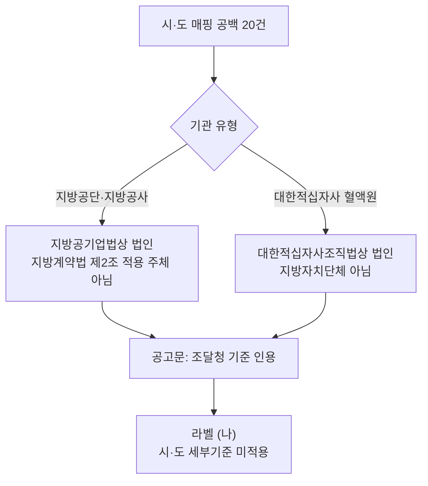

# 시·도 매핑 공백 20건 기관 유형별 적용 법령 판정

> **작성일**: 2026-11-06
> **작업**: Orca Task `task_ba5ebb7a8688` (builder, `run_8734173629f4`). 코드·규칙·원장은 고치지 않고 조사 문서만 쓴다.
> **정본 사양**: `.orca/capsules/task_ba5ebb7a8688/capsule.yaml` (`ORCA_TASK_CAPSULE_V2`)
> **작업 브랜치**: `kwanbum217/mapping-law`
> **기준 문서**: [local_rule_not_found_38_source_20261106.md](local_rule_not_found_38_source_20261106.md) 2.1·3.3절, [blocked_reason_breakdown_20261106.md](blocked_reason_breakdown_20261106.md)
> **판정 대상**: 시·도 매핑 공백으로 `LOCAL_RULE_NOT_FOUND` 가 된 20건. 서울특별시서대문구도시관리공단 12, 대한적십자사강원도혈액원 3, 대한적십자사 충북혈액원 1, 광주.전남적십자혈액원 2, 제주관광공사 1, 전남개발공사 1.
> **라벨**: (가) 시·도 세부기준 적용, (나) 조달청·행안부·자체 기준 등 다른 기준 적용, (다) 판정 불가
> **결과**: 20건 전부 (나). 시·도 세부기준 적용 0건.

---

## 1. 요약

### 1.1 요약 표

| 기관 | 유형 | 공고 수 | 유형별 내역 | 라벨 | 적용 기준 |
| --- | --- | ---: | --- | :---: | --- |
| 서울특별시서대문구도시관리공단 | 지방공단 (지방공기업법 제76조) | 12 | 시설분야 9, 소프트웨어 2, 여객 육상운송 1 | (나) | 공고문이 조달청 일반용역 적격심사 세부기준(제2025-257호)을 인용 |
| 대한적십자사강원도혈액원 | 특수법인 (대한적십자사조직법 제2조) | 3 | 시설분야 1, 화물 육상운송 2 | (나) | 공고문이 조달청 일반용역 적격심사 세부기준 별표2·별표5-2를 인용 |
| 대한적십자사 충북혈액원 | 특수법인 | 1 | 화물 육상운송 1 | (나) | 공고문이 조달청 일반용역 적격심사 세부기준 제2025-257호 별표5의2를 인용 |
| 광주.전남적십자혈액원 | 특수법인 | 2 | 화물 육상운송 2 | (나) | 공고문이 조달청 일반용역 적격심사 세부기준 제2025-257호 별표5의2를 인용 |
| 제주관광공사 | 지방공사 (지방공기업법 제49조) | 1 | 여객 육상운송 1 | (나) | 공고문이 조달청 일반용역 적격심사 세부기준 제2026-390호 별표5를 인용 |
| 전남개발공사 | 지방공사 | 1 | 보험 1 | (나) | 공고문이 조달청 일반용역 적격심사 세부기준 별표6을 인용 |
| **합계** | | **20** | | | |

- 검산: 12 + 3 + 1 + 2 + 1 + 1 = **20건**. 유형별 내역도 9+2+1 + 1+2 + 1 + 2 + 1 + 1 = **20건**이다.
- 검산: 20건의 공고번호는 서로 다르며, 3.1절 표에 20행으로 전부 적었다.
- "적용 기준"은 법령 구조만으로 추정한 값이 아니라, 해당 공고문 첨부에서 확인한 인용 문구다. 인용 발췌는 3.1절에 있다.

### 1.2 라벨 집계

| 라벨 | 기관 수 | 공고 수 | 비중 |
| --- | ---: | ---: | ---: |
| (가) 시·도 세부기준 적용 | 0 | 0 | 0.00% |
| (나) 다른 기준 적용 | 6 | 20 | 100.00% |
| (다) 판정 불가 | 0 | 0 | 0.00% |
| **합계** | **6** | **20** | **100.00%** |

### 1.3 핵심 결론

1. **20건 전부 시·도 세부기준 적용 대상이 아니다.** 지방공단·지방공사는 지방공기업법상 법인이고, 대한적십자사는 대한적십자사조직법상 법인이다. 「지방자치단체를 당사자로 하는 계약에 관한 법률」(이하 지방계약법) 제2조의 적용 주체인 "지방자치단체"에 해당하지 않는다.
2. **지방공기업에 대한 지방계약법령 준용은 시·도 예규까지 끌어오지 않는다.** 지방공기업법 제64조의2제6항과 시행령 제57조의8제1항은 계약의 기준·절차에 관한 지방계약법 시행령 조문을 "그 성질에 반하지 않는 범위"에서 준용하고, "지방자치단체"를 "공사"로 본다. 시·도지사가 정한 일반용역 적격심사 세부기준은 준용 목록에 없다.
3. **공고문도 전부 조달청 기준을 인용한다.** 20건의 공고문 첨부를 직접 확인한 결과, 시·도 세부기준을 인용한 공고는 0건이고, 20건 모두 조달청 일반용역 적격심사 세부기준(제2025-257호 또는 제2026-390호)과 그 별표를 인용했다. 법령 구조와 실제 공고 인용이 같은 방향이다.
4. **서대문구도시관리공단 12건은 서울시 예규의 적용 범위 문언에도 걸리지 않는다.** 서울시 예규 제1조는 "서울특별시 및 그 관할구역 안에 있는 자치구에서 집행하는 일반용역계약"을 범위로 한다. 공단은 서대문구가 설립한 지방공단이지 자치구 자체가 아니다.
5. **"시·도를 주입하면 20건이 계산된다"는 사실은 "적용 대상"과 다르다.** 기준 문서 3.3절의 강제 주입 실측은 계산 가능성만 본 것이다. 이 문서는 그 20건이 법적으로 시·도 기준 대상인지 별도로 판정했고, 답은 전부 아니다. 매핑을 단순히 소재지 시·도로 채우면 잘못된 기준으로 계산될 위험이 있다.

---

## 2. 법령 근거

### 2.1 적용 법령 구조

| 쟁점 | 지방공단·지방공사 | 대한적십자사 혈액원 |
| --- | --- | --- |
| 법인격 | 지방공기업법 제51조(공사), 제76조(공단) | 대한적십자사조직법 제2조 |
| 계약의 기본 법령 | 지방공기업법 제64조의2 + 시행령 제57조의8이 지방계약법령 일부 준용 | 국가계약법 및 조달청 기준을 공고문에서 직접 인용 |
| 지방계약법 제2조 적용 | 적용 주체가 "지방자치단체"이므로 직접 적용 아님 | 같음 |
| 시·도 세부기준 적용 | 적용 의무 없음. 공고문이 조달청 기준을 선택 적용 | 적용 의무 없음. 공고문이 조달청 기준을 선택 적용 |

### 2.2 지방계약법 제2조 (적용 범위)

- 조문 인용: "이 법은 지방자치단체(「지방자치법」 제2조에 따른 지방자치단체를 말한다)가 계약상대자와 체결하는 수입 및 지출의 원인이 되는 계약 등에 대하여 적용한다."
- 해석: 적용 주체는 지방자치단체로 한정된다. 지방공사·지방공단은 지방공기업법상 법인이고, 대한적십자사도 법인이다. 어느 쪽도 지방자치법 제2조의 지방자치단체가 아니다.
- URL: <https://www.law.go.kr/법령/지방자치단체를당사자로하는계약에관한법률>

### 2.3 지방공기업법 (지방공사·지방공단)

- 제51조(법인격): "공사는 법인으로 한다."
- 제64조의2제3항: "공사가 계약을 체결하려는 경우에는 일반경쟁의 방식으로 하여야 한다. 다만, 계약의 목적·성질 및 규모 등을 고려하여 참가자의 자격을 제한하거나 참가자를 지명하여 경쟁에 부치거나 수의계약으로 할 수 있다."
- 제64조의2제6항: "제1항부터 제5항까지의 규정에 따른 회계처리, 계약의 기준 및 절차, 입찰참가자격의 제한 등에 관하여 필요한 사항은 대통령령으로 정한다."
- 제76조제2항: 지방공단의 설립·운영에 제64조의2를 준용한다. "이 경우 '공사'는 '공단'으로, '사장'은 '이사장'으로 본다."
- 시행령 제57조의8제1항: "회계처리, 계약의 기준 및 절차와 입찰참가자격의 제한 등에 관하여는 그 성질에 반하지 않는 범위에서 「지방자치단체를 당사자로 하는 계약에 관한 법률」 제31조 및 제31조의5와 같은 법 시행령 제2조, 제6조, 제6조의2, 제7조부터 제32조까지, … 제33조부터 제42조까지 … 를 준용한다. 이 경우 '지방자치단체'는 '공사'로 … 본다."
- 해석: 지방공기업은 지방계약법 시행령의 계약 절차 조문을 준용하지만, 그 주체는 "공사"·"공단"으로 읽는다. 시·도지사가 정한 예규는 준용 대상 조문에 포함되지 않는다. 따라서 지방공기업이 시·도 세부기준을 적용할 법적 의무는 없고, 공사의 사장이 정한 계약규정이나 공고문에서 선택한 기준(조달청 기준 등)이 적용된다.
- URL: <https://www.law.go.kr/법령/지방공기업법>, <https://www.law.go.kr/법령/지방공기업법시행령>

### 2.4 대한적십자사조직법 (혈액원)

- 제2조(법인격): "대한적십자사(이하 '적십자사'라 한다)는 법인으로 한다."
- 제7조(사업) 제4호: "의료사업(간호사업 및 혈액사업을 포함한다), 응급구호사업, 자원봉사사업, 이산가족 재회사업, 청소년적십자사업, 관련 교육사업, 그 밖에 국민 보건 및 사회복지에 관한 사업"
- 해석: 혈액원은 적십자사의 사업 수행 조직이지 별도의 지방자치단체가 아니다. 지방계약법 제2조의 적용 주체가 아니므로 시·도 세부기준의 적용 대상도 아니다. 실제 공고문은 국가계약법과 조달청 기준을 인용한다.
- URL: <https://www.law.go.kr/법령/대한적십자사조직법>

### 2.5 시·도 세부기준의 적용 범위

- 시·도 세부기준은 각 시·도지사가 정한 예규로, 적용 범위도 해당 시·도가 집행하는 계약에 한정된다. 서울특별시 예규 제1조는 "서울특별시 및 그 관할구역 안에 있는 자치구에서 집행하는 일반용역계약"을 범위로 한다. 상세 인용은 [local_rule_not_found_38_source_20261106.md](local_rule_not_found_38_source_20261106.md) 2.2.1절에 있다.
- 행정안전부 「지방자치단체 입찰시 낙찰자 결정기준」(행정안전부 예규 제393호, 2026.10.30.)도 "지방자치단체에서 집행하는" 계약을 대상으로 적격심사 공통기준을 정한다. 시·도 세부기준은 이 예규의 범위 안에서 지방자치단체 계약에 적용되는 기준이다.
- 해석: 지방공단·지방공사·대한적십자사는 "지방자치단체"가 아니므로, 시·도 세부기준의 적용 범위 문언에 들어가지 않는다.
- URL: <https://www.law.go.kr/행정규칙/지방자치단체입찰시낙찰자결정기준>

### 2.6 조달청 일반용역 적격심사 세부기준

- 20건의 공고문이 인용한 기준은 조달청 공고 제2025-257호(2025.6.26.)와 제2026-390호(2026.7.24. 일부개정)의 「일반용역 적격심사 세부기준」이다. 시설분야·소프트웨어·화물 육상운송·여객 육상운송·보험용역 별표를 공고별로 지정한다.
- 이 기준은 국가계약법 계열의 조달청 기준으로, 지방자치단체의 시·도 예규와 별개다. 지방공기업과 적십자사가 공고문에서 선택 적용한 경우 그 공고문이 계약문서로서 기준을 구속한다.
- 조달청 기준 원문 전체는 이번 조사에서 확보하지 않았고, 공고문의 별표·조항 인용으로 확인했다. 이 한계는 6절에 적었다.

---

## 3. 공고별 첨부 인용

### 3.1 20건 전량

첨부는 `bid_announcements.raw_data` 의 `stdNtceDocUrl`(공고문)과 `ntceSpecDocUrl1`~`ntceSpecDocUrl6`(첨부)에서 받아 텍스트를 추출했다. 아래 인용은 모두 공고문 본문에서 확인한 문구다.

| # | 공고번호 | 기관 | 유형 | 추정가격(원) | 공고일(최신 차수) | 공고문 인용 |
| ---: | --- | --- | --- | ---: | --- | --- |
| 1 | `R25BK01175895` | 서울특별시서대문구도시관리공단 | 시설분야 | 310,181,818 | 2025-11-27 | 조달청 적격심사 세부기준(조달청공고 제2025-257호)의 추정 가격 5억원 이하인 시설분야용역 |
| 2 | `R25BK01187813` | 서울특별시서대문구도시관리공단 | 시설분야 | 310,181,818 | 2025-11-30 | 조달청 적격심사 세부기준(조달청공고 제2025-257호)의 추정 가격 5억원 미만인 시설분야용역 |
| 3 | `R25BK01200734` | 서울특별시서대문구도시관리공단 | 시설분야 | 310,181,818 | 2025-12-04 | 조달청 적격심사 세부기준(조달청공고 제2025-257호)의 추정 가격 5억원 미만인 시설분야용역 |
| 4 | `R25BK01202565` | 서울특별시서대문구도시관리공단 | 시설분야 | 193,800,000 | 2025-12-04 | 조달청 일반용역 적격심사 세부기준(제2025-257호, 2025.06.26.)을 적용 심사하여 종합평점 85점 |
| 5 | `R25BK01202828` | 서울특별시서대문구도시관리공단 | 시설분야 | 130,300,000 | 2025-12-04 | 조달청 적격심사 세부기준(조달청공고 제2025-257호 / 2025.06.26. 시행)의 추정 가격 5억원 미만인 시설분야용역 |
| 6 | `R25BK01210707` | 서울특별시서대문구도시관리공단 | 시설분야 | 73,700,000 | 2025-12-08 | 조달청 적격심사 세부기준(조달청공고 제2025-257호)의 추정 가격 5억원 미만인 시설분야용역 |
| 7 | `R25BK01210834` | 서울특별시서대문구도시관리공단 | 시설분야 | 88,200,000 | 2025-12-15 | 조달청 적격심사 세부기준(조달청공고 제2025-257호 / 2025.06.26. 시행)의 추정 가격 5억원 미만인 시설분야용역 |
| 8 | `R25BK01228286` | 서울특별시서대문구도시관리공단 | 시설분야 | 172,000,000 | 2025-12-15 | 조달청 일반용역 적격심사 세부기준(제2025-257호, 2025.06.26.)을 적용 심사하여 종합평점 85점 |
| 9 | `R25BK01230106` | 서울특별시서대문구도시관리공단 | 시설분야 | 88,200,000 | 2025-12-15 | 조달청 적격심사 세부기준(조달청공고 제2025-257호 / 2025.06.26. 시행)의 추정 가격 5억원 미만인 시설분야용역 |
| 10 | `R25BK01200967` | 서울특별시서대문구도시관리공단 | 소프트웨어 | 79,318,182 | 2025-12-04 | 조달청 일반용역 적격심사 세부기준(제2025-257호, 2025.06.26.)을 적용 심사하여 종합평점 88점 |
| 11 | `R25BK01210618` | 서울특별시서대문구도시관리공단 | 소프트웨어 | 50,332,727 | 2025-12-08 | 조달청 일반용역 적격심사 세부기준(제2025-257호, 2025.6.26.) 정보통신용역 종합평점 88점 |
| 12 | `R25BK01219234` | 서울특별시서대문구도시관리공단 | 여객 육상운송 | 944,940,000 | 2025-12-10 | 조달청 적격심사 세부기준(여객 육상운송용역, 5억 이상) |
| 13 | `R26BK01580432` | 대한적십자사강원도혈액원 | 시설분야 | 55,553,335 | 2026-06-16 | 적격심사(조달청 일반용역 적격심사 세부기준 [별표2] 시설분야, 추정가격 5억원 미만, 85점) |
| 14 | `R26BK01438435` | 대한적십자사강원도혈액원 | 화물 육상운송 | 64,307,273 | 2026-04-02 | 적격심사(조달청 일반용역적격심사 세부기준) [별표5-2] 화물 육상운송용역, 85점 |
| 15 | `R26BK01458047` | 대한적십자사강원도혈액원 | 화물 육상운송 | 64,307,273 | 2026-04-10 | 적격심사(조달청 일반용역적격심사 세부기준) [별표5-2] 화물 육상운송용역, 85점 |
| 16 | `R25BK01170875` | 대한적십자사 충북혈액원 | 화물 육상운송 | 272,727,273 | 2025-11-24 | 적격심사(조달청 일반용역 적격심사 세부기준 제2025-257호, 2025.06.26.) 별표5의2 |
| 17 | `R25BK01204063` | 광주.전남적십자혈액원 | 화물 육상운송 | 656,563,636 | 2025-12-12 | 조달청 일반용역 적격심사 세부기준(조달청공고 제2025-257호) 제5조제1항제5호 별표5의2, 5억원 이상 |
| 18 | `R25BK01224557` | 광주.전남적십자혈액원 | 화물 육상운송 | 656,563,636 | 2025-12-12 | 조달청 일반용역 적격심사 세부기준(조달청공고 제2025-257호) 제5조제1항제5호 별표5의2, 5억원 이상 |
| 19 | `R26BK01757878` | 제주관광공사 | 여객 육상운송 | 132,856,364 | 2026-10-06 | 조달청 일반용역 적격심사 세부기준(조달청공고 제2026-390호, 2026.7.24.) 별표5 여객 육상운송, 5억원 미만 |
| 20 | `R26BK01591628` | 전남개발공사 | 보험 | 186,000,000 | 2026-06-19 | 조달청 일반용역 적격심사 세부기준 별표6 보험용역, 5억원 미만 |

### 3.2 확인 결과

- 20건 전부 공고문에서 "조달청"과 "적격심사"를 함께 인용했다.
- 시·도 세부기준(서울특별시·강원특별자치도·충청북도·광주광역시·전라남도·제주특별자치도·전남광주통합특별시 일반용역 적격심사 세부기준)을 인용한 공고는 **0건**이다.
- 지방계약법 또는 지방자치단체 입찰시 낙찰자 결정기준을 인용한 공고는 있으나(예: `R26BK01591628`), 이는 계약 일반 절차의 인용이고 실제 적격심사 평가기준은 조달청 별표6이다. 인용과 실제 기준이 어긋나지 않는다.
- 같은 기관·같은 유형의 공고는 재공고·차수 변경이 있어도 같은 기준을 인용했다. 예를 들어 서대문구도시관리공단 시설분야 9건은 모두 조달청 제2025-257호 시설분야용역을 인용한다.
- PDF 첨부는 텍스트 레이어가 없어 추출하지 못했고, 같은 내용의 HWP 공고문으로 확인했다. 확인에 쓴 원본은 `.cache/inst_law/raw20/` 에 두었으며 커밋하지 않는다.

---

## 4. `institution_sido` 수정 범위 제안 (고치지 않음)

이 절은 제안이며 코드는 고치지 않았다. 현재 `institution_sido`([demand_institutions.py:297](../../src/app/services/demand_institutions.py#L297))는 `toplvl_instt_nm` 이 시·도 본청일 때만 시·도를 돌려주고, 지방공기업·특수법인은 `(None, None)` 을 돌려준다. 이 동작 자체가 틀린 것은 아니지만, 반환값을 "규칙 적용 시·도"로 해석하면 이번 20건을 잘못 계산하게 된다.

### 4.1 왜 단순 시·도 주입이 위험한가

- `institution_sido` 를 소재지 시·도로 채우면, 규칙 후보 생성 단계가 이를 "시·도 세부기준 적용 대상"으로 읽을 수 있다. 이번 20건은 그 대상이 아니므로, 계산은 되지만 근거 없는 값이 나온다.
- 기준 문서 3.3절은 시·도를 강제로 주입했을 때 20건이 계산된다는 것만 실측했다. 이 문서 2·3절은 그 계산이 법적으로 성립하지 않는다는 것을 보인다.
- 따라서 수정의 목표는 "20건을 계산되게 만들기"가 아니라 "소재지와 규칙 적용 대상을 분리하기"여야 한다.

### 4.2 기관 유형별 제안

| 기관 유형 | 판정 | 제안 |
| --- | --- | --- |
| 지방자치단체 본청·자치구 | 시·도 세부기준 적용 대상 | 기존처럼 `institution_sido` 로 시·도 규칙 후보를 만든다 |
| 지방공사·지방공단 | 시·도 세부기준 적용 대상 아님 | 소재지 시·도는 별도 필드로만 반환하고, 시·도 규칙 후보 생성에서는 제외한다. 적격심사 기준은 공고문 인용(조달청 기준 등)을 우선한다 |
| 대한적십자사 혈액원 등 특수법인 | 시·도 세부기준 적용 대상 아님 | 시·도 매핑 대상에서 제외한다. 소재지는 참고값으로만 둔다 |
| 교육기관 | 기존 판단 유지 | [edu_local_rule_basis_20261017.md](edu_local_rule_basis_20261017.md) 3.3절의 제외 판단을 뒤집지 않는다 |
| 산림청 등 미등록 기관 | 기존 판단 유지 | 미등록 상태를 유지한다 |

### 4.3 변경 범위

- 1단계: `institution_sido` 의 반환값과 별도로 "시·도 규칙 적용 대상 여부"를 나타내는 분류를 추가한다. 기관 유형 코드(지방자치단체, 지방공기업, 특수법인, 교육기관, 기타)를 만들고, `institution_sido` 는 소재지 반환만 담당하게 한다.
- 2단계: 규칙 후보 생성부에서 "지방공기업·특수법인"을 제외한다. 이때 `LOCAL_RULE_NOT_FOUND`(대상이나 원문이 없음)와 "시·도 규칙 적용 대상 아님"을 같은 사유로 뭉치지 않는다. 새 사유나 라벨을 분리한다.
- 3단계: 차단 사유 집계와 대시보드 문구를 새 사유에 맞춰 갱신한다.
- 4단계: 20건을 회귀 fixture 로 고정한다. 기대 결과는 "시·도 세부기준 미적용, 공고문 인용 기준 사용"이다. `evaluation_rules.py` 의 규칙 해석 로직은 바꾸지 않는 것을 권장한다.
- 이번 20건 중 광주.전남적십자혈액원 2건과 전남개발공사 1건은 공고일이 2026-07-16 통합 전이다. 기존 결정대로 종전 광주·전남 기준을 유지하고, 통합 지침을 소급 적용하지 않는다.

### 4.4 하지 말아야 할 변경

- 시·도만 채워 20건을 계산되게 만드는 단일 수정.
- 전남 준용 조항을 다른 시·도로 확대하는 변경. "전남만 준용" 결정과 충돌한다.
- 조달청 대행을 배제하는 결정을 뒤집는 변경.
- 시행일이 맞지 않는 규칙을 차단하는 장치를 우회하는 변경.
- 교육기관 제외 판단을 뒤집는 변경.
- 산림청을 규칙 대상으로 새로 등록하는 변경.

---

## 5. 사용자 결정 항목

1. **지방공기업 20건을 "시·도 예규 미적용"으로 확정할지.** 권고: 확정. 법령 구조와 20건 공고문 인용이 일치한다.
2. **`institution_sido` 를 소재지 반환과 규칙 적용 대상 판정으로 분리할지.** 권고: 분리. 반환값만 채우는 방식은 오판 위험이 크다.
3. **지방공기업·특수법인의 적격심사 기준을 조달청 기준으로 고정할지, 기관 자체 계약규정을 확인해 개별 등록할지.** 권고: 공고문 인용을 우선하고, 자체 계약규정이 확인되면 그 규정을 별도 근거로 추가한다.
4. **조달청 기준 버전을 공고일별로 관리할지.** 권고: 관리. 이번 20건은 제2025-257호(2025.6.26.)와 제2026-390호(2026.7.24.)로 갈린다.
5. **대한적십자사 혈액원을 시·도 매핑 대상에서 제외할지.** 권고: 제외. 혈액원은 적십자사의 사업 조직이지 지방자치단체가 아니다.
6. **새 차단 사유를 만들지, 기존 `LOCAL_RULE_NOT_FOUND` 에 라벨만 붙일지.** 권고: 새 사유 분리. "대상 아님"과 "원문 없음"은 후속 조치가 다르다.

---

## 6. 한계와 미확보

- 지방공기업 3곳(서대문구도시관리공단, 제주관광공사, 전남개발공사)의 자체 계약규정 원문은 확보하지 않았다. 공고문 인용으로 실제 적용 기준을 확인했고, 자체 계약규정이 시·도 세부기준을 준용하는 조항이 있으면 판정이 달라질 수 있다.
- 행정안전부 「지방공기업 계약사무 처리기준」은 국가법령정보센터 행정규칙 검색에서 현행 건을 찾지 못했다. 이 문서의 판정은 지방공기업법·시행령 조문과 공고문 인용으로만 구성했다.
- 조달청 일반용역 적격심사 세부기준의 원문 전체는 확보하지 않았다. 공고문이 인용한 별표·조항 번호로 확인했다.
- 시·도 세부기준 원문은 [local_rule_not_found_38_source_20261106.md](local_rule_not_found_38_source_20261106.md) 2.2절의 인용을 재사용했다. 서울특별시 예규의 적용 범위 문언만 이 문서에서 직접 대조했다.
- 20건의 공고번호는 DB에서 `Servc`·`낙030001`·최근 12개월 조건으로 후보를 뽑고, 기준 문서 3.3절의 기관·유형별 건수와 대조해 확정했다. 공고문 첨부는 20건 전부 확인했다.
- PDF 첨부는 텍스트 레이어가 없어 HWP 공고문으로 대체했다. HWP 파서가 읽지 못한 첨부는 판정 근거에서 제외했다.

---

## 7. 검증

| 명령 | 결과 |
| --- | --- |
| `uv run pytest tests/test_validate_doc_links.py -q` | 14 passed |
| `python3 scripts/validate_agent_rules.py --quiet` | 22/22 통과 |
| 공고문 첨부 확인 | 20/20건 조달청 기준 인용, 시·도 세부기준 인용 0건 |
| DB 조회 | `scripts/db_readonly_query.py` 읽기 전용 질의만 사용 |

- 코드·규칙·원장·DB 스키마는 변경하지 않았다.
- `.cache/inst_law/` 는 조사 중간 산출물이며 커밋하지 않는다.
