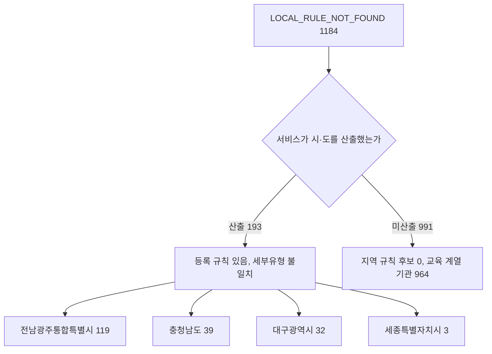

# 지역 규칙 부재(LOCAL_RULE_NOT_FOUND) 시·도별 규모 조사

> **작성일**: 2026-10-15
> **작업**: Orca Task `task_c2d8bb2e54e1` (builder). 제품 코드를 바꾸지 않고 조사만 한다.
> **정본 사양**: `.orca/capsules/task_local_rule_gap_prep_20261015/capsule.yaml` (`ORCA_TASK_CAPSULE_V2`)
> **작업 브랜치**: `kwanbum217/orca-local-rule-prep`
> **측정 DB**: 호스트 `127.0.0.1:3306` 의 Docker MySQL `procurement`. 선행 문서와 같은 창·같은 스냅샷이다.
> **산출 원장**: `.cache/local_rule_gap_prep_20261015.yaml` (커밋하지 않는 로컬 산출물)
> **범위**: 최근 12개월(`2025-10-15`~`2026-10-15`), 업무구분 `Servc`, 낙찰방법 코드 `낙030001`(적격심사제), 최신 차수만.
> **선행 문서**: [block_cause_survey_20261015.md](block_cause_survey_20261015.md) (원인 코드별 총계), [block_cause_split_20261015.md](block_cause_split_20261015.md) (`RULE_NOT_FOUND` 분해)

---

## 1. 목적과 결론

- 목적: 선행 문서가 `LOCAL_RULE_NOT_FOUND` 1,184건을 한 줄로만 적고 넘긴 지점을 시·도 단위로 나누고, 어느 시·도의 공식 원문이 이미 저장소에 있는지 구분한다. **지역 규칙을 등록하지 않는다.**
- 결론: `LOCAL_RULE_NOT_FOUND` 1,184건은 서비스가 시·도를 산출한 4개 시·도(193건, 16.3%)와, 시·도 값 자체가 산출되지 않은 991건(83.7%)으로 갈린다. 어느 시·도를 먼저 등록할지는 이 문서에서 고르지 않는다(7절).
- 서비스가 시·도를 산출한 4개 시·도(전남광주통합특별시·충청남도·대구광역시·세종특별자치시)는 **이미 `LOCAL_RULES` 에 규칙이 등록되어 있다**. 규칙 자체의 부재가 아니라, 등록된 세부유형에 그 공고가 매칭되지 않아 부재로 귀결된 건이다(5절).
- 시·도 값이 산출되지 않은 991건은 교육행정조직·학교·유치원 등 교육 계열 기관이 964건(97.3%)이다. 기관표에 시·도 코드가 없는 것이 아니라, 서비스의 시·도 산출 함수가 그 기관 유형에서 값을 내지 않는다(4절).
- 저장소에 공식 원문 근거가 있는 시·도는 `LOCAL_RULES` 에 등록된 16개 시·도다. 개별 시·도 명의 원문이 없는 곳은 광주광역시·전라남도이며, 두 지역은 전남광주통합특별시(코드 `12`)로 통합 등록되어 있다(6절).

### 1.1 건수가 갈리는 두 축



---

## 2. 측정 방법

- 집계는 서비스의 실제 판정 함수 `resolve_evaluation_rule_from_raw_data` 를 `scripts/report_rule_coverage.py` 의 `collect_records` 가 그대로 호출해 수행한다. 판정 로직을 측정용으로 새로 만들지 않는다(train/serve skew 방지).
- 생성 명령(정본): `uv run python scripts/report_rule_coverage.py --months 12 --category Servc --method-code 낙030001 --min-announcements 1 --output .cache/local_rule_gap_prep_20261015.yaml`
  - 이 워크트리에는 `.env` 가 없어 `SECRET_KEY`(32자 이상)가 필요하다. 파일로 만들지 않고 환경변수로만 주입해 실행했다.
  - 원장은 발행 원장(`data/reference/rule_coverage_ledger.yaml`)을 덮지 않도록 `.cache/` 경로로 따로 썼다.
- **시·도 값의 출처**: 시·도는 원장에 남지 않는다. 같은 창·같은 필터로 `collect_records` 를 돌려 공고별 `RuleResolutionResult` 를 받고, 수요기관 시·도는 서비스가 쓰는 `institution_sido`(`src/app/services/demand_institutions.py`)의 반환값을 그대로 썼다. 기관표에 없는 기관코드는 0건이다.
- **부재 귀결 경로의 출처**: `_select_local_rule`(`src/app/services/evaluation_rules.py:5583`)을 감싸, `LOCAL_RULE_NOT_FOUND` 로 끝난 호출마다 그 시·도에 `LOCAL_RULES` 규칙이 있는지(`has_rules`)를 함께 기록했다. 총 1,184건이 모두 포집되었고, 이 값이 원장의 코드 합계와 정확히 같다.
- DB 는 `SET SESSION TRANSACTION READ ONLY` 로 열고 `SELECT` 만 쓴다. `docker exec` 와 `mysql` 클라이언트는 쓰지 않았다.
- 생성 원장 검산: 공고 31,441건, 수요기관 3,435곳, 차단 20,905건, `tail` 은 `institutions: 0`, `announcements: 0`. 차단 코드 합계는 `RULE_REGIME_MISMATCH` 9,518 / `MANUAL_EVALUATION` 9,420 / `LOCAL_RULE_NOT_FOUND` 1,184 / `RULE_NOT_FOUND` 499 / `NON_PRED_PRICE` 212 / `LOCAL_SERVICE_TYPE_UNRESOLVED` 72 로, 선행 문서와 같은 값이다.
- `LOCAL_RULE_NOT_FOUND` 기관 수는 원장 기준 **451곳**이다.

---

## 3. LOCAL_RULE_NOT_FOUND 1,184건의 시·도별 분포

서비스가 산출한 시·도 값 기준이다. `기관` 은 그 시·도로 묶인 수요기관 수다.

| 순위 | 시·도(서비스 산출값) | 공고 | 비중 | 기관 | 등록 규칙 | 부재 귀결 경로 |
| ---: | --- | ---: | ---: | ---: | --- | --- |
| 1 | (시·도 값 미산출) | 991 | 83.71% | 388 | 해당 없음 | 지역 규칙 후보 0 |
| 2 | 전남광주통합특별시 | 119 | 10.05% | 37 | 있음 (6개) | 등록 세부유형 불일치 |
| 3 | 충청남도 | 39 | 3.29% | 14 | 있음 (6개) | 등록 세부유형 불일치 |
| 4 | 대구광역시 | 32 | 2.70% | 10 | 있음 (1개) | 등록 세부유형 불일치 |
| 5 | 세종특별자치시 | 3 | 0.25% | 2 | 있음 (7개) | 등록 세부유형 불일치 |
| | **합계** | **1,184** | **100.00%** | **451** | | |

- 검산: 시·도 행이 5개뿐이므로 상위 15행 조건에서 5행이 모두 포함된다. 상위 15행 합 = 1,184건 = `LOCAL_RULE_NOT_FOUND` 총건수(원장 `institutions[].block_codes` 합). 차이 0.
- 기관 수 검산: 388 + 37 + 14 + 10 + 2 = 451곳. 원장에서 `LOCAL_RULE_NOT_FOUND` 를 가진 기관 수 451곳과 같다.

### 3.1 부재 귀결 경로별 건수

| 경로 | 판정 근거 | 공고 | 비중 |
| --- | --- | ---: | ---: |
| 지역 규칙 후보 0 | `LOCAL_RULES` 에 그 시·도 규칙이 없음 | 991 | 83.71% |
| 등록 세부유형 불일치 | 규칙은 있으나 `GENERAL`·`SIMPLE_LABOR` 부재로 후보가 서지 못함 | 193 | 16.29% |
| **합계** | | **1,184** | **100.00%** |

- 검산: 991 + 193 = 1,184. 193 은 전남광주통합특별시 119 + 충청남도 39 + 대구광역시 32 + 세종특별자치시 3 이다.
- 선행 문서 `LOCAL_RULE_NOT_FOUND` 1,184건(차단의 5.66%)과 이 문서의 총건수는 같다.

---

## 4. 시·도 값이 산출되지 않은 991건

`institution_sido` 가 시·도 코드를 내지 않는 기관이 낸 건이다. 기관표 미등록 코드는 아니므로, 기관 정보가 없어서가 아니라 **기관 유형 때문에 시·도 값이 비는 것**이다.

### 4.1 기관 관할과 유형

| 항목 | 값 | 건수 |
| --- | --- | ---: |
| 관할(`jrsdctn_div_nm`) | 교육기관 | 829 |
| | 지방자치단체 | 122 |
| | 지방공기업 | 27 |
| | 기타기관 | 13 |
| 대분류(`instt_ty_lrgclsfc_nm`) | 교육행정조직 | 670 |
| | 초등학교 | 145 |
| | 고등학교 | 50 |
| | 유치원 | 47 |
| | 중학교 | 27 |
| | 특수학교 | 25 |
| | 유형 미분류 | 22 |
| | 자치행정조직 | 3 |
| | 산하기관 | 2 |

- 교육 계열 대분류(교육행정조직·초등학교·중학교·고등학교·유치원·특수학교) 합은 964건으로 991건의 97.3% 다.
- 시·도교육청 계열 이름이 상위를 차지한다. 예: 세종특별자치시교육청 세종특별자치시교육청학교지원본부 50건, 대구광역시교육청 대구학교지원센터 29건, 전북특별자치도교육청 전북특별자치도군산교육지원청 23건.

### 4.2 보조 축 — 기관표 `rgn_cd` 앞 2자리 기준 귀속 (17개 시·도)

서비스 판정 경로가 아니라 기관표의 행정구역코드를 쓴 보조 집계다. 이 표는 서비스가 낸 시·도가 아니므로 3절과 합산하지 않는다.

| 순위 | 시·도 | 공고 | 기관 |
| ---: | --- | ---: | ---: |
| 1 | 충청남도 | 124 | 69 |
| 2 | 전북특별자치도 | 122 | 19 |
| 3 | 부산광역시 | 105 | 54 |
| 4 | 충청북도 | 104 | 20 |
| 5 | 경상북도 | 98 | 52 |
| 6 | 대구광역시 | 92 | 41 |
| 7 | 세종특별자치시 | 64 | 6 |
| 8 | 경기도 | 58 | 33 |
| 9 | 서울특별시 | 50 | 14 |
| 10 | 울산광역시 | 47 | 23 |
| 11 | 강원특별자치도 | 46 | 16 |
| 12 | 대전광역시 | 26 | 12 |
| 13 | 인천광역시 | 19 | 10 |
| 14 | 경상남도 | 16 | 9 |
| 15 | 제주특별자치도 | 14 | 8 |
| 그 외 | 전남광주통합특별시 4, 광주광역시 2 | 6 | 2 |
| | **합계** | **991** | **388** |

- 검산: 상위 15행 985건 + 그 외 2개 시·도 6건 = 991건 = 4절 총건수. 차이 0.
- 기관 수 검산: 69+19+54+20+52+41+6+33+14+23+16+12+10+9+8 = 386곳 + 그 외 2곳 = 388곳.

---

## 5. 시·도 규칙 등록 현황과 부재 귀결 이유

### 5.1 서비스가 시·도를 산출하는 코드는 16개뿐이다

기관표 102,248곳 중 `institution_sido` 가 시·도를 내는 기관은 19,993곳이고, 그 코드는 다음 16개로만 나온다.

| 시·도 코드 | 시·도 | 기관 수 |
| --- | --- | ---: |
| `11` | 서울특별시 | 1,531 |
| `12` | 전남광주통합특별시 | 5,179 |
| `26` | 부산광역시 | 747 |
| `27` | 대구광역시 | 597 |
| `28` | 인천광역시 | 701 |
| `30` | 대전광역시 | 430 |
| `31` | 울산광역시 | 261 |
| `36` | 세종특별자치시 | 388 |
| `41` | 경기도 | 2,586 |
| `43` | 충청북도 | 757 |
| `44` | 충청남도 | 944 |
| `47` | 경상북도 | 1,306 |
| `48` | 경상남도 | 1,297 |
| `50` | 제주특별자치도 | 533 |
| `51` | 강원특별자치도 | 1,442 |
| `52` | 전북특별자치도 | 1,294 |

- 광주광역시(`29`)·전라남도(`46`) 단독 코드는 나오지 않는다. 두 지역은 전남광주통합특별시(`12`)로 통합되어 있다.

### 5.2 등록된 `LOCAL_RULES` 16개 시·도 (50개 규칙)

`src/app/services/evaluation_rules.py:1961` 이하 `LOCAL_RULES` 기준이다.

| 시·도 | 규칙 | 등록 세부유형 | `GENERAL` | `SIMPLE_LABOR` |
| --- | ---: | --- | --- | --- |
| 서울특별시 | 2 | GENERAL, SIMPLE_LABOR | 있음 | 있음 |
| 부산광역시 | 2 | GENERAL, SIMPLE_LABOR | 있음 | 있음 |
| 대구광역시 | 1 | SIMPLE_LABOR | **없음** | 있음 |
| 인천광역시 | 2 | GENERAL, SIMPLE_LABOR | 있음 | 있음 |
| 대전광역시 | 2 | GENERAL, SIMPLE_LABOR | 있음 | 있음 |
| 울산광역시 | 4 | GENERAL, SIMPLE_LABOR, WASTE, WASTE_HOUSEHOLD | 있음 | 있음 |
| 세종특별자치시 | 7 | FACILITY, LAND_TRANSPORT, LAND_TRANSPORT_SME, SW, SW_SME, WASTE, WASTE_HOUSEHOLD | **없음** | **없음** |
| 경기도 | 5 | GENERAL, INSURANCE, LAND_TRANSPORT, SW, WASTE | 있음 | **없음** |
| 강원특별자치도 | 2 | GENERAL, SIMPLE_LABOR | 있음 | 있음 |
| 충청북도 | 2 | GENERAL, SIMPLE_LABOR | 있음 | 있음 |
| 충청남도 | 6 | FACILITY, FISHERY_CLEANUP, LAND_TRANSPORT, SW, SW_SME, WASTE | **없음** | **없음** |
| 전남광주통합특별시 | 6 | FACILITY, FISHERY_CLEANUP, LAND_TRANSPORT, SW, WASTE, WASTE_HOUSEHOLD | **없음** | **없음** |
| 경상북도 | 4 | GENERAL, SIMPLE_LABOR, SW, WASTE | 있음 | 있음 |
| 경상남도 | 1 | GENERAL | 있음 | **없음** |
| 제주특별자치도 | 2 | GENERAL, SIMPLE_LABOR | 있음 | 있음 |
| 전북특별자치도 | 2 | GENERAL, SIMPLE_LABOR | 있음 | 있음 |

- 합계 검산: 2+2+1+2+2+4+7+5+2+2+6+6+4+1+2+2 = 50개. `LOCAL_RULES` 길이와 같다.

### 5.3 등록 시·도인데 부재로 귀결되는 이유

`_select_local_rule` 은 시·도 규칙 목록이 비면 부재로 끝낸다(`src/app/services/evaluation_rules.py:5612`). 규칙이 있어도 세부유형 판정이 `UNRESOLVED` 인데 `GENERAL`·`SIMPLE_LABOR` 규칙이 하나도 없으면 부재로 끝나고(`:5647`), 세부유형이 정해졌는데 그 유형의 규칙이 없고 `GENERAL` 대체도 없으면 역시 부재로 끝난다(`:5678`).

- 3절의 4개 시·도(전남광주통합특별시 119 + 충청남도 39 + 대구광역시 32 + 세종특별자치시 3 = 193건)가 이 경로다. 네 곳 모두 `GENERAL` 이 없고, 대구광역시를 뺀 세 곳은 `SIMPLE_LABOR` 도 없다.
- 대구광역시는 `SIMPLE_LABOR` 만 등록되어 있어, 세부유형이 다른 유형으로 정해지면 대체할 `GENERAL` 이 없어 부재로 끝난다.
- 세종특별자치시·충청남도·전남광주통합특별시는 `GENERAL`·`SIMPLE_LABOR` 가 모두 없어, 세부유형이 등록 목록 밖이거나 `UNRESOLVED` 이면 부재로 끝난다.
- 이 193건이 곧 "지역 규칙을 새로 등록해야 풀리는 건"은 아니다. 등록된 별표의 적용 범위를 넓히는 판단과 새 시·도 규칙을 추가하는 판단은 서로 다른 문제이며, 어느 쪽도 이 문서에서 확정하지 않는다.

---

## 6. 공식 원문이 저장소에 있는 시·도와 없는 시·도

원문을 새로 받지 않았다. 아래는 **이미 저장소에 남아 있는 근거**의 유무다.

| 시·도 | `LOCAL_RULES` 등록 | 개별 원문 근거 | 근거 위치 | 원문 확인 등급 |
| --- | --- | --- | --- | --- |
| 서울특별시 | 있음 | 있음 | `docs/analysis/servc_formula_recover_c_20261005.md:76-103` | 확인 |
| 부산광역시 | 있음 | 있음 | `docs/analysis/servc_formula_recover_c_20261005.md:105-132` | 확인 |
| 대구광역시 | 있음 | 있음 | `docs/analysis/servc_formula_collection_local_20261004.md:202-223` | 부분 |
| 인천광역시 | 있음 | 있음 | `docs/analysis/servc_formula_collection_local_20261004.md:122-146` | 확인 |
| 대전광역시 | 있음 | 있음 | `docs/analysis/servc_formula_recover_c_20261005.md:134-168` | 확인 |
| 울산광역시 | 있음 | 있음 | `docs/analysis/servc_formula_collection_local_20261004.md:279-306` | 확인 |
| 세종특별자치시 | 있음 | 있음 | `docs/analysis/servc_formula_collection_local_20261004.md:225-247` | 확인 |
| 경기도 | 있음 | 있음 | `docs/analysis/servc_formula_collection_local_20261004.md:400-463` | 부분 |
| 강원특별자치도 | 있음 | 있음 | `docs/analysis/servc_formula_collection_local_20261004.md:175-200` | 확인 |
| 충청북도 | 있음 | 있음 | `docs/analysis/servc_formula_collection_local_20261004.md:312-333` | 확인 |
| 충청남도 | 있음 | 있음 | `docs/analysis/servc_formula_recover_c_20261005.md:170-202` | 부분 |
| 경상북도 | 있음 | 있음 | `docs/analysis/servc_formula_collection_local_20261004.md:253-273` | 확인 |
| 경상남도 | 있음 | 있음 | `docs/analysis/servc_formula_collection_local_20261004.md:377-394` | 확인 |
| 제주특별자치도 | 있음 | 있음 | `docs/analysis/servc_formula_collection_local_20261004.md:148-173` | 확인 |
| 전북특별자치도 | 있음 | 있음 | `docs/analysis/servc_formula_recover_c_20261005.md:204-230` | 확인 |
| 전남광주통합특별시 | 있음 | 있음 | `docs/analysis/servc_formula_collection_local_20261004.md:339-371` | 확인 |
| 광주광역시 | 없음 (통합 등록) | **없음** | - | - |
| 전라남도 | 없음 (통합 등록) | **없음** | - | - |

- 개별 시·도 명의 원문이 없는 곳은 **광주광역시·전라남도** 두 곳이다. 두 지역은 전남광주통합특별시 원문 하나로 통합 등록되어 있고, 수집 색인에도 `jn_gj` 항목 하나만 있다.
- 원문 확인 등급이 `부분` 인 시·도는 대구광역시·경기도·충청남도 3곳이다. 등급은 수집 문서의 절 제목 표기를 그대로 옮겼다.
- **원문 파일 원본은 이 워크트리에 없다.** `data/sources/qualification/manifest.json` 의 `source_root` 는 `EXT_SRC` 이고, 그 아래 862개 파일과 `data/sources/qualification/files/` 가 모두 없다. 저장소에 남은 것은 문서 인용행과 수집 색인뿐이다.
- 수집 색인의 시·도 항목별 파일 수(위 16개 시·도 합 309개): 대구광역시 47, 세종특별자치시 39, 인천광역시 29, 경기도 27, 경상북도 26, 전남광주통합특별시 24, 강원특별자치도 23, 울산광역시 19, 서울특별시 17, 제주특별자치도 16, 경상남도 12, 충청북도 11, 전북특별자치도 7, 부산광역시 5, 충청남도 4, 대전광역시 3.

---

## 7. 이 문서가 하지 않은 것

| 항목 | 상태 |
| --- | --- |
| 지역 규칙 등록 | 없음. `LOCAL_RULES` 및 `src/` 변경 없음 |
| 우선순위 결정 | 없음. 어느 시·도를 먼저 등록할지 고르지 않음 |
| 발행 원장 | 없음. `data/reference/rule_coverage_ledger.yaml` 수정·재생성 없음 |
| 원문 신규 수집 | 없음. 외부 수집·다운로드 없음 |
| 시·도 세부기준 코드화 | 없음. 이 문서는 규모 기록까지다 |
| 캐시 원장 | `.cache/local_rule_gap_prep_20261015.yaml` 로만 생성. 커밋하지 않음 |

---

## 8. 한계와 후속

| 항목 | 내용 |
| --- | --- |
| 시·도 미산출 991건 | 1,184건의 83.7% 다. 서비스 산출값만으로는 시·도별 규모를 다 설명하지 못한다. 4.2절 보조 축은 기관표 `rgn_cd` 기준이며 서비스 판정 경로가 아니다. |
| 세부유형 원인 | 193건의 세부유형 불일치를 공고별 판정 근거(`basis`)로 더 나누지 않았다. 5.3절은 규칙 구성에서 끌어낸 구조 설명이다. |
| 창 | 조회 창은 `2025-10-15`~`2026-10-15` 다. 발행 원장(31,485 / 20,973)은 `2026-10-14` 창의 별개 측정이며 서로 대체하지 않는다. |
| 스냅샷 | 선행 문서와 같은 스냅샷이며, 총계가 선행 문서와 정확히 일치한다(공고 31,441 / 차단 20,905). |
| 원문 등급 | `부분` 등급 3곳은 원문이 부분만 읽힌 상태다. 규칙을 넓히려면 그 3곳의 미확인 항목을 먼저 닫아야 한다. |
| 후속 | 어느 시·도를 먼저 등록할지, 등록된 별표의 적용 범위를 넓힐지는 사용자 결정과 별도 Task 로 진행한다. 이 문서는 그 근거 자료다. |

---

## 9. 재현 방법

```sh
SECRET_KEY=<32자 이상 임시값> uv run python scripts/report_rule_coverage.py \
  --months 12 --category Servc --method-code 낙030001 \
  --min-announcements 1 --output .cache/local_rule_gap_prep_20261015.yaml
```

- 3절 시·도별 건수: 같은 창·같은 필터로 `collect_records` 를 돌리고, `LOCAL_RULE_NOT_FOUND` 로 차단된 건마다 `institution_sido` 반환값을 묶어 센다. 합이 원장 `institutions[].block_codes.LOCAL_RULE_NOT_FOUND` 합(1,184)과 같은지 먼저 확인한다.
- 3.1절 경로 구분: `_select_local_rule` 을 감싸 `LOCAL_RULE_NOT_FOUND` 로 끝난 호출마다 그 시·도의 `LOCAL_RULES` 유무를 기록한다. 포집 건수가 1,184인지 확인한다.
- 4.2절 보조 축: 4절 대상 기관의 기관표 `rgn_cd` 앞 2자리를 시·도로 옮겨 센다. 합이 991인지 확인한다.
- 5.2절 등록 현황: `LOCAL_RULES` 를 `region_name`·`service_type` 으로 묶는다. 합이 50개인지 확인한다.
- 6절 원문 근거: 두 수집 문서의 절 행 번호와 `data/sources/qualification/manifest.json` 의 `institutions`·`files` 를 대조한다.
