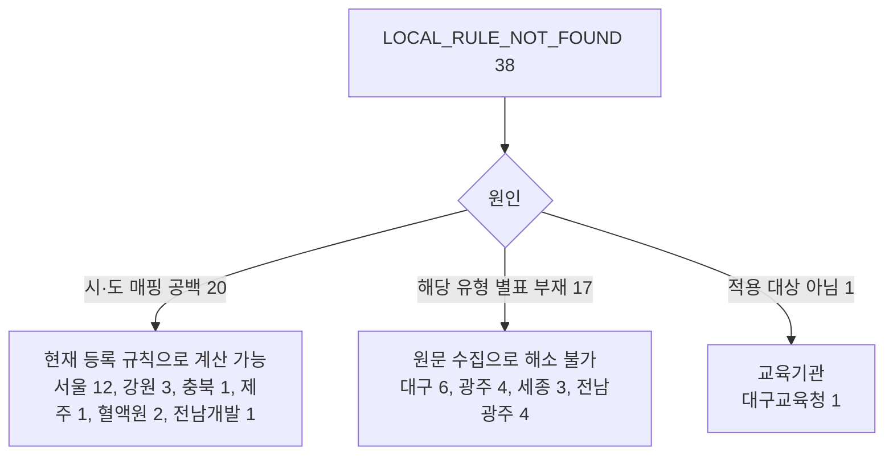

# LOCAL_RULE_NOT_FOUND 38건 시·도 원문 별표 유무 조사 (전남광주·충남 제외)

> **작성일**: 2026-11-06
> **작업**: Orca Task `task_d9c7e65b106a` (builder, `run_8734173629f4`). 코드·규칙·원장은 고치지 않고 조사 문서만 쓴다.
> **정본 사양**: `.orca/capsules/task_d9c7e65b106a/capsule.yaml` (`ORCA_TASK_CAPSULE_V2`)
> **작업 브랜치**: `kwanbum217/local38`
> **기준 문서**: [blocked_reason_breakdown_20261106.md](blocked_reason_breakdown_20261106.md) 2.3절, [local_not_found_basis_20261019.md](local_not_found_basis_20261019.md)
> **측정 창**: 2025-11-06 ~ 2026-11-06, 업무구분 `Servc`, 낙찰방법 코드 `낙030001`, 공고번호·업무구분별 최신 차수
> **판정 정본**: [src/app/services/evaluation_rules.py](../../src/app/services/evaluation_rules.py) `resolve_evaluation_rule_from_raw_data`, `resolve_local_service_type`
> **라벨**: (가) 원문 별표에 해당 유형·띠가 있어 등록 가능, (나) 원문에 해당 유형 별표가 없음, (다) 원문 미확보
> **결과**: 38건 22개 조합. (가) 3건 2조합, (나) 35건 20조합, (다) 0건.

---

## 1. 요약

### 1.1 대상과 라벨 집계

최근 12개월 `Servc`·`낙030001` 차단 9,811건 중 `LOCAL_RULE_NOT_FOUND` 114건에서 전남광주통합특별시 61건과 충청남도 15건을 뺀 **38건**을 조사했다. 공고일이 2026-07-16 통합특별시 출범 전인지 후인지에 따라 적용 원문이 갈리므로, 38건을 (적용 시·도, 용역 유형, 금액 구간) 조합으로 묶어 22개 조합을 만들었다.

| 라벨 | 조합 수 | 공고 수 | 비중 |
| --- | ---: | ---: | ---: |
| (가) 원문 별표에 해당 유형·띠가 있음 | 2 | 3 | 7.89% |
| (나) 원문에 해당 유형 별표가 없음 | 20 | 35 | 92.11% |
| (다) 원문 미확보 | 0 | 0 | 0.00% |
| **합계** | **22** | **38** | **100.00%** |

- 검산: 2 + 20 + 0 = 22조합, 3 + 35 + 0 = 38건. [blocked_reason_breakdown_20261106.md](blocked_reason_breakdown_20261106.md) 2.3절의 114건에서 61 + 15를 뺀 값과 같다.
- (나) 35건은 성격이 둘로 갈린다. **17건은 해당 유형 별표 자체가 없고**, **18건은 유형별 별표는 없지만 일반 별표 또는 준용 조항으로 대체할 수 있다**.
- 작성 중 공유 DB의 첨부 판별 테이블이 갱신되어 전체 차단 집계는 9,811건에서 9,801건으로, `LOCAL_RULE_NOT_FOUND` 는 114건에서 112건으로 관측됐다. **이 문서의 38건 부분집합은 두 시점 모두 38건으로 같고**, 줄어든 2건은 전남광주·충남 버킷에 있다. 총계는 기준 문서의 114건을 정본으로 적는다.

### 1.2 핵심 결론

1. **38건 중 20건은 원문 부족이 아니라 시·도 매핑 공백 때문에 막힌다.** 서울특별시서대문구도시관리공단 12건, 대한적십자사 강원혈액원 3건, 충북혈액원 1건, 제주관광공사 1건, 광주.전남적십자혈액원 2건, 전남개발공사 1건이다. 수요기관 기준정보의 `toplvl_instt_nm` 이 시·도 본청이 아니어서 `institution_sido` 가 `(None, None)` 을 돌려주고, 시·도 규칙 후보가 서지 않는다. 같은 공고에 시·도를 강제로 주입하면 20건 전량이 현재 등록 규칙으로 계산된다(3.3절 실측).
2. **17건은 해당 유형 별표가 시·도 원문에 실제로 없다.** 대구광역시 6건(수요기관 지정형 3, 보험 2, 임대차 1), 광주광역시 4건(보험), 세종특별자치시 3건(보험 2, 임대차 1), 전남광주통합특별시 4건(수리·점검)이다.
3. **1건은 원문 별표가 있으나 적용 대상이 아니다.** 대구광역시교육청 대구테크노초등학교의 여객 육상운송 1건은 대구광역시 별표 5·5의2가 원문에 있지만, 대구 예규 제1조의 적용 범위가 "대구광역시에서 집행하는 일반용역"이라 교육기관에는 적용되지 않는다.
4. **(가) 3건 중 2건도 매핑만 고치면 풀린다.** 광주.전남적십자혈액원의 화물 육상운송 2건은 광주광역시 예규 제377호 별표 1-5에 5억원 이상 띠가 있다. 공고일(2025-12)이 통합 전이므로 종전 광주 기준이 적용된다. 시·도만 주입하면 `SERVC_LOCAL_GWANGJU_20221115_ATTACH_1_5` 로 계산된다.



### 1.3 조합 요약 표

값은 (가)만 적었다. (나)의 "값"은 원문에 해당 유형 별표가 없다는 뜻이며, 괄호는 대체 경로다. 공고 수는 최신 차수 기준이다.

| # | 적용 시·도 | 코드 시·도 버킷 | 유형 | 금액 구간 | 공고 수 | 라벨 | 값·대체 경로 |
| ---: | --- | --- | --- | --- | ---: | :---: | --- |
| 1 | 강원특별자치도 | 대한적십자사 | `FACILITY` | 1억원 미만 | 1 | (나) | 없음(일반 별표 1 대체) |
| 2 | 강원특별자치도 | 대한적십자사 | `LAND_TRANSPORT` | 1억원 미만 | 2 | (나) | 없음(일반 별표 1 대체) |
| 3 | 광주광역시 | 광주광역시 | `INSURANCE` | 1억~2억원 | 1 | (나) | 없음 |
| 4 | 광주광역시 | 광주광역시 | `INSURANCE` | 1억원 미만 | 3 | (나) | 없음 |
| 5 | 광주광역시 | 대한적십자사 | `LAND_TRANSPORT` | 5억~10억원 | 2 | (가) | B 60/70, k 2, 기준 88, T 95, 하한 85.495% |
| 6 | 대구광역시 | 대구광역시 | `DEMAND_AGENCY` | 1억원 미만 | 3 | (나) | 없음 |
| 7 | 대구광역시 | 대구광역시 | `INSURANCE` | 2억~5억원 | 1 | (나) | 없음 |
| 8 | 대구광역시 | 대구광역시 | `INSURANCE` | 5억~10억원 | 1 | (나) | 없음 |
| 9 | 대구광역시 | 대구광역시 | `LEASE` | 2억~5억원 | 1 | (나) | 없음 |
| 10 | 대구광역시 | 대구광역시교육청 | `LAND_TRANSPORT` | 2억~5억원 | 1 | (가) | B 60/70, k 2(비대상)/4(대상), 기준 88/91, T 85/88, 하한 95.5%/94% |
| 11 | 서울특별시 | 서울특별시서대문구도시관리공단 | `FACILITY` | 1억~2억원 | 3 | (나) | 없음(일반 별표 1 대체) |
| 12 | 서울특별시 | 서울특별시서대문구도시관리공단 | `FACILITY` | 1억원 미만 | 3 | (나) | 없음(일반 별표 1 대체) |
| 13 | 서울특별시 | 서울특별시서대문구도시관리공단 | `FACILITY` | 2억~5억원 | 3 | (나) | 없음(일반 별표 1 대체) |
| 14 | 서울특별시 | 서울특별시서대문구도시관리공단 | `LAND_TRANSPORT` | 5억~10억원 | 1 | (나) | 없음(일반 별표 1 대체) |
| 15 | 서울특별시 | 서울특별시서대문구도시관리공단 | `SW` | 1억원 미만 | 2 | (나) | 없음(일반 별표 1 대체) |
| 16 | 세종특별자치시 | 세종특별자치시 | `INSURANCE` | 1억~2억원 | 2 | (나) | 없음 |
| 17 | 세종특별자치시 | 세종특별자치시 | `LEASE` | 10억~30억원 | 1 | (나) | 없음 |
| 18 | 전남광주통합특별시 | 전라남도 | `REPAIR_INSPECTION` | 1억~2억원 | 3 | (나) | 없음 |
| 19 | 전남광주통합특별시 | 전라남도 | `REPAIR_INSPECTION` | 2억~5억원 | 1 | (나) | 없음 |
| 20 | 전라남도 | 전남개발공사 | `INSURANCE` | 1억~2억원 | 1 | (나) | 없음(전남 준용 조항) |
| 21 | 제주특별자치도 | 제주관광공사 | `LAND_TRANSPORT` | 1억~2억원 | 1 | (나) | 없음(일반 별표 1 대체) |
| 22 | 충청북도 | 대한적십자사 | `LAND_TRANSPORT` | 2억~5억원 | 1 | (나) | 없음(일반 별표 1 대체) |

- 공고 수 합계: 1+2+1+3+2+3+1+1+1+1+3+3+3+1+2+2+1+3+1+1+1+1 = **38**.
- "코드 시·도 버킷"은 `institution_sido` 가 돌려준 값 또는 그 값이 없을 때 기관명에서 읽은 값이다. "적용 시·도"는 수요기관 소재지 기준으로 판정한 실제 시·도다. 차이가 나는 21건은 2.1절에 적었다.
- (나) 중 "일반 별표 1 대체" 17건은 코드가 이미 등록한 `GENERAL` 규칙으로 계산된다. 원문에 유형별 별표가 없다는 사실과 계산 가능성은 별개다.

---

## 2. 원문 근거

### 2.1 대상 산출과 시·도 매핑

- 38건은 [scripts/report_rule_coverage.py](../../scripts/report_rule_coverage.py) 의 `collect_records`([:417](../../scripts/report_rule_coverage.py:417))를 메모리에서 돌려 얻었다. 파일 쓰기는 없고, DB 세션은 `SET SESSION TRANSACTION READ ONLY` 로 열어 `SELECT` 만 썼다. 공고 모집단은 두 시점 모두 31,348건이다. 차단 총계는 작성 중 공유 DB의 첨부 판별 테이블 갱신으로 9,811건에서 9,801건으로, `LOCAL_RULE_NOT_FOUND` 는 114건에서 112건으로 달라졌다. 38건 부분집합은 두 시점 모두 38건이며 구성도 같다. 총계 정본은 [blocked_reason_breakdown_20261106.md](blocked_reason_breakdown_20261106.md) 의 114건을 쓴다.
- 114건의 시·도 분포는 전남광주통합특별시 61, 충청남도 15, 서울특별시서대문구도시관리공단 12, 대한적십자사 6, 대구광역시 6, 광주광역시 4, 전라남도 4, 세종특별자치시 3, 대구광역시교육청 1, 전남개발공사 1, 제주관광공사 1이다. 앞의 두 항목을 빼면 38건이다.
- 코드가 시·도를 산출하지 못한 21건은 수요기관 기준정보의 `rgn_cd`·`rgn_nm` 으로 소재 시·도를 정했다. 지방공기업·공단·교육기관은 `toplvl_instt_nm` 이 시·도 본청이 아니라 `institution_sido` 가 `(None, None)` 을 돌려준다.

| 수요기관 | 코드 시·도 | 적용 시·도 | 근거 |
| --- | --- | --- | --- |
| 서울특별시서대문구도시관리공단 | 없음 | 서울특별시 | `rgn_cd` 11410, `rgn_nm` 서울특별시 서대문구 |
| 대한적십자사 충북혈액원 | 없음 | 충청북도 | `rgn_cd` 43113, `rgn_nm` 충청북도 청주시 흥덕구 |
| 대한적십자사강원도혈액원 | 없음 | 강원특별자치도 | `rgn_cd` 51110, `rgn_nm` 강원특별자치도 춘천시 |
| 광주.전남적십자혈액원 | 없음 | 광주광역시 | `rgn_cd` 29155, `rgn_nm` 광주광역시 남구. 공고일이 통합 전이라 종전 광주 기준 |
| 대구광역시교육청 대구테크노초등학교 | 없음 | 대구광역시(적용 제외) | `rgn_cd` 27710, 대구광역시 달성군. 교육기관은 시·도 예규 적용 대상 아님 |
| 전남개발공사 | 없음 | 전라남도 | `rgn_cd` 12810, 전남광주통합특별시 무안군. 공고일이 통합 전이라 종전 전남 기준 |
| 제주관광공사 | 없음 | 제주특별자치도 | `rgn_cd` 50130, 제주특별자치도 서귀포시 |

- 공고일이 2026-07-16 이후인 전남광주통합특별시 신안군·소방본부 4건은 현행 통합 지침을 적용했다. 광주광역시·전라남도 버킷의 나머지 8건은 공고일이 통합 전이므로 종전 광주·전남 기준을 적용하고, 2026-11-06 현행 후속이 통합 지침임을 함께 적었다.

### 2.2 시·도별 현행 원문과 별표 목록

#### 2.2.1 서울특별시

- 원문: `서울특별시 일반용역 적격심사 세부기준`(개정전문, 시행 2024-08-12). 나라장터 공고 `R26BK01557506`(서울특별시 재무공고 제2026-1589호, 2026-06-02) 첨부 5 `★서울시 일반용역 적격심사 세부기준(2024.8.12.).hwp` 를 받아 `extract_document_text` 로 추출했다. 보조 출처는 서울시 정보소통광장 `https://opengov.seoul.go.kr/sanction/18765847` 이다.
- 적용 범위: 제1조 "서울특별시 및 그 관할구역 안에 있는 자치구에서 집행하는 일반용역계약". 서대문구도시관리공단은 서대문구가 설립한 지방공기업이므로 서울특별시 기준의 적용 대상으로 보았다. 다만 공단 자체가 "자치구"는 아니어서 적용 범위 문언은 6절 한계에 적었다.
- 별표 목록: `<별표 1> 적격심사항목 및 배점한도`, `<별표 2> 신인도 평가방법`, `<별표 3> 용역 분야별 평가방법`. 별표 1은 추정가격 4구간(10억원 이상, 10억원 미만 5억원 이상, 5억원 미만 2억원 이상, 2억원 미만)과 `5. 보험용역 적격심사` 로 구성된다.
- 해당 유형 별표: **시설분야·소프트웨어·육상운송 별표 없음**. 보험용역은 별표 1의 5항에 있으나 별도 별표가 아니다.
- 준용 조항: 제8조 "이 세부기준에 정하지 아니한 사항은 관련 법령 및 예규 등에 정한 바에 따른다."
- 부재 근거: 별표 제목 목록에 유형별 별표가 없고, 별표 1의 심사항목도 청소·시설관리·경비·주차장관리 등 동일분야 이행실적으로만 구성된다. 원문 인용: "이행실적 최근 5년이내 용역(청소, 시설관리, 경비, 주차장관리등 동일분야에 한함)".

#### 2.2.2 대구광역시

- 원문: 자치법규정보시스템 `https://www.elis.go.kr/allalr/selectAlrBdtOne?alrNo=27000005004039&histNo=008`, `대구광역시 일반용역 적격심사 세부기준 [시행 2026.05.11]`, `(일부개정) 2026-05-11 예규 제238호`.
- 별표 목록: `[별표 1] 단순노무 일반용역`, `삭제 〈2022.9.30.〉` 2건, `[별표 3] 소프트웨어용역(중소기업자간 경쟁 제품 비대상)`, `[별표 3의2] 소프트웨어용역(중소기업자간 경쟁 제품 대상)`, `[별표 4] 폐기물처리용역`, `[별표 5] 육상운송용역(중소기업자간 경쟁 제품 비대상)`, `[별표 5의2] 육상운송용역(중소기업자간 경쟁 제품 대상)`, `[별표 6] 신용평가등급`, `[별표 7] 신인도`, `[별표 8] 이행실적`.
- 제4조 제1항: "1. 단순노무 일반용역 … 별표 1 / 2. 삭제 / 3. 소프트웨어용역 … 별표 3 또는 별표 3의2 / 4. 폐기물처리용역 … 별표 4 / 5. 육상운송용역 … 별표 5 또는 별표 5의2".
- 해당 유형 별표: **수요기관 지정형·보험·임대차 별표 없음**. 육상운송은 별표 5·5의2 있음.
- 준용 조항: 제12조 제1항 "이 기준에서 정하지 않은 사항은 관계법령 등에서 정하는 바에 따른다." 특정 authority 를 지목하지 않는다.
- 부재 근거: 별표 목록과 제4조 제1항 어디에도 보험·임대차·수요기관 지정형이 없다. 수요기관 지정형 공고 3건은 공고 첨부 `3.수요기관 지정형 적격심사 세부기준.pdf` 를 별도로 붙이고 있다(3절 대표 공고 참조).

#### 2.2.3 광주광역시 (종전 기준, 2026-07-16 폐지)

- 원문: 자치법규정보시스템 `https://www.elis.go.kr/allalr/selectAlrBdtOne?alrNo=29000068001145&histNo=007`, `광주광역시 일반용역 적격심사 세부 기준 [시행 2022.11.15]`, `(일부개정) 2022-11-15 예규 제377호`. 같은 페이지 연혁에 `(폐지) 2026-07-01 예규 제3호 전남광주통합특별시 일반용역 적격심사 세부지침` 이 있고, 후속 지침 부칙 제1조의 시행일은 2026-07-16 이다.
- 별표 목록: 별표 1-1 청소·시설물경비·시설물관리, 1-2 소프트웨어, 1-3 폐기물, 1-4 분묘 개·화장, 1-5 육상운송, 1-6 기타일반. 별표 6은 입찰가격 평가방법이고, 별표 2~8은 이행실적·경영상태·기술능력·신인도 등 수행능력 평가방법이다.
- 해당 유형 별표: **보험 별표 없음**. 제11조 제1항이 "보험서비스 용역의 경우에는 예정가격 이하로서 최저가격으로 입찰한 자를 낙찰자로 결정한다"고만 적고 보험용역 별표를 두지 않는다. 육상운송은 별표 1-5 있음.
- 준용 조항: 제11조 제1항 통과점수 95점. 별도 준용 조항은 확인하지 못했다.
- 부재 근거: 제6조 "일반용역에 대한 적격심사의 평가기준은 다음 각 호에 따른다. 1. 청소, 시설물경비, 시설물관리용역 : 별표 1-1 / 2. 소프트웨어용역 : 별표 1-2 / 3. 폐기물처리용역 : 별표 1-3 / 4. 분묘 개·화장용역 : 별표 1-4 / 5. 육상운송용역 : 별표 1-5 / 6. 기타일반용역 : 별표 1-6". 보험 항목이 없다.

#### 2.2.4 전라남도 (종전 기준, 2026-07-16 폐지)

- 원문: 자치법규정보시스템 `https://www.elis.go.kr/allalr/selectAlrBdtOne?alrNo=46000007006065&histNo=005`, `전라남도 일반용역 적격심사 세부기준 [시행 2023.03.02]`, `(일부개정) 2023-03-02 예규 제1075호`. 같은 페이지 연혁에 `(폐지) 2026-07-01 예규 제3호 전남광주통합특별시 일반용역 적격심사 세부지침` 이 있다.
- 별표 목록: `(별표 1) 시설분야용역`, `(별표 2) 어장정화·정비용역`, `(별표 3) 정보통신용역`, `(별표 4) 폐기물처리용역`, `(별표 5) 육상운송용역`, `(별표 6) 생활폐기물 수집·운반 대행용역`, `(별표 7) 신인도`.
- 해당 유형 별표: **수리·점검 별표 없음**. 보험 별표도 없으나, 제11조 제1항이 "이 세부기준에 정하지 아니한 사항은 … 조달청 일반용역 적격심사 세부기준 등에서 정한 바에 따른다"고 준용을 명시한다. 이 준용은 코드에서 `_is_jeonnam_local_announcement` 경로로만 구현되어 있다.
- 부재 근거: 별표 목록 1~7에 수리·점검·보험이 없다.

#### 2.2.5 세종특별자치시

- 원문: 자치법규정보시스템 `https://www.elis.go.kr/allalr/selectAlrBdtOne?alrNo=36110115281011&histNo=005`, `세종특별자치시 일반용역 적격심사 세부기준 [시행 2025.12.01]`, `(일부개정) 2025.11.14 예규 제32호`.
- 별표 목록: `[별표 2] 시설분야용역`, `[별표 3] 소프트웨어용역`, `[별표 4] 폐기물처리용역`, `[별표 4의2] 생활폐기물처리용역`, `[별표 5] 육상운송용역`, `[별표 6] 신용평가등급`, `[별표 7] 신인도`.
- 제3조 제1항: "2. 시설분야용역 : 별표 2 / 3. 소프트웨어용역 : 별표 3 / 4. 폐기물처리용역 : 별표 4 / 4의2. 생활폐기물처리용역 : 별표 4의2 / 5. 육상운송용역 : 별표 5".
- 해당 유형 별표: **보험·임대차 별표 없음**.
- 준용 조항: 제11조 제1항 "이 세부기준에 정하지 않은 사항은 관련법규와 행정안전부의 지방계약 예규 등에서 정하는 바에 따른다."
- 부재 근거: 별표 목록과 제3조 제1항 어디에도 보험·임대차가 없다.

#### 2.2.6 강원특별자치도

- 원문: 자치법규정보시스템 `https://www.elis.go.kr/allalr/selectAlrBdtOne?alrNo=42000035005022&histNo=001`, `강원특별자치도 일반용역 적격심사 세부기준 [시행 2023.06.11]`, `(제정) 2023-05-26 예규 제832호`.
- 별표 목록: `[별표1] 일반용역 적격심사`, `[별표2] 폐기물처리용역`, `[별표3] 생활폐기물 수집·운반 대행용역`, `[별표4] 신인도`, `[별표5] 근로조건 이행계획`, `[별표6] 용역 분야별 평가방법`.
- 제3조 제1항: "1. 일반용역 적격심사 세부기준 : 별표 1, 별표 4, 별표 6 / 2. 단순노무에 의한 일반용역 : 별표 1, 별표 4, 별표 5, 별표 6 / 3. 폐기물처리용역 : 별표 2, 별표 4, 별표 6 / 4. 생활폐기물 수집·운반 대행용역 : 별표 3, 별표 4, 별표 5, 별표 6".
- 해당 유형 별표: **시설분야·육상운송 별표 없음**. 별표 1 일반용역이 유일한 일반 띠 별표다.
- 준용 조항: 제11조 "「지방자치단체 입찰시 낙찰자 결정기준」 및 「지방자치단체 입찰 및 계약 집행기준」 등에서 정한 바에 따른다."
- 부재 근거: 별표 목록에 시설분야·육상운송이 없고, 제3조 제1항도 일반·단순노무·폐기물·생활폐기물 네 갈래만 둔다.

#### 2.2.7 충청북도

- 원문: `충청북도 일반용역 적격심사 세부기준 [시행 2023. 10. 20.][충청북도 공고 제2023-1428호, 2023. 10. 18., 일부개정]`. 충북 산하 청주도시공사 게시 PDF `https://www.cjuc.or.kr/home/board/download.do?menukey=7403&fsn=1772443843-072-639&bsn=1756710989-000-010&dsn=1772442652-603-436` 를 `pdfplumber` 로 추출했다.
- 별표 목록: `<별표 1>` 하나. 제3조 제1항 "세부기준의 심사항목 및 배점기준은〈별표 1〉에 의한다."
- 해당 유형 별표: **육상운송 별표 없음**. 별표 1 일반용역 4구간(30/50/70/90)이 전부다.
- 부재 근거: 문서 전체에 별표가 1개뿐이고, 별표 1은 추정가격 4구간 일반용역 배점표다.

#### 2.2.8 제주특별자치도

- 원문: 자치법규정보시스템 `https://www.elis.go.kr/allalr/selectAlrBdtOne?alrNo=50000006014013&histNo=003`, `제주특별자치도 일반용역 적격심사 세부기준 [시행 2024.01.01]`, `(일부개정) 2023-12-13 예규 제82호`.
- 별표 목록: `[별표 1] 일반용역 적격심사 심사항목 및 배점기준`, `[별표 2] 신인도`, `[별표 3] 용역 분야별 평가방법`.
- 제3조 제1항 "적격심사 세부기준의 심사항목·배점기준·평가방법은 별표 1부터 별표 3까지에 따른다."
- 해당 유형 별표: **육상운송 별표 없음**. 별표 1 일반용역이 전부다.
- 준용 조항: 제7조(준용규정) "이 세부기준에 정하지 아니한 사항은 관련 회계예규 등을 준용하며, 이 세부기준을 적용할 경우 사실상 평가가 곤란하다고 인정되는 내용에 대하여는 입찰공고 등에 별도로 반영하여 시행할 수 있다."
- 부재 근거: 별표 1~3 제목에 육상운송이 없고, 별표 1은 추정가격 4구간 일반 배점표다.

#### 2.2.9 전남광주통합특별시 (현행, 2026-07-16 시행)

- 원문: 자치법규정보시스템 `https://www.elis.go.kr/allalr/selectAlrBdtOne?alrNo=12000091007019&histNo=001`, `전남광주통합특별시 일반용역 적격심사 세부지침 [시행 2026.07.16]`, `(제정) 2026-07-01 예규 제3호`.
- 별표 목록: `(별표 1) 시설분야용역`, `(별표 2) 소프트웨어용역`, `(별표 3) 폐기물처리용역`, `(별표 4) 생활폐기물 수집·운반 대행용역`, `(별표 5) 육상운송용역`, `(별표 6) 어장정화·정비용역`, `(별표 7) 신인도`.
- 제4조 제1항: "1. 시설분야용역 : 별표 1 / 2. 소프트웨어용역 : 별표 2 / 3. 폐기물처리용역 : 별표 3 / 4. 생활폐기물 수집·운반 대행용역 : 별표 4 / 5. 육상운송용역 : 별표 5 / 6. 어장정화·정비용역 : 별표 6".
- 해당 유형 별표: **보험·수리·점검 별표 없음**. 육상운송은 별표 5 있음.
- 준용 조항: 제11조 제1항 "이 지침에 정하지 아니한 사항은 「지방자치단체를 당사자로 하는 계약에 관한 법률」, 「지방자치단체 입찰시 낙찰자 결정기준」, 「지방자치단체 입찰 및 계약집행기준」 등에서 정한 바에 따른다." 조달청을 직접 지목하지는 않는다.
- 부칙 제2조: 이 지침 시행과 동시에 `광주광역시 일반용역 적격심사 세부 기준`과 `전라남도 일반용역 적격심사 세부기준`을 폐지한다. 제3조는 진행 중인 입찰에 종전 기준을 적용한다.
- 부재 근거: 별표 목록과 제4조 제1항에 보험·수리·점검이 없다. 제4조 제1항 단서는 "해당하지 않는 용역은 … 각 호의 어느 하나의 평가기준을 선택하여 적용할 수 있다"는 재량 조항일 뿐 유형별 별표를 두지 않는다.

### 2.3 (가) 조합의 값과 인용

#### 2.3.1 광주광역시 별표 1-5 육상운송 5억원 이상 (2건)

- 적용 원문: 광주광역시 예규 제377호 별표 1-5·별표 6. 공고일이 2025-12-04·2025-12-12 로 통합 전이다.
- 배점한도 표의 열은 `지역제한 금액 이상` / `지역제한 금액 미만` 이고, 입찰가격 배점은 `60` / `70` 이다. 원문 인용: "2. 입찰가격 | 60 | 70", "3. 지역업체 참여도 | 4 | -", "합계 | 100 | 100".
- 평점산식: `평점(점) = 60 - 2 × |88 - 투찰율|` (지역제한 금액 이상), `70 - 2 × |88 - 투찰율|` (미만). 원문 인용: "육상 운송 | 지역제한 금액이상 | o 평점(점) = 60 - 2× (88 - 입찰가격)×100 / 100 / 예정가격 | …%이상인 경우 평점은 55점으로 함 | 85.495".
- 값: B 60/70, k 2, 기준비율 88, T 95(제11조 제1항 "종합평점이 95점이상"), 하한율 85.495%, 하한 평점 55/65.
- 인용 근거: [gwangju_predecessor_source_20261017.md](gwangju_predecessor_source_20261017.md) 4.1·5.2절, [gwangju_predecessor_recheck_20261018.md](gwangju_predecessor_recheck_20261018.md) 4.3절.
- 공고 하한율 주의: 두 공고의 공고문 하한율은 80.495%로 별표 기본값 85.495%와 다르다. 코드는 공고 하한율을 우선 적용한다(3.3절 경고 로그).

#### 2.3.2 대구광역시 별표 5·5의2 육상운송 2억~5억원 (1건, 교육기관)

- 적용 원문: 대구광역시 예규 제238호 별표 5(중소기업자간 경쟁 제품 비대상)·별표 5의2(대상). 공고일 2026-01-28.
- 별표 5: B `60`(지역제한 금액 이상) / `70`(미만), k `2`, 기준 `88`. 원문 인용: "2. 입찰가격 | 60 | 70", "평점(점) = 배점한도 - 2 × ( 88 - 입찰가격 )× 100 / 100 / 예정가격", "입찰가격이 예정가격 이하로서 예정가격의 95.5% 이상인 경우에는 입찰가격이 예정가격의 95.5%인 경우의 점수로 평가한다".
- 별표 5의2: B `60`/`70`, k `4`, 기준 `91`. 원문 인용: "2. 입찰가격 | 60 | 70", "평점(점) = 배점한도 - 4 × ( 91 - 입찰가격 )× 100 / 100 / 예정가격", "입찰가격이 예정가격 이하로서 예정가격의 94% 이상인 경우에는 입찰가격이 예정가격의 94%인 경우의 점수로 평가한다".
- T: 제8조 제1항 "종합평점이 85점(소프트웨어용역 및 육상운송용역의 중소기업자간 경쟁대상은 88점) 이상".
- 값: 비대상 B 60/70, k 2, 기준 88, T 85, 하한 95.5%. 대상 B 60/70, k 4, 기준 91, T 88, 하한 94%.
- 지역제한 금액 경계: 대구 원문 제12조 제4항 "별표 배점한도의 지역제한 금액은 추정가격으로 한다". 이 공고의 추정가격 206,866,400원이 곧 지역제한 금액이므로 `지역제한 금액 이상` 열 B 60이 적용된다. 경계 해석의 상세는 [daegu_region_limit_20261019.md](daegu_region_limit_20261019.md) 3절을 따른다.
- 적용 제외: 대구 예규 제1조는 "대구광역시에서 집행하는 일반용역 계약"에 적용한다고만 적는다. 교육기관은 시·도 예규 적용 대상이 아니라는 판단은 [edu_local_rule_basis_20261017.md](edu_local_rule_basis_20261017.md) 3.3절과 같다. 따라서 이 조합은 원문 별표는 있으나 이 공고를 해소하지 못한다.

#### 2.3.3 전남광주통합특별시 별표 5 육상운송 5억원 이상 (참고)

- 현행 통합 지침 별표 5도 같은 띠를 갖는다. 5억원 이상 B `60`, 5억원 미만~2억원 이상 B `70`, 2억원 미만 B `80`, k `2`, 기준 `88`, 하한율 `85.495%`. 원문은 5억원 이상 "투찰율 90.5%이상인 경우 평점은 55점으로 함", 5억원 미만~2억원 이상 "65점으로 함", 2억원 미만 "75점으로 함"으로 적는다.
- 5억~10억원 공고의 통과점수는 제8조 제1항 "10억원 미만인 용역은 95점 이상"에 따라 95점이다.
- 다만 2.3.1의 두 공고는 공고일이 통합 전이므로 종전 광주 별표 1-5를 적용한다. 통합 별표 5는 2026-07-16 이후 공고에만 적용된다.

---

## 3. 조합별 대표 공고 인용

각 조합의 첫 공고를 대표로 적었다. 금액은 추정가격 `presmpt_prce` 원 단위다. 나머지 공고는 1.3절 공고 수와 같다.

| # | 시·도 | 유형 | 띠 | 라벨 | 대표 공고 | 수요기관 | 추정가격 | 낙찰방법명 |
| ---: | --- | --- | --- | :---: | --- | --- | ---: | --- |
| 1 | 강원특별자치도 | `FACILITY` | 1억원 미만 | (나) | `R26BK01580432` | 대한적십자사강원도혈액원 | 55,553,335 | 적격심사제-시설분야용역 적격심사 추정가격 5억원 미만 |
| 2 | 강원특별자치도 | `LAND_TRANSPORT` | 1억원 미만 | (나) | `R26BK01438435` | 대한적십자사강원도혈액원 | 64,307,273 | 적격심사제-화물 육상운송용역 적격심사 추정가격 고시금액미만 |
| 3 | 광주광역시 | `INSURANCE` | 1억~2억원 | (나) | `R26BK01589681` | 전남광주통합특별시광산구시설관리공단 | 130,000,000 | 적격심사제-보험용역 적격심사 추정가격 5억원미만 |
| 4 | 광주광역시 | `INSURANCE` | 1억원 미만 | (나) | `R26BK01284851` | 전남광주통합특별시북구시설관리공단 | 87,879,480 | 적격심사제-보험용역 적격심사 추정가격 5억원미만 |
| 5 | 광주광역시 | `LAND_TRANSPORT` | 5억~10억원 | (가) | `R25BK01204063` | 광주.전남적십자혈액원 | 656,563,636 | 적격심사제-화물 육상운송용역 적격심사 추정가격 5억원이상 |
| 6 | 대구광역시 | `DEMAND_AGENCY` | 1억원 미만 | (나) | `R25BK01218388` | 대구광역시 달성소방서 | 92,721,800 | 적격심사제-수요기관 지정형 적격심사 추정가격 고시금액 미만 |
| 7 | 대구광역시 | `INSURANCE` | 2억~5억원 | (나) | `R26BK01580775` | 대구공공시설관리공단 | 243,999,150 | 적격심사제-보험용역 적격심사 추정가격 5억원미만 |
| 8 | 대구광역시 | `INSURANCE` | 5억~10억원 | (나) | `R26BK01443244` | 대구공공시설관리공단 | 974,893,720 | 적격심사제-보험용역 적격심사 추정가격 5억원이상 |
| 9 | 대구광역시 | `LEASE` | 2억~5억원 | (나) | `R26BK01664152` | 대구공공시설관리공단 | 310,229,500 | 적격심사제-임대차 적격심사 추정가격 고시금액 이상 |
| 10 | 대구광역시 | `LAND_TRANSPORT` | 2억~5억원 | (가) | `R26BK01297838` | 대구광역시교육청 대구광역시달성교육지원청 대구테크노초등학교 | 206,866,400 | 적격심사제-여객 육상운송용역 적격심사 추정가격 5억원미만 |
| 11 | 서울특별시 | `FACILITY` | 1억~2억원 | (나) | `R25BK01202565` | 서울특별시서대문구도시관리공단 | 193,800,000 | 적격심사제-시설분야용역 적격심사 추정가격 5억원 미만 |
| 12 | 서울특별시 | `FACILITY` | 1억원 미만 | (나) | `R25BK01210707` | 서울특별시서대문구도시관리공단 | 73,700,000 | 적격심사제-시설분야용역 적격심사 추정가격 5억원 미만 |
| 13 | 서울특별시 | `FACILITY` | 2억~5억원 | (나) | `R25BK01175895` | 서울특별시서대문구도시관리공단 | 310,181,818 | 적격심사제-시설분야용역 적격심사 추정가격 5억원 미만 |
| 14 | 서울특별시 | `LAND_TRANSPORT` | 5억~10억원 | (나) | `R25BK01219234` | 서울특별시서대문구도시관리공단 | 944,940,000 | 적격심사제-여객 육상운송용역 적격심사 추정가격 5억원이상 |
| 15 | 서울특별시 | `SW` | 1억원 미만 | (나) | `R25BK01200967` | 서울특별시서대문구도시관리공단 | 79,318,182 | 적격심사제-소프트웨어용역(중소기업자간 경쟁제품 대상) 적격심사 추정가격 5억원 미만 |
| 16 | 세종특별자치시 | `INSURANCE` | 1억~2억원 | (나) | `R26BK01669860` | 세종도시교통공사 | 102,751,790 | 적격심사제-보험용역 적격심사 추정가격 5억원미만 |
| 17 | 세종특별자치시 | `LEASE` | 10억~30억원 | (나) | `R26BK01653130` | 세종특별자치시 | 1,483,200,000 | 적격심사제-임대차 적격심사 추정가격 고시금액 이상 |
| 18 | 전남광주통합특별시 | `REPAIR_INSPECTION` | 1억~2억원 | (나) | `R26BK01679038` | 전남광주통합특별시 신안군 | 134,979,336 | 적격심사제-수리ㆍ점검용역 적격심사 고시금액 미만 |
| 19 | 전남광주통합특별시 | `REPAIR_INSPECTION` | 2억~5억원 | (나) | `R26BK01710120` | 전남광주통합특별시 소방본부 전남권역부본부 | 278,720,909 | 적격심사제-수리ㆍ점검용역 적격심사 5억원 미만 고시금액 이상 |
| 20 | 전라남도 | `INSURANCE` | 1억~2억원 | (나) | `R26BK01591628` | 전남개발공사 | 186,000,000 | 적격심사제-보험용역 적격심사 추정가격 5억원미만 |
| 21 | 제주특별자치도 | `LAND_TRANSPORT` | 1억~2억원 | (나) | `R26BK01757878` | 제주관광공사 | 132,856,364 | 적격심사제-여객 육상운송용역 적격심사 추정가격 5억원미만 |
| 22 | 충청북도 | `LAND_TRANSPORT` | 2억~5억원 | (나) | `R25BK01170875` | 대한적십자사 충북혈액원 | 272,727,273 | 적격심사제-화물 육상운송용역 적격심사 추정가격 5억원미만-추정가격 고시금액이상 |

### 3.3 강제 시·도 주입 실측

시·도만 바꿔 `resolve_evaluation_rule_from_raw_data` 를 다시 호출했다. 코드·규칙·DB 는 고치지 않았고, 같은 함수에 `region_code`·`region_name` 만 넣었다.

| 구분 | 대상 | 공고 수 | 강제 시·도 | 결과 |
| --- | --- | ---: | --- | --- |
| 매핑만으로 해소 | 서울특별시서대문구도시관리공단 `FACILITY` | 9 | `11` 서울특별시 | `SERVC_LOCAL_SEOUL_20240812_ATTACH_01` (일반 별표 대체) |
| 매핑만으로 해소 | 서울특별시서대문구도시관리공단 `SW` | 2 | `11` | 위와 같음 |
| 매핑만으로 해소 | 서울특별시서대문구도시관리공단 `LAND_TRANSPORT` | 1 | `11` | 위와 같음 |
| 매핑만으로 해소 | 대한적십자사강원도혈액원 `LAND_TRANSPORT`·`FACILITY` | 3 | `51` 강원특별자치도 | `SERVC_LOCAL_GANGWON_20230611_ATTACH_01` |
| 매핑만으로 해소 | 대한적십자사 충북혈액원 `LAND_TRANSPORT` | 1 | `43` 충청북도 | `SERVC_LOCAL_CB_20231020_ATTACH_01` |
| 매핑만으로 해소 | 제주관광공사 `LAND_TRANSPORT` | 1 | `50` 제주특별자치도 | `SERVC_LOCAL_JEJU_20240101_ATTACH_01` |
| 매핑만으로 해소 | 광주.전남적십자혈액원 `LAND_TRANSPORT` | 2 | `29` 광주광역시 | `SERVC_LOCAL_GWANGJU_20221115_ATTACH_1_5` |
| 매핑만으로 해소 | 전남개발공사 `INSURANCE` | 1 | `46` 전라남도 | `SERVC_QUAL_POST_20260526_ATTACH_02` (전남 준용) |
| **소계** | | **20** | | **20건 전량 계산** |
| 별표 부재로 잔존 | 대구광역시 6, 광주광역시 4, 세종특별자치시 3, 전남광주통합특별시 4 | 17 | 각 시·도 | `LOCAL_RULE_NOT_FOUND` 유지 |
| 적용 제외로 잔존 | 대구광역시교육청 `LAND_TRANSPORT` | 1 | `27` 대구광역시 | `LOCAL_RULE_NOT_FOUND` 유지(교육기관) |

- 검산: 20 + 17 + 1 = 38.
- 일반 별표 대체는 같은 함수의 [evaluation_rules.py:2318](../../src/app/services/evaluation_rules.py:2318) 분기다. "별표 유형 … 이(가) 없어 일반 별표를 적용했습니다" 경고가 함께 남는다.
- 전남개발공사 1건은 [evaluation_rules.py:3266](../../src/app/services/evaluation_rules.py:3266) 의 전남 준용 경로다. 공고일이 2026-06-19 로 종전 전남 기준 적용 기간 안이다.
- 공고 하한율이 별표 기본값과 다른 경우가 있다. 실측 경고는 충북 80.495% 대 87.995%, 강원 84.245% 대 87.995%, 제주 89.995% 대 87.995%, 광주 80.495% 대 85.495% 였다. 이 차이는 현재 코드가 공고 하한율 우선으로 처리한다.

---

## 4. 등록 시 주의

1. **(가) 2조합의 띠 축은 추정가격이 아니다.** 광주 별표 1-5와 대구 별표 5·5의2는 열이 `지역제한 금액 이상/미만` 이다. 광주는 주 ①이 지역제한 금액을 시행규칙 제24조 제2호 나목의 행안부 고시 금액으로 정의한다. 대구는 제12조 제4항이 "지역제한 금액은 추정가격으로 한다"고만 적어 광주와 정의가 다르다. 띠를 추정가격 2억·5억·10억으로 등록하면 원문과 어긋난다.
2. **대구교육청 1건은 등록으로 풀리지 않는다.** 대구 별표 5·5의2는 원문에 있으나, 대구 예규 제1조의 적용 범위가 "대구광역시에서 집행하는 일반용역"이다. 교육기관은 시·도 예규 대상이 아니라는 기존 판단([edu_local_rule_basis_20261017.md](edu_local_rule_basis_20261017.md))을 뒤집지 않는다. 이 공고는 조달청 기준 경로로 남는다.
3. **일반 별표 대체 17건은 별표 부재가 아니다.** 서울·강원·충북·제주는 유형별 별표가 없지만 일반 별표 1이 있고, 코드는 `GENERAL` 규칙으로 대체한다. 문제는 `institution_sido` 가 지방공기업·공단의 시·도를 산출하지 못하는 점이다. 원문 수집 목록에 넣으면 이미 있는 원문을 다시 받는 셈이 된다.
4. **전남개발공사 1건은 전남 준용 조항으로 풀린다.** 전라남도 예규 제1075호 제11조 제1항이 조달청 일반용역 적격심사 세부기준을 준용한다. 코드는 이 경로를 전남 공고에만 적용한다. 다른 시·도로 확대하는 제안은 "전남만 준용" 결정과 충돌하므로 이 문서에서 하지 않는다.
5. **통합 전후 원문을 섞지 않는다.** 광주광역시·전라남도 버킷 8건과 광주.전남적십자혈액원 2건은 공고일이 2026-07-16 전이라 종전 광주·전남 기준이 적용된다. 신안군·소방본부 4건은 통합 지침 시행 후다. 통합 지침 부칙 제3조도 "시행 전에 진행 중인 입찰은 종전 기준"이라고 적는다.
6. **수요기관 지정형은 시·도 별표가 아니다.** 대구 3건의 공고 첨부에 `3.수요기관 지정형 적격심사 세부기준.pdf` 가 따로 붙는다. 시·도 별표를 새로 등록해도 이 공고의 기준 문서가 되지 않는다.
7. **보험 공고 일부는 조달청 별표를 첨부한다.** 광주 북구시설관리공단 보험 공고는 `[별표 6] 보험용역 적격심사(조달청 일반용역 적격심사 세부기준).pdf` 를, 강원혈액원 화물운송 공고는 `[별표 5의2] 화물 육상운송용역(조달청 일반용역 적격심사 세부기준).hwp` 를 첨부한다. 공고가 실제로 조달청 별표를 지목한 사례다. 준용 확대 제안은 하지 않는다.
8. **값을 지어내지 않았다.** (가) 값은 2.3절 원문 인용과 기존 조사 문서에 있는 것만 적었다. (나)는 "없음"만 적고 B·k를 만들지 않았다. (다)는 0건이다.
9. **미확보는 정상 결과다.** 이번 38건에는 (다)가 없지만, 원문 접근 실패를 부재로 바꾸지 않았다. 통합 지침은 2026-11-06 ELIS에서 직접 열어 별표 목록을 확인했다.

---

## 5. 사용자 결정 3 에 대한 선택지별 함의 (결정하지 않음)

사용자 결정 3은 `LOCAL_RULE_NOT_FOUND` 114건의 원문 수집 범위다. 이 문서는 그중 전남광주·충남을 뺀 38건만 본다. 결정은 내리지 않고, 선택지별로 이 38건에 미치는 영향만 적는다.

| 선택지 | 이 38건에 미치는 영향 | 근거 |
| --- | --- | --- |
| (가) 114건 전량 원문 수집 | 38건 중 새로 수집할 원문은 17건의 **부재 확인**뿐이다. 20건은 이미 원문과 등록 규칙이 있고, 1건은 적용 대상이 아니다. 수집해도 17건은 등록할 별표가 없어 차단이 유지된다 | 3.3절, 2.2절 |
| (나) 상위 시·도만 수집 | 이 38건에는 상위 두 시·도(전남광주 61, 충남 15)가 없다. 이 38건 기준으로는 추가 효과가 없다 | 1.1절, 2.1절 |
| (다) 현 사용자 입력 경로 유지 | 38건 전량이 지방계약 입력 경로로 계산된다([evaluations.py:1862](../../src/app/api/v1/evaluations.py:1862)). 자동 계산은 20건이 매핑 보완으로, 17건은 원문 부재로 열리지 않는다 | 3.3절, 1.2절 |

- (가)를 택하더라도 이 38건에서 자동 계산으로 바뀌는 상한은 20건이다. 그 20건은 원문 수집이 아니라 시·도 매핑 보완으로 열린다. 17건은 별표가 없어 등록할 대상이 없다.
- (나)는 이 38건과 직접 관련이 없다. 상위 두 시·도의 76건은 다른 조사 범위다.
- (다)는 현재 동작을 유지한다. 38건 전량이 사용자 입력으로 계산 가능하다는 사실은 [blocked_reason_breakdown_20261106.md](blocked_reason_breakdown_20261106.md) 3.2절과 같다.
- **준용 확대는 제안하지 않는다.** 전남만 준용 결정을 바꾸지 않고, 4절 4·7항은 사실 기록이다.

---

## 6. 한계

| 항목 | 내용 |
| --- | --- |
| 창 | 2025-11-06 ~ 2026-11-06, `Servc`, `낙030001`, 최신 차수만 센다. 다른 창·업무구분·낙찰방법 코드와 비교하지 않는다 |
| 시·도 축 | 코드가 산출한 시·도와 수요기관 소재 시·도가 다른 21건은 `rgn_cd`·`rgn_nm` 으로 보정했다. 기관명만으로 판단한 항목은 2.1절 표에 근거를 적었다 |
| 통합 전후 | 2026-07-16 전 공고는 종전 광주·전남 기준, 이후 공고는 통합 지침을 적용했다. 통합 지침 부칙 제3조의 경과조치를 따랐다 |
| 원문 접근 | 서울은 나라장터 공고 첨부, 대구·강원·제주·세종·전남광주는 ELIS 본문·별표 목록, 충북은 청주도시공사 게시 PDF를 썼다. 대구 별표 5·5의2와 통합 지침 별표 5는 ELIS에서 직접 내려받아 값을 확인했다. 폐지된 광주 별표 1-5 첨부는 ELIS에서 내려받지 못해 기존 조사 문서의 원문 인용을 근거로 삼았다 |
| 적용 범위 | 코드는 지방공기업·공단·교육기관을 `LOCAL` 로 분류하지만, 시·도 예규의 적용 범위 문언이 그 기관을 명시하지 않는 경우가 있다. 이 문서는 코드 분류와 소재 시·도를 기준으로 (유형, 띠) 별표 유무만 판정했고, 계약 주체별 법적 적용 가능성은 판정하지 않았다 |
| 별표 값 | (가) 2조합만 B·k·기준·T·하한율을 적었다. (나)는 별표 부재만 확인하고 값을 만들지 않았다 |
| 하지 않은 것 | 코드·규칙·DB·원장·`CURRENT_STATE` 변경, 규칙 등록, 원장 재생성, 새 라이브러리 설치, 운영 DB 쓰기, Redis·Docker 제어, `raw_data LIKE` 검색 |

---

## 부록. 재계산 명령

### A. 38건과 조합 재산출

```sh
uv run python - <<'PY'
from collections import Counter
from datetime import date, datetime, time as day_time, timedelta

from sqlalchemy import text

from scripts.report_rule_coverage import (
    ANNOUNCEMENT_SQL, _as_dict, _load_institutions, _months_ago, _ord_key, _to_record,
)
from src.app.services.band_regime_lookup import attachment_regime_key, lookup_attachment_regimes
from src.app.services.demand_institutions import institution_sido
from src.app.services.evaluation_rules import resolve_local_service_type
from src.app.core.db import engine


def band(v):
    try:
        v = float(v)
    except (TypeError, ValueError):
        return '미상'
    if v <= 0:
        return '미상'
    for limit, label in ((1e8, '1억원 미만'), (2e8, '1억~2억원'), (5e8, '2억~5억원'),
                         (1e9, '5억~10억원'), (3e9, '10억~30억원')):
        if v < limit:
            return label
    return '30억원 이상'


today = date.today()
wfrom = _months_ago(today, 12)
wend = today + timedelta(days=1)
rows = []
with engine.connect() as conn:
    conn.execute(text('SET SESSION TRANSACTION READ ONLY'))
    insts = _load_institutions(conn)
    res = conn.execution_options(stream_results=True).execute(text(ANNOUNCEMENT_SQL), {
        'category': 'Servc',
        'window_from': datetime.combine(wfrom, day_time.min),
        'window_end': datetime.combine(wend, day_time.min),
    })
    cur = None
    best = None
    best_ord = -1
    for row in res:
        raw = _as_dict(row.raw_data)
        if str(raw.get('sucsfbidMthdCd') or '').strip() != '낙030001':
            continue
        key = (row.bid_ntce_no, row.category)
        if key != cur:
            if best is not None:
                rows.append(best)
            cur, best, best_ord = key, None, -1
        o = _ord_key(row.bid_ntce_ord)
        if best is None or o > best_ord:
            best, best_ord = row, o
    if best is not None:
        rows.append(best)
    res.close()
    regimes = lookup_attachment_regimes(conn, (attachment_regime_key(r) for r in rows))

local = []
for row in rows:
    raw = _as_dict(row.raw_data)
    rec = _to_record(row, insts, regimes.get(attachment_regime_key(row)))
    if rec['result'] is None or not rec['result'].is_blocked:
        continue
    if rec['result'].block_reason_code != 'LOCAL_RULE_NOT_FOUND':
        continue
    inst = insts.get(str(raw.get('dminsttCd') or '').strip()) or {}
    sido_code, sido_name = institution_sido(inst)
    st, basis, reason = resolve_local_service_type(raw, raw.get('sucsfbidMthdNm'))
    local.append({
        'sido': sido_name or (inst.get('toplvl_instt_nm') or '미상'),
        'dminstt_nm': row.dminstt_nm,
        'bid_ntce_no': row.bid_ntce_no,
        'amount': row.presmpt_prce,
        'band': band(row.presmpt_prce),
        'service_type': st,
        'method': raw.get('sucsfbidMthdNm'),
    })

sub = [r for r in local if r['sido'] not in {'전남광주통합특별시', '충청남도'}]
print('local', len(local), 'sub', len(sub))
print(Counter((r['sido'], r['service_type'], r['band']) for r in sub).most_common())
PY
```

### B. 강제 시·도 주입 실측

A에서 뽑은 38건에 대하여 `resolve_evaluation_rule_from_raw_data` 를 같은 인자로 부르되 `region_code`·`region_name` 만 2.1절의 적용 시·도로 바꾼다. 결과가 `is_blocked=False` 이면 매핑만으로 해소되는 공고다. 이 문서 3.3절 수치는 이 방법으로 얻었다.

A의 출력은 공유 DB 첨부 판별 테이블 상태에 따라 `local` 이 112 또는 114로 나올 수 있다. `sub` 는 어느 경우에도 38이어야 한다. 38이 아니면 `institution_sido` 의 전남광주·충남 계열 매핑이 달라진 것이므로, 2.1절 표의 적용 시·도로 다시 맞춘다.

### C. 검증 명령

```sh
uv run pytest tests/test_validate_doc_links.py -q
python3 scripts/validate_agent_rules.py --quiet
```
