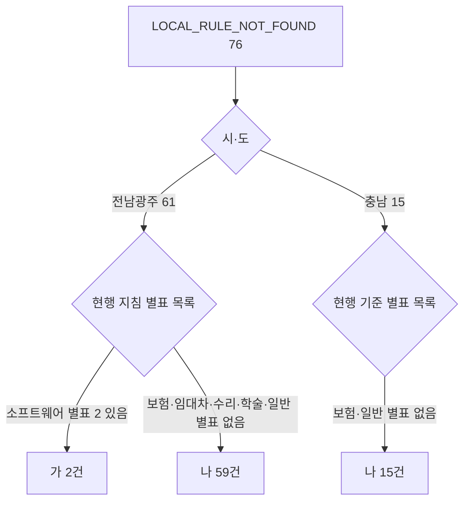

# LOCAL_RULE_NOT_FOUND 76건 시·도 현행 원문 별표 판정

> **작성일**: 2026-11-06
> **작업**: Orca Task `task_37e5545def8e` (builder, `run_8734173629f4`)
> **정본 사양**: `.orca/capsules/task_37e5545def8e/capsule.yaml` (`ORCA_TASK_CAPSULE_V2`)
> **작업 브랜치**: `kwanbum217/local76`
> **대상**: `LOCAL_RULE_NOT_FOUND` 114건 중 전남광주통합특별시 61건, 충청남도 15건(76건)
> **판정 기준**: 각 시·도의 현행 일반용역 적격심사 원문. (유형, 금액 구간) 조합 단위.
> **범위**: 조사 문서 한 건. 제품 코드·규칙·DB·원장을 바꾸지 않았다. 원문은 읽기만 했다.

---

## 1. 요약

### 1.1 조사 방법

2026-11-06 차단 분해 문서의 수집·판정과 같은 함수를 메모리에서 다시 돌렸다. 측정 창은 2025-11-06 ~ 2026-11-06, 업무구분 `Servc`, 낙찰방법 코드 `낙030001`, 공고번호·업무구분별 최신 차수다. 공고 31,348건에 서비스 판정 함수를 그대로 호출해 `LOCAL_RULE_NOT_FOUND` 이면서 시·도가 전남광주통합특별시 또는 충청남도인 76건을 골랐다([report_rule_coverage.py:417](../../scripts/report_rule_coverage.py), [evaluation_rules.py:2255](../../src/app/services/evaluation_rules.py)). DB 세션은 `SET SESSION TRANSACTION READ ONLY` 로 열어 `SELECT` 만 썼다.

용역 유형은 낙찰방법명(`sucsfbidMthdNm`)에서 `resolve_local_service_type` 이 돌려주는 값을 썼다([evaluation_rules.py:1952](../../src/app/services/evaluation_rules.py)). 금액 구간은 추정가격 기준 1억원 미만 / 1억~2억원 / 2억~5억원 / 5억~10억원 / 10억~30억원 / 30억원 이상으로 나눴다. 76건에서 나온 조합은 19개다.

라벨은 캡슐 정의를 그대로 쓴다.

- **(가)**: 현행 원문 별표에 해당 유형·띠가 있어 등록 가능. B·k·기준비율·T·하한율과 인용을 붙였다.
- **(나)**: 현행 원문에 해당 유형 별표가 없음. 별표 전체 목록과 조항 인용으로 부재를 뒷받침했다.
- **(다)**: 원문 미확보. 이번 조사에는 없다.

### 1.2 조합별 판정

| 시·도 | 유형 | 금액 구간 | 공고 수 | 라벨 | 값 |
| --- | --- | --- | ---: | --- | --- |
| 전남광주통합특별시 | 보험 (INSURANCE) | 1억원 미만 | 5 | (나) | 해당 없음(별표 없음) |
| 전남광주통합특별시 | 보험 (INSURANCE) | 1억~2억원 | 5 | (나) | 해당 없음(별표 없음) |
| 전남광주통합특별시 | 보험 (INSURANCE) | 2억~5억원 | 5 | (나) | 해당 없음(별표 없음) |
| 전남광주통합특별시 | 보험 (INSURANCE) | 5억~10억원 | 3 | (나) | 해당 없음(별표 없음) |
| 전남광주통합특별시 | 임대차 (LEASE) | 1억~2억원 | 1 | (나) | 해당 없음(별표 없음) |
| 전남광주통합특별시 | 임대차 (LEASE) | 2억~5억원 | 21 | (나) | 해당 없음(별표 없음) |
| 전남광주통합특별시 | 임대차 (LEASE) | 5억~10억원 | 6 | (나) | 해당 없음(별표 없음) |
| 전남광주통합특별시 | 수리·점검 (REPAIR_INSPECTION) | 1억원 미만 | 1 | (나) | 해당 없음(별표 없음) |
| 전남광주통합특별시 | 수리·점검 (REPAIR_INSPECTION) | 1억~2억원 | 7 | (나) | 해당 없음(별표 없음) |
| 전남광주통합특별시 | 수리·점검 (REPAIR_INSPECTION) | 2억~5억원 | 2 | (나) | 해당 없음(별표 없음) |
| 전남광주통합특별시 | 학술연구 (ACADEMIC) | 2억~5억원 | 2 | (나) | 해당 없음(별표 없음) |
| 전남광주통합특별시 | 일반 미확정 (GENERAL) | 1억~2억원 | 1 | (나) | 해당 없음(별표 없음) |
| 전남광주통합특별시 | 소프트웨어 (SW) | 1억~2억원 | 1 | (가) | B 80, k 20, 기준비율 88, T 95, 하한율 87.745% |
| 전남광주통합특별시 | 소프트웨어 (SW) | 2억~5억원 | 1 | (가) | B 70, k 4, 기준비율 88, T 95, 하한율 86.745% |
| 충청남도 | 보험 (INSURANCE) | 1억원 미만 | 3 | (나) | 해당 없음(별표 없음) |
| 충청남도 | 보험 (INSURANCE) | 1억~2억원 | 2 | (나) | 해당 없음(별표 없음) |
| 충청남도 | 보험 (INSURANCE) | 2억~5억원 | 3 | (나) | 해당 없음(별표 없음) |
| 충청남도 | 보험 (INSURANCE) | 10억~30억원 | 3 | (나) | 해당 없음(별표 없음) |
| 충청남도 | 일반 미확정 (GENERAL) | 1억~2억원 | 4 | (나) | 해당 없음(별표 없음) |

- 검산: 전남광주 61건(5+5+5+3+1+21+6+1+7+2+2+1+1+1), 충남 15건(3+2+3+3+4), 합계 76건이다.
- 라벨 합계: (가) 2개 조합 2건, (나) 17개 조합 74건, (다) 0건이다.

### 1.3 핵심 결과

1. **현행 원문에 해당 유형 별표가 있는 조합은 2개(2건)뿐이고, 둘 다 소프트웨어용역이다.** 전남광주통합특별시 현행 지침 별표 2가 1억~2억원 띠와 2억~5억원 띠를 덮는다.
2. **나머지 74건은 현행 원문에 해당 유형 별표 자체가 없다.** 보험·임대차·수리·점검·학술연구·일반(미확정) 조합이다. 전남광주 지침은 별표 1~7 중 6개가 시설·소프트웨어·폐기물·생활폐기물·육상운송·어장정화이고, 충남 기준도 시설·정보통신·폐기물·육상운송·해양환경·신용평가·신인도뿐이다.
3. **(가) 2건도 이번 차단을 바로 풀지 못한다.** 두 공고일(2025-11-21, 2026-04-09)이 현행 지침 시행일 2026-07-16 이전이다. 부칙 제3조에 따라 종전 기준이 적용된다.
4. **76건 중 현행 기준 시행일 이후 공고는 6건(전남광주)이고, 그 6건도 모두 유형 별표가 없는 조합이다.** 충남 15건은 모두 2026-07-13 이전 공고다.
5. **따라서 현행 원문만 수집·등록해서는 76건 중 계산 가능해지는 공고가 없다.** 이 사실은 사용자 결정 3의 선택지별 함의로 5절에 적었고, 결정은 내리지 않았다.

---

## 2. 원문 근거

### 2.1 전남광주통합특별시

- 원문: 자치법규정보시스템 `https://www.elis.go.kr/allalr/selectAlrBdtOne?alrNo=12000091007019&histNo=001`
- 법규명: 전남광주통합특별시 일반용역 적격심사 세부지침
- 제정·시행: 2026-07-01 예규 제3호, 시행 2026-07-16
- 수집본: `.cache/local114/raw/jeonnamgwangju.html`, 136,651 bytes, sha256 `d39a47fd72d3be2d8fea3b382cc736397d229af6275fa57f3a84ae0a3f4ae57b` (커밋하지 않음)

**별표 목록(원문 인용)**

> 별표
> (별표 1) 시설분야용역 적격심사
> (별표 2) 소프트웨어용역 적격심사
> (별표 3) 폐기물처리용역 적격심사
> (별표 4) 생활폐기물 수집·운반 대행용역 적격심사
> (별표 5) 육상운송용역 적격심사
> (별표 6) 어장정화·정비용역 적격심사
> (별표 7) 신인도 평가기준

**적용 범위(제2조 제1호)**

> "일반용역"이란 「지방자치단체 입찰 및 계약집행기준」에서 규정한 기술용역과 학술용역을 제외한 나머지 모든 종류의 용역(시설분야용역, 소프트웨어용역, 폐기물처리용역, 생활폐기물 수집·운반 대행용역, 육상운송용역, 어장정화·정비용역)을 총칭한다.

**심사기준(제4조 제1항)**

> ① 용역별 적격심사 항목 및 배점한도는 다음 각 호에 따른다. 다만, 다음 각 호에 해당하지 않는 용역은 해당 용역의 내용과 평가기준 등을 고려하여 각 호의 어느 하나의 평가기준을 선택하여 적용할 수 있으며, 용역의 특성에 따라 평가기준의 일부를 조정할 필요가 있는 경우에는 입찰공고 등에 그 내용을 별도로 명시하여 달리 정할 수 있다.
> 1. 시설분야용역 평가기준: 별표 1
> 2. 소프트웨어용역 평가기준: 별표 2
> 3. 폐기물처리용역 평가기준: 별표 3
> 4. 생활폐기물 수집·운반 대행용역 평가기준: 별표 4
> 5. 육상운송용역 평가기준: 별표 5
> 6. 어장정화·정비용역 평가기준: 별표 6

**통과점수(제8조 제1항)**

> 종합평점이 추정가격 30억 원 이상 용역은 85점 이상, 30억 원 미만 10억 원 이상인 용역은 90점 이상, 10억 원 미만인 용역은 95점 이상인 자를 낙찰자로 결정한다. 다만, 시설분야용역의 경우 추정가격에 상관없이 95점 이상인 자를 낙찰자로 결정한다.

**그 밖의 사항(제11조 제1항)**

> 이 지침에 정하지 아니한 사항은 「지방자치단체를 당사자로 하는 계약에 관한 법률」, 「지방자치단체 입찰시 낙찰자 결정기준」, 「지방자치단체 입찰 및 계약집행기준」 등에서 정한 바에 따른다.

**부칙**

> 제1조(시행일) 이 예규는 2026년 7월 16일부터 시행한다.
> 제2조(다른 예규의 폐지) 이 예규 시행과 동시에 다음 각 호의 예규는 폐지한다. 1. 광주광역시 일반용역 적격심사 세부 기준 2. 전라남도 일반용역 적격심사 세부기준
> 제3조(진행 중인 입찰 등에 관한 경과조치) 이 예규 시행 전에 종전의 「광주광역시 일반용역 적격심사 세부 기준」 및 「전라남도 일반용역 적격심사 세부기준」의 규정에 따라 진행 중인 입찰 및 적격심사 등 절차에 관하여는 종전의 기준을 적용한다.

**부재 근거**

- 별표 1~7의 제목 어디에도 보험·임대차·수리·점검·학술연구·정보통신·일반용역 별표가 없다.
- 추출 텍스트에서 `보험용역`, `임대차`, `수리ㆍ점검`, `수리·점검`, `정보통신` 문자열은 0회다.
- 학술연구는 제2조 제1호가 일반용역에서 명시적으로 제외한다.
- 일반(미확정)은 별표 1~6 어디에도 해당하지 않는다. 제4조 제1항 단서는 별표를 새로 두지 않고 계약담당자가 기존 별표 중 하나를 선택하거나 공고에 별도 기준을 명시하는 길만 둔다.

### 2.2 충청남도

- 원문: 충청남도 계약법령예규 게시글 `https://www.chungnam.go.kr/gyeyak/bbs/B0000503/view.do?nttId=2178921&menuNo=6700013`
- 첨부: `충청남도 일반용역 적격심사 세부기준(2026년).pdf`, 733,629 bytes, sha256 `d0bbd1b2e70457e328a154125eb69e228ec375d9fda3cce3cb9603aab1ff6ff3`
- 문서 머리말: 충청남도 공고 2026-1235호, 행정안전부 협의(2026. 06. 16.)
- 수집본: `.cache/local114/raw/chungnam_2026.pdf` (커밋하지 않음)

**별표 목록(제2절 제1호)**

> 가. 시설분야용역 평가기준 : [별표 1]
> 나. 정보통신용역 평가기준 : [별표 2] 또는 [별표 2의 1]
> 다. 폐기물처리용역 평가기준 : [별표 3]
> 라. 육상운송용역 평가기준 : [별표 4]
> 마. 해양환경관리 및 어장관리용역 평가기준 : [별표 5]

이 밖에 [별표 6] 신용평가, [별표 7] 신인도가 있다. [별표 2의 1]·[별표 2의1-1]·[별표 2의1-2]는 정보통신용역 중 중소기업자간 경쟁제품 대상 평가기준이다.

**다른 일반용역의 처리(제2절 제1호 아목)**

> 계약담당자는 용역의 특성·성질상 이 세부기준을 적용하기 곤란하다고 인정되는 다른 일반용역에 대하여는 입찰공고에 별도로 반영하여 심사한다.

**통과점수(제6절 제1호)**

> 종합평점이 85점(다만, 정보통신 용역의 중소기업자간 경쟁제품은 88점, 이하 "적격통과점수"라 한다) 이상인 자를 낙찰자로 결정한다.

**그 밖의 사항(제7절 제1호)**

> 이 세부기준에 정하지 아니한 사항은 관련법규와 지방계약 예규 등에 정한 바에 따른다.

**부칙**

> 이 세부기준은 행정안전부장관 협의 완료 후 2026년 7월 13일 입찰공고부터 적용한다.

**부재 근거**

- 별표 제목 전체에 보험·임대차·수리·점검·일반용역 별표가 없다. `보험용역`, `임대차`, `수리ㆍ점검`, `수리·점검` 문자열은 추출 텍스트에서 0회다. `보험`은 근로조건의 4대 사회보험 문맥에만 나온다.
- 일반(미확정) 조합은 제2절 제1호 아목의 "다른 일반용역" 처리 대상이다. 이 조항은 별표가 아니라 공고별 별도 반영 조항이다.
- 생활폐기물처리대행은 제2절 제1호 다목이 적용 대상에서 제외하고 시·군 조례로 돌린다.

### 2.3 소프트웨어 별표 2의 값

전남광주통합특별시 별표 2는 추정가격을 3개 띠로 나눈다. 76건의 두 소프트웨어 조합이 걸리는 띠의 값은 아래와 같다.

| 띠 | B(입찰가격 배점한도) | k(평점계수) | 기준비율 | T(통과점수) | 낙찰하한율 | 근거 |
| --- | ---: | ---: | ---: | ---: | ---: | --- |
| 2억원 미만 | 80 | 20 | 88 | 95 | 87.745% | 별표 2 1. 배점한도, 7. 입찰가격, 제8조 제1항 |
| 5억원 미만 2억원 이상 | 70 | 4 | 88 | 95 | 86.745% | 별표 2 1. 배점한도, 7. 입찰가격, 제8조 제1항 |

**원문 인용(별표 2, [별표 2] 소프트웨어용역 적격심사)**

> 5억원 미만 ~ 2억원 이상: 평점 = 70 - 4 × |88 - 입찰가격/예정가격 × 100|, 낙찰하한율 86.745%, 투찰율 89.25% 이상인 경우 평점은 65점으로 함
> 2억원 미만: 평점 = 80 - 20 × |88 - 입찰가격/예정가격 × 100|, 낙찰하한율 87.745%, 투찰율 88.25% 이상인 경우 평점은 75점으로 함
> 2. 입찰가격 50 / 70 / 80 (5억원 이상 / 5억원 미만~2억원 이상 / 2억원 미만)

- 첨부 원문: `(별표 2) 소프트웨어용역 적격심사.hwp`, 57,856 bytes, sha256 `4a66613facaac7405fbe7a17142d4e8d618d76e21c753fc9a8f35d5155007152`.
- 코드 등록값과 대조: `SERVC_LOCAL_JNGJ_20260716_ATTACH_02` 의 2억원 미만 B 80·k 20·하한율 87.745, 5억원 미만 2억원 이상 B 70·k 4·하한율 86.745 와 같다([evaluation_rules_local.py:1489](../../src/app/services/evaluation_rules_local.py)). 즉 이 두 조합은 별표 값이 이미 코드에 등록되어 있고, 차단 원인은 원문 부재가 아니라 공고일과 시행일의 관계 및 구판 미등록이다.

### 2.4 수집 정합성에 관한 사실

- 조사 중 `bid_announcement_regime` 에 충남 보령시 2건(`R25BK01229566`, `R25BK01252798`)의 첨부 판별 `MOIS_ACADEMIC` 행이 추가되었다(분류 시각 2026-11-06). 이 2건은 최신 DB 상태에서는 `LOCAL_RULE_NOT_FOUND` 가 아니라 행안부 학술연구 기준으로 판정된다.
- 이 문서의 76건은 착수 시점 `LOCAL_RULE_NOT_FOUND` 114건 구성(전남광주 61, 충남 15)을 그대로 유지한다. 위 2건도 그 15건에 포함해 판정했다. 최신 재수집에서는 충남이 13건으로 줄어든다.
- 두 건 모두 충남 일반(미확정) 1억~2억원 조합의 대표 후보가 아니며(대표는 태안군 `R26BK01481966`), 조합 라벨 (나)는 나머지 2건만으로도 성립한다.

---

## 3. 조합별 대표 공고

각 조합에서 추정가격이 가장 낮은 공고를 대표로 적었다. 공고번호 뒤 괄호는 차수다.

| 시·도 | 유형 | 금액 구간 | 대표 공고번호 | 수요기관 | 추정가격(원) | 공고일 | 낙찰방법명 |
| --- | --- | --- | --- | --- | ---: | --- | --- |
| 전남광주통합특별시 | 보험 | 1억원 미만 | R26BK01461498 (000) | 전남광주통합특별시 순천시 | 29,624,010 | 2026-04-13 | 보험용역 적격심사 추정가격 5억원미만 |
| 전남광주통합특별시 | 보험 | 1억~2억원 | R26BK01442071 (000) | 전남광주통합특별시 무안청사 | 106,569,903 | 2026-04-03 | 보험용역 적격심사 추정가격 5억원미만 |
| 전남광주통합특별시 | 보험 | 2억~5억원 | R26BK01737632 (000) | 전남광주통합특별시 영암군 | 217,000,000 | 2026-09-21 | 보험용역 적격심사 추정가격 5억원미만 |
| 전남광주통합특별시 | 보험 | 5억~10억원 | R26BK01325001 (000) | 전남광주통합특별시 순천시 | 834,996,400 | 2026-02-10 | 보험용역 적격심사 추정가격 5억원이상 |
| 전남광주통합특별시 | 임대차 | 1억~2억원 | R26BK01673847 (000) | 전남광주통합특별시교육청 전남광주통합특별시무안교육지원청 | 138,292,636 | 2026-08-10 | 임대차 적격심사 추정가격 고시금액 미만 |
| 전남광주통합특별시 | 임대차 | 2억~5억원 | R25BK01230433 (000) | 전남광주통합특별시교육청 전남광주통합특별시강진교육지원청 | 294,573,818 | 2025-12-15 | 임대차 적격심사 추정가격 고시금액 이상 |
| 전남광주통합특별시 | 임대차 | 5억~10억원 | R26BK01259130 (000) | 전남광주통합특별시교육청 전남광주통합특별시무안교육지원청 | 582,528,000 | 2026-01-05 | 임대차 적격심사 추정가격 고시금액 이상 |
| 전남광주통합특별시 | 수리·점검 | 1억원 미만 | R26BK01409049 (000) | 전남광주통합특별시 무안청사 | 77,494,545 | 2026-03-19 | 수리ㆍ점검용역 적격심사 고시금액 미만 |
| 전남광주통합특별시 | 수리·점검 | 1억~2억원 | R26BK01526836 (000) | 전남광주통합특별시 무안청사 | 118,418,182 | 2026-05-15 | 수리ㆍ점검용역 적격심사 고시금액 미만 |
| 전남광주통합특별시 | 수리·점검 | 2억~5억원 | R26BK01498215 (000) | 전남광주통합특별시 완도군 | 214,493,636 | 2026-04-29 | 수리ㆍ점검용역 적격심사 고시금액 미만 |
| 전남광주통합특별시 | 학술연구 | 2억~5억원 | R26BK01505521 (001) | 전남광주통합특별시교육청 전남광주통합특별시장성교육지원청 | 224,681,818 | 2026-05-08 | 학술연구용역 적격심사 추정가격 고시금액 미만 |
| 전남광주통합특별시 | 일반 미확정 | 1억~2억원 | R26BK01506722 (002) | 전남광주통합특별시 북구 | 136,981,818 | 2026-05-07 | 추정가격 2억미만 1억이상 |
| 전남광주통합특별시 | 소프트웨어 | 1억~2억원 | R25BK01171487 (000) | 전남광주통합특별시 서구 | 151,083,655 | 2025-11-21 | 소프트웨어용역(중소기업자간 경쟁제품 비대상) 추정가격 고시금액미만 |
| 전남광주통합특별시 | 소프트웨어 | 2억~5억원 | R26BK01454418 (000) | 전남광주통합특별시 광주청사 | 324,000,000 | 2026-04-09 | 소프트웨어용역(중소기업자간 경쟁제품 비대상) 적격심사 추정가격 5억원 미만-추정가격 고시금액이상 |
| 충청남도 | 보험 | 1억원 미만 | R26BK01458695 (000) | 충청남도 아산시 농업기술센터 | 44,387,940 | 2026-04-13 | 보험용역 적격심사 추정가격 5억원미만 |
| 충청남도 | 보험 | 1억~2억원 | R26BK01271811 (000) | 충청남도 예산군 | 100,000,000 | 2026-01-13 | 보험용역 적격심사 추정가격 5억원미만 |
| 충청남도 | 보험 | 2억~5억원 | R26BK01272428 (000) | 아산시시설관리공단 | 267,547,800 | 2026-01-13 | 보험용역 적격심사 추정가격 5억원미만 |
| 충청남도 | 보험 | 10억~30억원 | R26BK01361650 (000) | 충청남도 당진시 | 1,056,108,920 | 2026-02-27 | 보험용역 적격심사 추정가격 5억원이상 |
| 충청남도 | 일반 미확정 | 1억~2억원 | R26BK01481966 (001) | 충청남도 태안군 | 105,000,000 | 2026-04-22 | 추정가격 2억미만 1억이상 |

---

## 4. 등록 시 주의

1. **시행일이 판정과 등록의 경계를 가른다.** 전남광주통합특별시 현행 지침은 2026-07-16, 충청남도 현행 기준은 2026-07-13 시행이다. 76건 중 이 날짜 이후 공고는 전남광주 6건뿐이고 충남은 0건이다. 나머지 70건에는 종전 기준이 적용된다(전남광주 부칙 제3조, 충남 부칙).
2. **(가) 두 조합은 값이 원문에 있지만 이번 차단을 풀지 못한다.** 두 공고(`R25BK01171487`, `R26BK01454418`) 모두 현행 지침 시행 전 공고다. 현행 별표 2를 등록해도 부칙 제3조 때문에 이 공고에는 적용할 수 없다. 종전 전라남도·광주광역시 기준의 별표 유무는 이 문서의 판정 범위가 아니다.
3. **(나) 17개 조합은 별표를 새로 만들지 않는 한 등록 대상이 없다.** 보험·임대차·수리·점검·학술연구·일반(미확정) 별표가 현행 원문에 없다. 전남광주 제4조 제1항 단서와 충남 제2절 제1호 아목은 기존 별표 선택 또는 공고별 별도 기준만 허용한다.
4. **학술연구는 전남광주 지침의 적용 대상이 아니다.** 제2조 제1호가 일반용역에서 학술용역을 제외한다. 충남은 별표 목록에 학술연구가 없고, 첨부 판별로 행안부 학술연구 기준에 배정되는 경우가 있다.
5. **일반(미확정)은 유형 표기가 없는 공고다.** 낙찰방법명이 `적격심사제-추정가격 2억미만 1억이상` 처럼 금액 구간만 표기한다. 전남광주 1건(북구 실태조사), 충남 4건(태안 위험성평가, 서천·보령 지역역량강화 등)이다. 이 중 보령 2건은 조사 중 첨부 판별 갱신으로 행안부 학술연구 기준에 배정되었다(2.4절).
6. **전남광주 현행 지침의 준용 조항은 조달청 기준을 명시하지 않는다.** 제11조 제1항의 준용 대상은 지방계약법·지방자치단체 입찰시 낙찰자 결정기준·지방자치단체 입찰 및 계약집행기준이다. 구 전라남도 예규 제1075호 제11조가 조달청 일반용역 적격심사 세부기준을 명시했던 것과 다르므로, 과거 조사 문구를 그대로 옮기지 않았다.
7. **값은 원문 인쇄값만 적었다.** 소프트웨어 별표 2의 B·k·기준비율·낙찰하한율은 별표 표와 산식에, T는 제8조 제1항에 인쇄되어 있다. 코드 등록값(`SERVC_LOCAL_JNGJ_20260716_ATTACH_02`)과 일치함을 대조만 했다.
8. **이 문서는 코드·규칙·원장을 고치지 않았다.** `.cache/` 수집본은 커밋하지 않는다.

---

## 5. 사용자 결정 3 선택지별 함의

2026-11-06 차단 분해 문서 5절의 선택지는 (가) 114건 전량 원문 수집, (나) 상위 시·도만 수집, (다) 현 사용자 입력 경로 유지다. 이 절의 (가)·(나)·(다)는 사용자 결정 3의 선택지이고, 1~4절의 (가)·(나)는 원문 판정 라벨이다. 이 문서는 그 결정을 내리지 않고, 76건 판정 결과가 각 선택지에 갖는 함의만 적는다.

| 선택지 | 76건에 대한 함의 |
| --- | --- |
| (가) 114건 전량 원문 수집 | 76건 중 현행 원문에 유형 별표가 있는 조합은 2개(2건)뿐이고, 그 2건도 시행일 이전 공고다. 나머지 74건은 유형 별표가 없어 수집만으로 등록할 수 없다. 114건 전체로 보면 이 문서 범위 밖 38건(대구 6, 광주 4, 전남 4, 세종 3, 시·도 미상 21)이 남는다. |
| (나) 상위 시·도만 수집 | 전남광주 61건·충남 15건의 판정 결과는 (가)와 같다. 두 시·도만으로는 76건 중 현행 별표로 계산 가능한 공고가 0건이다. 나머지 38건은 별도 판정이 필요하다. |
| (다) 현 사용자 입력 경로 유지 | 76건은 `LOCAL_RULE_NOT_FOUND` 로 남고, 지방계약 입력 경로에서 B·k·기준비율·통과점수와 비가격 정량점수를 입력해 계산한다([evaluations.py:1862](../../src/app/api/v1/evaluations.py)). 원문 수집·등록 비용은 들지 않는다. |

- 세 선택지 모두 이 문서의 판정 라벨을 바꾸지 않는다. 선택지 (가)·(나)를 고르더라도 현행 원문에는 라벨 (나) 조합의 별표가 없고, 라벨 (가) 조합의 공고는 시행일 이전이다.
- 준용 확대(조달청 기준을 시·도 기준으로 끌어오기)는 "전남만 준용" 기존 결정을 바꾸는 일이므로 이 문서에서 제안하지 않는다.

---

## 6. 검증

- 원문 수집: 전남광주통합특별시 ELIS 상세 HTML과 별표 2 HWP, 충청남도 계약법령예규 게시글 PDF. sha256은 2.1·2.2·2.3절에 적었다.
- 텍스트 추출: HWP는 `scripts/extract_score_params.py` 의 `extract_document_text`, PDF는 `pdfplumber` 를 썼다. 새 라이브러리는 설치하지 않았다.
- 판정 재현: `scripts/report_rule_coverage.py` 의 수집·판정 함수를 메모리에서 호출해 공고 31,348건을 확인하고, 착수 시점 `LOCAL_RULE_NOT_FOUND` 114건 구성 중 전남광주 61건·충남 15건(76건)을 골랐다. 다만 2.4절의 첨부 판별 갱신 이후 최신 재수집의 `LOCAL_RULE_NOT_FOUND` 는 112건이고 충남은 13건이다.
- 문서 검증: `uv run pytest tests/test_validate_doc_links.py -q`, `python3 scripts/validate_agent_rules.py --quiet`.
- 잔여 토큰 확인: 문서 내 잔여 토큰 표식이 없음을 확인했다.
