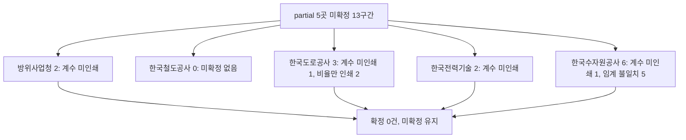

# R1 partial 5곳 미확정 구간 원문 추가 수집 보고서 (방위사업청·한국철도공사·한국도로공사·한국전력기술·한국수자원공사)

> **작성일**: 2026-10-13
> **작업**: Orca Task `task_c13dcef67638` (builder), Run `run_7815d8daf16a`, Dispatch `ctx_4d058fee3bce`
> **정본 사양**: `.orca/capsules/task_c13dcef67638/capsule.yaml` (`ORCA_TASK_CAPSULE_V2`)
> **기준 커밋**: `main` `98d06541`, 작업 브랜치 `kwanbum217/i1-partial-inst-sources` (`main` 직접 커밋 없음)
> **대상**: R1 명세 [institution_rules_20261013.yaml](../../data/reference/institution_rules_20261013.yaml) 의 `status=partial` 5곳
> **목적**: 5곳의 미확정 구간 원문을 웹·나라장터 공고 첨부에서 추가 수집하고, 확정할 수 있는 구간만 문서와 YAML 에 반영한다.
> **역할 경계**: 코드·설정·패키지를 변경하지 않았다. [evaluation_rules.py](../../src/app/services/evaluation_rules.py) 를 손대지 않았고, 기관 `status` 도 `confirmed` 로 바꾸지 않았다.
> **원문 취급**: 내려받은 파일은 `.cache/inst_sources/` 아래에만 두었고 커밋하지 않는다(`.cache` 는 gitignore 대상).
> **판정 규칙**: [20260930_servc_formula_recalc_kwater_koex.md](20260930_servc_formula_recalc_kwater_koex.md) 3절의 10개 규칙을 그대로 적용한다. 계수 생략 시 평탄 대입이 인쇄 점수와 맞을 때만 k=1 이고 평탄 문장이 없으면 k=1 로 두지 않는다(규칙 5). 대입값이 인쇄 점수와 0.01점이라도 다르면 미확정이다(규칙 7).

---

## 1. 결론

- **확정 0건**이다. 5곳 미확정 구간에 대해 웹·나라장터·행정규칙을 추가 수집했으나, 인쇄 근거를 새로 확보한 구간이 없다. YAML band 값과 기관 `status` 는 그대로 유지한다.
- 대상 구간 수: 방위사업청 2, 한국도로공사 3, 한국전력기술 2, 한국수자원공사 6. **한국철도공사는 YAML 에 미확정 band 가 없다**(승강기 점검보수 4구간 모두 확인).
- 미확정 원인은 세 갈래다. (1) 원문에 계수를 인쇄하지 않고 평탄 문장도 없다(규칙 5). (2) 원문이 비율만 인쇄하고 대응 점수를 인쇄하지 않는다(규칙 7). (3) 평탄 임계값과 인쇄 점수가 원문 소수점 조항으로 설명되지 않게 0.010~0.025점 어긋난다(규칙 7).
- 이 기관들의 나라장터 공고 첨부에는 자체 적격심사 별표(입찰가격 평점표)가 실리지 않는다. 추정가격 10억원 이상 방위사업청 공고는 모두 협상계약(제안서 평가)이고, 한국전력기술·한국수자원공사 공고 첨부는 공고서·제안요청서·영문요약서뿐이다.
- 현행판으로 재내려받은 한국수자원공사 40차 HWP 와 한국전력기술 HWPX 는 선행 세션이 쓴 파일과 sha256 이 같았다. 즉 현행판이 바뀌지 않았고 값도 종전과 같다.

---

## 2. 수집 경로와 방법

| 항목 | 값 |
| --- | --- |
| 웹 열람 | 웹 검색·문서 열람 도구, `curl -L -m 30` |
| 행정규칙 | 국가법령정보센터 `law.go.kr` (방위사업청예규 제1082호) |
| 나라장터 공고 | `scripts/db_readonly_query.py --sql` 로 `procurement.bid_announcements` 읽기 전용 조회, `raw_data` 의 `ntceSpecFileNm1~3` 파싱 |
| 본문 추출 | 저장소 `scripts/extract_score_params.py` 의 `extract_document_text` (HWPX·HWPML·바이너리 HWP). HWPX 수식은 표준 `zipfile` 로 `hp:script` 파싱. PDF 는 추출기 미지원 |
| 금지 준수 | 운영 DB 쓰기·docker 조작 없음, 새 Python 라이브러리 추가 없음, 요청 간 1초 대기 |

내려받은 파일과 sha256:

| 파일 | 형식 | 크기(byte) | sha256 | 비고 |
| --- | --- | ---: | --- | --- |
| `.cache/inst_sources/kwater_40ch.hwp` | HWP 5.x | 142,336 | `0b6f17f6f05e1511443d07b2665949eeb6cc359635d58c515e1f646ace397695` | [institution_formula_unresolved_20261012.md](institution_formula_unresolved_20261012.md) 2.1절 40차 해시와 일치 |
| `.cache/inst_sources/kwater_38ch.pdf` | PDF 1.4, 30쪽 | 585,761 | `e9b383e9b056e68bc0f99ed7530669be5876d50c768987119cbbbd8a5233f0a7` | 같은 문서 2.1절 38차 해시와 일치 (기관 도메인 원본) |
| `.cache/inst_sources/kepcoec_dtl3164.bin` | HWPX | 247,841 | `780ab4b1fb048f03aa984fd6a2a8dfbad4ed97f7d499530e9ab6ffdd9ead5574` | [servc_formula_collection_energy_20261004.md](servc_formula_collection_energy_20261004.md) 3.1절 원본 해시와 일치 |
| `.cache/inst_sources/korail_tech_22.hwp` | HWP 5.x | 50,688 | `ef615e3b06cdbd42d402387e368686429cd367af5dabf76a1087a9ba4e5b2e80` | 이번에 처음 내려받은 한국철도공사 자체 기술용역 기준(개정 2022-01-24) |

---

## 3. 기관별 시도 경로와 결과

| 기관 | 시도 경로 | 응답 | 결과 |
| --- | --- | --- | --- |
| 방위사업청 | 국가법령정보센터 `law.go.kr/LSW/admRulLsInfoP.do?admRulSeq=2100000285258` | 200 | 예규 제1082호(시행 2026-09-21) 본문·별표 목록 확인. 별표 1 의 10억원 이상 행에 계수 자리가 없음 |
| 방위사업청 | 나라장터 Servc 2025-01-01 이후 69건 중 추정가격 10억원 이상 5건 | 200 (DB) | 모두 협상계약. 자체 적격심사 별표 첨부 없음 |
| 한국철도공사 | 나라장터 Servc 2025-01-01 이후(모기관 접두 `한국철도공사%`) | 0건 | 자체 별표 첨부 없음 |
| 한국철도공사 | 티비드 게시글 `tbid.co.kr/www/board/notice?B_KEY=2268` | 200 | 자체 「기술용역적격심사 세부기준」(개정 2022-01-24) 첨부 확보·검산 |
| 한국도로공사 | 나라장터 Servc 2025-01-01 이후(모기관 접두 `한국도로공사%`) | 0건 (자회사 2곳만 존재) | 자체 별표 첨부 없음 |
| 한국도로공사 | 검색으로 현행 2022-10-01 판 미러 확인 | 200 | 상업·교육 게시글 첨부만 있고 기관 도메인 원문 아님(규칙 1 단서). 별표 1-1 계수·평탄 미인쇄, 별표 2 비율만 인쇄 |
| 한국전력기술 | `kepco-enc.com` 사전정보공표 HWPX(최종공포 2025-08-20) 재내려받아 수식 추출 | 200 | 별표 1-1·1-5 모두 계수 미인쇄, 평탄 문장 없음 |
| 한국전력기술 | 나라장터 Servc 2025-01-01 이후 | 1건 | 첨부는 제안요청서·과업지시서뿐. 자체 별표 없음 |
| 한국수자원공사 | `ebid.kwater.or.kr` 38차 PDF, 미러 40차 HWP 재내려받아 본문 확인 | 200 | 40차 평탄 문장·인쇄 점수가 종전과 동일. 별표 7의1 계수 미인쇄 |
| 한국수자원공사 | 나라장터 Servc 2025-01-01 이후 | 4건 | 첨부는 공고서·영문요약서 등. 자체 별표 없음 |

---

## 4. 기관별 미확정 구간 판정

### 4.1 방위사업청 (2구간)

명세에 반영된 미확정 band 는 아래 두 행이다. 두 행은 원문 별표 1 의 같은 "10억원 이상" 행을 제9조① 통과점수 경계로 나눈 것이다.

| band | B | k | 기준비율 | 통과점수 | 하한율 | 판정 |
| --- | ---: | ---: | ---: | ---: | ---: | --- |
| 별표 1 · 10억원 이상 30억원 미만 용역 | 30 | 미확정 | 88 | 90 | `null` | 미확정 |
| 별표 1 · 30억원 이상 용역 | 30 | 미확정 | 88 | 85 | `null` | 미확정 |

- 원문(예규 제1082호 별표 1)은 10억원 이상 입찰가격 산식을 `30-│(88/100 − 입찰가격/예정가격)×100│` 로 인쇄한다. 계수 자리가 없고, 같은 별표에 평탄 문장도 없다. 규칙 5에 따라 k=1 로 두지 않는다.
- 나라장터 2025-01-01 이후 방위사업청 추정가격 10억원 이상 용역 5건은 전부 협상에 의한 계약(제안서 평가)이라 적격심사 별표가 붙지 않았다. 선행 세션 [servc_formula_resolve_daegu_dapa_gg_20261005.md](servc_formula_resolve_daegu_dapa_gg_20261005.md) 4절의 판정과 같다.
- 새 근거 없음. **미확정 유지**.

### 4.2 한국철도공사 (미확정 구간 없음)

- 명세의 bands 는 승강기 점검보수용역 한정 4구간이고 모두 `status: confirmed` 다. 미확정 band 가 없다.
- 이번에 처음 확보한 자체 「기술용역적격심사 세부기준」(개정 2022-01-24)의 붙임 1 은 4구간을 인쇄한다. 참고로 검산하면 아래와 같이 대입값이 인쇄 점수와 모두 일치한다.

| 적용 구간(추정가격) | B | k | 기준 | 평탄 문장(원문) | 통과점수 | 인쇄 점수 | 대입값 |
| --- | ---: | ---: | ---: | --- | ---: | ---: | --- |
| 10억원 이상 | 30 | 1(계수 생략) | 88 | `100분의 96이상인 경우의 평점은 22점으로 한다` | 92 | 22 | 30 − 1×8 = 22.000 |
| 10억원 미만 5억원 이상 | 50 | 2 | 88 | `100분의 90.5이상인 경우의 평점은 45점으로 한다` | 95 | 45 | 50 − 2×2.5 = 45.000 |
| 5억원 미만 고시금액 이상 | 70 | 4 | 88 | `100분의 89.25이상인 경우의 평점은 65점으로 한다` | 95 | 65 | 70 − 4×1.25 = 65.000 |
| 고시금액 미만 | 90 | 20 | 88 | `100분의 88.25이상인 경우의 평점은 85점으로 한다` | 95 | 85 | 90 − 20×0.25 = 85.000 |

- 다만 이 표는 **YAML 이 다루는 승강기 점검보수용역과 다른 용역 유형**이고, 확보 경로가 상업 게시판 첨부이며(규칙 1: 상업 페이지 계수는 옮기지 않는다), 현행 판본은 상업 게시판 표제로 2026-02-27 개정 단서만 확인되어 2022-01-24 판을 현행으로 단정할 수 없다. 따라서 이번 작업에서 기술용역 bands 를 YAML 에 추가하지 않는다.
- 기존 승강기 4구간의 확정 상태와 기관 `status: partial` 을 유지한다.

### 4.3 한국도로공사 (3구간)

| band | B | k | 기준비율 | 통과점수 | 원문 인쇄 점수 | 판정 |
| --- | ---: | ---: | ---: | ---: | --- | --- |
| 별표 1-1 일반용역 10억원 이상 | 30 | 미확정 | 88 | 85 | 인쇄 없음 | 미확정(규칙 5) |
| 별표 2 시설분야용역 고시금액 이상 | 70 | 60 | 88 | 85 | 인쇄 없음 | 미확정(규칙 7) |
| 별표 2 시설분야용역 고시금액 미만 | 80 | 60 | 88 | 85 | 인쇄 없음 | 미확정(규칙 7) |

- 현행 2022-10-01 판 원문은 기관 전자조달(`ebid.ex.co.kr`, 로그인·인증서)에서 도달하지 못했고, 나라장터 모기관 Servc 공고도 0건이다. 접근 가능한 2019-04-05·2020-04-01·2022-10-01 판본은 별표 1-1 에 계수·평탄 문장이 없고, 별표 2 는 `88.25% 평점으로 함` 이라는 비율만 인쇄하고 점수를 인쇄하지 않는다(선행 [institution_formula_g2b_attachment_sweep_20261012.md](institution_formula_g2b_attachment_sweep_20261012.md) 4·5절).
- 새 근거 없음. **미확정 유지**.

### 4.4 한국전력기술 (2구간)

| band | B | k | 기준비율 | 통과점수 | 판정 |
| --- | ---: | ---: | ---: | ---: | --- |
| 별표 1-1 기술용역 10억원 이상 | 30 | 미확정 | 88 | 85 | 미확정(규칙 5) |
| 별표 1-5 수주계약 하도급 조건 | 40 | 미확정 | 92 | 92 | 미확정(규칙 5) |

- 현행 HWPX(최종공포 2025-08-20)를 재내려받아 수식 개체를 추출한 결과, 별표 1-1 은 `30-│(88/100 − 입찰가격/예정가격)×100│`, 별표 1-5 는 `40-│(92/100 − 입찰가격/예정가격)×100│` 로 인쇄된다. 두 행 모두 계수가 없고 평탄 문장도 없다.
- 문서 전체에서 평탄 문장은 별표 1-2(`95.5% 이상 35점`)와 별표 1-4(`88.75% 이상 75점`) 두 곳뿐이며, 대상 두 행에는 없다.
- 나라장터 2025-01-01 이후 한국전력기술(주) Servc 1건의 첨부도 제안요청서·과업지시서뿐이어서 보강 근거가 없다.
- 새 근거 없음. **미확정 유지**.

### 4.5 한국수자원공사 (6구간)

| band | B | k | 기준비율 | 통과점수 | 인쇄 임계값 | 인쇄 점수 | 대입값 | 판정 |
| --- | ---: | ---: | ---: | ---: | ---: | ---: | ---: | --- |
| 별표 5 학술연구용역 | 40 | 2 | 88 | 85 | 95.495 | 25 | 25.010 | 미확정(규칙 7) |
| 별표 6 시설분야용역 | 60 | 5 | 91 | 85 | 93.995 | 45 | 45.025 | 미확정(규칙 7) |
| 별표 7의1 기타용역 10억원 이상 | 30 | 미확정 | 88 | 85 | 없음 | 인쇄 없음 | 산출 불가 | 미확정(규칙 5) |
| 별표 7의2 기타용역 10억원 미만 5억원 이상 | 50 | 2 | 88 | 85 | 95.505 | 35 | 34.990 | 미확정(규칙 7) |
| 별표 7의3 기타용역 5억원 미만 고시금액 이상 | 70 | 3 | 88 | 85 | 93.005 | 55 | 54.985 | 미확정(규칙 7) |
| 별표 8 기타용역 고시금액 미만 | 80 | 5 | 88 | 85 | 91.005 | 65 | 64.975 | 미확정(규칙 7) |

- 현행 40차(개정 2026-06-29, 시행 2026-06-30) HWP 를 재내려받아 본문을 확인했다. 별표 7의2·7의3·8 의 평탄 문장은 종전과 같게 `100분의 95.505% 이상 → 35점`, `100분의 93.005% 이상 → 55점`, `100분의 91.005% 이상 → 65점` 으로 인쇄되어, 대입값(34.990·54.985·64.975)과 인쇄 점수가 종전과 같은 폭으로 어긋난다.
- 별표 5·6 의 평탄 문장(`예정가격의 95.495% 이상 → 25점`, `93.995% 이상 → 45점`)은 선행 문서가 38차 PDF·40차 HWP 로 인용한 값이며, 이번 40차 HWP 재추출에서는 표·수식 개체 추출 한계로 해당 구간 문장이 재현되지 않았다. 다만 재내려받은 40차 파일의 sha256 이 선행 세션과 같아 값은 동일하다.
- 별표 7의1 은 산식이 `30-│( )×100│` 로 계수 자리가 없고 평탄 문장도 없다(규칙 5).
- 나라장터 2025-01-01 이후 한국수자원공사 Servc 4건의 첨부에도 자체 별표가 없다.
- 새 근거 없음. **미확정 유지**.

---

## 5. YAML 반영

- band 값과 기관 `status` 는 바꾸지 않았다. 확정 근거가 없기 때문이다. 규칙 5·7 을 완화해 값을 만들지 않는다.
- partial 5곳의 `sources` 에 이번 재수집 근거 문서(본 문서)를 추가하고, `note` 에 2026-10-13 재수집 결과 한 줄을 덧붙였다.
- 확인 기관 10곳과 모든 band 값은 손대지 않았다. `status` 를 `confirmed` 로 바꾸지 않아 [institution_rules_apply_20261013.md](institution_rules_apply_20261013.md) 의 부분 기관 제외 동작과 `tests/test_institution_rules.py` 의 partial·unresolved 고정 시험이 그대로 유지된다.

---

## 6. 확인 불가·유의 사항

- **보안모듈·로그인 경로**: 한국도로공사 전자조달(`ebid.ex.co.kr`)은 로그인·인증서 기반이라 원문 자료실에 도달하지 못했다. 접속 실패는 문서 부재의 증거가 아니다(규칙 9).
- **HWP 추출 한계**: 40차 HWP 재추출에서 별표 5·6 의 평탄 문장이 재현되지 않았다. sha256 이 선행 세션과 같으므로 값은 선행 문서 인용을 유지한다.
- **상업·교육 게시글**: ebei, tbid, modoobid, igunsul 등은 원문 대체가 아니며 규칙 1에 따라 계수를 옮기지 않았다. 제목·날짜 단서로만 썼다.
- **한국철도공사 기술용역 bands**: 위 4.2절 표는 참고용이며 YAML 에 반영하지 않았다. 현행 판본(2026-02-27 개정 단서)과 상업 게시판 출처 때문이다.
- **본 문서 범위**: 미확정 3곳(한국토지주택공사·한전 전력연구원·한전KPS)은 `status=unresolved` 라 이번 대상이 아니다.

---

## 7. 검증

| 항목 | 값 |
| --- | --- |
| 규칙 검증 | `python3 scripts/validate_agent_rules.py --quiet` |
| 문서·시험 | `uv run pytest tests/test_validate_doc_links.py tests/test_institution_rules.py -q` |
| YAML 파싱 | `python3 -c "import yaml; yaml.safe_load(open('data/reference/institution_rules_20261013.yaml'))"` |
| 코드 변경 | 없음. `evaluation_rules.py`, 테스트, DB 스키마, Meilisearch 색인, Docker 관련 파일 미변경 |
| 변경 파일 | `docs/analysis/partial_institution_sources_20261013.md`, `data/reference/institution_rules_20261013.yaml` |
| 작업 브랜치 | `kwanbum217/i1-partial-inst-sources` (`main` 직접 커밋 없음) |

---

## 8. 참고

- [institution_rules_20261013.yaml](../../data/reference/institution_rules_20261013.yaml) — R1 기관 산식 명세
- [institution_rule_inventory_20261013.md](institution_rule_inventory_20261013.md) — 기관별 인벤토리와 상태
- [institution_rules_apply_20261013.md](institution_rules_apply_20261013.md) — 확인 구간 코드 반영과 partial·unresolved 처리
- [institution_formula_unresolved_20261012.md](institution_formula_unresolved_20261012.md) — 수자원공사·도로공사 미확정 9행 재조사
- [institution_formula_g2b_attachment_sweep_20261012.md](institution_formula_g2b_attachment_sweep_20261012.md) — 나라장터 첨부 조사
- [servc_formula_resolve_daegu_dapa_gg_20261005.md](servc_formula_resolve_daegu_dapa_gg_20261005.md) — 방위사업청 10억원 이상 미확정 재판정
- [servc_formula_collection_central_20261004.md](servc_formula_collection_central_20261004.md) — 중앙부처·공단 9곳
- [servc_formula_collection_energy_20261004.md](servc_formula_collection_energy_20261004.md) — 에너지·공항 8곳(한국전력기술·한국수자원공사)
- [servc_formula_recover_b_20261005.md](servc_formula_recover_b_20261005.md) — 한국도로공사·한국철도공사 등
- [20260930_servc_formula_recalc_kwater_koex.md](20260930_servc_formula_recalc_kwater_koex.md) — 판정 규칙과 선행 재계산
