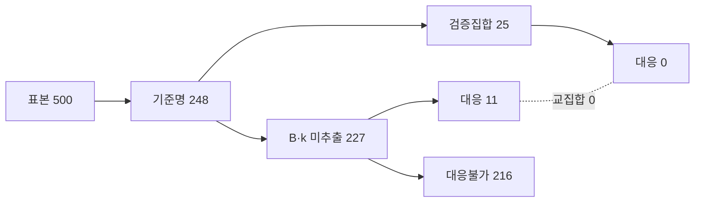
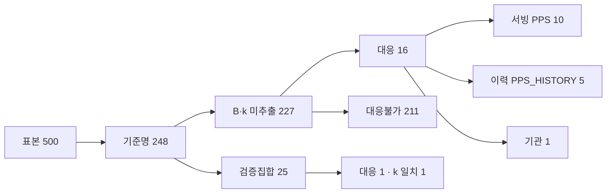

# 과거 용역 공고 기준명을 기존 적격심사 규칙에 대응시켜 B·k 를 채울 수 있는지 실측

> **작성일**: 2026-10-13
> **작업 브랜치**: `kwanbum217/c1-criteria-rule-map`
> **대상 파일**: `scripts/map_past_criteria_to_rules.py`, `tests/test_map_past_criteria_to_rules.py`
> **표본**: 2015~2024년 용역 적격심사제(`낙030001`) 공고 500건 (연도별 50건, 시드 `h1pilot20261013`)
> **선행 실측**: [bk_extract_improve_20261013.md](bk_extract_improve_20261013.md) (B·k 동시 23건, 기준명 248건)
> **판정**: 기준명이 뽑힌 B·k 미추출 227건 중 규칙 대응이 되는 것은 **11건(4.85%)** 입니다. 지배적 사유는 **규칙 레지스트리가 2023-05-01 이후만 담고 있어 그 이전 공고에는 시행 중인 규칙 자체가 없다**는 점(169건)입니다. 별표에서 실제 B·k 를 뽑은 검증 집합 25건과 대응 성공 11건은 **교집합이 0건**이라 일치율은 측정 불가(분모 0)입니다.

---

## 1. 질문과 배경

과거 용역 공고는 `sucsfbidMthdNm` 이 전부 `공고서참조` 자리표시자이고, 첨부에 적격심사 별표가 없어 B·k 를 못 뽑는 경우가 대부분입니다. 다만 [bk_extract_improve_20261013.md](bk_extract_improve_20261013.md) 의 표본 500건에서 **기준명**(예: `시설분야용역 적격심사`)이 추출된 공고가 248건 있습니다.

본 작업은 그 기준명과 **공고일·추정가격·수요기관**을 `src/app/services/evaluation_rules.py` 의 기존 규칙(조달청 PRE/POST, LOCAL, 기관)에 대응시켜 B·k·통과점수(T)·낙찰하한율을 채울 수 있는지 실측합니다. 운영 코드는 고치지 않았습니다.

핵심 질문은 셋입니다.

1. 기준명이 뽑힌 B·k 미추출 공고 중 몇 건이 기존 규칙에 대응되는가.
2. 대응된 결과가 별표에서 실제로 뽑은 B·k(검증 집합)와 일치하는가.
3. 전량(22.7만 건)에 적용하면 기대 효과가 얼마인가.

---

## 2. 방법

### 2.1 대응 절차

`scripts/map_past_criteria_to_rules.py` 는 다음 순서로 한 공고에 규칙 하나를 확정합니다.

1. **기준명 정규화**: 기준명 표기 변형 사전(`_CRITERIA_SERVICE_TYPES`)으로 용역 세부유형 집합을 뽑습니다. 조달청 규칙과 LOCAL·기관 규칙이 같은 용역을 다른 코드로 쓰므로 집합으로 둡니다(예: `소프트웨어용역` -> `SW_NON_SME`/`SW_SME`/`SW`).
2. **후보 우선순위**: 운영과 같은 순서로 **기관 > 시·도(LOCAL) > 조달청** 후보를 고릅니다. 기관 축은 `_axis_matches`(코드·이름·하위 조직), LOCAL 축은 수요기관명과 시·도명의 정확 일치입니다.
3. **미래 규칙 금지**: `date.fromisoformat(rule.effective_date) <= 공고일` 인 규칙만 남깁니다. 공고일보다 늦게 시행된 규칙은 절대 쓰지 않습니다.
4. **구간 확정**: 같은 유형 후보가 여럿이면 추정가격으로 하나를 고릅니다. LOCAL·기관은 `price_bands`, 조달청은 원문 표기의 구간 문구(`5억원 미만`, `고시금액 이상`, `2억원 미만 2억원 이상` 등)를 AND/OR 로 해석합니다.
5. **값 산출**: 확정 규칙에 `resolve_score_params` 를 적용해 B·k·T 를, 구간 하한율로 낙찰하한율을 구합니다.

### 2.2 왜 기준명을 낙찰방법명으로 그대로 넣지 않는가

운영 판별기 `resolve_evaluation_rule` 은 `match_rule_by_mthd_nm` 으로 별표를 고르는데, 조달청 규칙의 `patterns` 는 `시설분야용역 적격심사 추정가격 5억원 미만` 처럼 **구간 문구까지 포함**합니다. 과거 공고에는 이 구간 문구가 없고 기준명만 있으므로, 기준명을 그대로 넣으면 조달청 매칭은 `RULE_NOT_FOUND` 입니다. 그래서 이 스크립트는 **추정가격으로 구간을 보완한 뒤 서비스 유형으로 규칙을 고르는** 절차를 별도로 둡니다. LOCAL·기관 축 판정만 운영 헬퍼(`_axis_matches`, `_band_lwlt_rate`)를 그대로 재사용합니다.

### 2.3 검증 집합 정의

**검증 집합**은 파일럿 추출 CSV 에서 별표로부터 B 또는 k 를 실제로 뽑은 공고입니다(25건, 그중 B·k 동시 23건). 대응 결과가 검증 집합의 추출 후보(`1|2|4` 형태)에 드는지로 일치를 봅니다.

### 2.4 표본·산출물

표본은 [bk_extract_improve_20261013.md](bk_extract_improve_20261013.md) 와 동일한 SQL·시드로 다시 뽑고 첨부를 다시 받았습니다(요청 간 1초). 표본 수치(기준명 248, T 164, B 25, k 23, B·k 동시 23)가 그 보고서와 정확히 일치해 코퍼스 동일성을 확인했습니다. 산출 CSV 는 `.cache/past_notice_pilot/criteria_rule_map.csv`(커밋 대상 아님)입니다.

---

## 3. 결과

### 3.1 대응률

| 모집단 | 건수 | 대응 | 대응률 |
| --- | ---: | ---: | ---: |
| 표본 전체 | 500 | - | - |
| 기준명 추출 | 248 | - | - |
| **B·k 미추출 + 기준명 추출** | **227** | **11** | **4.85%** |

### 3.2 대응 범위·기준명별

| 구분 | 값 | 건수 |
| --- | --- | ---: |
| 범위 | 조달청(PPS) | 10 |
| 범위 | 기관(INSTITUTION) | 1 |
| 기준명 | 학술연구용역 적격심사 | 10 |
| 기준명 | 일반용역 적격심사 | 1 |

대응 11건은 전부 `학술연구용역`(조달청 제2023-53호 별표) 또는 `일반용역`(국토교통부훈령 제965호 별표, 대전지방국토관리청 하위 조직)입니다.

### 3.3 연도별 대응

| 연도 | 기준명 | 대응 | 비고 |
| ---: | ---: | ---: | --- |
| 2015 | 17 | 0 | 규칙 레지스트리 시작(2023-05-01) 이전 |
| 2016 | 27 | 0 | 동일 |
| 2017 | 19 | 0 | 동일 |
| 2018 | 31 | 0 | 동일 |
| 2019 | 23 | 0 | 동일 |
| 2020 | 23 | 0 | 동일 |
| 2021 | 24 | 0 | 동일 |
| 2022 | 23 | 1 | 국토교통부 기관 규칙(2018-01-04 시행) |
| 2023 | 21 | 3 | 학술연구용역(PRE_20230501) |
| 2024 | 19 | 7 | 학술연구용역(PRE_20230501) |
| **합계** | **227** | **11** | - |

대응은 2022~2024년에만 발생합니다.

### 3.4 대응 불가 사유 (216건)

| 사유 | 건수 | 설명 |
| --- | ---: | --- |
| 공고일 시점에 시행 중인 규칙이 없음(미래 규칙 미사용) | 169 | 규칙 레지스트리가 2023-05-01 이후만 담아 2015~2023-04 공고는 대응 규칙 부재 |
| LOCAL 규칙에 대응하는 용역 유형이 없음 | 20 | 수요기관이 시·도이나 기준명이 기술용역 등 LOCAL 미등록 유형 |
| PPS 규칙에 대응하는 용역 유형이 없음 | 14 | 일반용역(GENERAL)은 개정 후에만 규칙이 있어 개정 전 대응 없음 |
| 기준명에서 용역 세부유형을 확정하지 못함 | 9 | 기준명이 `적격심사세부기준` 등 일반 표기 |
| INSTITUTION 규칙에 대응하는 용역 유형이 없음 | 3 | 수요기관은 기관 규칙 대상이나 해당 유형 미등록 |
| 공고일보다 늦게 시행된 규칙만 존재 | 1 | 서울특별시 LOCAL 규칙(2024-08-12)이 공고일(2024-01-01 보다 늦음) |

`공고일 시점에 시행 중인 규칙이 없음` 은 "규칙이 아예 없음"과 "있지만 더 늦게 시행됨"을 미래 규칙 금지 규칙으로 구분한 결과이며, 후자는 마지막 한 건뿐입니다.

### 3.5 검증 집합과의 일치

| 항목 | 건수 |
| --- | ---: |
| 검증 집합(B 또는 k 추출) | 25 |
| 검증 집합 중 B·k 동시 | 23 |
| 검증 집합 중 대응 성공 | **0** |
| B 일치 | 0 |
| k 일치 | 0 |
| B·k 동시 일치 | 0 |

별표에서 B·k 가 나온 23건은 전부 **2015~2023-12** 공고이고, 그중 대응 가능 구간(2023-05-01 이후)에 드는 유일한 건(2023-12-06 일반용역)은 GENERAL 규칙이 개정 전에 없어 대응되지 않았습니다. 즉 **대응 성공 11건과 검증 집합 25건의 교집합이 0건**이므로, 일치율은 분모 0으로 측정 불가입니다.



### 3.6 대응 11건의 채운 값

| 연도 | 공고번호 | 기준명 | 추정가격 | 범위 | 규칙 | B | k | T | 하한율 |
| ---: | --- | --- | ---: | --- | --- | ---: | ---: | ---: | ---: |
| 2022 | 2022-10-21 | 일반용역 적격심사 | 63,036,364 | INSTITUTION | `SERVC_INST_MOLIT_20180104_GENERAL` | 70 | 20 | 95 | 87.745 |
| 2023 | 2023-09-13 | 학술연구용역 적격심사 | 1,287,246,363 | PPS | `SERVC_QUAL_PRE_20230501_ATTACH_07` | 60 | 2 | 85 | 80.495 |
| 2023 | 2023-10-11 | 학술연구용역 적격심사 | 410,000,000 | PPS | `SERVC_QUAL_PRE_20230501_ATTACH_07` | 70 | 2 | 85 | 80.495 |
| 2023 | 2023-10-27 | 학술연구용역 적격심사 | 707,090,909 | PPS | `SERVC_QUAL_PRE_20230501_ATTACH_07` | 60 | 2 | 85 | 80.495 |
| 2024 | 2024-02-20 | 학술연구용역 적격심사 | 453,900,000 | PPS | `SERVC_QUAL_PRE_20230501_ATTACH_07` | 70 | 2 | 85 | 80.495 |
| 2024 | 2024-07-22 | 학술연구용역 적격심사 | 181,818,182 | PPS | `SERVC_QUAL_PRE_20230501_ATTACH_06` | 70 | 4 | 85 | 84.245 |
| 2024 | 2024-09-03 | 학술연구용역 적격심사 | 41,227,273 | PPS | `SERVC_QUAL_PRE_20230501_ATTACH_06` | 70 | 4 | 85 | 84.245 |
| 2024 | 2024-09-30 | 학술연구용역 적격심사 | 3,193,636,364 | PPS | `SERVC_QUAL_PRE_20230501_ATTACH_07` | 60 | 2 | 85 | 80.495 |
| 2024 | 2024-10-10 | 학술연구용역 적격심사 | 17,310,467,273 | PPS | `SERVC_QUAL_PRE_20230501_ATTACH_07` | 60 | 2 | 85 | 80.495 |
| 2024 | 2024-12-04 | 학술연구용역 적격심사 | 380,363,636 | PPS | `SERVC_QUAL_PRE_20230501_ATTACH_07` | 70 | 2 | 85 | 80.495 |
| 2024 | 2024-12-18 | 학술연구용역 적격심사 | 1,567,100,000 | PPS | `SERVC_QUAL_PRE_20230501_ATTACH_07` | 60 | 2 | 85 | 80.495 |

학술연구용역은 고시금액(2023·2024년 2.2억) 미만이면 `ATTACH_06`(k=4), 이상이면 `ATTACH_07`(k=2)로 갈립니다.

---

## 4. 전량 적용 기대 효과

표본 선형 외삽입니다. 표본이 연도별 50건 균등이므로 연도 구성은 실제와 다를 수 있습니다.

| 항목 | 값 |
| --- | ---: |
| 전량(2015~2024 Servc 낙030001) | 227,588 |
| 표본 대응률 | 11 / 500 = 2.20% |
| 기대 대응 건수 | 약 **5,007건** |

기대 효과는 학술연구용역(2023~2024)과 국토교통부 계열 일반용역에 집중되며, 2015~2021년은 사실상 0건입니다. 대응 성공분은 별표 검증 집합과 겹치지 않아 별표 대조로 검증할 수 없습니다.

---

## 5. 판정

1. **기준명만으로 기존 규칙에 대응해 B·k 를 채우는 경로의 실효는 낮습니다.** 기준명이 뽑힌 B·k 미추출 227건 중 대응 11건(4.85%)입니다.
2. **주된 한계는 파서가 아니라 규칙 레지스트리의 시간 범위입니다.** 169건이 `공고일 시점에 시행 중인 규칙 없음` 으로, 규칙이 2023-05-01 이후만 담깁니다. 미래 규칙을 쓰지 않는다는 원칙 때문에 이 169건은 원리적으로 대응 불가입니다.
3. **검증 집합과 대응 성공 집합의 교집합이 0건입니다.** 별표에서 B·k 가 나온 23건은 2015~2023-12 인데 대응 가능 구간(2023-05-01 이후)에 드는 건이 없어, 일치율을 별표로 검증할 수 없습니다. 대응 성공분은 "새로 채운 값"일 뿐 검증된 값이 아닙니다.
4. **기술용역·일반용역이 최대 병목입니다.** 미추출 기준명 상위가 기술용역 126건·일반용역 75건인데, 레지스트리에 개정 전 기술용역 B·k 규칙과 개정 전 GENERAL 규칙이 없습니다. 기준명 대응을 늘리려면 규칙 자체를 확장해야 합니다.
5. **결론**: 이 경로만으로 전량 B·k 를 채우는 것은 기대하기 어렵습니다. 2015~2021년은 규칙 부재로 불가하고, 얻을 수 있는 것은 2023~2024 학술연구용역 중심 약 5천 건 규모입니다.

---

## 6. 재현

```sh
# 1) 표본 선정 (읽기 전용 DB, 시드 고정)
uv run python scripts/db_readonly_query.py \
    --sql-file .cache/past_notice_pilot/sample.sql --format json --limit 500 \
    > .cache/past_notice_pilot/sample_raw.json

# 2) 첨부 다운로드 + 기준명·B·k 추출 (요청 간 1초, 커밋 대상 아님)
uv run python scripts/pilot_past_notice_method_extract.py \
    --sample .cache/past_notice_pilot/sample_raw.json \
    --out-dir .cache/past_notice_pilot

# 3) 기준명 -> 규칙 대응 실측
uv run python scripts/map_past_criteria_to_rules.py \
    --sample .cache/past_notice_pilot/sample_raw.json \
    --pilot-results .cache/past_notice_pilot/sample_extract_results.csv \
    --out-csv .cache/past_notice_pilot/criteria_rule_map.csv
```

본 문서의 표는 결과 CSV 에서 재계산됩니다.

```sh
uv run python - <<'PY'
import csv
from collections import Counter
rows = list(csv.DictReader(open('.cache/past_notice_pilot/criteria_rule_map.csv', encoding='utf-8')))
crit = [r for r in rows if r['criteria_name']]
miss = [r for r in crit if not (r['extracted_B'] and r['extracted_k'])]
mapped = [r for r in miss if r['mapped'] == '1']
valid = [r for r in rows if r['extracted_B'] or r['extracted_k']]
print('표본', len(rows))
print('기준명', len(crit))
print('B·k 미추출+기준명', len(miss))
print('대응', len(mapped), round(len(mapped) / len(miss), 4))
print('검증집합', len(valid), '검증 대응', sum(1 for r in valid if r['mapped'] == '1'))
print('scope', Counter(r['scope'] for r in mapped))
print('criteria', Counter(r['criteria_name'] for r in mapped))
print('year', sorted(Counter(r['year'] for r in mapped).items()))
print('reasons', Counter(r['reason'] for r in miss if r['mapped'] == '0').most_common())
print('외삽', round(227588 * len(mapped) / len(rows)))
PY
```

측정 실행 시 위 코드의 출력은 다음과 같았습니다.

```text
표본 500
기준명 248
B·k 미추출+기준명 227
대응 11 0.0485
검증집합 25 검증 대응 0
scope Counter({'PPS': 10, 'INSTITUTION': 1})
criteria Counter({'학술연구용역 적격심사': 10, '일반용역 적격심사': 1})
year [('2022', 1), ('2023', 3), ('2024', 7)]
reasons [('공고일 시점에 시행 중인 규칙이 없음(미래 규칙 미사용)', 169), ('LOCAL 규칙에 대응하는 용역 유형이 없음', 20), ('PPS 규칙에 대응하는 용역 유형이 없음', 14), ('기준명에서 용역 세부유형을 확정하지 못함', 9), ('INSTITUTION 규칙에 대응하는 용역 유형이 없음', 3), ('공고일보다 늦게 시행된 규칙만 존재', 1)]
외삽 5007
```

시험은 합성 기준명으로 만든 단위 시험이며 네트워크·DB 를 쓰지 않습니다.

```sh
uv run pytest tests/test_map_past_criteria_to_rules.py -q
uv run pytest tests/ -q -m 'not data_assets'
uv run mypy src
python3 scripts/validate_agent_rules.py --quiet
```

---

## 7. 이력 레지스트리 반영 후 재측정

> **측정일**: 2026-10-13
> **작업 브랜치**: `kwanbum217/h3-history-registry`
> **추가·수정 파일**: `src/app/services/evaluation_rules_history.py`(생성물), `scripts/build_pps_history_rules.py`, `scripts/map_past_criteria_to_rules.py`, `tests/test_evaluation_rules_history.py`, `tests/test_map_past_criteria_to_rules.py`, `.github/workflows/ci.yml`
> **입력 명세**: [`data/reference/pps_servc_qual_history_2015_2022.yaml`](../../data/reference/pps_servc_qual_history_2015_2022.yaml) ([P2 명세 문서](pps_servc_qual_history_20261013.md))
> **표본**: 1~6장과 완전히 같은 500건(`.cache/past_notice_pilot/`, 시드 `h1pilot20261013`)
> **판정**: B·k 미추출 + 기준명 227건 중 대응이 **11건(4.85%) 에서 16건(7.05%)** 으로 늘었습니다. 늘어난 5건은 전부 **2023-01~04 학술연구용역** 이며, 3.5절에서 교집합 0건이라 측정할 수 없던 검증 집합 일치가 **k 일치 1건**으로 처음 생겼습니다.

### 7.1 무엇을 반영했나

서빙 레지스트리 [`src/app/services/evaluation_rules.py`](../../src/app/services/evaluation_rules.py) 는 **한 줄도 바꾸지 않았습니다.** 2015~2022 판을 그 튜플에 넣으면 낙찰방법명 패턴 탐색(`match_rule_by_mthd_nm`) 결과가 달라져 현행 공고 매칭이 흔들릴 수 있기 때문입니다. 대신 과거 공고 전용 이력 레지스트리를 새 모듈로 두었습니다.

| 구성 | 내용 |
| --- | --- |
| 이력 레지스트리 | `src/app/services/evaluation_rules_history.py`. P2 명세 YAML 을 frozen dataclass 상수로 옮긴 **생성물**이며, 서빙 경로는 이 모듈을 import 하지 않습니다. |
| 생성 스크립트 | `scripts/build_pps_history_rules.py`. YAML 만 읽어 모듈을 만들고, `--check` 로 커밋된 모듈과 대조합니다. 값을 추정하거나 파생하지 않습니다. |
| 조회 함수 | `resolve_history_band(notice_date, service_type, estimated_price, notice_amount_boundary)` -> 개정판·별표·구간의 B·k·기준비율·평탄비율·통과점수·하한율과 출처. 확정하지 못하면 `None` 과 사유를 돌려줍니다. |
| 대응 분기 | `scripts/map_past_criteria_to_rules.py` 는 공고일이 **2023-05-01 이전**이면 이력 레지스트리를, 이후면 기존 서빙 레지스트리를 씁니다. 기관·시·도(LOCAL) 후보는 두 구간 모두에서 먼저 검토되어 기존 우선순위가 유지됩니다. |

처리 규칙 넷입니다.

1. **시행 구간이 뒤집힌 제2016-48호는 조회에서 뺍니다.** 명세상 종료일(2016-04-30)이 시행일(2016-05-01)보다 앞섭니다. 같은 시행일의 제2016-51호가 그 구간을 담당하므로 라우팅에서 제외하고 사유를 `exclusion_reason` 에 남겼습니다.
2. **`고시금액` 경계는 근거가 있는 연도에만 풉니다.** 명세는 2019-31 판부터 구간 경계를 금액이 아니라 `고시금액` 으로 인쇄합니다. 저장소에 근거가 있는 값은 2022-42 판 구간(2023-01~04)에 쓰이는 **2023년 2.2억원**(`src/ml/notice_amount.py`, 기획재정부 고시 제2022-32호)뿐이며, 2019~2022년 값은 근거가 없어 상수로 두지 않고 조회 시 미확정으로 돌려줍니다. B 축과 평점산식 축의 경계가 다른 별표는 두 축을 따로 판정합니다.
3. **대상/비대상이 갈리는 별표는 기준명만으로 고르지 않습니다.** `소프트웨어용역 적격심사` 처럼 중소기업자간 경쟁제품 대상·비대상 별표가 둘 다 있는 경우 후보가 둘 이상이므로 모호로 남깁니다.
4. **B·k 구간 경계는 하한 이상·상한 미만**이며 경계값은 상위 구간에 듭니다.

### 7.2 대응률

| 모집단 | 건수 | 대응 | 대응률 | C1 대비 |
| --- | ---: | ---: | ---: | --- |
| 표본 전체 | 500 | - | - | - |
| 기준명 추출 | 248 | - | - | - |
| **B·k 미추출 + 기준명 추출** | **227** | **16** | **7.05%** | +5건 (+2.20%p) |

### 7.3 대응 범위·기준명별

| 구분 | 값 | 건수 | C1 대비 |
| --- | --- | ---: | --- |
| 범위 | 조달청 서빙(PPS) | 10 | 0 |
| 범위 | **조달청 이력(PPS_HISTORY)** | **5** | **+5** |
| 범위 | 기관(INSTITUTION) | 1 | 0 |
| 기준명 | 학술연구용역 적격심사 | 15 | +5 |
| 기준명 | 일반용역 적격심사 | 1 | 0 |

늘어난 5건은 전부 조달청 이력 축(`PPS_HISTORY`)의 학술연구용역입니다. 나머지 10건은 C1 과 같이 2023-09 이후 학술연구용역(서빙 `PRE_20230501`)과 2022년 국토교통부 일반용역(기관)입니다.

### 7.4 연도별 대응

| 연도 | 기준명 | 대응 | 비고 |
| ---: | ---: | ---: | --- |
| 2015 | 17 | 0 | 명세 첫 판 시행(2015-05-01) 이전 7건 + 기술용역·일반용역 |
| 2016 | 27 | 0 | 기술용역·일반용역뿐 |
| 2017 | 19 | 0 | 동일 |
| 2018 | 31 | 0 | 동일 |
| 2019 | 23 | 0 | 학술연구 1건이 `고시금액` 미상으로 남음 |
| 2020 | 23 | 0 | 동일 |
| 2021 | 24 | 0 | 폐기물 1건이 `고시금액` 미상으로 남음 |
| 2022 | 23 | 1 | 국토교통부 기관 규칙(2018-01-04 시행) |
| 2023 | 21 | **8** | 이력 5건(01~04월) + 서빙 3건(09월 이후) |
| 2024 | 19 | 7 | 학술연구용역(서빙 `PRE_20230501`) |
| **합계** | **227** | **16** | - |

### 7.5 대응 불가 사유 (211건)

| 사유 | 건수 | 설명 |
| --- | ---: | --- |
| 이력 레지스트리에 TECH 별표가 없습니다 | 95 | 기술용역은 조달청 일반용역 세부기준 제2조 1호가 제외하는 별도 고시 소관이라 이 명세 범위 밖 |
| 이력 레지스트리에 GENERAL 별표가 없습니다 | 61 | 명세에 일반용역 별표가 없음(서빙 레지스트리도 개정 후에만 GENERAL 규칙이 있음) |
| LOCAL 규칙에 대응하는 용역 유형이 없음 | 20 | 수요기관이 시·도이나 기준명이 LOCAL 미등록 유형 |
| PPS 규칙에 대응하는 용역 유형이 없음 | 14 | 2023-05-01 이후 공고의 일반용역(GENERAL) |
| 기준명에서 용역 세부유형을 확정하지 못함 | 9 | 기준명이 `적격심사세부기준` 등 일반 표기 |
| 공고일 시점에 시행 중인 이력 개정판이 없습니다 | 7 | 2015-01~04월 공고. 명세 첫 판 시행일이 2015-05-01 |
| INSTITUTION 규칙에 대응하는 용역 유형이 없음 | 3 | 수요기관은 기관 규칙 대상이나 해당 유형 미등록 |
| 공고일보다 늦게 시행된 규칙만 존재 | 1 | 서울특별시 LOCAL 규칙(2024-08-12)이 공고일보다 늦음 |
| 구간 경계가 고시금액인데 해당 연도 고시금액 근거가 없습니다 | 1 | 2021-12 폐기물. 2019~2022년 고시금액은 저장소에 근거 없음 |

C1 의 최대 사유였던 `공고일 시점에 시행 중인 규칙이 없음(미래 규칙 미사용)` 169건은 이력 레지스트리가 받아 95(TECH)·61(GENERAL)·7(개정판 없음)·1(고시금액 미상)·5(대응)로 갈라졌습니다. 남은 2019~2022년 미대응은 대부분 **기술용역·일반용역**이며, 이는 파서나 시간 범위가 아니라 명세·서빙 레지스트리 양쪽에 그 두 용역의 별표가 없기 때문입니다.

### 7.6 검증 집합과의 일치

별표에서 B 또는 k 를 실제로 뽑은 25건과 대응 결과를 대조했습니다.

| 항목 | C1 | 반영 후 |
| --- | ---: | ---: |
| 검증 집합(B 또는 k 추출) | 25 | 25 |
| 검증 집합 중 B·k 동시 | 23 | 23 |
| 검증 집합 중 대응 성공 | **0** | **1** |
| B 일치 | 0 | 0 |
| k 일치 | 0 | **1** |
| B·k 동시 일치 | 0 | **1** |

일치 1건은 2023-03-15 서울교통공사 학술연구용역 공고입니다. 별표에서 뽑은 값은 B 후보 `30`, k 후보 `1|2|20|4` 였고 이력 레지스트리는 2022-42 판 별표 1 에서 B `40`, k `2` 를 골랐습니다. **k 는 후보 집합에 들어 일치하지만 B 는 `40` 이 후보 `30` 에 없어 불일치**입니다. 교집합이 1건뿐이라 이 일치율로 이력 값을 검증했다고 말할 수는 없으며, "추출 후보와 겹치는 값이 생겼다"는 신호로만 읽습니다.



### 7.7 반영 5건의 채운 값

| 공고일 | 수요기관 | 추정가격 | 규칙 | B | k | T | 하한율 |
| --- | --- | ---: | --- | ---: | ---: | ---: | ---: |
| 2023-01-31 | 경기도건설본부 | 60,033,200 | `SERVC_QUAL_HIST_2022_42_ATTACH_01` | 70 | 4 | 85 | 84.245 |
| 2023-02-10 | 장수군 | 119,172,727 | `SERVC_QUAL_HIST_2022_42_ATTACH_01` | 70 | 4 | 85 | 84.245 |
| 2023-02-14 | 강서도로사업소 | 145,000,000 | `SERVC_QUAL_HIST_2022_42_ATTACH_01` | 70 | 4 | 85 | 84.245 |
| 2023-03-27 | 서산교육지원청 | 121,806,363 | `SERVC_QUAL_HIST_2022_42_ATTACH_01` | 70 | 4 | 85 | 84.245 |
| 2023-04-06 | 홍성군 | 165,454,545 | `SERVC_QUAL_HIST_2022_42_ATTACH_01` | 70 | 4 | 85 | 84.245 |

다섯 건 모두 추정가격이 2023년 고시금액(2.2억원) 미만이라 학술연구 별표 1 의 `고시금액 미만` 구간(B=70, k=4)에 듭니다. 2023-01~04월은 제2022-42호(시행 2022-02-11, 종료 2023-04-30)가 시행 중이었습니다.

### 7.8 서빙 불변

- `src/app/services/evaluation_rules.py` 는 `git diff` 가 비어 있습니다.
- `tests/test_evaluation_rules_pre.py`, `tests/test_evaluation_rules_scope_axis.py`, `tests/test_evaluation_scoring.py`, `tests/test_evaluations_api.py` 가 수정 전후 모두 통과합니다.
- 이력 레지스트리는 `scripts/` 만 import 하며, 서빙 판별기 `resolve_evaluation_rule` 은 이 모듈을 쓰지 않습니다.

### 7.9 한계

- 2019~2022년 고시금액은 저장소에 근거가 없어 상수로 두지 않았습니다. 그 구간의 `고시금액` 경계 별표(학술연구 B 축, 정보통신·소프트웨어·폐기물·육상운송 평점산식 축)는 미확정으로 남습니다.
- 명세의 B 축·평점산식 축이 다른 별표를 두 축으로 판정하지만, 대상/비대상이 갈리는 별표는 기준명만으로 확정하지 않습니다.
- 검증 집합 대응이 1건뿐이라 이력 값의 정확도를 별표 대조로 확증하지는 못했습니다. 값 자체는 생성 `--check` 로 명세와 1:1 대조됩니다.

### 7.10 재현

```sh
# 1) 명세 -> 이력 레지스트리 생성물 대조
uv run python scripts/build_pps_history_rules.py --check

# 2) C1 과 같은 표본으로 재측정 (첨부·결과는 .cache 재사용, 신규 요청 없음)
uv run python scripts/map_past_criteria_to_rules.py \
    --sample .cache/past_notice_pilot/sample_raw.json \
    --pilot-results .cache/past_notice_pilot/sample_extract_results.csv \
    --out-csv .cache/past_criteria_map_c1/criteria_rule_map_h3.csv

# 3) 시험·타입·규칙 검증
uv run pytest tests/test_evaluation_rules_history.py tests/test_map_past_criteria_to_rules.py -q
uv run pytest tests/ -q -m 'not data_assets'
uv run mypy src
python3 scripts/validate_agent_rules.py --quiet
```

본 절의 표는 결과 CSV 에서 재계산됩니다.

```sh
uv run python - <<'PY'
import csv
from collections import Counter
rows = list(csv.DictReader(open('.cache/past_criteria_map_c1/criteria_rule_map_h3.csv', encoding='utf-8')))
crit = [r for r in rows if r['criteria_name']]
miss = [r for r in crit if not (r['extracted_B'] and r['extracted_k'])]
mapped = [r for r in miss if r['mapped'] == '1']
valid = [r for r in rows if r['extracted_B'] or r['extracted_k']]
print('B·k 미추출+기준명', len(miss), '대응', len(mapped), round(len(mapped) / len(miss), 4))
print('scope', Counter(r['scope'] for r in mapped))
print('criteria', Counter(r['criteria_name'] for r in mapped))
print('history', [(r['bid_ntce_dt'], r['rule_id']) for r in mapped if r['scope'] == 'PPS_HISTORY'])
print('검증 대응', sum(1 for r in valid if r['mapped'] == '1'),
      'k 일치', sum(1 for r in valid if r['mapped'] == '1' and r['mapped_k'] and r['mapped_k'] in set(r['extracted_k'].split('|'))))
print('reasons', Counter(r['reason'] for r in miss if r['mapped'] == '0').most_common())
PY
```

측정 실행 시 출력은 다음과 같았습니다.

```text
B·k 미추출+기준명 227 대응 16 0.0705
scope Counter({'PPS': 10, 'PPS_HISTORY': 5, 'INSTITUTION': 1})
criteria Counter({'학술연구용역 적격심사': 15, '일반용역 적격심사': 1})
history [('2023-01-31', 'SERVC_QUAL_HIST_2022_42_ATTACH_01'), ('2023-02-10', 'SERVC_QUAL_HIST_2022_42_ATTACH_01'), ('2023-02-14', 'SERVC_QUAL_HIST_2022_42_ATTACH_01'), ('2023-03-27', 'SERVC_QUAL_HIST_2022_42_ATTACH_01'), ('2023-04-06', 'SERVC_QUAL_HIST_2022_42_ATTACH_01')]
검증 대응 1 k 일치 1
reasons [('이력 레지스트리에 TECH 별표가 없습니다.', 95), ('이력 레지스트리에 GENERAL 별표가 없습니다.', 61), ('LOCAL 규칙에 대응하는 용역 유형이 없음', 20), ('PPS 규칙에 대응하는 용역 유형이 없음', 14), ('기준명에서 용역 세부유형을 확정하지 못함', 9), ('공고일 시점에 시행 중인 이력 개정판이 없습니다.', 7), ('INSTITUTION 규칙에 대응하는 용역 유형이 없음', 3), ('공고일보다 늦게 시행된 규칙만 존재', 1), ('구간 경계가 고시금액인데 해당 연도 고시금액 근거가 없습니다.', 1)]
```
