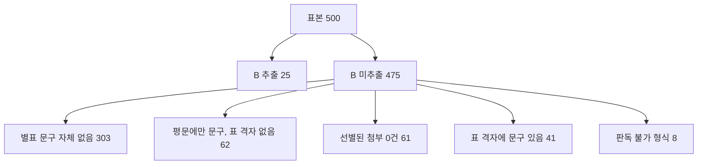

# P1(바이너리 HWP 표 복원) 이후 과거 용역 공고 B·k 추출률 재측정

> **작성일**: 2026-10-13
> **작업 브랜치**: `kwanbum217/h2-pilot-remeasure`
> **비교 기준**: [past_notice_method_pilot_20261013.md](past_notice_method_pilot_20261013.md) (이하 H1, 수정 전)
> **선행 작업**: `3234f708` (P1, 바이너리 HWP 표 레코드에서 행·열 격자 복원)
> **표본**: 2015~2024년 용역 적격심사제(`낙030001`) 공고 500건 (연도별 50건, 시드 `h1pilot20261013`)
> **산출물**: `scripts/pilot_past_notice_method_extract.py` (수정 없음), 결과 CSV `.cache/past_notice_pilot/sample_extract_results.csv`, `.cache/past_notice_pilot/year_summary.csv` (커밋 대상 아님)
> **판정**: P1 은 동일 코퍼스에서 B·k 동시 추출을 1건에서 10건으로 늘렸습니다. 다만 표본 기준 2.0% 로, H1 이 제시한 선행 조건 1번은 해소됐으나 전량 추출 근거로는 아직 부족합니다.

---

## 1. 질문과 배경

H1 은 과거 용역 공고 500건에서 B(가격 배점한도)·k(평점계수) 동시 추출이 1건(판독 가능 431건 기준 0.23%)에 그친 원인을 **첨부의 92.7% 가 바이너리 HWP 인데 추출기가 그 표를 복원하지 못하는 구조적 한계**로 지목하고, 선행 조건 1번으로 "바이너리 HWP 표 복원 파서 추가"를 제시했습니다.

P1(`3234f708`)이 그 작업입니다. `scripts/extract_score_params.py` 에 다음 세 가지가 들어갔습니다.

1. `_binary_hwp_document` 가 `TABLE`/`LIST_HEADER` 레코드에서 셀 주소와 병합 정보를 읽어 `rows`(행·열 격자)를 만듭니다.
2. `parse_price_formula` 에 바이너리 HWP 수식 개체 서식(`평점=배점한도-계수`) 폴백을 추가했습니다.
3. `parse_price_limit` 이 `30점` 접미사와 수식 셀 혼재 행을 허용합니다.

본 문서는 **H1 과 같은 시드·같은 표본 규칙으로 다시 돌려** B·k 추출률이 실제로 얼마나 올랐는지 재고, 남은 실패 원인을 분류합니다. 코드는 고치지 않았습니다.

---

## 2. 방법

### 2.1 표본과 코퍼스 동일성

H1 과 동일한 SQL·동일 시드(`h1pilot20261013`)로 500건을 다시 뽑고, 첨부 529건을 나라장터에서 다시 받았습니다(요청 간 1초, 동시 1개, 재시도 1회). 받은 첨부는 H1 과 **파일 수 529건, 총 72,933,678 B 로 완전히 일치**했습니다. 표본도 연도별 50건 구성이 동일합니다.

| 항목 | H1 | 재측정 | 일치 |
| --- | ---: | ---: | :---: |
| 표본 | 500 | 500 | O |
| 선별 첨부 | 529 | 529 | O |
| 첨부 용량 | 72,933,678 B | 72,933,678 B | O |
| 다운로드 성공 | 439/439 | 439/439 | O |
| 판독 가능 | 431 | 431 | O |

### 2.2 수정 전 기준선

비교 기준선을 두 개 둡니다.

- **H1 보고서 수치**: 수정 전 실측값(B·k 동시 1건).
- **동일 코퍼스 재현**: `3234f708^` 리비전의 `extract_score_params.py` 를 꺼내 같은 캐시 첨부에 그대로 돌린 값. 표본 재추출 잡음 없이 P1 효과만 분리합니다.

### 2.3 지표 정의 (H1 과 동일, CSV 로 재계산 가능)

| 지표 | 정의 |
| --- | --- |
| 첨부 있음 | `attachment_count > 0` |
| 선별 | `selected_count > 0` |
| 다운로드 성공 | `downloaded_count > 0` |
| 판독 가능 형식 | `readable_count > 0` |
| 기준명 추출 | `criteria_name` 비어 있지 않음 |
| T 추출 | `pass_threshold` 비어 있지 않음 |
| B 추출 | `max_price_score` 비어 있지 않음 |
| k 추출 | `multiplier` 비어 있지 않음 |
| B·k 동시 | `max_price_score` 와 `multiplier` 가 모두 비어 있지 않음 |

---

## 3. 결과

### 3.1 연도별 표

| 연도 | 표본 수 | 첨부 있음 | 선별 | 다운로드 성공 | 판독 가능 형식 | 기준명 추출 | T 추출 | B 추출 | k 추출 | B·k 동시 |
| ---: | ---: | ---: | ---: | ---: | ---: | ---: | ---: | ---: | ---: | ---: |
| 2015 | 50 | 50 | 37 | 37 | 37 | 19 | 19 | 2 | 1 | 1 |
| 2016 | 50 | 50 | 44 | 44 | 44 | 31 | 21 | 5 | 2 | 2 |
| 2017 | 50 | 50 | 42 | 42 | 42 | 20 | 14 | 1 | 0 | 0 |
| 2018 | 50 | 50 | 47 | 47 | 47 | 33 | 20 | 2 | 0 | 0 |
| 2019 | 50 | 50 | 45 | 45 | 44 | 25 | 16 | 2 | 0 | 0 |
| 2020 | 50 | 50 | 48 | 48 | 47 | 26 | 22 | 3 | 2 | 2 |
| 2021 | 50 | 50 | 44 | 44 | 41 | 25 | 14 | 2 | 0 | 0 |
| 2022 | 50 | 50 | 45 | 45 | 44 | 27 | 8 | 4 | 2 | 2 |
| 2023 | 50 | 50 | 44 | 44 | 43 | 23 | 14 | 3 | 2 | 2 |
| 2024 | 50 | 50 | 43 | 43 | 42 | 19 | 16 | 1 | 1 | 1 |
| **합계** | **500** | **500** | **439** | **439** | **431** | **248** | **164** | **25** | **10** | **10** |

선별·다운로드·판독 수치는 H1 과 전부 동일합니다(439/439/431). 달라진 것은 B·k 계열뿐입니다.

### 3.2 결과 분류 (outcome)

| 분류 | H1 | 재측정 | 증감 |
| --- | ---: | ---: | ---: |
| 전량추출 (T·B·k 모두) | 0 | 7 | +7 |
| 부분추출 | 166 | 165 | -1 |
| 표 해석 실패 | 265 | 259 | -6 |
| 첨부 없음 (키워드 미선별) | 61 | 61 | 0 |
| 판독 불가 형식 | 6 | 6 | 0 |
| 스캔 PDF | 2 | 2 | 0 |
| 다운로드 실패 | 0 | 0 | 0 |
| **합계** | **500** | **500** | **0** |

### 3.3 B·k 동시 추출 10건

| 연도 | 공고번호 | 첨부 형식 | T | B | k |
| ---: | --- | --- | ---: | --- | --- |
| 2015 | 20151210400 | hwp | 85 | 80 | 1\|2\|3 |
| 2016 | 20160312279 | hwp | - | 90 | 1\|2\|4 |
| 2016 | 20160822119 | hwp | 95 | 90 | 1\|2\|4 |
| 2020 | 20200318226 | hwp | 95 | 90 | 20 |
| 2020 | 20200721393 | hwp | 95 | 30\|50 | 1\|2\|20\|4 |
| 2022 | 20220324979 | hwp | 95 | 30 | 2\|4 |
| 2022 | 20220805251 | hwp;hwpx | 92 | 88 | 2\|4 |
| 2023 | 20230326984 | hwp;hwpx | 95 | 30 | 2\|4 |
| 2023 | 20231208519 | hwpx | - | 60\|70 | 2\|4 |
| 2024 | 20240825233 | hwp | - | 100 | 2\|4 |

10건 중 9건이 바이너리 HWP 를 포함합니다. HWPX 단독 1건(2023)은 P1 이전에도 추출 가능했던 건입니다. 값이 `1|2|4` 처럼 여러 개로 나오는 것은 같은 문서에 구간별 계산식이 여러 개 있고 추출기가 후보를 합쳐 내보내기 때문이며, 구간 확정은 `select_band` 의 별도 과제입니다.

---

## 4. 수정 전후 비교

### 4.1 지표별 비교

| 지표 | 수정 전 (H1 보고서) | 수정 전 (동일 코퍼스 재현) | 수정 후 | 증감 |
| --- | ---: | ---: | ---: | ---: |
| 기준명 추출 | 241 | 241 | 248 | +7 |
| T 추출 | 164 | 164 | 164 | 0 |
| B 추출 | 4 | 4 | 25 | +21 |
| k 추출 | 1 | 1 | 10 | +9 |
| **B·k 동시** | **1** | **1** | **10** | **+9** |
| T·B·k 전량 | 0 | 0 | 7 | +7 |

동일 코퍼스 재현값과 H1 보고서 수치가 정확히 일치하므로, 두 실행의 표본·첨부가 동일함이 확인됩니다. P1 효과는 **B·k 동시 +9건, B 단독 +21건, k +9건**이며 **회귀는 0건**입니다(T 164건 유지, B·k 를 잃은 공고 없음).

### 4.2 추출률

| 비율 | 수정 전 | 수정 후 |
| --- | ---: | ---: |
| B·k 동시 / 표본 500 | 0.20% | 2.00% |
| B·k 동시 / 판독 가능 431 | 0.23% | 2.32% |
| B 추출 / 판독 가능 431 | 0.93% | 5.80% |
| T·B·k 전량 / 표본 500 | 0.00% | 1.40% |

### 4.3 기준명 증가(+7)의 원인

기준명은 첨부 파일명·평문·**표 행**을 모두 합친 텍스트에서 찾습니다. P1 이 바이너리 HWP 의 `rows` 를 채우면서, 표 안에만 있던 문구가 탐색 대상에 들어왔습니다. T 는 평문만 쓰므로 변하지 않았습니다(164 유지).

---

## 5. 남은 실패 원인

### 5.1 B 미추출 475건 분해



| 원인 | 건수 | 설명 |
| --- | ---: | --- |
| 별표 배점한도 문구 자체가 선별 첨부에 없음 | 303 | 공고문·안내문만 첨부되고 적격심사 별표가 없음 |
| 평문에만 문구가 있고 표 격자에는 없음 | 62 | 별표가 이미지로 들어갔거나 표로 복원되지 않음 |
| 선별된 첨부 0건 | 61 | 키워드(`적격심사`, `평점`, `별표` 등)에 걸리는 첨부 없음 |
| 표 격자에 문구가 있는데도 B 실패 | 41 | 표는 복원됐고 배점한도 문구도 격자에 있으나 숫자 행을 특정하지 못함 |
| 판독 불가 형식(pdf·스캔) | 8 | 기존 한계 그대로 |

k 도 같은 병목입니다. 평점 계산식 행이 복원된 격자 안에 있어야 하는데, B 미추출 475건에서는 그 행이 없습니다.

### 5.2 남은 개선 여지

- **41건**: 표 복원이 됐는데도 실패한 유일한 파서 몫입니다. 배점한도 표의 숫자 셀 병합·서식 차이를 확인하면 가장 먼저 회수할 수 있는 구간입니다.
- **62건**: 별표가 이미지인 경우로, 표 파서가 아니라 OCR 영역입니다.
- **61건**: 키워드 선별 누락으로, H1 이 제시한 "첨부 전량 다운로드" 선택지가 해당됩니다.
- **303건**: 선별 첨부 자체에 별표가 없어 어떤 파서로도 나오지 않습니다. 첨부 구성(공고문 외 별도 문서 존재 여부)을 먼저 확인해야 합니다.

---

## 6. 판정

1. **P1 은 목적한 효과를 냈습니다.** 동일 코퍼스에서 B·k 동시 추출 1 → 10건, 회귀 0건입니다. H1 이 지목한 구조적 병목(바이너리 HWP 표)의 상당 부분이 실제로 열렸습니다.
2. **다만 절대 수준은 아직 낮습니다.** B·k 동시 2.32%(판독 가능 기준)로, H1 이 전량 추출을 보류한 근거("시간·용량 대비 산출물이 없음")가 완전히 뒤집히지는 않았습니다.
3. **표본 선형 외삽 시** 22.7만 건에서 B·k 동시 약 4,540건(2.0%), T·B·k 약 3,180건(1.4%)이 기대됩니다. 표본 500건 / 529 요청 / 69.6 MiB / 약 10분(1 req/s) 조건이므로 전량은 약 24만 요청, 약 33 GB, 약 78시간 규모로 H1 추정과 동일합니다. **목표 산출량이 4천 건대여도 충분한지는 별도 판단이 필요합니다.**
4. **다음 우선순위**는 표 격자에 문구가 있는데도 실패한 41건의 파서 보정이며, 이어서 별표 이미지 62건과 키워드 누락 61건입니다. 전량 수집 착수 여부는 코디네이터·사용자 판단 사항으로 남깁니다.

---

## 7. 재현

```sh
# 1) 표본 선정 (읽기 전용 DB, 시드 고정)
uv run python scripts/db_readonly_query.py \
    --sql-file .cache/past_notice_pilot/sample.sql --format json --limit 500 \
    > .cache/past_notice_pilot/sample_raw.json

# 2) 첨부 다운로드 + 추출 (요청 간 1초, 커밋 대상 아님)
uv run python scripts/pilot_past_notice_method_extract.py \
    --sample .cache/past_notice_pilot/sample_raw.json \
    --out-dir .cache/past_notice_pilot
```

본 문서의 모든 표는 결과 CSV 에서 재계산됩니다.

```sh
uv run python - <<'PY'
import csv
rows = list(csv.DictReader(open('.cache/past_notice_pilot/sample_extract_results.csv', encoding='utf-8')))
print('표본', len(rows))
print('판독 가능', sum(1 for r in rows if int(r['readable_count']) > 0))
print('기준명', sum(1 for r in rows if r['criteria_name']))
print('T', sum(1 for r in rows if r['pass_threshold']))
print('B', sum(1 for r in rows if r['max_price_score']))
print('k', sum(1 for r in rows if r['multiplier']))
print('B·k 동시', sum(1 for r in rows if r['max_price_score'] and r['multiplier']))
print('T·B·k', sum(1 for r in rows if r['pass_threshold'] and r['max_price_score'] and r['multiplier']))
PY
```

수정 전 기준선(동일 코퍼스)은 P1 직전 리비전으로 같은 캐시를 재생해 확인했습니다.

```sh
git show 3234f708^:scripts/extract_score_params.py > /tmp/old_extract_score_params.py
```

규칙 검증은 다음과 같습니다.

```sh
python3 scripts/validate_agent_rules.py --quiet
```
