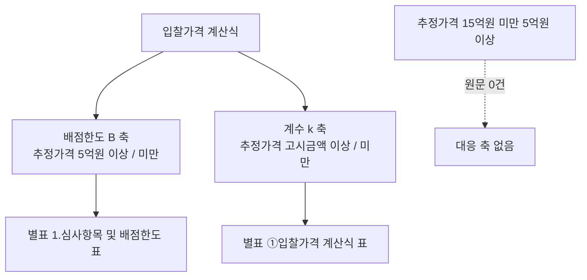

# 조달청 일반용역 적격심사 제2026-260호·제2026-390호 원문 재독 — 추정가격 15억원 미만 5억원 이상 구간의 인쇄 가격식 유무

> **작성일**: 2026-10-15
> **작업**: Orca Task `task_08d1f0081092` (builder), Run `run_5631fae373c0`, Dispatch `ctx_721358f688e4`
> **정본 사양**: `.orca/capsules/task_08d1f0081092/capsule.yaml` (`ORCA_TASK_CAPSULE_V2`)
> **작업 브랜치**: `kwanbum217/orca-pps-band-5-15`
> **선행 문서**: [rule_not_found_id_mismatch_20261015.md](rule_not_found_id_mismatch_20261015.md) (낙찰방법명 띠 문자열 389건), [pps_flat_zone_source_20261005.md](pps_flat_zone_source_20261005.md) (일반 띠 3개의 별표 귀속 미확인)
> **역할 경계**: 이 문서 한 건만 이번 작업의 커밋 산출물입니다. `src/`·`data/`·원장·DB 를 바꾸지 않았습니다.
> **판정**: `candidate`. 규칙을 코드에 넣지 않았고, 등록 여부도 고르지 않았습니다.

---

## 1. 목적과 결론

- 목적: 조달청 일반용역 적격심사 세부기준 제2026-260호(시행 2026-05-26)와 제2026-390호(시행 2026-07-27) **원문**에서 `추정가격 15억원 미만 5억원 이상` 구간이 **인쇄된 가격식**을 갖는지 재독합니다. 새 계수는 만들지 않습니다.
- 결론 1: 두 고시 원문 전문 어디에도 `추정가격 15억원 미만 5억원 이상` 문자열이 없습니다. 띠 표기를 구성하는 `15억`·`30억`·`2억` 문자열이 **두 원문 모두 0건**입니다(4절).
- 결론 2: 두 고시가 인쇄하는 입찰가격 계산식은 **2축 체계뿐**입니다. 배점한도 `B` 는 `추정가격 5억원 이상/미만` 축, 계수 `k` 는 `추정가격 고시금액 이상/미만` 축으로만 갈립니다(3절).
- 결론 3: 별표는 **용역 종류**로만 갈립니다(제5조제1항 각 호 → 별표 1~9). 추정가격 규모로 갈리는 별표는 없습니다. 따라서 `15억원 미만 5억원 이상` 구간 전용 별표도, 그 구간 전용으로 인쇄된 `B`·`k`·기준비율도 없습니다.
- 결론 4: 이 문서는 어떤 계수도 만들지 않았고, 등록 여부를 확정하지 않습니다. 등록된 일반 띠 3개의 별표 귀속 문제도 여기서 결정하지 않습니다.

---

## 2. 재독 대상과 원문 확보

### 2.1 게시글

| 차수 | 게시글 주소 | 등록일 | 시행일 근거 |
| --- | --- | --- | --- |
| 조달청 공고 제2026-260호 | `https://www.pps.go.kr/kor/bbs/view.do?key=00030&bbsSn=2605220029` | 2026-05-22 | 부칙<2026. 5. 22.> 제1조 "2026년 5월 26일부터 시행한다" |
| 조달청 공고 제2026-390호 | `https://www.pps.go.kr/kor/bbs/view.do?key=00030&bbsSn=2607240033` | 2026-07-24 | 부칙<2026. 7. 24.> 제1조 "2026년 7월 27일부터 시행한다" |

- 제2026-390호의 첨부 파일명은 `★260724_...(시행7.24)` 이지만, 부칙 시행일과 낙찰하한율 안내 적용 문구는 모두 `2026. 7. 27.` 입니다. 파일명의 7.24 는 공고일 표기입니다.

### 2.2 첨부 원문

| 차수 | 첨부 | `fileDown.do` 파라미터 | 이 문서에서 쓴 이름 |
| --- | --- | --- | --- |
| 260 | 「조달청 일반용역 적격심사 세부기준」 개정 전문 | `key=202605220020&sn=3` | `pps_260_full` |
| 260 | 「조달청 일반용역 적격심사 세부기준」 신구조문대비표 | `key=202605220020&sn=2` | `pps_260_diff` |
| 260 | 분야별 낙찰하한율 안내_260526(수정) | `key=202605220020&sn=4` | `pps_260_lwlt` |
| 390 | 「조달청 일반용역 적격심사 세부기준」 개정 전문(시행7.24) | `key=202607240030&sn=3` | `pps_390_full` |
| 390 | 「조달청 일반용역 적격심사 세부기준」 개정안 신구조문대비표 | `key=202607240030&sn=1` | `pps_390_diff` |
| 390 | 분야별 낙찰하한율 안내_260727 | `key=202607240030&sn=2` | `pps_390_lwlt` |

- 원문 HWPX 와 추출문은 `.cache/pps_band_5_15/` 에만 두었고 **커밋하지 않았습니다**(캡슐 계약).
- 추출 방법: HWPX 는 zip 이며 `Contents/section0.xml` 하나에 본문과 수식이 들어 있습니다. `hp:t`(본문·표 셀)와 `hp:script`(HancomEQN 수식)를 문서 순서대로 뽑았습니다. 표준 `zipfile` 만 썼고 새 저장소 의존성은 추가하지 않았습니다.
- 3절 이하의 `파일:행번호` 인용은 모두 이 추출문(`.cache/pps_band_5_15/pps_*_full.txt`) 기준입니다. 추출문은 커밋되지 않으므로, 같은 인용문을 8절 재현 절차로 다시 만들 수 있게 원문 문자열을 함께 적었습니다.

---

## 3. 원문이 인쇄하는 가격식 체계 — 2축

### 3.1 별표는 용역 종류로만 갈린다

- 제5조제1항은 **심사분야 → 별표** 매핑만 인쇄합니다(`pps_260_full.txt:219`~`:230`).

| 호 | 심사분야 | 별표 |
| --- | --- | --- |
| 1 | 학술연구용역 | 별표 1 |
| 2 | 시설분야용역 | 별표 2 |
| 3 | 소프트웨어용역 | 별표 3 또는 별표 3의2 |
| 4 | 폐기물처리용역 | 별표 4 |
| 5 | 육상운송용역 | 별표 5 또는 별표 5의2 |
| 6 | 보험용역 | 별표 6 |
| 7 | 수리ㆍ점검용역 | 별표 7 |
| 8 | 임대차 | 별표 8 |
| 9 | 수요기관 지정형 | 별표 9 |

- 두 원문의 별표 목록은 별표 1·2·3·3의2·4·5·5의2·6·7·8·9 와 별표 10(경영상태)·별표 11(신인도)입니다. **추정가격 규모로 갈리는 별표는 하나도 없습니다.**
- 제2조 용어 정의 13호는 서비스 종류만 규정하며, `추정가격 N억원 미만인 용역` 같은 띠 이름은 정의하지 않습니다(`:24`~`:79`).

### 3.2 축 1 — 배점한도 `B`: 추정가격 5억원

- 각 별표 1.심사항목 및 배점한도 표의 `Ⅱ.입찰가격` 열은 `추정가격 5억원 이상 / 추정가격 5억원 미만` 두 열로 인쇄됩니다.
- 별표 1 학술연구용역: `Ⅱ. 입찰가격 … 60 / 70` (`pps_260_full.txt:582`~`:585`).
- 별표 7 수리·점검용역: `Ⅱ.입찰가격 … 60 / 70` (`:2147`~`:2150`).
- 즉 `B` 는 `추정가격 5억원` **한 개의 경계**로만 갈립니다.

### 3.3 축 2 — 계수 `k`: 추정가격 고시금액

- 각 별표의 `①입찰가격 계산식` 표는 행이 `추정가격 고시금액 이상 / 추정가격 고시금액 미만` 두 개로 인쇄됩니다. 열 머리는 `사업예산규모 · 계산식 · 예외사항` 이고, `사업예산규모` 칸이 `추정가격`+`고시금액`+`이상`/`미만` 으로 풀려 나옵니다(`pps_260_full.txt:603`~`:610`, `:621`~`:623`).
- 계산식 표 11개의 구성은 다음과 같습니다(두 차수 동일).

| 계산식 표 형태 | 해당 별표 | 근거 |
| --- | --- | --- |
| 고시금액 2행 | 별표 1 · 3 · 4 · 5의2 · 7 · 8 · 9 | `pps_260_full.txt:609`·`:622`, `:1035`·`:1048`, `:1462`·`:1473`, `:1898`·`:1908`, `:2171`·`:2182`, `:2348`·`:2356`, `:2492`·`:2501` |
| 단일 행 | 별표 2(`k`=5) · 별표 3의2(`k`=4) · 별표 5(`k`=4) · 별표 6(`k`=0.375) | `:805`, `:1250`, `:1699`, `:2073` |

- 두 축을 합쳐도 경계는 **추정가격 5억원**과 **고시금액** 둘뿐입니다. `15억원`·`30억원`·`2억원` 경계는 계산식 어디에도 없습니다.



---

## 4. 띠 문자열 부재 확인 (정량)

- 추출문 전문(공백 포함 문자열 일치) 기준 건수입니다. 두 차수 값이 같습니다.

| 문자열 | 제2026-260호 | 제2026-390호 |
| --- | ---: | ---: |
| `15억` | 0 | 0 |
| `2억` | 0 | 0 |
| `30억` | 0 | 0 |
| `5억원` | 40 | 40 |
| `고시금액` | 17 | 17 |
| `미만인 용역` | 0 | 0 |

- `5억원` 40건은 모두 `추정가격 5억원 이상` / `추정가격 5억원 미만` 형태입니다. 다른 금액 표기는 없습니다.
- 첨부 3종도 확인했습니다. 신구조문대비표와 낙찰하한율 안내에는 `억`·`추정가격 5억원` 문자열이 아예 없거나, 있어도 `고시금액` 축뿐입니다.
  - 신구조문대비표: 계산식 행이 `<추정가격 고시금액 이상>` · `<추정가격 고시금액 미만>` 두 개뿐입니다(별표 1 예: `pps_260_diff` 미리보기 텍스트).
  - 낙찰하한율 안내: 행이 `고시금액 미만 86.245%` / `고시금액 이상 82.495%` 로 갈리고, 나머지는 별표별 단일 값입니다(`pps_260_lwlt.txt:15`~`:29`).

---

## 5. 원문 인용

### 5.1 제2026-260호 별표 1 (학술연구용역) — 계산식 2행

> `pps_260_full.txt:603`~`:636`

```text
① 입찰가격 계산식
사업예산규모 | 계산식 | 예외사항
추정가격 고시금액 이상
  평점(점)=배점한도-2×|(90/100)-(입찰가격/예정가격)|×100
  입찰가격이 예정가격 이하로서 예정가격의 97.5% 이상인 경우에는
  입찰가격이 예정가격의 97.5%인 경우의 점수로 평가
추정가격 고시금액 미만
  평점(점)=배점한도-4×|(90/100)-(입찰가격/예정가격)|×100
  입찰가격이 예정가격 이하로서 예정가격의 93.75% 이상인 경우에는
  입찰가격이 예정가격의 93.75%인 경우의 점수로 평가
```

### 5.2 제2026-260호 별표 7 (수리·점검용역) — 같은 2행 구조

> `pps_260_full.txt:2166`~`:2184`

```text
①입찰가격 평점 계산식
사업예산규모 | 평점 계산식 | 예외사항
추정가격 고시금액 이상   → 평점(점)=배점한도-2×|(90/100)-(입찰가격/예정가격)|×100 … 97.5% …
추정가격 고시금액 미만   → 평점(점)=배점한도-4×|(90/100)-(입찰가격/예정가격)|×100 … 97.5% …
```

- 같은 별표의 배점한도 표는 `추정가격 5억원 이상 / 추정가격 5억원 미만` 두 열이고 `Ⅱ.입찰가격` 값이 `60 / 70` 입니다(`:2119`~`:2122`, `:2147`~`:2150`).

### 5.3 제2026-390호 별표 1 — 같은 2행 구조

> `pps_390_full.txt:612`~`:634`

```text
① 입찰가격 계산식
추정가격 고시금액 이상  → 평점(점)=배점한도-2×|(90/100)-(입찰가격/예정가격)|×100 … 97.5% …
추정가격 고시금액 미만  → 평점(점)=배점한도-4×|(90/100)-(입찰가격/예정가격)|×100 … 93.75% …
```

### 5.4 제2026-390호 별표 5 (여객 육상운송) — 단일 행, 96%

> `pps_390_full.txt:1685`~`:1692`

```text
①입찰가격 계산식
평점(점)=배점한도-4×|(93/100)-(입찰가격/예정가격)|×100
(다만, 입찰가격이 예정가격 이하로서 예정가격의 96%이상인 경우에는
 입찰가격이 예정가격의 96%인 경우의 점수로 평가)
```

### 5.5 분야별 낙찰하한율 안내 — 축이 고시금액뿐

> `pps_260_lwlt.txt:15`~`:29` (제2026-390호 판도 같은 문구, 값만 `[별표5] 여객` 이 `89.995%` 로 이동)

```text
분야(적용기준) | 적격심사 통과점수 | 낙찰하한율
[별표1] 학술연구용역 … [별표9] 수요기관 지정형 : 고시금액 미만 85점 86.245% / 고시금액 이상 82.495%
[별표2] 시설분야용역 : 89.995%
[별표3의2] 소프트웨어용역(중소기업자간 경쟁제품 대상) : 88점 87.995%
[별표5] 여객육상운송용역 : 87.995%
[별표6] 보험용역 : 85점 47.995%
```

- 낙찰하한율 표에 `2억원`·`5억원`·`15억원`·`30억원` 띠 구분은 없습니다.

---

## 6. 이 문서가 하지 않은 것

| 항목 | 상태 |
| --- | --- |
| `src/app/services/evaluation_rules.py` | 수정 없음. 띠 규칙 추가 없음 |
| 발행 원장 `data/reference/rule_coverage_ledger.yaml` | 수정 없음 |
| 매칭 패턴(`폐기물처리`, `적격심사`, `일반용역` 등) | 추가 없음. 권고도 없음 |
| 계수 생성 | 없음. `15억원 미만 5억원 이상` 전용 `B`·`k`·기준비율을 만들지 않았음 |
| 낙찰하한율 역산 | 없음. 원문에 인쇄된 값만 적었음 |
| DB 조회 | 없음. 같은 낙찰방법명 공고 건수(389건)도 재계수하지 않았음 |
| 등록 여부 판정 | 확정하지 않음. 판정은 `candidate` |

- 한계: 이 재독은 두 고시의 **개정 전문과 그 첨부 3종**만 봅니다. 등록된 일반 띠 3개(`SERVC_QUAL_POST_20260526_ATTACH_12`·`_13`·`_14`)의 띠 이름이 어느 문서에서 왔는지는 이 문서가 결정하지 않습니다. 선행 문서 [pps_flat_zone_source_20261005.md](pps_flat_zone_source_20261005.md) 4.5/7절의 `미확인` 상태는 그대로입니다.
- 접속 실패는 문서 부재의 증거가 아니지만, 이번에는 두 게시글과 첨부 6건 모두 HTTP 200 으로 내려받았습니다.

---

## 7. 검증

| 항목 | 값 |
| --- | --- |
| 검증 명령 | `python3 scripts/validate_agent_rules.py --quiet` |
| 변경 파일 | `docs/analysis/pps_band_5_15_20261015.md` (문서 1개) |
| 작업 브랜치 | `kwanbum217/orca-pps-band-5-15` (main 직접 커밋 없음) |

---

## 8. 재현 방법

```sh
# 게시글 HTML 에서 첨부 fileDown 파라미터를 찾는다. 값은 프로세스에만 둔다.
curl -sSL -o .cache/pps_band_5_15/pps_260_post.html \
  "https://www.pps.go.kr/kor/bbs/view.do?key=00030&bbsSn=2605220029"
curl -sSL -o .cache/pps_band_5_15/pps_390_post.html \
  "https://www.pps.go.kr/kor/bbs/view.do?key=00030&bbsSn=2607240033"
grep -oE 'fileDown\.do[^"]*key=[0-9]+&sn=[0-9]+' .cache/pps_band_5_15/*.html

# 개정 전문(260 sn=3, 390 sn=3)을 내려받아 HWPX 를 푼다.
curl -sSL -o .cache/pps_band_5_15/pps_260_full.hwpx \
  "https://www.pps.go.kr/common/fileDown.do?key=202605220020&sn=3"
curl -sSL -o .cache/pps_band_5_15/pps_390_full.hwpx \
  "https://www.pps.go.kr/common/fileDown.do?key=202607240030&sn=3"

# hp:t(본문)와 hp:script(수식)를 문서 순서대로 추출한다.
python3 - <<'PY'
import zipfile, re, html
for src, dst in [(".cache/pps_band_5_15/pps_260_full.hwpx", ".cache/pps_band_5_15/pps_260_full.txt"),
                 (".cache/pps_band_5_15/pps_390_full.hwpx", ".cache/pps_band_5_15/pps_390_full.txt")]:
    xml = zipfile.ZipFile(src).read("Contents/section0.xml").decode("utf-8", "replace")
    out = []
    for m in re.finditer(r"<hp:script[^>]*>(.*?)</hp:script>|<hp:t[^>]*>(.*?)</hp:t>", xml, re.S):
        t = "[[EQ]] " + m.group(1) if m.group(1) is not None else m.group(2)
        out.append(html.unescape(re.sub(r"<[^>]+>", "", t)))
    open(dst, "w", encoding="utf-8").write("".join(f"{i}: {l}\n" for i, l in enumerate(out, 1)))
PY

# 금액 축이 5억원 하나뿐인지 확인한다. 15억/2억/30억은 0 이어야 한다.
grep -c '15억' .cache/pps_band_5_15/pps_260_full.txt .cache/pps_band_5_15/pps_390_full.txt
grep -c '5억원' .cache/pps_band_5_15/pps_260_full.txt .cache/pps_band_5_15/pps_390_full.txt
grep -n '고시금액' .cache/pps_band_5_15/pps_260_full.txt
```

- 첨부 신구조문대비표·낙찰하한율 안내는 같은 방식으로 `sn=2`·`sn=4`(260), `sn=1`·`sn=2`(390)을 받아 추출합니다.
