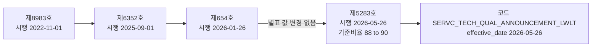

# 기술용역 적격심사 하한율: 시행일 2026-05-26 이전 공식 규정 수집

> **작성일**: 2026-10-15
> **작업**: Orca Task `task_4c8d16871f3d` (builder). 제품 코드를 바꾸지 않고 공식 원문만 수집한다.
> **정본 사양**: `.orca/capsules/task_pps_tech_lwlt_pre_20261015/capsule.yaml` (`ORCA_TASK_CAPSULE_V2`)
> **작업 브랜치**: `kwanbum217/orca-tech-lwlt-pre`
> **산출 파일**: [data/reference/pps_tech_lwlt_pre_20260526.yaml](../../data/reference/pps_tech_lwlt_pre_20260526.yaml) (신규)
> **선행 명세**: [data/reference/pps_servc_tech_qual_history_2015_2022.yaml](../../data/reference/pps_servc_tech_qual_history_2015_2022.yaml) (2015-11-19 ~ 2025-08-31 시행판, 수정하지 않음)
> **선행 분석**: [block_cause_split_20261015.md](block_cause_split_20261015.md) (`RULE_REGIME_MISMATCH` 시행일 묶음), [block_cause_survey_20261015.md](block_cause_survey_20261015.md) (원인 코드별 총계)
> **원문 보관**: `.cache/pps_tech_lwlt_pre/` (커밋하지 않음)

---

## 1. 목적과 결론

- 목적: 기술용역 적격심사 하한율 규칙 `SERVC_TECH_QUAL_ANNOUNCEMENT_LWLT`(시행일 `2026-05-26`)보다 앞선 공고에 적용할 **공식 규정이 실제로 있는지**를 공식 원문으로 확인하고, 있으면 문서 번호·시행일·하한율의 소재(별표인지 공고 값인지)·인용 문장을 남긴다. 대응 구현은 하지 않는다.
- 결론: **있다.** 시행일 `2026-05-26` 이전에 적용할 공식 판은 조달청지침 **제654호(시행 2026-01-26)** 이고, 그 앞 판은 **제6352호(시행 2025-09-01)**, 그 앞 판은 **제8983호(시행 2022-11-01)** 다. 세 판 모두 「조달청 기술용역 적격심사 세부기준」이라는 같은 행정규칙이며, 하한율 계열 값은 **별표1** 에 고정 값으로 인쇄되어 있다.
- 하한율 계열 값은 제8983호·제6352호·제654호에서 **한 번도 바뀌지 않았다**(기준비율 88/100, 평점 평탄 비율 96 / 90.5 / 89.25 / 88.25). 시행일 `2026-05-26` 판(제5283호)에서만 기준비율이 90/100 으로, 평탄 비율이 98 / 92.5 / 91.25 / 90.25 로 네 구간 모두 2%p 올랐다(6절).
- 「조달청 기술용역 적격심사 세부기준」 본문·별표에는 **"낙찰하한율"이라는 문자열이 한 번도 나오지 않는다**. 세부기준이 인쇄하는 것은 기준비율·평점계수·배점한도·평점 평탄 문구다. 공고에 실리는 `sucsfbidLwltRate` 는 세부기준이 직접 인쇄하지 않는다(4절).

### 1.1 시행판 흐름



---

## 2. 수집 경로

| 경로 | 결과 | 비고 |
| --- | --- | --- |
| 국가법령정보센터 첨부 원문 PDF (`law.go.kr/flDownload.do`) | 성공 | 제6352호·제654호·제5283호 원문 확보, 별표1 텍스트 층 판독 |
| 법제처 원문의 공개 사본 (kepco srm 첨부) | 성공 | 제8983호 원문 확보, 별표1은 텍스트 층이 없어 렌더 이미지로 판독 |
| 국가법령정보센터 행정규칙 본문 화면 | 실패 | 스크립트 렌더링 화면이라 조문·별표 텍스트를 꺼내지 못함. 첨부 원문으로 우회 |
| 조달청 고시 게시판 | 부분 실패 | 일반용역 제2026-260호 게시물 확인. 기술용역 제5283호 게시물은 확인하지 못함 |
| 상업 게시판(블로그) 하한율 표 | 사용 안 함 | 계수·하한율을 옮기지 않음. 값은 국가법령정보센터 원문 별표에서만 취함 |
| 나라장터 고시·지침 목록 | 확인 안 함 | 국가법령정보센터가 행정규칙 정본을 제공해 대체 경로가 필요하지 않았음 |

- 원문은 `.cache/pps_tech_lwlt_pre/` 아래에만 두고 커밋하지 않는다. 확보한 파일과 체크섬은 YAML `source.originals` 에 적었다.
- 표는 텍스트 층과 페이지 렌더 이미지를 **함께** 보고 확인했다. 제8983호는 텍스트 층이 없어 이미지만 썼고, 그래서 3.1절에서 그 사실을 따로 표시했다.

---

## 3. 시행일 2026-05-26 이전에 존재하는 공식 규정

| 판 | 문서 번호 | 발령일 | 시행일 | 적용 기간 | 근거 |
| --- | --- | --- | --- | --- | --- |
| 직전 판 | 조달청지침 제8983호 | 2022-10-14 | 2022-11-01 | 2022-11-01 ~ 2025-08-31 | 부칙 `시행일 ... 2022년 11월 1일부터 시행한다.` |
| 2025-09-01 판 | 조달청지침 제6352호 | 2025-07-14 | 2025-09-01 | 2025-09-01 ~ 2026-01-25 | 부칙 `제1조(시행일) 이 세부기준은 2025년 9월 1일부터 시행한다.` |
| **2026-05-26 직전 판** | **조달청지침 제654호** | 2026-01-26 | 2026-01-26 | 2026-01-26 ~ 2026-05-25 | 부칙 `제1조(시행일) 이 기준은 발령한 날부터 시행한다.` |
| 경계 판(현행) | 조달청지침 제5283호 | 2026-05-22 | 2026-05-26 | 2026-05-26 ~ | 부칙 `제1조(시행일) 이 세부기준은 2026년 5월 26일부터 시행한다.` |

- 규정 이름은 네 판 모두 **「조달청 기술용역 적격심사 세부기준」** 이고, 소관은 조달청(건설기술계약과)이다. 제1조가 `계약예규 「적격심사기준」 제6조에 따라 조달청에서 집행하는 기술용역 입찰의 낙찰자 결정에 적용할 적격심사 세부기준` 이라고 적용 범위를 적는다.
- **적용례가 공고일 기준이다.** 제6352호 부칙 제2조 `이 세부기준은 2025년 9월 1일 이후 최초 입찰 공고하는 적격심사 분부터 적용한다.`, 제5283호 부칙 제2조 `이 세부기준은 2026년 5월 26일 이후 최초 입찰 공고하는 적격심사 분부터 적용한다.` 따라서 시행일보다 앞선 공고일에는 이전 판이 적용된다.
- 제654호 부칙에는 적용례 조항이 없고 시행일만 있다(`이 기준은 발령한 날부터 시행한다.`). 발령일 2026-01-26 부터 시행된 것으로 읽는다.

### 3.1 판별 확인 방법

| 판 | 판독 방식 | 별표1 확인 범위 |
| --- | --- | --- |
| 제8983호 | 렌더 이미지 | 구간 1·2·3·4 모두 확인 |
| 제6352호 | 텍스트 층 + 렌더 이미지 | 구간 1·2·3·4 모두 확인 |
| 제654호 | 텍스트 층 | 구간 1·2·3·4 모두 확인 |
| 제5283호 | 텍스트 층 + 렌더 이미지 | 구간 1·2·3·4 모두 확인 |

---

## 4. 하한율의 소재: 별표다, 공고 값이 아니다

- 하한율 계열 값은 **별표1 「심사항목 및 배점한도」** 의 `2. 입찰가격` 항목에 있다. 구간마다 (1) 입찰가격 평점 개산식의 기준비율, (2) 평점계수, (3) `입찰가격이 예정가격이하로서 (예정가격의) 100분의 N이상인 경우의 평점은 M점으로 한다` 는 평점 평탄 문구가 인쇄되어 있다.
- 값은 공고마다 달라지지 않는다. 별표에 고정되어 있고, 바뀌려면 행정규칙이 개정되어야 한다. 실제로 시행일 `2026-05-26` 판에서만 값이 바뀌었다(6절).
- 반면 **"낙찰하한율"이라는 용어 자체는 네 판 어디에도 없다.** 판독 텍스트에서 문자열 `낙찰하한율` 은 제8983호·제6352호·제654호·제5283호 모두 **0회**다.
- 공고에 실리는 `sucsfbidLwltRate`(코드의 `source` 문자열이 가리키는 값)는 세부기준이 직접 인쇄하지 않는다. 별표의 기준비율·평점계수·통과점수에서 아래 식으로 유도되는 값과 표기 관행(`.995`)이 같은 자리에서 나오지만, **그 유도 관계를 원문이 문장으로 적어 두지는 않았다.**

```text
별표 평점식        P = B - k × |기준비율/100 - 입찰가격/예정가격| × 100
하한율 파생식      기준비율 - (100 - 적격통과점수) / k
표기 관행          소수 둘째 자리까지 버린 뒤 0.005 를 뺀다. 예: 80.000 -> 79.995, 87.500 -> 87.495
```

- 위 파생식과 표기 관행은 선행 명세 `PPS_SERVC_TECH_QUAL_HISTORY_V1` 의 `conventions` 와 **같은 정의**를 쓴다. 이 문서의 파생값도 원문에 인쇄된 값이 아니라 역산값이다.

### 4.1 인용 문장 (제654호, 시행 2026-01-26, 별표1)

| 구간 | 인용 문장 |
| --- | --- |
| 추정가격 10억원 이상 | `* 추정가격이 10억원 이상인 용역에서 입찰가격이 예정가격이하로서 100분의 96이상인 경우의 평점은 22점으로 한다.` |
| 10억원 미만 5억원 이상 | `* 입찰가격이 예정가격이하로서 100분의 90.5이상인 경우의 평점은 45점으로 한다.` |
| 5억원 미만 고시금액 이상 | `* 입찰가격이 예정가격이하로서 100분의 89.25이상인 경우의 평점은 65점으로 한다.` |
| 고시금액 미만 | `* 입찰가격이 예정가격이하로서 예정가격의 100분의 88.25이상인 경우의 평점은 85점으로 한다.` |

- 같은 문장이 제6352호(시행 2025-09-01)와 제8983호(시행 2022-11-01)에 **글자까지 같게** 인쇄되어 있다.
- 적격통과점수 근거는 본문이다. `제4조(낙찰자결정 및 적격심사 제출서류 등) ① 예정가격 이하인 최저가 입찰자부터 심사하여 종합평점이 용역규모별 적격통과점수(추정가격이 10억원 이상인 용역은 92점, 추정가격이 10억원 미만인 용역은 95점) 이상인 최저가 입찰자를 낙찰자로 결정한다.`

---

## 5. 구간별 별표 명세 (시행 2026-05-26 이전)

| 구간 | 추정가격 | 배점한도 B | 평점계수 k | 기준비율 | 평점 평탄 비율 | 통과점수 | 파생 하한율 |
| ---: | --- | ---: | ---: | ---: | ---: | ---: | ---: |
| 1 | 10억원 이상 | 30 | 1 | 88/100 | 96 | 92 | 79.995 |
| 2 | 10억원 미만 5억원 이상 | 50 | 2 | 88/100 | 90.5 | 95 | 85.495 |
| 3 | 5억원 미만 고시금액 이상 | 70 | 4 | 88/100 | 89.25 | 95 | 86.745 |
| 4 | 고시금액 미만 | 90 | 20 | 88/100 | 88.25 | 95 | 87.745 |

- 표의 `기준비율`·`평점계수`·`배점한도`·`평점 평탄 비율`·`통과점수` 는 **원문 인쇄값**이고, `파생 하한율` 만 역산값이다.
- 구간 경계는 문자열 `고시금액` 이다. 별표 주는 `고시금액은 「국가를 당사자로 하는 계약에 관한 법률」제4조의 규정에 의하여 기획재정부장관이 고시하는 금액을 말한다.` 라고 적는다.
- 구간 3의 별표 표기에는 괄호 조건이 붙는다. `3. 추정가격이 5억원 미만 고시금액 이상인 용역 (건축사법에 따른 설계용역은 5억원 미만 1억원 이상)`.
- 구간 4 서식은 경영상태 평가(자기자본비율·유동비율 각 5점)만 있고 사업수행능력 항목이 없다. 배점한도 90점이 모두 입찰가격이다.
- 네 구간 모두 `* 최저평점은 2점으로 한다.` 를 함께 인쇄한다.

---

## 6. 경계 대조: 시행 2026-05-26 판에서 바뀐 것

| 항목 | 제8983호·제6352호·제654호 (2022-11-01 ~ 2026-05-25) | 제5283호 (2026-05-26 ~) | 차이 |
| --- | --- | --- | --- |
| 기준비율 | 88/100 | 90/100 | +2 |
| 구간 1 평점 평탄 비율 | 96 | 98 | +2%p |
| 구간 2 평점 평탄 비율 | 90.5 | 92.5 | +2%p |
| 구간 3 평점 평탄 비율 | 89.25 | 91.25 | +2%p |
| 구간 4 평점 평탄 비율 | 88.25 | 90.25 | +2%p |
| 배점한도·평점계수·통과점수 | 30/50/70/90, 1/2/4/20, 92/95 | 같음 | 없음 |
| 파생 하한율(구간 1~4) | 79.995 / 85.495 / 86.745 / 87.745 | 81.995 / 87.495 / 88.745 / 89.745 | +2%p |

- 즉 **시행일 `2026-05-26` 이전 공고에 적용할 구판 별표 값은 공식 원문에 존재한다.** 값은 `96 / 90.5 / 89.25 / 88.25`(기준비율 88/100)이고, 파생 하한율은 `79.995 / 85.495 / 86.745 / 87.745` 다.
- 개정 취지가 기술용역 규모별 낙찰하한율 2%p 상향이라는 점은 조달청 보도자료 사본과 협회 공지로 확인되지만, 그 자료는 이 문서의 값 출처로 쓰지 않았다. 값은 국가법령정보센터 원문 별표에서만 취했다.
- 시행일 `2026-05-26` 묶음의 규모는 선행 분석에 있다. [block_cause_split_20261015.md](block_cause_split_20261015.md) 4.2절은 시행일 `2026-05-26` 이 `RULE_REGIME_MISMATCH` 8,936건(93.9%)을 차지하고, 그중 8,222건이 이 기술용역 하한율 별표에서 나온다고 적는다.

---

## 7. 규칙 코드와의 관계 (변경 없음)

- 규칙 코드에는 시행 `2026-05-26` 판만 들어 있다. `src/app/services/evaluation_rules.py` 의 `SERVC_TECH_QUAL_ANNOUNCEMENT_LWLT` 는 `effective_date="2026-05-26"`, `base_rate=Decimal("0.90")`, `source="공고별 sucsfbidLwltRate"`, `lwlt_rate=Decimal("0")` 로 선언되어 있다. `base_rate 0.90` 은 6절의 현행 기준비율 90/100 과 같은 값이다.
- 그 바로 위 주석은 `기술용역은 식별 문자열별 고정 규칙으로 환원하지 않고 공고 하한율만 사용합니다.` 라고 적는다. 이번 Task 는 그 주석과 코드를 **바꾸지 않았다.**
- 이 Task 의 변경 파일은 이 문서와 YAML 두 개뿐이다. `src/` · 발행 원장 `data/reference/rule_coverage_ledger.yaml` · `docs/context/CURRENT_STATE.md` 는 건드리지 않았고, 이미 병합된 선행 명세 `pps_servc_tech_qual_history_2015_2022.yaml` 도 덮어쓰지 않았다.

---

## 8. 실패 경로와 미확정 사항

| 항목 | 상태 | 내용 |
| --- | --- | --- |
| 국가법령정보센터 본문 화면 | 실패 | 조문·별표 텍스트를 꺼내지 못함. 첨부 원문 PDF 로 우회 |
| 조달청 고시 게시판 기술용역 게시물 | 미확인 | 일반용역 제2026-260호 게시물만 확인. 기술용역은 국가법령정보센터 원문으로 대체 |
| 제654호 일련번호 | 미확정 | 연혁 화면이 렌더링이라 판별 일련번호를 읽지 못해 YAML 에 `null` 로 두었다 |
| 공고 값과 별표 파생값의 대조 | 범위 밖 | 실제 공고의 `sucsfbidLwltRate` 분포와 별표 파생값의 일치는 DB 측정이 필요하다 |
| 상업 게시판 계수 | 사용 안 함 | 계약대로 옮기지 않았다 |

- 규정을 찾았으므로 "찾지 못함" 갈래는 없다. 다만 별표 값과 공고 값을 잇는 방법, 구판을 규칙 코드에 넣을지는 **사용자 결정 사항**이므로 이 기록의 판정은 `candidate` 다.

---

## 9. 재현 방법

```sh
mkdir -p .cache/pps_tech_lwlt_pre && cd .cache/pps_tech_lwlt_pre

# 시행 2025-09-01 판 (조달청지침 제6352호)
curl -sSL -o tech_lwlt_20250901.pdf "https://www.law.go.kr/flDownload.do?flSeq=154448221"

# 시행 2026-01-26 판 (조달청지침 제654호)
curl -sSL -o tech_lwlt_20260126.pdf "https://www.law.go.kr/flDownload.do?flSeq=161209621"

# 시행 2026-05-26 판 (조달청지침 제5283호, 경계 참조)
curl -sSL -o tech_lwlt_current_20260526.pdf "https://www.law.go.kr/flDownload.do?flSeq=164500539"

# 시행 2022-11-01 판 (조달청지침 제8983호, 비교용)
curl -sSL -o tech_lwlt_20221101.pdf \
  "https://srm.kepco.net/printDownloadAttachment.do?id=3c517b7f-2fe3-49c5-b907-1f1f677081fb"

# 별표1 판독 (프로젝트 가상환경의 pdfplumber 사용)
uv run python - <<'PY'
import pdfplumber
for name in ["tech_lwlt_20250901", "tech_lwlt_20260126", "tech_lwlt_current_20260526"]:
    with pdfplumber.open(f"{name}.pdf") as pdf:
        text = "".join((p.extract_text() or "") + "\n" for p in pdf.pages)
    print(name, "기준비율", set(__import__("re").findall(r"(88|90) 입찰가격", text)))
PY
```

- 판독 결과가 5절·6절과 맞는지 확인한다. 기준비율은 제6352호·제654호가 88, 제5283호가 90 이어야 하고, 평점 평탄 비율은 각각 `96/90.5/89.25/88.25` 와 `98/92.5/91.25/90.25` 여야 한다.
- 제8983호는 별표1 페이지에 텍스트 층이 없어 렌더 이미지로만 읽힌다. 텍스트 판독이 비면 이미지를 만들어 눈으로 확인한다.
- `낙찰하한율` 문자열이 네 판 모두 0회인지도 함께 확인한다.

---

## 10. 한계와 후속

| 항목 | 내용 |
| --- | --- |
| 범위 | 공식 원문 수집과 기록만 한다. 대응 구현·구판 코드 등록은 하지 않았다. |
| 값 출처 | 확정 행의 값은 모두 국가법령정보센터 원문 별표에서 취했다. 파생 하한율만 역산값이다. |
| 용어 | `낙찰하한율` 은 세부기준에 없는 용어다. 이 문서는 별표 조항과 파생값을 구분해 적었다. |
| 선행 명세와의 관계 | 선행 명세는 2025-08-31 까지를 담고, 이 명세는 2025-09-01 ~ 2026-05-25 를 담는다. 두 파일은 서로 덮지 않는다. |
| 후속 | 구판 별표를 규칙 코드에 넣을지, 공고 값 경로를 그대로 둘지는 사용자 결정과 별도 Task 로 진행한다. |
