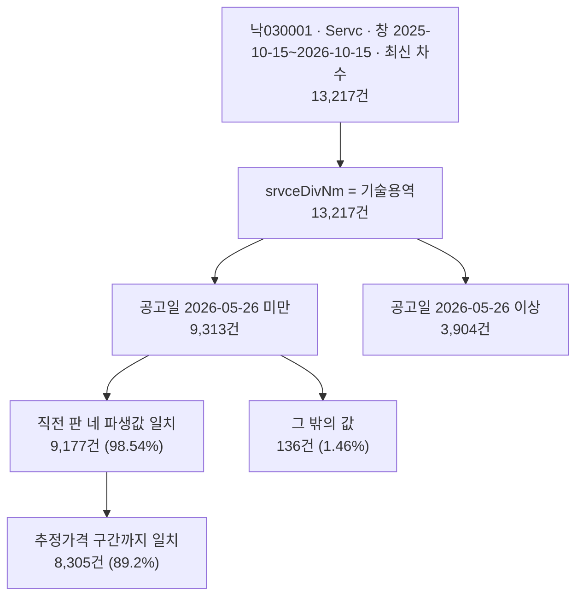

# 기술용역 적격심사 하한율 공고값과 별표 파생값 대조

> **작성일**: 2026-10-15
> **작업**: Orca Task `task_46e89b3e645d` (builder). 읽기 전용 측정이며 제품 코드를 바꾸지 않는다.
> **정본 사양**: `.orca/capsules/task_pps_tech_lwlt_rate_compare_20261015/capsule.yaml` (`ORCA_TASK_CAPSULE_V2`)
> **작업 브랜치**: `kwanbum217/orca-tech-lwlt-compare`
> **산출 파일**: 이 문서 (신규). 그 밖의 파일은 만들지 않았다.
> **측정 대상 명세**: [data/reference/pps_tech_lwlt_pre_20260526.yaml](../../data/reference/pps_tech_lwlt_pre_20260526.yaml) (시행 2025-09-01 ~ 2026-05-25 별표, 시행 2026-05-26 판은 `boundary_reference` 로만 수록)
> **선행 문서**: [pps_tech_lwlt_pre_20260526.md](pps_tech_lwlt_pre_20260526.md) (명세의 8절이 "공고 값과 별표 파생값의 대조"를 범위 밖으로 남겼다), [block_cause_split_20261015.md](block_cause_split_20261015.md) (`RULE_REGIME_MISMATCH` 시행일 묶음)
> **측정 DB**: Docker MySQL 스냅샷. `scripts/db_readonly_query.py` 의 `SELECT` 만 사용했고 `docker exec` 와 `mysql` 클라이언트는 쓰지 않았다.
> **범위**: 창 `2025-10-15` ~ `2026-10-15`, 업무구분 `Servc`, 낙찰방법 코드 `낙030001`(적격심사제), 최신 차수.

---

## 1. 목적과 결론

- 목적: 기술용역 적격심사 공고가 실은 낙찰하한율(`sucsfbidLwltRate`)이 시행일 `2026-05-26` 이전 별표에서 역산한 네 파생값과 실제로 얼마나 맞는지, 값 분포가 어떤지 읽기 전용으로 재고 기록한다.
- 요구 측정 구간(공고일 `2025-09-01` 이상 `2026-05-26` 미만)은 기술용역 적격심사 공고 **9,313건**이고, **전부 하한율을 실었다**(빈값·누락 0건). 그중 **9,177건(98.54%)** 이 네 파생값과 일치했다.
- 나머지 **136건(1.46%)** 은 네 파생값 밖의 값이다. 성격이 둘로 갈린다. 값을 어느 구간에도 대응시킬 수 없는 소수(예: `1`, `10`)와, 다른 시행판 또는 다른 용역 별표에서 나온 것으로 보이는 값(예: 시행 `2026-05-26` 판의 `88.745`·`89.745`, `82.995`·`82.95`)이다(3.3절).
- 파생값 일치 9,177건을 추정가격 구간까지 맞춰 보면 **8,305건(89.2%)** 이 구간까지 정확히 맞는다. 구간이 어긋나는 872건의 대부분은 추정가격 `2억 3천만원` 미만 구간이 구간 3의 값(`86.745`)을 실은 696건이다(3.4절).
- 시행일 `2026-05-26` 이후 공고는 별도 구간으로만 적는다(5절). 이 구간은 시행일 `2026-05-26` 판의 네 파생값 일치가 **719건(18.4%)** 에 그치고 **3,119건(79.9%)** 이 여전히 직전 판 값을 실었다. 이 값은 이 문서의 요구 측정 구간 밖이며 경계 참조로만 남긴다.

### 1.1 측정 흐름



---

## 2. 측정 정의와 방법

| 항목 | 값 |
| --- | --- |
| 창 | `bid_ntce_dt >= '2025-10-15'` 그리고 `bid_ntce_dt < '2026-10-16'` |
| 업무구분 | `category = 'Servc'` |
| 낙찰방법 | `raw_data.sucsfbidMthdCd = '낙030001'` (적격심사제) |
| 기술용역 식별 | `raw_data.srvceDivNm = '기술용역'` |
| 최신 차수 | `(bid_ntce_no, category)` 별 `MAX(bid_ntce_ord)` 한 행만 |
| 하한율 값 | `raw_data.sucsfbidLwltRate` |
| 추정가격 | `presmpt_prce` 컬럼 |

- **기술용역 식별 근거**: 공고 `raw_data.srvceDivNm` 이 `기술용역` 과 `일반용역` 을 나눈다. 같은 창·같은 낙찰방법에서 `낙030001` 최신 차수는 일반용역 18,214건, 기술용역 13,217건이다. 이 문서는 `srvceDivNm` 축을 쓴다.
- **민감도**: 낙찰방법명 `raw_data.sucsfbidMthdNm` 에 문자열 `기술용역` 이 들어 있는지로 좁히면 모집단이 달라진다. 좁은 정의에서 공고일 `2026-05-26` 미만은 8,292건(일치 8,276건), 이상은 3,467건이다. 차이 1,458건(13,217건의 11.0%)은 `적격심사제-관리규정외 수기심사(총점입력)` 처럼 낙찰방법명에 `기술용역` 이 없는 건이다. 이 문서의 본문 수치는 `srvceDivNm` 정의를 쓴다.
- **최신 차수 정리 효과**: 필터에 맞는 원시 행은 16,419건이고, 최신 차수만 남기면 13,217건이다.
- **차수 비교 방식**: 창 안의 `bid_ntce_ord` 는 모두 길이 3(`000` ~ `012`)이라 문자열 비교와 정수 비교 결과가 같다. 그래도 `CAST(bid_ntce_ord AS UNSIGNED)` 로 정수 비교해 `scripts/report_rule_coverage.py` 의 `_ord_key` 와 같은 순서를 쓴다.
- **읽기 전용 보장**: `scripts/db_readonly_query.py` 가 문장 시작 토큰 검사, 금지 키워드 검사, 단일 문장 검사를 하고, 질의는 `SET SESSION TRANSACTION READ ONLY` 안에서 실행된다. 쓰기 문장은 파서 수준과 드라이버 수준에서 함께 막힌다.
- **환경 변수**: `Settings` 가 `SECRET_KEY` 를 요구한다. 값은 실행 프로세스 환경에만 주입했고 파일·문서·보고에 적지 않았다.

---

## 3. 요구 측정: 공고일 2025-09-01 이상 2026-05-26 미만

### 3.1 건수 요약

| 구분 | 건수 | 비중 |
| --- | ---: | ---: |
| 기술용역 적격심사 공고(최신 차수) | 9,313 | 100.00% |
| 하한율 있음(`sucsfbidLwltRate` 비어 있지 않음) | 9,313 | 100.00% |
| 하한율 없음(빈값 또는 누락) | 0 | 0.00% |
| 직전 판 네 파생값과 일치 | 9,177 | 98.54% |
| 그 밖의 값 | 136 | 1.46% |

- 네 파생값은 시행 2025-09-01 판(조달청지침 제6352호)과 시행 2026-01-26 판(제654호)의 별표에서 역산한 `79.995`, `85.495`, `86.745`, `87.745` 다. 선행 명세 `pps_tech_lwlt_pre_20260526.yaml` 의 `derived_lwlt_rate` 와 같은 값이며, **원문이 인쇄한 낙찰하한율이 아니라 역산 파생값**이다(6절).
- 하한율이 없는 건이 0이라는 것은 `sucsfbidLwltRate` 가 JSON null 이거나 빈 문자열인 건이 이 구간에 없다는 뜻이다.

### 3.2 네 파생값별 건수

| 파생값(구간) | 추정가격 구간 | 건수 | 비중 |
| ---: | --- | ---: | ---: |
| 79.995 (구간 1) | 10억원 이상 | 2,446 | 26.27% |
| 85.495 (구간 2) | 10억원 미만 5억원 이상 | 1,114 | 11.96% |
| 86.745 (구간 3) | 5억원 미만 고시금액 이상 | 2,080 | 22.33% |
| 87.745 (구간 4) | 고시금액 미만 | 3,537 | 37.98% |
| **합계** | | **9,177** | **98.54%** |

- 검산: 2,446 + 1,114 + 2,080 + 3,537 = 9,177.

### 3.3 그 밖의 값 분포 136건

| 값 | 건수 | 값 | 건수 | 값 | 건수 |
| ---: | ---: | ---: | ---: | ---: | ---: |
| 82.995 | 32 | 89.745 | 2 | 85.745 | 1 |
| 100 | 21 | 88.745 | 2 | 87.5 | 1 |
| 80.495 | 18 | 10 | 2 | 88.25 | 1 |
| 88 | 15 | 47.995 | 2 | 99 | 1 |
| 77.995 | 10 | 80.5 | 1 | 88.738 | 1 |
| 1 | 9 | 72.95 | 1 | 80 | 1 |
| 82.95 | 4 | 100.0 | 1 | 86.75 | 1 |
| 84.95 | 2 | 85 | 1 | 84.245 | 1 |
| 89 | 2 | 90.0 | 1 | 84.995 | 1 |
| | | | | 86.48 | 1 |

- 검산: 상위 6행 합 105, 다음 6행 합 16, 1건짜리 15행 합 15, 총 136.
- 성격 구분:
  - **다른 시행판 값**: `89.745`·`88.745` 는 시행 `2026-05-26` 판의 구간 4·3 파생값이다. `82.995`(32건)·`82.95`(4건)·`80.495`(18건)는 시행 `2026-05-26` 판 계열의 다른 별표 값으로 보이나, 이 문서는 그 유도를 확정하지 않는다.
  - **구간 대응이 서지 않는 값**: `1`(9건), `10`(2건), `100`(21건)·`100.0`(1건), `47.995`(2건) 등이다. `100` 은 하한율이 아니라 상한 성격의 입력으로 보이지만 근거를 확인하지 않았다.
  - **별표 밖 소수 표기**: `86.75`·`86.48`·`88.738`·`87.5`·`88.25`·`85`·`89` 같이 별표의 `.995` 표기 관행을 따르지 않는 값이 1~2건씩 있다.
- 값의 출처가 공고마다 다를 수 있으므로, 이 136건을 "오류"로 단정하지 않는다. 하한율을 실은 주체와 산식은 이 Task 의 측정 범위 밖이다.

### 3.4 추정가격 구간까지 맞춘 일치

구간 경계는 별표 구간 1·2의 경계(10억원, 5억원)와 구간 3·4의 경계를 썼다. 구간 3·4 경계는 별표가 문자열 `고시금액` 으로만 적어 수치가 원문에 없다. 아래 표는 측정에서 **관찰된** 경계 `230,000,000` 을 쓴 것이다(3.5절).

| 추정가격 구간 | 기대 파생값 | 전체 | 구간까지 일치 | 구간 일치율 |
| --- | ---: | ---: | ---: | ---: |
| 10억원 이상 | 79.995 | 2,505 | 2,446 | 97.64% |
| 10억원 미만 5억원 이상 | 85.495 | 958 | 942 | 98.33% |
| 5억원 미만 2억 3천만원 이상 | 86.745 | 1,438 | 1,384 | 96.24% |
| 2억 3천만원 미만 | 87.745 | 4,412 | 3,533 | 80.09% |
| **합계** | | **9,313** | **8,305** | **89.18%** |

- 구간까지 일치 8,305건은 값만 본 일치 9,177건보다 872건 적다. 값은 네 파생값 중 하나이지만 추정가격 구간과 짝이 어긋나는 건이 872건이라는 뜻이다.
- 어긋남의 대부분은 마지막 구간이다. 추정가격 `2억 3천만원` 미만인데 구간 3의 값 `86.745` 를 실은 건이 696건, 구간 2의 값 `85.495` 를 실은 건이 141건이다. 구간 3에서 구간 2의 값 `85.495` 를 실은 건은 30건이다.
- 10억원 이상 구간에서는 `82.995` 22건, `80.495` 16건, `77.995` 10건이 네 파생값 밖이다.

### 3.5 구간 3·4 경계 관찰

추정가격 5억원 미만 건에서 값별 추정가격 분포를 세었다. `87.745` 는 2억 3천만원 미만에 3,533건, 이상에 3건으로 사실상 한쪽에만 있다. `86.745` 는 2억 3천만원 이상에 1,384건, 미만에 696건이다.

| 추정가격 구간 | 87.745 | 86.745 | 85.495 |
| --- | ---: | ---: | ---: |
| 1억원 미만 | 983 | 106 | 4 |
| 1억원 이상 2억원 미만 | 2,467 | 298 | 96 |
| 2억원 이상 2억 3천만원 미만 | 83 | 292 | 41 |
| 2억 3천만원 이상 3억원 미만 | 2 | 476 | 8 |
| 3억원 이상 4억원 미만 | 1 | 512 | 15 |
| 4억원 이상 5억원 미만 | 0 | 396 | 7 |

- `87.745` 분포가 `2억 3천만원` 에서 끊기고 `86.745` 가 그 위에서 우세해, 별표 구간 3·4 경계가 `230,000,000` 부근임을 데이터가 시사한다. 다만 이 수치는 **별표 원문에 인쇄된 값이 아니라 측정에서 관찰한 경계**이며, 연도별 고시금액 자체를 원문으로 확인한 것은 아니다.

---

## 4. 공고일 2025-09-01 이전 구간

| 구간 | 건수 | 별표 값 대조 |
| --- | ---: | --- |
| 공고일 `2025-09-01` 미만 | 0 | 하지 않음 |
| 공고일 `2025-09-01` 이상 | 13,217 | 3절·5절 |

- 요구 창이 `2025-10-15` 부터라 창 안에 공고일 `2025-09-01` 미만인 건이 **한 건도 없다**. 위 0건은 창의 시작이 `2025-09-01` 보다 늦기 때문이며, 값 대조를 하지 않은 것이 아니라 대조할 모집단이 비어 있다.
- 따라서 시행 2022-11-01 판(조달청지침 제8983호) 구간의 실측은 이 Task 에 없다. 창을 넓혀 재려면 별도 Task 가 필요하다.
- 참고로 선행 명세는 시행 2022-11-01 ~ 2026-05-25 동안 하한 계열 별표 값(기준비율 `88/100`, 평점 평탄 비율 `96 / 90.5 / 89.25 / 88.25`)이 한 번도 바뀌지 않았다고 적는다. 그 기록이 맞다면 창을 넓혀도 비교 대상은 같은 네 파생값이 된다.

---

## 5. 경계 참조: 공고일 2026-05-26 이상

요구 측정 구간 밖이지만 같은 창·같은 모집단이므로 함께 기록한다. 비교 대상은 선행 명세 `boundary_reference`(조달청지침 제5283호)의 파생값 `81.995`, `87.495`, `88.745`, `89.745` 다.

| 값 | 건수 | 비중 | 성격 |
| ---: | ---: | ---: | --- |
| 89.745 | 371 | 9.50% | 시행 2026-05-26 판 구간 4 파생값 |
| 87.495 | 131 | 3.36% | 시행 2026-05-26 판 구간 2 파생값 |
| 88.745 | 119 | 3.05% | 시행 2026-05-26 판 구간 3 파생값 |
| 81.995 | 98 | 2.51% | 시행 2026-05-26 판 구간 1 파생값 |
| 79.995 | 1,033 | 26.46% | 직전 판 구간 1 파생값 |
| 87.745 | 977 | 25.03% | 직전 판 구간 4 파생값 |
| 86.745 | 774 | 19.83% | 직전 판 구간 3 파생값 |
| 85.495 | 335 | 8.58% | 직전 판 구간 2 파생값 |
| 그 밖의 값 | 66 | 1.69% | 3절과 같은 성격 |
| **합계** | **3,904** | **100.00%** | |

- 시행일 `2026-05-26` 이후 공고 3,904건 가운데 시행 `2026-05-26` 판 파생값을 실은 건은 **719건(18.42%)** 이다. 직전 판 파생값을 실은 건이 **3,119건(79.90%)** 로 더 많다.
- 추정가격 구간까지 맞춘 일치도 같은 모양이다. 구간별 구간 일치율은 10억원 이상 8.53%, 5억~10억원 18.43%, 2억 3천만원~5억원 17.19%, 2억 3천만원 미만 21.30% 이고 합계 648건(16.60%)이다.
- 이 구간의 값 분포는 시행일과 공고 하한율이 항상 같이 움직이지는 않는다는 사실을 보여준다. 다만 이 문서는 그 원인을 판정하지 않는다. `block_cause_split_20261015.md` 가 다룬 차단은 반대 방향(공고일이 시행일보다 이른 건)이며, 이 구간은 차단 건이 아니다.
- 발행 원장의 `2026-10-14` 창 수치(공고 31,485건, 차단 20,973건)는 이 문서의 `2025-10-15` ~ `2026-10-15` 창과 다른 측정이다. 두 수치를 서로 대체하지 않는다.

---

## 6. 값 출처와 용어

| 구분 | 내용 |
| --- | --- |
| 원문 인쇄값 | 별표 1 의 기준비율 `88/100`, 평점계수 `1/2/4/20`, 배점한도 `30/50/70/90`, 평점 평탄 비율 `96 / 90.5 / 89.25 / 88.25`, 본문 제4조의 통과점수 `92`·`95` |
| 역산 파생값 | 위 값에 `기준비율 - (100 - 통과점수) / k` 를 적용하고 소수 둘째 자리까지 버린 뒤 `0.005` 를 뺀 값. `79.995`, `85.495`, `86.745`, `87.745` 와 시행 `2026-05-26` 판의 `81.995`, `87.495`, `88.745`, `89.745` |
| 공고 실린 값 | `raw_data.sucsfbidLwltRate`. 세부기준이 직접 인쇄하지 않는다 |

- 이 문서가 "일치"라고 적은 것은 **공고가 실은 값과 별표에서 역산한 파생값의 수치가 같다**는 뜻이다. 파생값을 원문이 인쇄한 낙찰하한율이라고 적지 않는다. 원문 판독 텍스트에 `낙찰하한율` 문자열은 네 판 모두 0회다(선행 명세 4절).
- 파생값과 공고 값을 잇는 유도 관계는 원문이 문장으로 적어 두지 않았다. 이 문서는 그 관계를 확정하지 않는다.

---

## 7. 이 문서가 하지 않은 것

| 항목 | 상태 |
| --- | --- |
| 규칙 코드 | 변경 없음. `src/app/services/evaluation_rules.py` 와 구판 등록 여부를 다루지 않았다 |
| 발행 원장 | 변경 없음. `data/reference/rule_coverage_ledger.yaml` 을 읽지도 쓰지도 않았다 |
| 상태 문서 | 변경 없음. `docs/context/CURRENT_STATE.md` 를 수정하지 않았다 |
| 별표 명세 | 변경 없음. `data/reference/pps_tech_lwlt_pre_20260526.yaml` 을 수정하지 않았다 |
| 구판 등록 결정 | 하지 않음. 구판을 코드에 넣을지 여부는 이 문서의 결론이 아니며 사용자 결정 사항으로 남는다 |
| 창 밖 측정 | 하지 않음. 창은 `2025-10-15` ~ `2026-10-15` 로 고정했다. 공고일 `2025-09-01` 이전 구간은 창 안에서 비어 있다 |
| 임시 산출물 | 만들지 않음. 측정 출력은 SQL 결과를 파이프로 집계했고 별도 YAML·캐시 파일을 남기지 않았다 |

---

## 8. 한계와 후속

| 항목 | 내용 |
| --- | --- |
| 기술용역 식별 | `raw_data.srvceDivNm` 축을 썼다. 낙찰방법명 문자열로 좁히면 공고일 `2026-05-26` 미만이 8,292건으로 1,021건 줄어든다(2절 민감도) |
| 구간 3·4 경계 | 별표는 경계를 문자열 `고시금액` 으로만 적는다. 이 문서는 측정에서 관찰된 `230,000,000` 을 썼고, 고시금액 자체를 원문으로 확인하지 않았다 |
| 그 밖의 값 성격 | 136건과 66건의 값이 어느 판·어느 별표에서 나왔는지 확정하지 않았다. "다른 시행판 계열로 보인다"는 수준이다 |
| 값의 의미 | `sucsfbidLwltRate` 를 실은 주체와 산식은 확인하지 않았다. 이 문서는 수치 비교만 한다 |
| 선행 문서와의 관계 | 선행 문서는 구판 별표 수집과 차단 원인 분석이다. 이 문서는 그 명세의 파생값과 실제 공고 값의 대조이며, 선행 문서들을 덮지 않는다 |
| 후속 | 구판 등록 여부, 그리고 시행 `2026-05-26` 이후 구간에서 직전 판 값이 다수 남는 원인은 사용자 결정과 별도 Task 로 진행한다 |

---

## 9. 재현 방법

```sh
export SECRET_KEY=<32자 이상 임시값>
uv run python scripts/db_readonly_query.py --limit 0 --format json --sql "
SELECT CASE WHEN a.bid_ntce_dt < '2026-05-26' THEN 'A_pre' ELSE 'B_post' END AS win,
       CASE WHEN a.presmpt_prce >= 1000000000 THEN '1_ge10eok'
            WHEN a.presmpt_prce >= 500000000 THEN '2_5to10eok'
            WHEN a.presmpt_prce >= 230000000 THEN '3_2.3to5eok'
            ELSE '4_lt2.3eok' END AS band,
       JSON_UNQUOTE(JSON_EXTRACT(a.raw_data, '\$.sucsfbidLwltRate')) AS lwlt,
       COUNT(*) AS n
FROM bid_announcements a
JOIN (
  SELECT bid_ntce_no, category, MAX(CAST(bid_ntce_ord AS UNSIGNED)) AS mo
  FROM bid_announcements
  WHERE category = 'Servc'
    AND bid_ntce_dt >= '2025-10-15' AND bid_ntce_dt < '2026-10-16'
  GROUP BY bid_ntce_no, category
) m ON m.bid_ntce_no = a.bid_ntce_no AND m.category = a.category
   AND CAST(a.bid_ntce_ord AS UNSIGNED) = m.mo
WHERE a.bid_ntce_dt >= '2025-10-15' AND a.bid_ntce_dt < '2026-10-16'
  AND JSON_UNQUOTE(JSON_EXTRACT(a.raw_data, '\$.sucsfbidMthdCd')) = '낙030001'
  AND JSON_UNQUOTE(JSON_EXTRACT(a.raw_data, '\$.srvceDivNm')) = '기술용역'
GROUP BY win, band, lwlt
ORDER BY win, band, n DESC"
```

- 검산 순서: 3.1절의 합(9,313)이 3.2절과 3.3절의 합(9,177 + 136)과 같은지, 3.4절 구간별 전체 합이 9,313인지, 5절 합이 3,904인지 확인한다.
- 모집단을 좁은 정의로 바꾸려면 같은 질의에 `AND JSON_UNQUOTE(JSON_EXTRACT(a.raw_data, '\$.sucsfbidMthdNm')) LIKE '%기술용역%'` 를 더한다. 2절 민감도 수치가 나와야 한다.
- 환경 변수 값은 셸 세션에만 두고 파일로 만들지 않는다.
