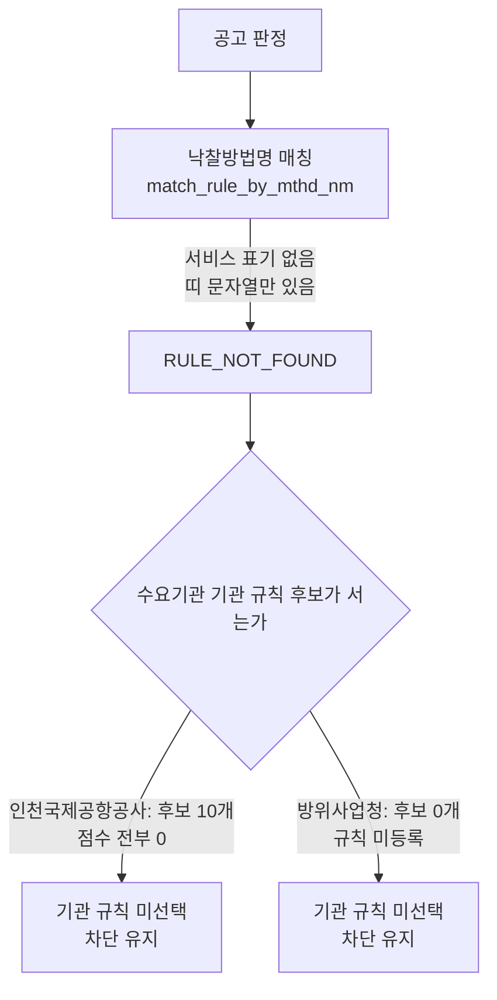

# 규칙 미발견 2건의 공고 식별 문자열 불일치

> **작성일**: 2026-10-15
> **작업**: Orca Task `task_809a17f60255` (builder). 읽기 전용 조사이며 제품 코드를 바꾸지 않는다.
> **정본 사양**: `.orca/capsules/task_rule_not_found_id_mismatch_20261015/capsule.yaml` (`ORCA_TASK_CAPSULE_V2`)
> **작업 브랜치**: `kwanbum217/orca-id-mismatch`
> **선행 문서**: [block_cause_split_20261015.md](block_cause_split_20261015.md) (RULE_NOT_FOUND 499건의 두 갈래)
> **측정 DB**: 호스트 `127.0.0.1:3306` 의 Docker MySQL `procurement`. 선행 문서와 같은 창·같은 스냅샷이다.
> **범위**: 최근 12개월(`2025-10-15`~`2026-10-15`), 업무구분 `Servc`, 낙찰방법 코드 `낙030001`(적격심사제).
> **판정**: `candidate`. 매칭 패턴을 추가하지 않았고 대응 선택지도 확정하지 않았다.

---

## 1. 목적과 결론

- 목적: 선행 문서 3.2절이 "명단에 있으나 별표 식별 문자열이 맞지 않는 수요기관 2건"으로만 적고 넘긴 지점을, 공고 식별 문자열 수준에서 확인한다. 대응 구현은 하지 않는다.
- 두 건은 낙찰방법명이 **띠 문자열 하나뿐**이라는 공통점을 가진다. 낙찰방법명 `적격심사제-추정가격 15억원 미만 5억원 이상인 용역` 에는 서비스 표기(시설분야용역·학술연구용역·폐기물처리용역·기타용역 등)가 전혀 없다.
- 인천국제공항공사 건은 기관 규칙 후보 10개가 모두 서지만 매칭 점수가 전부 0이라 기관 규칙이 선택되지 않는다. 방위사업청 건은 기관 규칙 자체가 코드에 등록돼 있지 않다. 두 경우 모두 조달청 기본 별표 경로로 되돌아가는데, 그 경로에 이 띠가 없다.
- 결론: 두 공고에만 붙는 좁은 서비스 표기 토큰은 없다. 폐기물처리·폐기물처리용역 같은 넓은 토큰은 매칭 패턴으로 권하지 않는다(5절).

### 1.1 두 건이 걸리는 지점



---

## 2. 측정 방법

- 차단 판정은 서비스의 실제 판정 함수 `resolve_evaluation_rule_from_raw_data`(`src/app/services/evaluation_rules.py:6728`)를 그대로 호출해 얻었다. 판정 로직을 측정용으로 새로 만들지 않는다(train/serve skew 방지).
- 기관 규칙 선택 단계는 같은 파일의 `_select_institution_rule`(`src/app/services/evaluation_rules.py:5730`)과 `_institution_match_score`(`:5715`)를 직접 호출해 후보별 점수를 확인했다.
- DB 는 `uv run python scripts/db_readonly_query.py` 의 `SELECT` 만 썼다. 이 스크립트는 문장 시작 토큰 검사와 `READ ONLY` 트랜잭션으로 쓰기를 막는다(`scripts/db_readonly_query.py:120`, `:149`). `docker exec` 와 `mysql` 클라이언트는 쓰지 않았다.
- 환경 변수 값은 프로세스에만 두었고 이 문서에 적지 않는다. 이 워크트리에 `.env` 가 없어 `SECRET_KEY` 는 임시값을 환경변수로만 주입했다(7절).
- 대상 집합: 같은 창·같은 업무구분·낙찰방법 코드로, 수요기관명이 두 곳인 공고 89행. 그중 `RULE_NOT_FOUND` 는 2행이고 기관별로 1행씩이다.
- DB 쓰기, `src/` 변경, 기관 규칙 명세 변경, 발행 원장 변경은 모두 없다.

---

## 3. 두 공고의 식별 문자열

| 항목 | A. 인천국제공항공사 | B. 방위사업청 |
| --- | --- | --- |
| 수요기관명 | 인천국제공항공사 | 방위사업청 |
| 수요기관 코드 | `B551177` | `1690000` |
| 명단 상태(선행 문서) | `confirmed` | `partial` |
| 공고명 | 2026년 공항운영분야 건설폐기물 위탁처리용역 | 방위사업청 청사 신축공사 건설폐기물 처리용역 |
| 낙찰방법명 | 적격심사제-추정가격 15억원 미만 5억원 이상인 용역 | 적격심사제-추정가격 15억원 미만 5억원 이상인 용역 |
| 낙찰방법 코드 | `낙030001` | `낙030001` |
| 업무구분 | `Servc` / 일반용역 | `Servc` / 일반용역 |
| 공고기관 | 인천국제공항공사 (`B551177`) | 조달청 서울지방조달청 (`1230121`) |
| 차단 코드 | `RULE_NOT_FOUND` | `RULE_NOT_FOUND` |

- 두 공고의 낙찰방법명이 **같은 문자열**이다. 이 띠 표기는 창 안에서 389건에 쓰인다(5절). 즉 띠 문자열 자체는 특이값이 아니고, 특이한 것은 이 띠에 서비스 표기가 붙지 않은 공고라는 점이다.
- 두 공고 모두 공고 하한율(`sucsfbidLwltRate`)과 예정가격 결정방법(`복수예가`)을 정상적으로 갖고 있다. 차단 원인은 값의 결측이 아니라 별표 식별이다.
- 같은 기관 21건 규칙 적용(인천국제공항공사)과 4건 조달청 기본 규칙 적용(방위사업청)은 선행 문서 3.2절 값을 그대로 쓴다. 이 문서는 그 명단을 다시 세지 않는다.

---

## 4. 왜 기존 기관 규칙과 맞지 않는가

### 4.1 공통 — 낙찰방법명에 별표 식별 문자열이 없다

- 조달청 기본 경로는 `match_rule_by_mthd_nm(sucsfbid_mthd_nm, ...)`(`src/app/services/evaluation_rules.py:6111`)로 **낙찰방법명만** 본다. 공고명은 이 단계의 입력이 아니다.
- 낙찰방법명을 정규화하면 `적격심사제추정가격15억원미만5억원이상인용역` 이다. 서비스 표기가 없으므로 기관 규칙 패턴은 물론 조달청 별표 패턴 중 어느 것도 이 문자열에 들어 있지 않다.
- 조달청 일반용역 띠로 등록된 표기는 추정가격 2억원 미만(`SERVC_QUAL_POST_20260526_ATTACH_12`, `:949`), 5억원 미만 2억원 이상(`_ATTACH_13`, `:966`), 30억원 미만 15억원 이상(`_ATTACH_14`, `:983`) 셋이다. `추정가격 15억원 미만 5억원 이상` 띠는 등록돼 있지 않다.
- 두 공고일(`2025-11-03`, `2026-03-17`)은 모두 시행일 `2025-09-01` 벌 구간이라 `_allocate_rules_for_announcement`(`:6209`)가 개정 전 벌을 고른다. 그 벌과 현행 벌 어디에도 이 띠는 없으므로 매칭이 서지 않고 `match_rule_by_mthd_nm` 이 `None` 을 돌려준다. 호출부는 여기서 `RULE_NOT_FOUND` 로 차단한다(`:6679`~`:6688`).
- 두 공고의 업무구분이 `일반용역` 이라 기술용역 경로(`:6637`)도 타지 않는다. 이 경로는 `srvce_div_nm == "기술용역"` 일 때만 서고, 낙찰하한율을 공고값으로 적용한다.

### 4.2 A. 인천국제공항공사 — 후보는 서지만 점수가 0

- 수요기관 코드 `B551177` 이 기관 규칙의 `institution_code` 와 같아 후보 10개가 모두 선다(`_axis_matches`, `src/app/services/evaluation_rules.py:6068`; 매칭 축은 `:6084`~`:6091`).
- 기관 규칙 선택은 낙찰방법명 **과 공고명을 합친 텍스트**를 정규화해 규칙의 `patterns` 포함 여부를 본다(`:5770`~`:5775`). 이 건의 정규화 텍스트는 `적격심사제추정가격15억원미만5억원이상인용역2026년공항운영분야건설폐기물위탁처리용역` 이다.
- 폐기물 계열 등록 표기는 `폐기물처리용역`·`폐기물처리`(`SERVC_INST_IIAC_20250101_WASTE`, `:4789`)인데, 공고명은 `건설폐기물 위탁처리용역` 이다. 정규화하면 `건설폐기물위탁처리용역` 이 되어 `폐기물` 과 `처리용역` 사이에 `위탁` 이 끼고, 등록 표기가 부분 문자열로도 성립하지 않는다. `기타` 표기도 텍스트에 없다.
- 그래서 후보 10개 전부 점수 0이다. 점수가 0이면 `_select_institution_rule` 은 규칙도 차단도 돌려주지 않고(`:5774`~`:5775`), 호출부는 조달청 경로에서 선 `RULE_NOT_FOUND` 를 그대로 유지한다(`:6298`~`:6317`). 이 건의 `scope_stage` 는 비어 있고, 차단 사유 메시지도 조달청 기본 별표 문구다.
- 같은 기관·같은 폐기물 계열 공고라도 낙찰방법명에 `적격심사제-폐기물처리용역 추정가격 고시금액 미만` 표기가 있으면 WASTE 규칙 점수가 7로 서서 기관 규칙이 선택된다. 즉 선택을 만드는 것은 공고명이 아니라 낙찰방법명의 서비스 표기다. 이 건은 그 표기가 빠졌고 공고명 단서도 등록 표기와 어긋난다.

### 4.3 B. 방위사업청 — 기관 규칙 자체가 없다

- `INSTITUTION_RULES`(`src/app/services/evaluation_rules.py:3023` 이하)에 방위사업청 규칙이 없다. 코드 주석이 이유를 적는다: 정본 `data/reference/institution_rules_20261013.yaml` 의 `partial` 5곳(방위사업청 포함)은 값 추정을 피해 넣지 않고 종전 조달청 규칙 경로를 그대로 쓴다(`:2897`~`:2900`).
- 따라서 기관 규칙 후보가 0개이고 `_select_institution_rule` 이 곧바로 빈 결과를 돌려준다(`:5759`~`:5760`). 기관 단위 식별 실패가 아니라 기관 규칙 부재다.
- 이 건은 공고기관이 조달청 서울지방조달청(`1230121`)이라 조달청 대행 배제(`:5761`~`:5768`, `EXCLUDE_INSTITUTION_RULES_FOR_PPS_PROXY`)도 걸리지만, 후보가 이미 0개여서 배제 여부가 결과를 바꾸지 않는다.
- 남는 단서는 낙찰방법명의 띠 문자열 하나인데, 그 띠가 조달청 일반 별표에 없다(4.1절). 결과가 `RULE_NOT_FOUND` 다.
- 원장의 `registry_status` 가 `partial` 인 것과 코드 기관 규칙 레지스트리에 규칙이 없는 것은 같은 사실의 두 표현이다. `partial` 은 "명단에 이름은 있으나 확정된 별표 구간 값이 없다"는 뜻이고, 그 상태를 코드가 종전 경로로 처리한다.

---

## 5. 좁은 토큰 후보 (기록만, 패턴으로 넣지 않음)

- 창 안 `Servc` 공고명에서 두 공고를 가르는 문자열을 세었다. 판정 기준은 "그 문자열이 이 공고에만 있는가"와 "그 문자열이 별표 서비스 표기에 준하는가" 두 가지다.

| 대상 | 후보 문자열 | 창 안 건수 | 판단 |
| --- | --- | ---: | --- |
| A | 공항운영분야 | 1 | 이 공고에만 있다. 다만 사업명 수식어이고 별표 서비스 표기가 아니다. 후보로만 기록하고 넣지 않는다. |
| A | 건설폐기물위탁처리 | 43 | 넓다. 다른 공고에도 붙는다. |
| A | 폐기물위탁처리 | 1,035 | 넓다. |
| A·B 공통 | 추정가격 15억원 미만 5억원 이상 | 389 (낙찰방법명 기준) | 띠 문자열이며 넓다. 값을 넘겨받는 띠 규칙이라 패턴 토큰이 아니다. |
| B | 청사신축공사건설폐기물 | 5 | 이 공고 전용이 아니다. |

- 결론: 두 공고에만 붙으면서 별표 식별 문자열에 준하는 좁은 토큰은 **없다**. A 의 `공항운영분야` 는 유일하지만 별표 표기가 아니라 사업명 수식어이므로 기록에 그친다.
- `폐기물처리`, `폐기물처리용역`, `적격심사`, `일반용역` 처럼 다른 용역 공고에도 붙는 토큰은 매칭 패턴으로 권하지 않는다. 기관 규칙의 `patterns` 는 `_institution_match_score` 가 **가장 긴 표기**를 채택하는 구조라(`:5715`~`:5727`), 넓은 토큰을 더하면 인천국제공항공사의 폐기물·기타 건에서 다른 규칙과 동점이 되어 `RULE_SCOPE_AMBIGUOUS` 차단이 늘 위험이 있다.
- 하위 조직 접두를 추가하거나 권고하지 않는다. 이 두 건은 접두 문제가 아니다.
- 이 문서는 어떤 패턴도 코드에 넣지 않았고, 넣을 것을 권고하지도 않는다. 대응 선택지(띠 규칙 추가, 수기심사 안내, 기관 규칙 등록 등)는 확정하지 않는다.

---

## 6. 이 문서가 하지 않은 것

| 항목 | 상태 |
| --- | --- |
| `src/app/services/evaluation_rules.py` | 수정 없음. 기관 규칙 패턴 변경 없음 |
| 기관 규칙 명세 `data/reference/institution_rules_20261013.yaml` | 수정 없음 |
| 발행 원장 `data/reference/rule_coverage_ledger.yaml` | 수정 없음 |
| `docs/context/CURRENT_STATE.md` | 수정 없음 |
| DB | 쓰기 없음. `SELECT` 만 사용 |
| 패턴 권고 | 없음. 좁은 토큰 후보만 기록(5절) |

- 검산: 두 공고 모두 `RULE_NOT_FOUND` 1행씩이고, 선행 문서 3.2절 갈래 B 의 두 수요기관과 기관·건수가 1:1로 같다. 갈래 A(497건)와 497건의 미등록 기관 명단은 재조사하지 않았다.
- 한계: 이 측정은 낙찰방법명과 공고명 문자열만 본다. 원문 별표가 어느 띠를 대상으로 하는지는 공고문 확인이 필요하며, 이 문서는 그 결론을 내지 않는다.
- 후속: 대응 구현은 사용자 결정과 별도 Task 로 진행한다. 이 문서는 그 근거 자료다.

---

## 7. 재현 방법

```sh
# 두 기관의 12개월 창 공고를 판정 함수에 직접 넣는다. 값은 프로세스에만 둔다.
SECRET_KEY=<32자 이상 임시값> uv run python scripts/db_readonly_query.py \
  --format json --limit 0 \
  --sql "SELECT id, category, dminstt_nm, cntrct_mthd_nm, presmpt_prce, raw_data
         FROM bid_announcements
         WHERE category='Servc'
           AND dminstt_nm IN ('인천국제공항공사','방위사업청')
           AND JSON_UNQUOTE(JSON_EXTRACT(raw_data,'\$.sucsfbidMthdCd'))='낙030001'
           AND bid_ntce_dt >= '2025-10-15'" \
| uv run python -c '
import sys, json
sys.path.insert(0, ".")
from src.app.services.evaluation_rules import resolve_evaluation_rule_from_raw_data
for r in json.load(sys.stdin):
    raw = json.loads(r["raw_data"])
    res = resolve_evaluation_rule_from_raw_data(
        r["category"], raw,
        institution_name_fallback=r.get("dminstt_nm"),
        cntrct_mthd_nm=r.get("cntrct_mthd_nm"),
        estimated_price=r.get("presmpt_prce"),
    )
    if res.block_reason_code == "RULE_NOT_FOUND":
        print(r["id"], r["dminstt_nm"], raw.get("sucsfbidMthdNm"), raw.get("bidNtceNm"))
'
```

- 4.2절의 후보 점수는 `_select_institution_rule` 과 `_institution_match_score` 를 같은 방식으로 직접 호출해 확인한다. 인천국제공항공사 건은 후보 10개가 전부 0점이고, 낙찰방법명에 폐기물처리용역 표기가 있는 건은 WASTE 규칙이 7점이다.
- 5절의 건수는 공고명에서 공백을 지운 뒤 문자열 포함으로 세고, 띠 문자열은 `sucsfbidMthdNm` 값 일치로 센다.
