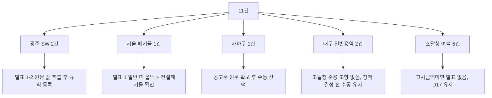

# 정량평가 산식 차단 공고 11건 원문 확인 조사 (2026-11-15)

> **작성일**: 2026-11-15
> **작업**: Orca Task `task_44011d803b3e` (builder, `run_87d6d4d819d1`). 소스 코드·규칙 데이터·시험은 고치지 않고 조사 문서 한 개만 씁니다.
> **정본 사양**: `.orca/capsules/task_source_check_11_20261115/capsule.yaml` (`ORCA_TASK_CAPSULE_V2`)
> **대상**: 11건. 광주광역시 소프트웨어 2건과 `docs/analysis/blocked_misc_rules_20261115.md` 3절 R2~R5의 9건입니다.
> **원문 범위**: 저장소 안의 원문 수집 문서(`docs/analysis/`)와 원문 사본·추출본(`data/`)만 씁니다. 웹을 조회하지 않았습니다.
> **판정 단위**: 공고 1건입니다. 등록·재공고로 같은 사업이 반복되어도 원장 규칙대로 각각 1건으로 셉니다.
> **검증**: `python3 scripts/validate_agent_rules.py --quiet`

---

## 1. 요약

### 1.1 판정 라벨

| 라벨 | 정의 |
| --- | --- |
| 자체 별표 있음 | 질문한 용역 유형의 자체 별표가 해당 시·도 원문에 있고, 별표 번호를 저장소 문서에서 확인할 수 있음 |
| 준용 조항 있음 | 질문한 유형의 자체 별표는 없지만, 원문의 준용 조항이 적용할 다른 기준을 지목함 |
| 해당 없음 | 질문한 별표 또는 조항이 원문에 없음. 준용 조항이 있어도 특정 기준을 지목하지 않으면 이 라벨로 적음 |
| 원문 미확보 | 저장소 안에 판정에 쓸 원문 근거가 없음 |

이번 11건에는 `준용 조항 있음`으로 판정할 건이 없습니다. 서울특별시 제8조와 대구광역시 제12조제1항은 준용 조항이지만 `관련 법령 및 예규 등`처럼 대상을 특정하지 않아, `조달청 준용 조항이 있는가`라는 질문에는 `해당 없음`이 맞습니다.

### 1.2 판정표

| 건 | 공고번호 | 질문 | 판정 | 근거 위치 |
| ---: | --- | --- | --- | --- |
| 1 | `R25BK01171487` | 광주광역시 예규 제377호에 자체 소프트웨어 별표가 있는가 | 자체 별표 있음 (별표 1-2) | `docs/analysis/local_rule_not_found_38_source_20261106.md:125`, `:128` |
| 2 | `R26BK01454418` | 같음 | 자체 별표 있음 (별표 1-2) | 같음 |
| 3 | `R25BK01244020` | 사하구 을숙도문화회관 `인력공급서비스`가 단순노무인가 | 원문 미확보 | `docs/analysis/blocked_misc_rules_20261115.md:50`, `:93`, `:200` |
| 4 | `R26BK01817736` | 서울특별시 예규에 폐기물처리용역 전용 별표가 있는가 | 해당 없음 (전용 별표 없음, 별표 1 일반 띠 폴백) | `docs/analysis/local_general_fallback_source_check_20261107.md:42` |
| 5 | `R26BK01270603` | 대구광역시 예규 제238호 일반용역에 조달청 준용 조항이 있는가 | 해당 없음 (조달청 지목 없음) | `docs/analysis/local_rule_not_found_38_source_20261106.md:119` |
| 6 | `R26BK01724914` | 같음 | 해당 없음 (조달청 지목 없음) | 같음 |
| 7 | `R26BK01344845` | 조달청 여객 육상운송에 `고시금액미만` 별표가 있는가 | 해당 없음 (여객 별표는 5억원 2구간) | `docs/analysis/servc_2023_53_original_attachments_20261003.md:30`, `:48` / `docs/analysis/rule_not_found_32_source_20261106.md:74-82` |
| 8 | `R26BK01348950` | 같음 | 해당 없음 | 같음 |
| 9 | `R26BK01365102` | 같음 | 해당 없음 | 같음 |
| 10 | `R26BK01367374` | 같음 | 해당 없음 | 같음 |
| 11 | `R26BK01372328` | 같음 | 해당 없음 | 같음 |
| **합계** | | | **자체 별표 있음 2, 해당 없음 8, 원문 미확보 1** | **11건** |

### 1.3 핵심 결론

1. **광주광역시 예규 제377호에는 소프트웨어 별표가 있습니다.** 제6조가 `2. 소프트웨어용역 : 별표 1-2` 를 명시합니다(`docs/analysis/local_rule_not_found_38_source_20261106.md:128`). 기존 인수인계 문서의 `광주 구판에 소프트웨어 별표가 없어 차단 유지` 는 별표 부재가 아니라 `별표 1-2` 값이 코드에 미등록된 상태를 잘못 옮긴 것입니다.
2. **광주 별표 1-2 의 산식 값은 저장소에 없습니다.** 코드에는 광주 구판 `별표 1-3`(폐기물)과 `별표 1-5`(육상운송)만 등록되어 있습니다(`src/app/services/evaluation_rules_local.py:1312-1505`). 두 공고는 규칙 등록 전에 별표 1-2 원문에서 B·k·기준비율·통과점수와 띠 경계를 추출해야 합니다.
3. **서울특별시 예규에는 폐기물처리용역 전용 별표가 없습니다.** 별표 1 은 추정가격 4구간별 일반용역 별표이고, 폐기물처리용역은 그 별표 1 의 일반 띠로 포괄 처리합니다(`docs/analysis/local_general_fallback_source_check_20261107.md:42`). 제8조는 `관련 법령 및 예규 등`이라는 일반 준용 조항만 둡니다.
4. **대구광역시 예규 제238호에는 조달청을 지목한 준용 조항이 없습니다.** 제12조제1항은 `관계법령 등에서 정하는 바에 따른다` 이고, 일반용역 별표는 2022-09-30 삭제되었습니다(`docs/analysis/local_rule_not_found_38_source_20261106.md:117-119`). 선행 조사도 대구 일반용역을 조달청이 아니라 행정안전부 예규 제373호에 두었습니다(`docs/analysis/servc_formula_resolve_daegu_dapa_gg_20261005.md:116`).
5. **조달청 여객 육상운송 별표에는 `고시금액미만` 구간이 없습니다.** 별표 5 여객은 B 60/70(5억원 축)에 k 4 단일식이고(`docs/analysis/servc_2023_53_original_attachments_20261003.md:30`, `:48`), 2026-390 판도 `추정가격 5억원이상`과 `추정가격 5억원미만` 두 구간만 인쇄합니다(`docs/analysis/rule_not_found_32_source_20261106.md:77`). 5건은 다른 구간으로 근사하지 않고 차단을 유지하는 것이 현행 결정(D17)과 맞습니다(`src/app/services/evaluation_rules.py:4002-4013`).
6. **11건 가운데 지금 바로 규칙 등록으로 풀리는 건은 없습니다.** 광주 2건은 원문 값 추출이, 서울 1건은 코드의 공고명 신호 반영과 건설폐기물 여부 확인이, 나머지 8건은 수동 유지 또는 정책 결정이 선행되어야 합니다.

---

## 2. 건별 상세

### 2.1 광주광역시 소프트웨어 2건 (건 1~2)

**질문**: 광주광역시 예규 제377호(시행 2022-11-15, 2026-07-16 폐지)에 자체 소프트웨어 별표가 있는가.

**적용 판본**: 두 공고일은 2025-11-21 과 2026-04-09 로 모두 통합특별시 출범(2026-07-16) 전입니다. 유효 시·도는 옛 계열 `29`(광주광역시)이고, 적용 원문은 광주광역시 예규 제377호입니다(`docs/analysis/blocked_local_rule_not_found_20261115.md:108`).

**원문 근거**

- 별표 목록에 `1-2 소프트웨어` 가 있습니다: `별표 1-1 청소·시설물경비·시설물관리, 1-2 소프트웨어, 1-3 폐기물, 1-4 분묘 개·화장, 1-5 육상운송, 1-6 기타일반`(`docs/analysis/local_rule_not_found_38_source_20261106.md:125`).
- 제6조 인용: `일반용역에 대한 적격심사의 평가기준은 다음 각 호에 따른다. 1. 청소, 시설물경비, 시설물관리용역 : 별표 1-1 / 2. 소프트웨어용역 : 별표 1-2 / 3. 폐기물처리용역 : 별표 1-3 / 4. 분묘 개·화장용역 : 별표 1-4 / 5. 육상운송용역 : 별표 1-5 / 6. 기타일반용역 : 별표 1-6`(`docs/analysis/local_rule_not_found_38_source_20261106.md:128`).
- 별표 첨부 확보 기록: 같은 문서의 `histNo=007` 별표 첨부에서 `별표 1-1~1-6, 별표 2~8` 을 확보했습니다(`docs/analysis/gwangju_predecessor_source_20261017.md:346`).
- 유형 부재 라벨이 `보험` 만인 기록과도 일치합니다. `docs/analysis/local_rule_not_found_types_20261018.md:92-96` 4.4절은 광주광역시의 빠진 유형을 `보험` 으로만 적었습니다.

**판정**: 자체 별표 있음. 별표 번호는 `별표 1-2` 입니다.

**산식 값의 저장소 내 위치**: 없습니다.

- 코드에는 광주 구판 `별표 1-3`(WASTE)과 `별표 1-5`(LAND_TRANSPORT)만 있습니다(`src/app/services/evaluation_rules_local.py:1314-1505`). `별표 1-2`(SW) 규칙은 없습니다.
- `docs/analysis/gwangju_predecessor_apply_20261017.md:200` 은 `광주광역시 전신 기준의 다른 세부유형(시설분야·소프트웨어 등) 값은 읽지 않았으므로` 라고 적습니다. 별표가 없다는 뜻이 아니라 값을 읽지 않았다는 뜻입니다.
- 저장소에 기록된 소프트웨어 B·k 값은 전남광주통합특별시 현행 지침 별표 2 의 값입니다(`docs/analysis/local_rule_not_found_76_source_20261106.md:172-184`). 이 값은 2026-07-16 이후 공고용이고, 같은 문서 `:212-213` 이 이번 두 공고를 그 표의 대표로 적었지만 판본이 다릅니다. 광주 구판 별표 1-2 의 값으로 전용하지 않습니다.
- 현행 통합 별표 2 규칙은 이미 코드에 있습니다(`SERVC_LOCAL_JNGJ_20260716_ATTACH_02`, `src/app/services/evaluation_rules_local.py:1551-1579`). 이번 2건의 차단 원인은 현행 규칙 부재가 아니라 광주 구판 규칙 미등록입니다.

**차단 경로 확인**: 유효 시·도 `29` 의 지역 규칙은 `WASTE`·`LAND_TRANSPORT` 뿐이므로 `candidates = [rule for rule in region_rules if rule.service_type == "SW"]` 가 비고, `GENERAL` 대체도 성립하지 않아 `LOCAL_RULE_NOT_FOUND` 가 됩니다(`src/app/services/evaluation_rules.py:2532`, `:2555-2561`; `docs/analysis/blocked_local_rule_not_found_20261115.md:112`).

### 2.2 부산광역시 사하구 을숙도문화회관 인력공급 1건 (건 3)

**질문**: `2026년 을숙도 들락날락 안전요원 인력 파견 용역`(`R25BK01244020`)의 세부유형이 단순노무인가.

**저장소 안 원문 상태**: 공고문과 과업지시서의 본문이 없습니다.

- 공고명은 `2026년 을숙도 들락날락 안전요원 인력 파견 용역` 이고, 낙찰방법명은 `적격심사제-추정가격 2억미만 1억이상 - 지역업체참여`, 조달분류는 `행사관리 및 기타 사업 지원서비스 / 기타 / 인력공급서비스` 입니다(`docs/analysis/blocked_misc_rules_20261115.md:50`).
- DB 첨부 이름은 `공고문.hwp`, `과업지시서 _들락날락 안전요원.hwp` 뿐이고 본문 텍스트는 저장소에 없습니다. 읽기 전용 질의로 첨부 이름만 확인했습니다.
- `docs/analysis/band_2to1_attachment_classifier_design_20261106.md:312` 는 `부산 사하구는 단순노무용역` 이라고 적지만, 같은 문장에서 `이번 판별 결과만으로는 세부유형까지 확정하지 않습니다` 라고 유보합니다. 같은 문서 `:766` 의 첨부 인용도 `부산광역시 일반용역 적격심사 세부기준(부산광역시 공고 제2025-1981호` 에서 끊겨 `단순노무` 문구를 보여주지 않습니다. 원문 인용이 아니므로 판정 근거로 쓰지 않았습니다.

**판정**: 원문 미확보. `안전요원 인력 파견` 이 단순노무인지 일반용역인지 확정하지 못했습니다.

**참고**: 부산광역시 예규의 별표 1 은 `단순노무외의 용역`과 `단순노무` 행을 모두 인쇄하고, 두 행의 값은 이미 코드에 등록되어 있습니다(`docs/analysis/servc_formula_recover_c_20261005.md:117-130`; `src/app/services/evaluation_rules_local.py:1905-1936`). 세부유형만 확정되면 규칙 값은 바로 쓸 수 있습니다.

### 2.3 서울주택도시개발공사 폐기물처리용역 1건 (건 4)

**질문**: 서울특별시 예규에 폐기물처리용역 전용 `WASTE` 별표가 있는가.

**원문 근거**

- 서울특별시 별표 목록은 `<별표 1> 적격심사항목 및 배점한도`, `<별표 2> 신인도 평가방법`, `<별표 3> 용역 분야별 평가방법` 입니다. 별표 1 은 추정가격 4구간과 `5. 보험용역 적격심사` 로 구성되며, 시설분야·소프트웨어·육상운송 전용 별표는 없습니다(`docs/analysis/local_rule_not_found_38_source_20261106.md:108-109`).
- 준용 조항은 제8조 `이 세부기준에 정하지 아니한 사항은 관련 법령 및 예규 등에 정한 바에 따른다` 입니다(`docs/analysis/local_rule_not_found_38_source_20261106.md:110`). 조달청이나 환경부를 지목하지 않습니다.
- `docs/analysis/local_general_fallback_source_check_20261107.md:42` 는 서울특별시 폐기물처리용역 11건을 `(가) 폴백 정당` 으로 판정하고, 근거로 `같은 파일 :38 <별표 1>은 :40·:386·:729·:1072의 추정가격 구간별 용역만 두고 세부유형 전용 별표가 없음. 제8조(:34)는 "정하지 아니한 사항은 관련 법령 및 예규"` 를 적습니다.
- `docs/analysis/decision_backlog_20261107.md:145` 도 `서울·부산·제주·경남·충남 ... 이 5개 시·도는 WASTE 별표도 없고 cdw_exclusion 선언도 없는 이중 공백` 이라고 적습니다.
- 서울 예규 수집 원문에는 폐기물처리용역 정의 자체가 없습니다(`docs/analysis/cdw_local_overlap_20261019.md:99`).

**판정**: 해당 없음. 폐기물처리용역 전용 별표는 없고, 별표 1 의 추정가격 4구간 일반용역 띠로 처리하는 것이 서울 원문에 부합합니다.

**공고 특이사항**: 이 공고의 제목은 `홍릉 스타트업 랩 기존건물 해체공사 폐기물처리용역` 입니다. 해체공사 폐기물은 건설폐기물일 수 있어 환경부 고시 「건설폐기물처리용역 적격업체 평가기준」 대상인지 확인이 필요합니다. 그러나 이 워크트리에는 공고 첨부(Zip)의 본문이 없고, 서울 예규 원문에도 건설폐기물 제외 문구가 확인되지 않았습니다. 서울 `GENERAL` 규칙의 `cdw_exclusion="notice_cited"` 는 공고문이 환경부 고시를 인용한 경우만 해당하므로(`src/app/services/evaluation_rules_local.py:1879-1883`), 이 공고가 그 경우인지는 별도 확인 대상입니다.

### 2.4 대구광역시 일반용역 2건 (건 5~6)

**질문**: 대구광역시 예규 제238호(시행 2026-05-11)에 일반용역을 조달청 기준으로 넘기는 준용 조항이 있는가.

**원문 근거**

- 별표 목록은 `[별표 1] 단순노무 일반용역`, `삭제 <2022.9.30.>` 2건, `[별표 3] 소프트웨어용역(중소기업자간 경쟁 제품 비대상)`, `[별표 3의2] 소프트웨어용역(중소기업자간 경쟁 제품 대상)`, `[별표 4] 폐기물처리용역`, `[별표 5]·[별표 5의2] 육상운송용역` 등입니다(`docs/analysis/local_rule_not_found_38_source_20261106.md:116`).
- 제4조제1항은 `1. 단순노무 일반용역 … 별표 1 / 2. 삭제 / 3. 소프트웨어용역 … 별표 3 또는 별표 3의2 / 4. 폐기물처리용역 … 별표 4 / 5. 육상운송용역 … 별표 5 또는 별표 5의2` 입니다(`docs/analysis/local_rule_not_found_38_source_20261106.md:117`). 일반용역(단순노무 외) 별표가 없습니다.
- 준용 조항은 제12조제1항 `이 기준에서 정하지 않은 사항은 관계법령 등에서 정하는 바에 따른다` 이고, `특정 authority 를 지목하지 않는다` 고 기록되어 있습니다(`docs/analysis/local_rule_not_found_38_source_20261106.md:119`).
- 제3조 적용예외는 `입찰공고에 별도로 반영하여 심사` 입니다(`docs/analysis/local_general_fallback_source_check_20261107.md:81`). 즉 공고문이 다른 기준을 직접 적은 경우에만 그 기준을 쓸 수 있고, 예규 자체가 조달청을 지목하지는 않습니다.
- 선행 조사는 대구 본청 공고 6건을 대조해 `단순노무·소프트웨어는 자체 별표 인용, 기타 일반용역은 협상·소액수의` 임을 확인했고, 자체 가격 별표가 없으므로 판정 규칙 10에 따라 행정안전부 예규 제373호에 두었습니다(`docs/analysis/servc_formula_resolve_daegu_dapa_gg_20261005.md:108-116`). 조달청 별표 숫자를 대구 계수로 옮기지는 않았습니다.

**판정**: 해당 없음. 대구 예규에는 조달청을 지목한 준용 조항이 없습니다. 일반 준용 조항(제12조제1항)과 공고별 별도 반영 조항(제3조)만 있습니다.

**이번 2건의 상태**: `R26BK01270603` 은 `대구광역시 중구 평생학습도시 조성을 위한 중장기 발전계획 연구용역`, `R26BK01724914` 는 `2026년 대구 북구 빈집정비계획 수립 용역` 이고, 낙찰방법명은 둘 다 `적격심사제-추정가격 1억미만` 입니다. 낙찰방법명에 조달청 기준 표시가 없고, DB 첨부 이름도 공고문·과업지시서뿐입니다. 공고문 본문이 저장소에 없어 `제3조 적용예외` 로 조달청 기준을 적었는지는 확인하지 못했습니다.

### 2.5 조달청 여객 육상운송 `고시금액미만` 5건 (건 7~11)

**질문**: 조달청 일반용역 적격심사 세부기준의 여객 육상운송 별표에 `고시금액미만` 구간이 있는가.

**원문 근거**

- 조달청 별표 5(제5조제1항제5호 관련)의 여객 배점한도는 `추정가격 5억원이상 60` 과 `5억원미만 70` 두 구간입니다. 2023-53 판 별표 5는 `k 4(단일식)`, 기준비율 91, 평탄 94%로 기록되어 있고(`docs/analysis/servc_2023_53_original_attachments_20261003.md:30`, `:48`), 화물 별표 5의2만 `고시금액미만`·`고시금액이상` 전용 첨부를 가집니다(같은 문서 `:55-56`).
- 이번 5건이 걸치는 제2025-257호·제2026-15호 계열에서도 별표 5 여객은 기준비율 91, k 4 단일식입니다(`docs/analysis/pps_pre_band_source_check_20261107.md:82`, `:111`). 제2025-257호의 수식 숫자는 PUA 글리프로 복원되지 않아 제2026-15호로 확인했습니다(같은 문서 `:58`).
- 2026-390 판도 배점한도가 `추정가격 5억원이상 60` 과 `5억원미만 70` 두 구간뿐이고, 입찰가격 산식은 `평점(점)=배점한도-4 TIMES vert ( {93} over {100} - {입찰가격} over {예정가격} ) TIMES 100 vert`, 평탄 상한 96%, 최저평점 2점, 통과점수 88점입니다(`docs/analysis/rule_not_found_32_source_20261106.md:76-79`). 출처는 `https://www.law.go.kr/LSW/flDownload.do?flSeq=167657527&bylClsCd=200201` 의 제2026-390호 별표 5 HWPX 입니다(같은 문서 `:80`). `고시금액` 구간은 인쇄되지 않습니다.
- 코드의 조달청 여객 규칙도 `5억원미만`·`5억원이상` 패턴만 가집니다(`src/app/services/evaluation_rules.py:801-815`, `:1459-1472`). `고시금액미만` 패턴은 화물 규칙에만 있습니다(`src/app/services/evaluation_rules.py:918-932`).
- 선행 조사는 이 5건이 교정된 이름 `여객 육상운송용역 적격심사 추정가격 고시금액미만` 과 맞는 패턴이 없어 차단된다고 기록했습니다(`docs/analysis/method_name_mismatch_trace_20261107.md:131`, `:157`).

**5건의 공고 정보**

| 건 | 공고번호 | 공고명 | 추정가격(원) | 공고일 |
| ---: | --- | --- | ---: | --- |
| 7 | `R26BK01344845` | 2026년 현금수입금 수납 및 지폐·주화교환 위탁용역 | 57,682,776 | 2026-02-20 |
| 8 | `R26BK01348950` | 2026년 남양주시다산노인복지관 셔틀버스 임차 용역 | 109,220,000 | 2026-02-23 |
| 9 | `R26BK01365102` | 2026년 남양주시다산노인복지관 셔틀버스 임차 용역 | 109,220,000 | 2026-03-03 |
| 10 | `R26BK01367374` | (긴급)부산솔빛학교 통학버스(동승보호자 포함) 임차용역 입찰 공고 | 206,004,990 | 2026-03-04 |
| 11 | `R26BK01372328` | [재공고]2026년 현금수입금 수납 및 지폐·주화교환 위탁용역 | 57,682,776 | 2026-03-05 |

추정가격은 모두 5억원 미만이지만 낙찰방법명이 `고시금액미만` 이라 `5억원미만` 규칙과 자동으로 매칭되지 않습니다. 이를 `5억원미만` 규칙으로 계산하는 것은 다른 구간 근사이며, 현행 D17 은 이를 금지합니다(`src/app/services/evaluation_rules.py:4002-4013`; `docs/analysis/decision_backlog_20261107.md:84`).

**판정**: 해당 없음. 조달청 여객 별표에는 `고시금액미만` 구간이 없습니다.

---

## 3. 다음 과업 제안

원문 근거로 바로 확정할 수 있는 것은 `자체 별표 있음` 2건의 **별표 번호**까지이고, 산식 값은 아직 저장소에 없습니다. 아래 건수 합계는 11건입니다.

| 다음 과업 | 대상 | 건수 | 선행 조건 |
| --- | --- | ---: | --- |
| A. 광주광역시 구판 별표 1-2 규칙 등록 | 건 1~2 | 2 | 별표 1-2 원문에서 띠 경계·B·k·기준비율·통과점수·낙찰하한율을 추출해야 합니다. 저장소에 값이 없습니다. 판본은 예규 제377호, `superseded_date` 는 2026-07-16 입니다. |
| B. 서울특별시 폐기물처리용역 GENERAL 폴백 | 건 4 | 1 | 서울 예규에 전용 별표가 없으므로 별표 1 일반 띠 폴백이 원문에 부합합니다. 현재 코드는 공고명을 세부유형 입력으로 쓰지 않아 차단됩니다. 공고명 `폐기물` 신호를 넣는 코드 변경과, 건설폐기물·환경부 고시 해당 여부 확인이 필요합니다. |
| C. 수동 유지: 사하구 세부유형 | 건 3 | 1 | 공고문·과업지시서 원문을 확보해 단순노무 여부를 확인해야 합니다. 확정되면 부산 규칙은 이미 있습니다. |
| D. 수동 유지: 대구 일반용역 | 건 5~6 | 2 | 조달청 준용 조항이 없습니다. 정책으로 행정안전부 예규 제373호 준용을 결정할 때만 규칙 등록 근거가 생깁니다. |
| E. 수동 유지: 여객 `고시금액미만` | 건 7~11 | 5 | 여객 별표는 5억원 2구간뿐입니다. 5억원미만 규칙 적용은 D17 근사 금지 해제 결정이 필요합니다. |
| **합계** | | **11** | **규칙 등록 2, 폴백 1, 수동 유지 8** |

**정책 결정이 필요한 항목**

- 광주 별표 1-2 등록은 원문 값 추출만 선행되면 되므로 정책 결정 항목이 아닙니다.
- 서울 폐기물 1건은 `폐기물` 공고명 신호를 세부유형 판정에 넣을지가 코드 정책입니다. 넣으면 `WASTE` 후보가 없어 `GENERAL` 폴백으로 계산됩니다(`src/app/services/evaluation_rules.py:2555-2559`).
- 대구 2건과 여객 5건은 각각 `행안부 예규 준용`과 `5억원미만 근사`라는 기존 결정을 바꾸는 문제이므로, 원문 조사만으로 확정하지 않습니다.

---

## 4. 확인하지 못한 것

1. **광주광역시 별표 1-2 의 산식 값**: 별표 목록과 제6조 조문만 저장소 문서에서 확인했습니다. 별표 1-2 원문 파일과 추출본이 이 워크트리에 없어 B·k·기준비율·통과점수·띠 경계를 확정하지 못했습니다. 값을 추측해 적지 않았습니다.
2. **사하구 공고문·과업지시서 본문**: DB 첨부 이름(`공고문.hwp`, `과업지시서 _들락날락 안전요원.hwp`)만 확인했습니다. `안전요원 인력 파견` 이 단순노무인지 일반용역인지 원문 없이 확정하지 못했습니다.
3. **서울 폐기물 공고의 건설폐기물 여부**: 공고명은 `기존건물 해체공사 폐기물처리용역` 이지만, 첨부 Zip 본문이 저장소에 없습니다. 환경부 고시 「건설폐기물처리용역 적격업체 평가기준」 을 인용했는지 확인하지 못했습니다.
4. **대구 2건의 공고문 본문**: 낙찰방법명이 `적격심사제-추정가격 1억미만` 이고 첨부도 공고문·과업지시서뿐이라, 제3조 적용예외로 조달청 기준을 적었는지 확인하지 못했습니다. 다만 예규 자체에는 조달청 준용 조항이 없습니다.
5. **조달청 별표 5 원문 파일**: 별표 5 의 구조는 2023-53 판(`docs/analysis/servc_2023_53_original_attachments_20261003.md:30`, `:48`), 제2026-15호 계열(`docs/analysis/pps_pre_band_source_check_20261107.md:82`, `:111`), 제2026-390호(`docs/analysis/rule_not_found_32_source_20261106.md:74-82`)의 기록으로 대조했습니다. 세 판본 모두 여객 별표가 5억원 2구간이고 `고시금액미만` 구간이 없다는 점은 같습니다. 다만 이 워크트리에 HWPX 원본이 없어 직접 재대조하지는 않았습니다.
6. **`data/sources/qualification/files/` 아래 원문 사본**: `docs/analysis/` 문서들이 인용하는 `data/sources/qualification/files/...` 경로의 파일이 이 워크트리에는 없습니다(현재 `data/sources/qualification/` 에는 `README.md` 와 `manifest.json` 만 있음). 이 보고서는 저장소 문서에 기록된 `file:line` 인용을 원문 근거로 삼았고, 원본 파일을 다시 열어 대조하지는 않았습니다.
7. **판정 함수 실행 재현**: 캡슐 규칙에 따라 `resolve_evaluation_rule_from_raw_data` 를 직접 호출하지 않았습니다. 차단 경로는 코드 줄과 DB 입력 필드 대조로 추적했습니다.
