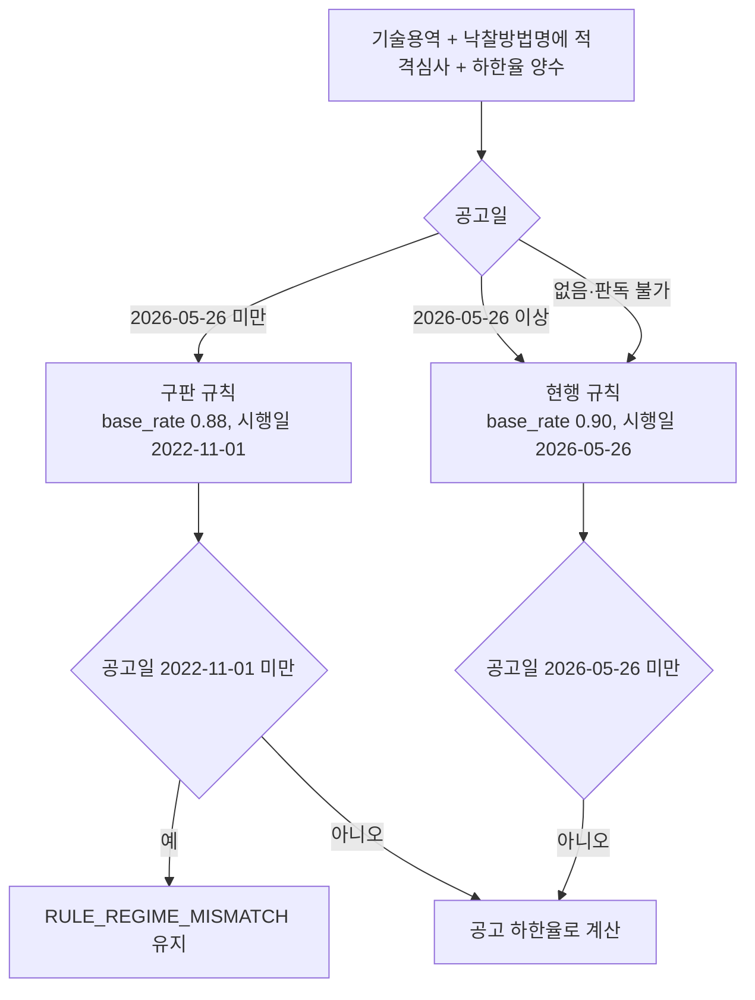

# 기술용역 적격심사 구판 별표를 공고일로 고르는 서빙 반영

> **작성일**: 2026-10-17
> **작업**: Orca Task `task_ec16dc9ce727` (builder). 서빙 규칙 코드·화면·시험을 함께 고친다.
> **정본 사양**: `.orca/capsules/task_tech_pre_rule_20261017/capsule.yaml` (`ORCA_TASK_CAPSULE_V2`)
> **작업 브랜치**: `kwanbum217/orca-tech-pre-rule`
> **근거 명세**: [data/reference/pps_tech_lwlt_pre_20260526.yaml](../../data/reference/pps_tech_lwlt_pre_20260526.yaml), [pps_tech_lwlt_pre_20260526.md](pps_tech_lwlt_pre_20260526.md)
> **선행 분석**: [block_cause_split_20261015.md](block_cause_split_20261015.md) 4.2절 (시행일 `2026-05-26` 차단 8,936건 중 기술용역 8,222건), [pps_tech_lwlt_rate_compare_20261015.md](pps_tech_lwlt_rate_compare_20261015.md)
> **측정 DB**: 호스트 `127.0.0.1:3306` 의 Docker MySQL. `scripts/db_readonly_query.py` 의 `SELECT` 만 사용했다.
> **범위**: 기술용역(`raw_data.srvceDivNm` = 기술용역) 적격심사 규칙 선택. 일반용역·기관·지역 규칙은 건드리지 않는다.

---

## 1. 목적과 결론

- 목적: 별표 시행일 `2026-05-26` 한 점에 몰려 있던 기술용역 적격심사 `RULE_REGIME_MISMATCH` 차단을, 공고일 `2026-05-26` 미만 공고에 쓸 구판 규칙 등록으로 푼다.
- 구판 규칙 `SERVC_TECH_QUAL_ANNOUNCEMENT_LWLT_PRE_20260526` 을 서빙 레지스트리에 넣고, 기술용역 분기가 공고일로 현행과 구판을 고르게 했다. 파이썬의 규칙 ID 비교 세 곳과 화면 배지 한 곳은 두 ID 를 함께 받도록 바꿨다.
- 공고일 `2026-05-26` 이상 공고의 `rule_id`·`base_rate`·하한율·차단 여부는 바뀌지 않는다. 공고일이 `2022-11-01` 미만인 공고는 구판 규칙의 시행일 대조로 여전히 `RULE_REGIME_MISMATCH` 다.
- 최근 12개월(`2025-10-17` 이상) 기술용역 적격심사 공고 중 공고일 `2026-05-26` 미만이고 하한율이 양수인 최신 차수 공고는 **9,220건**이다. 이것이 이번 변경으로 계산 가능으로 바뀌는 상한이다(5절).

### 1.1 선택 흐름



---

## 2. 바꾼 위치

| 파일 | 위치 | 변경 |
| --- | --- | --- |
| `src/app/services/evaluation_rules.py` | `SERVC_TECH_QUAL_ANNOUNCEMENT_LWLT` 아래 신규 상수 | 구판 규칙 `SERVC_TECH_QUAL_ANNOUNCEMENT_LWLT_PRE_20260526` 정의. 현행 규칙을 `dataclasses.replace` 로 복제해 `rule_id`, `table_name`(기술용역 적격심사 (개정 전)), `effective_date`(2022-11-01), `base_rate`(0.88), `source`(제8983호·제6352호·제654호 시행일)만 바꿨다 |
| 같은 파일 | 신규 상수 `SERVC_TECH_QUAL_RULE_IDS` | 현행·구판 두 규칙 ID 를 담은 `frozenset` |
| 같은 파일 | `resolve_evaluation_rule` 의 `_resolve_by_method_name` 호출 | 파싱한 공고일 `announced` 를 인자로 전달 |
| 같은 파일 | `_resolve_by_method_name` 시그니처와 기술용역 분기 | `announced < 2026-05-26` 이면 구판, 그 밖에는 현행을 골라 하한율 결측 차단 반환과 성공 반환 모두에 싣는다 |
| 같은 파일 | 기관 규칙 선택 건너뛰기 조건, 지역 규칙 선택 건너뛰기 조건, 정밀 매칭 분기 | `== "SERVC_TECH_QUAL_ANNOUNCEMENT_LWLT"` / `!= ...` 를 `in SERVC_TECH_QUAL_RULE_IDS` / `not in ...` 으로 교체 |
| `src/app/templates/bids/detail.html` | `setEvaluationScopeBadge` | `data.rule_id === 'SERVC_TECH_QUAL_ANNOUNCEMENT_LWLT'` 를 `typeof data.rule_id === 'string' && data.rule_id.startsWith('SERVC_TECH_QUAL_ANNOUNCEMENT_LWLT')` 로 교체 |

---

## 3. 고른 기준

| 공고일 | 고른 규칙 | `rule_id` | `base_rate` | `effective_date` | 하한율 |
| --- | --- | --- | --- | --- | --- |
| `2022-11-01` 이상 `2026-05-26` 미만 | 구판 | `SERVC_TECH_QUAL_ANNOUNCEMENT_LWLT_PRE_20260526` | 0.88 | 2022-11-01 | 공고 `sucsfbidLwltRate` |
| `2026-05-26` 이상 | 현행 | `SERVC_TECH_QUAL_ANNOUNCEMENT_LWLT` | 0.90 | 2026-05-26 | 공고 `sucsfbidLwltRate` |
| 없음 | 현행 | `SERVC_TECH_QUAL_ANNOUNCEMENT_LWLT` | 0.90 | 2026-05-26 | 공고 `sucsfbidLwltRate` |
| 판독 불가 | 현행 + 경고 | `SERVC_TECH_QUAL_ANNOUNCEMENT_LWLT` | 0.90 | 2026-05-26 | 공고 `sucsfbidLwltRate` |
| `2022-11-01` 미만 | 구판 선택 뒤 시행일 대조 | `SERVC_TECH_QUAL_ANNOUNCEMENT_LWLT_PRE_20260526` | 0.88 | 2022-11-01 | 계산 차단 |

- 구판·현행 모두 공고 하한율만 쓰는 성격은 그대로다. `lwlt_rate` 는 두 규칙 모두 0 이며, 하한율이 없으면 `TECH_SERVICE_MISSING_LWLT` 로 차단한다.
- 구판 `source` 는 명세가 확정한 세 판(제8983호 시행 2022-11-01, 제6352호 시행 2025-09-01, 제654호 시행 2026-01-26)의 별표1 기준비율이 88/100 으로 같다는 사실을 적는다.

---

## 4. 시험 목록

| 파일 | 시험 | 단정 |
| --- | --- | --- |
| `tests/test_tech_service_qualification.py` | `test_tech_announcement_before_20260526_uses_pre_rule` | 2026-05-25 공고가 차단되지 않고 구판 `rule_id`, `base_rate` 0.88, `effective_date` 2022-11-01, `lwlt_rate` 0, 공고 하한율(`ANNOUNCEMENT`)로 풀린다 |
| 같은 파일 | `test_tech_announcement_on_20260526_keeps_current_rule` | 2026-05-26 공고가 현행 `rule_id`, `base_rate` 0.90, 같은 공고 하한율을 유지한다 |
| 같은 파일 | `test_tech_announcement_before_pre_rule_effective_date_stays_blocked` | 2022-10-31 공고가 `RULE_REGIME_MISMATCH` 로 남고 구판 규칙이 붙는다 |
| 같은 파일 | `test_tech_pre_rule_skips_institution_rule_selection` | 환경부(1482000) 기술용역 공고라도 구판 선택 시 기관 규칙 대신 구판 규칙(`scope_stage` = ALL)을 쓴다 |
| `tests/test_evaluation_ui_tech_service.py` | `test_scope_badge_is_reset_for_general_tech_and_negotiation_responses` | 배지가 `startsWith('SERVC_TECH_QUAL_ANNOUNCEMENT_LWLT')` 로 두 ID 를 함께 받는다 |
| `tests/test_bid_method_code_and_regime.py` | `test_tech_service_announcement_before_pre_rule_is_blocked` | 기존 `test_pre_regime_tech_service_is_blocked` 를 새 동작에 맞춰 고친 시험. 공고일을 2025-08-27 에서 2022-10-31 로 옮겨 구판 시행일 이전만 차단됨을 단정한다 |

- 기존 시험 중 2026-05-26 이전 기술용역 공고를 `RULE_REGIME_MISMATCH` 로 단정하던 것은 위 `test_pre_regime_tech_service_is_blocked` 한 건이었고, 이름을 `test_tech_service_announcement_before_pre_rule_is_blocked` 로 바꿔 차단 경계를 구판 시행일로 옮겼다.
- 나머지 기존 시험(`test_tech_service_division_matches_without_tech_service_in_method_name`, `test_local_tech_service_keeps_announcement_lwlt`, `test_placeholder_with_qualification_code_for_tech_service_uses_announcement_rate` 등)은 공고일이 없거나 2026-06-01 이후라 현행 규칙 기대를 그대로 유지한다.

---

## 5. 풀리는 상한 (DB 측정)

| 항목 | 값 | 조건 |
| --- | ---: | --- |
| 대상 공고(최신 차수) | **9,220** | `2025-10-17` 이상 `2026-05-26` 미만, `category` Servc, `낙030001`, `srvceDivNm` 기술용역, 낙찰방법명에 적격심사 포함, 하한율 > 0 |
| 낙찰방법명에 기술용역까지 포함 | 8,202 | 같은 조건에서 `sucsfbidMthdNm` 에 문자열 기술용역까지 요구(비교용) |
| 원시 행(차수 접기 없음) | 11,470 | 최신 차수 접기 없이 같은 조건 |
| 선행 분석의 차단 건수 | 8,222 | [block_cause_split_20261015.md](block_cause_split_20261015.md) 4.2절, 창 `2025-10-15` ~ `2026-10-15` |

- 9,220건은 이번 변경이 계산 가능으로 바꾸는 최신 차수 공고의 상한이다. 선행 분석의 차단 8,222건과의 차이는 창(`2025-10-15` 시작), 하한율 양수 조건, 그리고 차단되지 않았던 건(기관·지역 규칙으로 이미 풀린 건 등)을 포함하기 때문이다.
- 창 하한 `2025-10-17` 은 구판 시행일 `2022-11-01` 보다 한참 뒤이므로, 이 창의 대상 공고 중 구판 시행일 대조로 다시 차단되는 건은 없다.
- 재현 질의는 7절에 적는다.

---

## 6. 바꾸지 않은 것

| 항목 | 상태 |
| --- | --- |
| 공고일 `2026-05-26` 이상 기술용역 공고의 `rule_id`·`base_rate`·하한율·차단 여부 | 변경 없음 |
| 일반용역 별표, 기관 규칙, 지역 규칙 | 변경 없음 |
| 공고 하한율 파싱과 우선순위(`ANNOUNCEMENT` > `RULE_DEFAULT`), `TECH_SERVICE_MISSING_LWLT` | 변경 없음 |
| 공고일 `2022-11-01` 미만 기술용역 공고의 `RULE_REGIME_MISMATCH` | 변경 없음 |
| 공고일이 없거나 판독 불가일 때의 현행 규칙 + 경고 경로 | 변경 없음 |
| `data/reference/rule_coverage_ledger.yaml`, `docs/context/CURRENT_STATE.md` | 수정 없음 (원장은 병합 뒤 코디네이터가 재생성) |
| ML 특징·추론 경로(`src/ml/features.py` 등) | 변경 없음 |
| DB 스키마·데이터 | 변경 없음 (읽기 전용 SELECT 만 사용) |

---

## 7. 재현 방법

```sh
uv run python scripts/db_readonly_query.py --limit 0 --sql "
SELECT COUNT(*) AS n
FROM bid_announcements a
JOIN (
  SELECT bid_ntce_no, category, MAX(CAST(bid_ntce_ord AS UNSIGNED)) AS mo
  FROM bid_announcements
  WHERE category = 'Servc'
    AND bid_ntce_dt >= '2025-10-17' AND bid_ntce_dt < '2026-05-26'
  GROUP BY bid_ntce_no, category
) m ON m.bid_ntce_no = a.bid_ntce_no AND m.category = a.category
   AND CAST(a.bid_ntce_ord AS UNSIGNED) = m.mo
WHERE a.bid_ntce_dt >= '2025-10-17' AND a.bid_ntce_dt < '2026-05-26'
  AND JSON_UNQUOTE(JSON_EXTRACT(a.raw_data, '\$.sucsfbidMthdCd')) = '낙030001'
  AND JSON_UNQUOTE(JSON_EXTRACT(a.raw_data, '\$.srvceDivNm')) = '기술용역'
  AND JSON_UNQUOTE(JSON_EXTRACT(a.raw_data, '\$.sucsfbidMthdNm')) LIKE '%적격심사%'
  AND CAST(JSON_UNQUOTE(JSON_EXTRACT(a.raw_data, '\$.sucsfbidLwltRate')) AS DECIMAL(12,4)) > 0"
```

- 차수 접기를 빼면 같은 조건의 원시 행 11,470건이 나온다. 낙찰방법명에 기술용역까지 요구하면 8,202건이다.

---

## 8. 검증 명령과 결과

| 명령 | 결과 |
| --- | --- |
| `uv run pytest tests/test_tech_service_qualification.py tests/test_bid_method_code_and_regime.py tests/test_evaluation_ui_tech_service.py tests/test_local_regime_rules.py -q -m 'not data_assets'` | 178 passed |
| `uv run pytest tests/ -q -m 'not data_assets'` | 7653 passed, 41 skipped, 3 deselected |
| `uv run mypy src` | Success: no issues found in 135 source files |
| `npm run build:css` 와 `git diff --exit-code -- src/app/static/css/tailwind.css` | 빌드 성공, 생성물 변경 없음 |
| `python3 scripts/validate_agent_rules.py --quiet` | 21/21 통과 |
