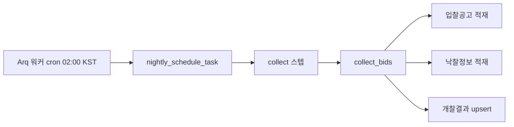

# 개찰결과(유찰 포함) 수집 운영 런북 (Openg Collection Runbook)

> **작성일**: 2026-11-06
> **적용 범위**: 유찰 설계 T6 운영. `bid_openg_results` 정기 수집, 과거분 소급, 지표 확인, 장애 대응
> **정본 설계**: [fail_bid_collection_design_20261031.md](../analysis/fail_bid_collection_design_20261031.md)
> **관련 문서**: [CURRENT_STATE.md](../context/CURRENT_STATE.md), [environment_variables.md](environment_variables.md)

---

## 1. 개요

### 1.1 무엇을 왜 수집하는가

나라장터 낙찰정보(`getScsbidListSttus<분류>`)는 낙찰자가 있는 건만 돌려주므로 유찰을 구조적으로 담지 못합니다. 기존 `bid_results` 도 낙찰 성공 행만 보관하고 상태 컬럼이 없습니다. 이에 개찰결과 목록 오퍼레이션(`getOpengResultListInfo<분류>`)을 별도로 수집해 신규 테이블 `bid_openg_results` 에 적재합니다.

| 현황 | 내용 | 근거 |
| --- | --- | --- |
| 기존 낙찰 테이블 | `bid_announcements`·`bid_results` 에 상태 컬럼이 없고 `bid_results` 는 낙찰 성공 행만 담는다 | 설계 1.1절 |
| 결과 없음의 의미 | 2026-09-01 ~ 2026-10-31 공사 공고 중 개찰일이 지난 17,958건 가운데 낙찰결과 매칭이 없는 행이 6,129건(34.1%)이다. 미개찰·취소·수집 누락이 섞여 있어 유찰의 대체 신호가 아니다 | 설계 1.2절 |
| 수집 원천 | 개찰결과구분명 `progrsDivCdNm` 이 유찰 판정 필드다 | 설계 2.2절 |
| 저장 원칙 | 기존 테이블은 건드리지 않고 `bid_openg_results` 만 추가한다 | 설계 3장, G1 |

### 1.2 유찰 정의 (최종 차수 기준)

이 문서에서 **유찰 공고**는 같은 공고·차수·분류 안에서 재입찰번호가 가장 큰 행이 유찰인 경우를 말합니다. 특정 차수의 유찰 행이 하나 있다는 사실만으로 유찰 공고라고 부르지 않습니다. 유찰 뒤 재입찰에서 개찰완료된 공고는 최종 차수가 개찰완료이므로 유찰 공고에서 제외됩니다.

| 판정 대상 | 기준 | 구현 위치 |
| --- | --- | --- |
| 유찰 행 | `progrs_div_cd_nm == "유찰"` | `src/app/models/openg_results.py` `classify_openg_status` |
| 유찰 공고 | 같은 `(bid_ntce_no, bid_ntce_ord, category)` 행 중 `rbid_no` 가 가장 큰 행이 유찰 | `src/rag/structured_data.py` `_final_round_void_condition` |
| 재입찰 | 별도 상태 라벨이다. 유찰로 세지 않으며 수집 분류에서는 `기타` 로 둔다 | `src/app/models/openg_results.py` |
| 참가업체 수 | `prtcpt_cnum` 은 보조 지표다. 0 이어도 유찰이 아닌 행, 유찰인데 0보다 큰 행이 실측되었다 | 설계 2.3절 |

`rbid_no` 는 `000` ~ `007` 고정 3자리 문자열이므로 문자열 비교가 차수 순서와 같습니다. 따라서 최종 차수 판정에 별도 형변환이 필요하지 않습니다.

> 스크립트 실행 요약의 `progrs_div_cd_nm` 분포는 **행 단위** 집계입니다. 최종 차수 기준 유찰 공고 수와 값이 다를 수 있으므로 두 수치를 같은 지표로 섞어 읽지 않습니다.

---

## 2. 저장

### 2.1 테이블과 키

| 항목 | 값 |
| --- | --- |
| 테이블 | `bid_openg_results` |
| ORM 모델 | `BidOpengResult` (`src/app/models/openg_results.py`) |
| 마이그레이션 | `migrations/versions/c1d2e3f4a5b6_add_bid_openg_results.py`, `migrations/versions/a9b8c7d6e5f4_align_bid_openg_results_collation.py` |
| 기본 키 | `id` BIGINT AUTO_INCREMENT |
| 유니크 키 | `uq_bid_openg_results (bid_ntce_no, bid_ntce_ord, rbid_no, category)` |
| 보조 인덱스 | `ix_openg_cat_dt(category, openg_dt)`, `ix_openg_status_dt(progrs_div_cd_nm, openg_dt)`, `ix_openg_inst_cat_dt(dminstt_nm, category, openg_dt)`, `ix_openg_notice(bid_ntce_no, category)` |

### 2.2 주요 컬럼

| 컬럼 | 의미 | 비고 |
| --- | --- | --- |
| `bid_ntce_no` | 입찰공고번호 | 유니크 키 |
| `bid_ntce_ord` | 입찰공고차수 | 3자리(`000`) |
| `rbid_no` | 재입찰번호 | 3자리, 유니크 키 |
| `bid_clsfc_no` | 입찰분류번호 | 저장하지만 유니크 키에는 넣지 않는다 |
| `category` | 업무구분 | `Thng`, `Cnstwk`, `Servc` |
| `progrs_div_cd_nm` | 개찰결과구분명 | 유찰 판정 원천 |
| `prtcpt_cnum` | 참가업체 수 | 보조 지표 |
| `bid_ntce_nm` | 공고명 | |
| `dminstt_nm` | 수요기관명 | |
| `openg_dt` | 개찰일시 | 기간 조회 축 |
| `raw_data` | 응답 원문 | `opengCorpInfo` 는 개인정보라 제외 |
| `first_seen_at` | 처음 관측 시각 | upsert 충돌 시 갱신하지 않는다 |
| `last_seen_at` | 마지막 관측 시각 | upsert 충돌 시 갱신 |
| `collected_at` | 적재 시각 | upsert 충돌 시 갱신 |

### 2.3 멱등 적재와 상태 갱신

적재는 `INSERT IGNORE` 가 아니라 유니크 키 기준 upsert 입니다. 개찰 상태는 늦게 확정될 수 있어(`유찰` -> `개찰완료`) 충돌 시 아래 컬럼만 갱신합니다.

| 갱신 대상 | 이유 |
| --- | --- |
| `progrs_div_cd_nm` | 최종 개찰 상태 반영 |
| `raw_data` | 원문 최신화 |
| `last_seen_at`, `collected_at` | 관측·적재 시각 갱신 |
| `first_seen_at` | 갱신하지 않음. 첫 관측 근거로 보존 |

같은 기간을 다시 수집해도 행이 늘지 않습니다. 다만 유니크 키 `(공고번호, 차수, 재입찰번호, 분류)` 는 실측 확정 전 가정입니다. 같은 공고·차수에서 `rbid_no` 중복 사례가 확인되면 upsert 가 한 행으로 합쳐지므로, 분포 확인 중 중복이 보이면 키 조정을 별도 과제로 올립니다.

`opengCorpInfo`(개찰 업체 정보, 대표자명 등 포함)는 컬럼으로 만들지 않고 `raw_data` 에서도 제거합니다.

### 2.4 G1 보존

`bid_announcements`·`bid_results` 의 컬럼·타입·인덱스·행 수는 변경하지 않습니다. 이 수집 경로에서 기존 테이블에 쓰는 동작은 없으며, 신규 테이블 추가만 수행합니다. 운영 DB 에서 `bid_openg_results` 를 삭제·절단하는 조치는 금지합니다.

---

## 3. 정기 수집

### 3.1 실행 경로



- `src/tasks/worker.py` 의 `cron_jobs` 에 `nightly_schedule_task` 가 매일 02:00 으로 등록되어 있습니다.
- `nightly_schedule_task` 는 `run_automation_pipeline(run_mode="nightly_schedule")` 을 호출하고, 실행 순서는 `collect -> search -> rag -> predict -> inspect` 입니다 (`src/tasks/run_mode_matrix.py`).
- `collect` 스텝은 `src/tasks/automation_steps.py` 의 `_step_collect` 이며 `collect_bids` 를 호출합니다.
- `collect_bids` 는 분류마다 입찰공고, 낙찰정보, 개찰결과 순서로 적재합니다 (`src/app/services/collector_service.py`).

### 3.2 크론 선언

워커 컨테이너는 `TZ=Asia/Seoul` 로 동작하므로 아래 시각은 한국 시간입니다.

| 선언 | 실행 시각 | 타임아웃 | 역할 |
| --- | --- | --- | --- |
| `cron(nightly_schedule_task, hour=2, minute=0, timeout=10800)` | 매일 02:00 | 10,800초 | 수집·색인·RAG·예측·점검 번들 |
| `cron(development_data_refresh_task, hour=2, minute=0, timeout=10800)` | 매일 02:00 | 10,800초 | 개발 데이터 갱신 |
| `collect_bids_task` | 크론 없음 | 10,800초 | `functions` 에 등록되어 수동·자동화 큐에서 `collect_only` 로 실행 |

`worker.py` 의 `cron_jobs` 에 `collect_bids_task` 를 직접 등록한 선언은 없습니다. 정기 수집은 `nightly_schedule_task` 의 `collect` 스텝으로 돕니다. `collect_bids_task` 는 같은 수집을 단독 실행할 때 쓰는 태스크입니다.

`nightly_schedule_task` 는 `AUTOMATION_NIGHTLY_SCHEDULE_ENABLED` 로 제어됩니다. 운영 Compose 는 기본 `true`, 개발 Compose 는 `false` 입니다.

### 3.3 수집 창

날짜를 명시하지 않으면 DB 체크포인트로 공백을 계산합니다.

| 규칙 | 내용 |
| --- | --- |
| 체크포인트 | 요청 분류별 `MAX(bid_ntce_dt)`(공고)의 최솟값과 `MAX(rl_openg_dt)`(낙찰)의 최솟값 중 더 오래된 날짜 |
| 희소 분류 제외 | 외자(`Frgcpt`)는 체크포인트 계산에서 제외 |
| 종료일 | 어제 |
| 자동 회수 상한 | 최근 7일 (`MAX_CATCHUP_DAYS`) |
| 시작일 명시 | 수동 백필 경로로 간주해 명시값을 그대로 사용 |

개찰결과는 공고·낙찰과 같은 창을 쓰되 조회 축은 개찰일시(`inqryDiv=3`)입니다. 내부적으로 15일 구간으로 나눠 병렬 수집하고, `numOfRows=999`, 동시 요청 수는 `G2B_MAX_CONCURRENT` 기본 16 입니다. 외자(`Frgcpt`)는 개찰결과 오퍼레이션이 없어 건너뜁니다.

> 체크포인트는 `bid_announcements` 와 `bid_results` 만 봅니다. 개찰결과만 실패한 경우 다음 날 야간 수집이 그 구간을 자동으로 되돌아보지 않습니다. 7.2절의 수동 소급이 필요합니다.

### 3.4 개찰결과 스텝의 전제

개찰결과 적재는 아래 조건을 모두 만족할 때만 실행됩니다.

| 전제 | 기본값 | 확인 위치 | 조치 |
| --- | --- | --- | --- |
| `OPENG_RESULT_COLLECTION_ENABLED` | 꺼짐(빈 문자열) | `src/app/services/collector_service.py` | 워커 환경에 `true` 전달 |
| Compose 워커 환경 전달 | 두 Compose 모두 미전달 | `docker-compose.yml`, `docker-compose.prod.yml` 의 `worker.environment` | 워커 서비스에 변수 추가 |
| `AUTOMATION_NIGHTLY_SCHEDULE_ENABLED` | 운영 `true`, 개발 `false` | Compose 워커 환경 | 운영에서 `true` 유지 |
| `G2B_SERVICE_KEY` | 없음 | 워커 환경 | 승인된 서비스 키 설정 |
| 분류 | `Thng`, `Cnstwk`, `Servc` | `OPENG_RESULT_URLS` | 외자는 대상 아님 |

워커는 `.env` 파일을 직접 읽지 않으므로, 호스트 `.env` 에만 값을 넣으면 컨테이너에는 반영되지 않습니다. Compose 의 `worker.environment` 에 변수를 추가한 뒤 워커를 재기동합니다.

```bash
# 개발 Compose
docker compose up -d worker

# 운영 Compose
docker compose -f docker-compose.prod.yml up -d worker
```

기동 후 아래 로그가 3개 분류에서 보이면 개찰결과 스텝이 실행된 것입니다.

```bash
docker compose logs --since 24h worker
```

```
[용역] 개찰결과 1,234건 적재
```

---

## 4. 지표와 대시보드

### 4.1 수집 지표

`collect_bids` 는 실행이 끝나는 지점에서 `record_collection_metrics` 를 한 번 호출합니다 (`src/app/core/observability.py`). 수집 도중 워커가 종료되면 그 실행의 지표는 남지 않습니다.

| Prometheus 지표 | 속성 | 값 | 의미 |
| --- | --- | --- | --- |
| `bid_collection_saved_rows_total` | `kind` | `announcement`, `result`, `openg_result` | 적재 처리 행 수 |
| `bid_collection_saved_rows_total` | `category` | `Thng`, `Cnstwk`, `Servc` 등 | 업무구분 |
| `bid_collection_failed_ranges_total` | `kind` | `announcement`, `result`, `openg_result`, `license_limit`, `participation_region` | 재수집 필요 구간 수 |

- `bid_collection_saved_rows_total` 은 upsert 처리 행 수입니다. 같은 창을 다시 수집하면 중복이어도 다시 증가하며, 순수 신규 행 수와 다릅니다.
- `bid_collection_failed_ranges_total` 은 실패 구간 **개수**만 셉니다. 어느 기간이 실패했는지는 워커 로그의 `N개 구간 수집 실패: 시작~종료` 문구에서 확인합니다.
- 두 지표 모두 누적 카운터입니다. 성공 재실행으로 과거 실패 값이 줄지 않으므로, 복구 확인은 재실행 전후 값 비교로 합니다.
- `license_limit`·`participation_region` 은 적재 행 수 지표에 포함되지 않고 실패 구간 지표에만 나타납니다.

### 4.2 대시보드 패널

파일: `docker/grafana/dashboards/openg_collection.json`
제목: `정기 수집 지표 (유찰 개찰결과)`
UID: `bidbox-openg-collection`

| ID | 유형 | 패널 제목 | 질의 |
| ---: | --- | --- | --- |
| 1 | stat | 분류별 개찰결과 적재 행 수 (24h) | `sum by (category) (increase(bid_collection_saved_rows_total{kind="openg_result"}[24h]))` |
| 2 | timeseries | 재수집 필요 실패 구간 수 (24h, kind 별) | `sum by (kind) (increase(bid_collection_failed_ranges_total[24h]))` |
| 3 | timeseries | 적재 행 수 추이 (kind 별) | `sum by (kind) (increase(bid_collection_saved_rows_total[$__rate_interval]))` |

### 4.3 조회 경로와 전제

| 항목 | 값 |
| --- | --- |
| Grafana | `http://127.0.0.1:3000` |
| Prometheus | `http://127.0.0.1:9090` |
| 기동 | `make observability-up` |
| 대시보드 프로비저닝 | `docker/grafana/provisioning/dashboards`, `docker/grafana/dashboards` |

개발 Compose 의 관측성 스택은 `observability` 프로파일에 속하며 기본 기동 대상이 아닙니다. 워커 지표도 `OTEL_ENABLED=true` 와 exporter 설정이 있어야 노출됩니다. 개발 Compose 의 `OTEL_ENABLED` 기본값은 `false` 이므로, 지표가 비어 있으면 먼저 이 값을 확인합니다.

---

## 5. 과거분 소급

### 5.1 스크립트와 옵션

스크립트: `scripts/backfill_openg_results.py`
기본 동작은 dry-run 입니다. 외부 API 호출과 DB 적재는 `--execute` 를 명시할 때만 수행합니다.

| 옵션 | 필수 | 기본값 | 설명 |
| --- | :---: | --- | --- |
| `--start` | 아니오 | 오늘 기준 1년 전 | 시작일 `YYYYMMDD` |
| `--end` | 아니오 | 오늘 | 종료일 `YYYYMMDD` |
| `--window-days` | 아니오 | `7` | 창 크기(일) |
| `--categories` | 아니오 | `공사 물품 용역` | 코드(`Cnstwk`/`Thng`/`Servc`) 또는 이름. 외자 미지원 |
| `--max-calls` | 예 | 없음 | 창 단위 호출 상한 |
| `--dry-run` | 아니오 | 켜짐 | 창 목록과 예상 호출 수만 출력 |
| `--execute` | 아니오 | 꺼짐 | 실제 API 호출과 적재 수행 |
| `--ledger` | 아니오 | `.cache/openg_backfill_ledger.json` | 창별 실패 원장 JSON 경로 |

`--max-calls` 는 생략할 수 없습니다. 창 하나는 최소 1회 호출이며 실제 HTTP 요청 수는 응답 페이지 수만큼 늘어납니다. 창 단위 상한은 HTTP 요청 상한이 아닙니다.

### 5.2 실행 예

먼저 dry-run 으로 기간·분류·예상 호출 수를 확인합니다.

```bash
uv run python scripts/backfill_openg_results.py \
  --start 20231104 --end 20251103 \
  --categories 공사 물품 용역 \
  --window-days 7 \
  --max-calls 400
```

출력의 `예상 호출 수(창 단위 최소)` 가 승인 트래픽 안에 있는지 확인한 뒤 실행합니다.

```bash
uv run python scripts/backfill_openg_results.py \
  --start 20231104 --end 20251103 \
  --categories 공사 물품 용역 \
  --window-days 7 \
  --max-calls 400 \
  --execute
```

원장 경로를 바꾸려면 `--ledger` 를 지정합니다. 기간과 창 크기를 그대로 두고 다시 실행하면 성공한 창은 건너뛰고 실패·중단 창만 재시도합니다.

```bash
uv run python scripts/backfill_openg_results.py \
  --start 20231104 --end 20251103 \
  --categories 공사 물품 용역 \
  --window-days 7 \
  --max-calls 400 \
  --ledger .cache/openg_backfill_ledger.json \
  --execute
```

### 5.3 동작과 원장

| 항목 | 동작 |
| --- | --- |
| 창 분할 | `--window-days` 단위로 기간을 나누고 분류 수만큼 창을 만든다 |
| 예상 호출 | `창 수 x 분류 수` |
| 실제 수집 | 창마다 15일 이하 구간으로 API 를 호출하고 페이지를 끝까지 읽는다 |
| 적재 | `_upsert_openg_results` 를 재사용해 유니크 키 기준 upsert |
| 원장 | 창을 처리할 때마다 JSON 을 원자적으로 다시 쓴다 |
| 재개 | 원장 상태가 `success` 인 창은 건너뛴다. `failed`·`skipped` 는 다시 시도한다 |

원장은 `OPENG_BACKFILL_LEDGER_V1` 스키마이며 `windows` 객체의 키는 `분류|시작일|종료일` 형식입니다. 각 항목은 `status`, `rows`, `error`, `attempts`, `updated_at` 을 가집니다.

```bash
python3 -m json.tool .cache/openg_backfill_ledger.json
```

`--window-days` 를 바꾸면 원장 키의 시작일·종료일이 달라져 성공 창을 건너뛰지 못합니다. 재개할 때는 처음 실행과 같은 기간·창 크기를 씁니다. 원장 파일을 잃으면 모든 창을 다시 호출하므로, upsert 덕분에 행은 늘지 않아도 호출 한도를 소모합니다. `.cache` 는 Git 추적 대상이 아니므로 원장을 커밋하지 않습니다.

실행이 끝나면 아래 항목을 출력합니다.

| 출력 | 의미 |
| --- | --- |
| `창 처리: 성공 / 실패 / 건너뜀` | 창 상태 집계와 사용 호출 수 |
| `이번 실행 적재` | 이번 실행에서 upsert 처리한 행 수 |
| `기간 내 적재 행 수` | 요청 기간의 실제 행 수 |
| `progrs_div_cd_nm 분포` | 상태별 행 수. 행 단위 집계 |

### 5.4 종료 코드와 안전 수칙

| 종료 코드 | 의미 |
| ---: | --- |
| 0 | 전체 성공 또는 dry-run |
| 1 | 서비스 키 없음, 부분 성공, `--max-calls` 초과로 중단 |
| 2 | 입력 오류(날짜 형식, 분류, 창 크기, 호출 상한) |

- `--execute` 는 운영 DB 에 쓰므로 dry-run 으로 기간·분류·상한을 먼저 확인합니다.
- 이 스크립트는 Arq 의 무거운 태스크 잠금(`heavy_task_guard`) 밖에서 실행됩니다. 야간 수집(02:00)과 겹치지 않게 실행합니다.
- `--max-calls` 를 승인 트래픽보다 크게 잡지 않습니다.
- `G2B_SERVICE_KEY` 가 없으면 `FAIL: G2B serviceKey 가 설정되지 않았습니다` 를 남기고 종료 코드 1 로 끝납니다.
- 서비스 키 값은 코드·원장·표준출력에 기록되지 않습니다.

---

## 6. 소급 이력

| 실행일 | 기간 | 창 수 | 성공/실패/건너뜀 | 적재 행 수 | 유찰 행 수(행 단위) | 비고 |
| --- | --- | ---: | --- | ---: | ---: | --- |
| 2026-11-04 | 2025-11-04 ~ 2026-11-04 | 159 | 159/0/0 | 416,228 | 73,668 | 1년 소급 완료 |
| 2026-11-06 | 2023-11-04 ~ 2025-11-03 | 코디네이터 기입 | 코디네이터 기입 | 코디네이터 기입 | 코디네이터 기입 | 2년 추가 소급, 수치 미기입 |

1년 소급의 159창은 7일 창 53개 x 분류 3개와 일치합니다. 아래 dry-run 으로 같은 창 수를 재확인할 수 있습니다.

```bash
uv run python scripts/backfill_openg_results.py \
  --start 20251104 --end 20261104 \
  --window-days 7 \
  --max-calls 400
```

```
대상 기간: 2025-11-04 ~ 2026-11-04 (366일), 창 53개 x 분류 3개
예상 호출 수(창 단위 최소): 159회
```

2년 추가 구간(2023-11-04 ~ 2025-11-03)의 수치는 실행 후 코디네이터가 기입합니다. 이 문서는 해당 구간의 창 수·적재 행 수·유찰 행 수를 추정해 적지 않습니다.

> 적재 행 수와 유찰 행 수는 스크립트 실행 요약 기준입니다. 유찰 행 수는 `progrs_div_cd_nm="유찰"` 행 수이며, 1.2절의 최종 차수 기준 유찰 공고 수와 다릅니다.

---

## 7. 점검과 장애 대응

### 7.1 일일 점검

| 점검 | 방법 | 정상 기준 |
| --- | --- | --- |
| 실행 로그 | `docker compose logs --since 26h worker` 에서 `개찰결과` 적재 줄 확인 | `Thng`, `Cnstwk`, `Servc` 모두 적재 줄 존재 |
| 적재 지표 | Grafana 패널 1 | 24시간 증가가 분류별로 0보다 큼 |
| 실패 구간 | Grafana 패널 2 | `kind="openg_result"` 증가가 0 |
| 최신 적재 | 아래 최신 행 질의 | `collected_at` 이 26시간 이내 |
| 상태 분포 | 아래 분포 질의 | 유찰 행이 존재하고 예상 밖 라벨이 없음 |

최신 적재 행은 기본 키 역순으로 가볍게 확인합니다.

```bash
uv run python scripts/db_readonly_query.py --sql "SELECT id, category, progrs_div_cd_nm, openg_dt, collected_at FROM bid_openg_results ORDER BY id DESC LIMIT 5"
```

상태 분포는 분류와 개찰일시를 함께 걸어 인덱스를 사용합니다. 분류를 바꿔 세 번 실행합니다.

```bash
uv run python scripts/db_readonly_query.py --sql "SELECT category, progrs_div_cd_nm, COUNT(*) AS row_count FROM bid_openg_results WHERE category = 'Servc' AND openg_dt >= '2026-10-01' AND openg_dt < '2026-11-01' GROUP BY category, progrs_div_cd_nm ORDER BY row_count DESC"
```

DB 확인은 읽기 전용 실행기만 사용합니다. `docker exec`, `mysql` 직접 호출, `sh -c` 래핑, `raw_data` 에 `LIKE` 를 거는 질의는 운영 부하와 무손실 원칙 때문에 사용하지 않습니다.

### 7.2 부분 실패

`collect_bids` 는 일부 스텝이 실패하면 `status="partial_success"` 를 돌려줍니다. 개찰결과만 실패해도 공고·낙찰은 이미 적재되어 체크포인트가 전진합니다.

| 확인 | 내용 |
| --- | --- |
| 로그 | `[분류] 개찰결과 부분 실패: ... N개 구간 수집 실패: 시작~종료` |
| 지표 | `bid_collection_failed_ranges_total{kind="openg_result"}` 증가 |
| 파이프라인 요약 | `_step_collect` 의 요약 문구에는 개찰결과 건수가 포함되지 않는다. 로그와 지표를 함께 본다 |

복구 절차는 아래 순서입니다.

1. 로그에서 실패 구간(`시작~종료`)과 분류를 읽습니다.
2. 실패 구간을 그대로 `--start`·`--end` 로 주고 `--window-days` 를 구간 길이 이상으로 잡아 dry-run 합니다. 이때 창이 1개인지 확인합니다.
3. 같은 기간·분류로 `--execute` 를 실행합니다. 야간 수집에는 원장이 없으므로 이 실행은 실패 구간을 처음부터 다시 받습니다.
4. 재실행 전후의 `bid_collection_failed_ranges_total{kind="openg_result"}` 값을 비교해 새 증가가 없는지 확인합니다. 누적 카운터라 과거 실패는 성공 재실행으로 줄지 않습니다.
5. 7.1절의 최신 적재·상태 분포를 다시 확인합니다.

소급 스크립트 자체가 부분 실패한 경우에는 원장이 있으므로, 원래 실행과 같은 기간·같은 `--window-days` 로 다시 실행해 성공 창을 건너뛰고 실패 창만 재시도합니다.

야간 수집은 개찰결과 실패 구간을 자동으로 다시 조회하지 않으므로, 실패 구간을 다시 적재해 확인하기 전에 완료로 보고하지 않습니다.

### 7.3 504·429 재시도

개찰결과 API 호출은 아래 조건에서 자동 재시도합니다 (`src/app/services/api_collector.py`).

| 항목 | 값 |
| --- | --- |
| 재시도 상태 코드 | `429`, `502`, `503`, `504` |
| 연결 오류 | `httpx.RequestError` 도 재시도 |
| 최대 시도 | 5회 |
| 대기 | 3초 x 시도 횟수 (3, 6, 9, 12초) |
| 요청 타임아웃 | 120초 |

5회를 모두 실패하면 해당 수집 구간(최대 15일)이 실패로 기록되고 `RangeCollectionError` 가 발생합니다. 성공한 다른 구간의 적재는 이미 커밋되어 있으므로 전체를 다시 받을 필요가 없습니다. 실패 구간만 소급 스크립트로 재실행합니다.

동시 요청 수 기본값은 `G2B_MAX_CONCURRENT=16` 입니다. 실측 차단 지점이 32이므로 이 값을 올리지 않습니다. 조정이 필요하면 워커 Compose 환경에 변수를 전달해야 하며, 호스트 `.env` 만 바꿔서는 컨테이너에 반영되지 않습니다.

### 7.4 원장 기반 재실행

소급 스크립트의 원장은 야간 수집 실패를 자동으로 채우지 않습니다. 야간 수집에는 원장이 없으므로 7.2절처럼 로그에서 구간을 읽어 소급 스크립트로 넘깁니다.

| 원장 상태 | 재실행 동작 |
| --- | --- |
| `success` | 건너뛴다 |
| `failed` | 다시 호출한다 |
| `skipped` | 다시 호출한다. `--max-calls` 상한에 걸려 중단된 창이 여기에 남는다 |

원장을 확인할 때는 같은 기간·같은 `--window-days` 를 유지합니다. 창 크기가 달라지면 키가 바뀌어 성공 창도 다시 호출합니다.

### 7.5 챗봇 가드 해제 조건

챗봇 유찰 가드의 해제 판단은 아래 세 조건을 모두 만족할 때만 내립니다 (설계 6.1절). 조건 1의 기준선은 소급 전에 정할 수 없고, 34.1% 라는 "결과 없음" 비율을 커버리지 기준으로 쓰지 않습니다.

| 조건 | 판정 기준 | 검증 방법 |
| --- | --- | --- |
| 1. 적재 커버리지 | 최근 30일 개찰 공고 중 개찰결과 행이 있는 비율을 측정해 기준선을 정하고, 그 기준을 넘음 | 소급 후 DB 집계 |
| 2. 목록 정확성 | 유찰 조건 목록 상위 N건이 전부 `progrs_div_cd_nm="유찰"` | 표본 질의·시험 |
| 3. 회귀 시험 | 정의 질문("유찰이 뭐야")은 계속 LLM 경로로 통과 | `tests/test_data_gap_guard.py` |

현재 `src/rag/data_gap_guard.py` 에는 유찰 항목이 없고, `src/rag/structured_data.py` 가 최종 차수 기준 유찰 조건을 담당합니다. 해제 상태를 유지하려면 위 세 조건의 확인 결과를 릴리스 기록에 남깁니다. 되돌려야 하면 설계 6.2절의 위치를 참고하되, 현재 코드에는 해당 안내 문구가 없으므로 재추가가 필요합니다.

### 7.6 자주 보는 실패

| 증상 | 원인 후보 | 조치 |
| --- | --- | --- |
| `G2B serviceKey 가 설정되지 않아 수집을 수행할 수 없습니다` | 워커 환경에 키 없음 | `G2B_SERVICE_KEY` 를 워커 환경에 전달하고 재기동 |
| 개찰결과 적재 줄이 없음 | 플래그 꺼짐, Compose 미전달, 야간 스케줄 꺼짐 | 3.4절의 전제 확인 |
| 대시보드가 비어 있음 | 관측성 스택 미기동, `OTEL_ENABLED=false`, 수집 미실행 | `make observability-up`, `OTEL_ENABLED` 확인, 워커 로그 확인 |
| 공고·낙찰은 성공, 개찰결과만 실패 | 일시적 504, 구간 실패 | 7.2절 수동 소급, 7.3절 재시도 확인 |
| 예상 밖 `progrs_div_cd_nm` 값 | API 신규 상태 라벨 | 분포 질의로 확인. 코드는 미지 값을 `기타` 로 분류하며 스키마 변경은 별도 승인 |

---

## 8. 관련 문서

| 문서 | 성격 |
| --- | --- |
| [fail_bid_collection_design_20261031.md](../analysis/fail_bid_collection_design_20261031.md) | 유찰 수집 설계 정본 |
| [CURRENT_STATE.md](../context/CURRENT_STATE.md) | 프로젝트 현재 운영 상태 |
| [environment_variables.md](environment_variables.md) | 환경변수 목록 |
| [alerting.md](alerting.md) | 알람 운영 |
| [db_migration_runbook.md](../migration/db_migration_runbook.md) | DB 마이그레이션 절차 |
| [openg_results.py](../../src/app/models/openg_results.py) | 테이블 모델과 유찰 분류 |
| [collector_service.py](../../src/app/services/collector_service.py) | 정기 수집과 upsert |
| [observability.py](../../src/app/core/observability.py) | 수집 지표 정의 |
| [worker.py](../../src/tasks/worker.py) | Arq 워커와 크론 선언 |
| [automation_steps.py](../../src/tasks/automation_steps.py) | collect 스텝 |
| [run_mode_matrix.py](../../src/tasks/run_mode_matrix.py) | 실행 모드별 스텝 순서 |
| [structured_data.py](../../src/rag/structured_data.py) | 최종 차수 기준 유찰 조회 |
| [data_gap_guard.py](../../src/rag/data_gap_guard.py) | 챗봇 데이터 공백 가드 |
| [backfill_openg_results.py](../../scripts/backfill_openg_results.py) | 과거분 소급 스크립트 |
| [openg_collection.json](../../docker/grafana/dashboards/openg_collection.json) | 수집 지표 대시보드 |
| [test_openg_results_upsert.py](../../tests/test_openg_results_upsert.py) | upsert 시험 |
| [test_data_gap_guard.py](../../tests/test_data_gap_guard.py) | 가드 회귀 시험 |
